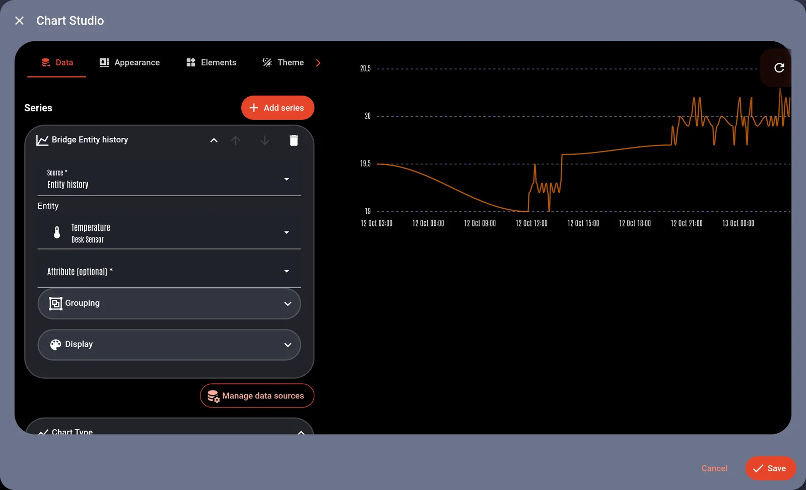

# Release notes

Each release has one page on the docs site, `doc/releases/<tag>.md`. That page is the source of truth: the `Release` workflow exports it as the GitHub release body (`node scripts/release-notes.mjs export <version>`), and GitHub appends its own commit list underneath. Never write notes on GitHub by hand; edit the page.

## Lifecycle

1. **First dev build of a new version:** create `doc/releases/<next version>.md` with `status: testing` and no `date`. The dev docs (`/dev/` on the docs site) show it at the top of `/releases/` as "In testing", and each `-dev.N` GitHub pre-release carries it with a "dev build" note.
2. **Every dev build:** add what changed to that page, in the house style below.
3. **Stable release:** set `status: released` and `date: YYYY-MM-DD` before merging `dev` into `main`. The `Release` workflow fails a stable release whose page is missing or still in testing, before it tags anything. After publishing, it archives that version's docs at `/v/<version>/` (frozen; the version switcher lists it), and the root `/` follows `main`.

Only one page may be in testing at a time, and its version must not be older than `package.json`.

`notes_through` (a commit sha) records the last commit the notes cover; `npm run release:commits` lists the commits after it. The step-by-step procedure (for Claude) is the `lcards-release-notes` skill in `.claude/skills/`; the maintainer's side (bumps, commits, workflow runs) is `COOKBOOK.md` § Releases.

## Frontmatter

```yaml no-validate
---
version: "2026.11.0"     # quoted; must equal the file name (the git tag)
date: 2026-11-04          # released pages only
status: released          # released | testing
summary: "One line for the release list and the page description."
breaking: true            # shows the Breaking changes badge
highlights:               # optional: the ### features the slim GitHub body leads with (5 to 8)
  - "Astrometrics card"
notes_through: "3f70b3007746"   # optional: last commit the notes cover
---

# LCARdS 2026.11.0
```

The `# LCARdS <version>` title is required (the export drops it; GitHub shows the release name). The line with the date and GitHub link under it is added by the site.

## Who it's for

People who use LCARdS on their dashboards, not people who work on its code. Readers have a short attention span: lead with the main features, keep it short, and leave the detail to collapsed blocks. Release notes are part marketing: say why a feature is worth having, in the maintainer's own voice (see the released pages), not a list of everything that was done.

- Say what a feature does and why it matters before how to set it up.
- A new feature is one item, however many commits built it ("new model", "new nebula shape" are details of the feature, not entries of their own).
- Show config only when the user has to type it. Keep it short and valid (YAML blocks are schema-checked like every docs page).
- No internal names: no file paths, class or function names, batch or session ids, subsystem jargon ("ConfigProcessor", "B3", "the S8 runner"). Say what the user sees: "the data source dialog", "Main Engineering".
- Link to the docs page for details instead of repeating it: `[Series and time](/cards/chart/series)`. Root-relative links; the export makes them absolute.
- Credit people: `[@handle](https://github.com/handle)` and issues as `[#123](https://github.com/snootched/lcards/issues/123)`. The export turns both back into GitHub's short forms.
- House punctuation: no em dashes anywhere (the docs build fails on them).
- One line per paragraph. Don't put `---` before a `##` heading (the site already draws a rule there).

## Sections

In this order, leaving out any that are empty:

1. **Intro:** a short video or picture, one or two sentences, then a bullet list of the headline items.
2. **`## Before you update`:** the changes a user has to act on, one or two sentences each: what changed and what to do. Smaller behaviour changes (mostly fixes that change what you see) go in one `::: details Smaller changes that may affect a dashboard (mostly fixes)` block at the end of the list. Set `breaking: true` when this section exists.
3. **`## New features`:** one `###` per feature, the biggest first. Each has a **lead**: one to three sentences, a picture when there is something to see, and a docs link. Everything else (bullets, more pictures) goes in a `::: details More on ...` block under it.
4. **`## Improvements & Fixes`:** two collapsed blocks, `::: details Improvements` and `::: details Fixes` (fixes grouped by area, one bullet per area).

Allowed markdown: plain markdown, HTML ``/`<video>` for pictures, and `::: tip|info|warning|danger|details` containers (exported as GitHub alerts and `<details>`). No Vue components and no `yaml live` or `yaml lab` blocks: they can't be exported (the check fails on them). Link to the card's docs page, which has the live demo.

## Two tiers: the docs page and the GitHub body

The docs page is the full release notes. The GitHub release body (also what Home Assistant's update dialog and HACS show) is a slim version made from the same page, so the two never drift. A page with `highlights:` in its frontmatter exports:

- the intro;
- "Before you update", its `::: details` block replaced by a link to the full list;
- the features named in `highlights:`, each without its `::: details` blocks (so the lead is what GitHub shows);
- the other features as one "Also new" list of links to the page;
- the fixes that link a GitHub issue, under "Reported issues fixed";
- a link to the full notes.

Aim for 400 to 800 words; `release:check` fails above 900 (`SLIM_WORD_LIMIT` in `scripts/release-lib.mjs`) and when a highlight names no `###` feature. A video becomes its GIF twin on GitHub (`<name>.gif` beside it, `release:shots --gif`); without one, a video with a `poster` (a `.webp` still beside it) becomes that still linked to the clip, which suits long or colourful clips whose GIF would be heavy; else a link. `npm run release:notes -- <version>` prints the slim body; add `--full` for the whole page. Pages without `highlights:` (the older ones) export whole.

## Pictures

Files live in `doc/public/releases/<version>/`, named by feature (`chart-studio.webp`), referenced by site path:

```html

<video class="release-shot" src="/releases/2026.11.0/slider-drag-badge.webm" title="What it shows" autoplay loop muted playsinline></video>
```

- Stills are WebP, at most 1600 px wide. Animations are looping muted WebM (a GIF is ten times larger). On GitHub a video becomes its `.gif` twin when one exists (`--gif` below), otherwise a link.
- Always write a real `alt` (or `title` for a video).
- The check fails on a missing image and on files in the folder that no page uses.

### Capturing them

`npm run release:shots -- <version> [name ...] [--gif]` runs the shot list `doc/releases/shots/<version>.yaml` against the dev HA (token in `.ha-token` or `$HA_TOKEN`; run `npm run build` first). Each shot mounts a card, its editor or a studio inside `home-assistant` on a plain backdrop (or opens an HA path), runs steps (click, type, drag, wait, JavaScript, service calls), and crops to an element. Videos are recorded in real time. The options are listed at the top of `scripts/release-shots.mjs`; the 2026.10.0 list has an example of each kind.

**Before committing any picture, look at it for personal data:** entity ids, areas, dashboard and city names from the dev HA. Shots should use the `lcards_test_*` helpers, or real sensors only behind a `name:` in places that never show the entity id. Pictures you take by hand go in the same folder.

## Commands

```bash
npm run release:commits                   # commits the notes don't cover yet
npm run release:check                     # every page: frontmatter, images, no components
npm run release:notes -- 2026.11.0        # print the GitHub body (as the workflow makes it)
npm run release:shots -- 2026.11.0 --gif  # capture the pictures
node scripts/release-notes.mjs import     # backfill from GitHub releases (done once, 2026-10-12)
```

`tests/docs/releases.test.js` (in `npm test`) runs the check and covers the export and import transforms.
