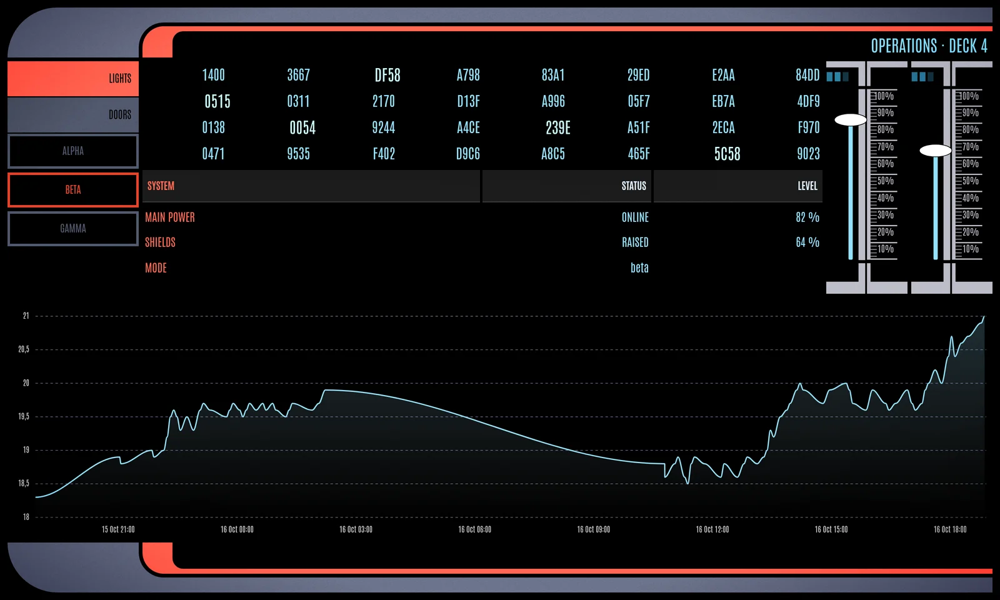
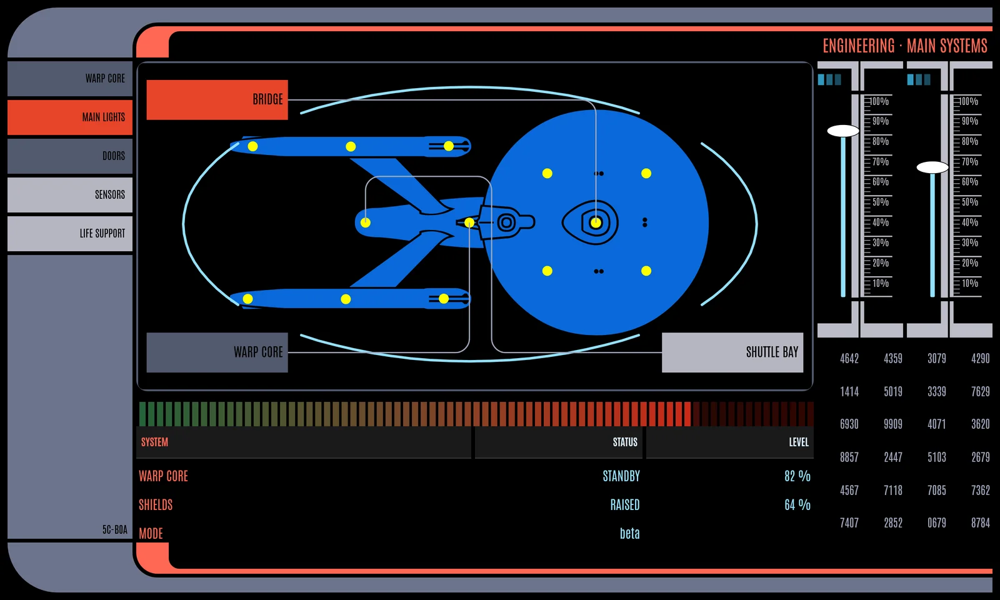
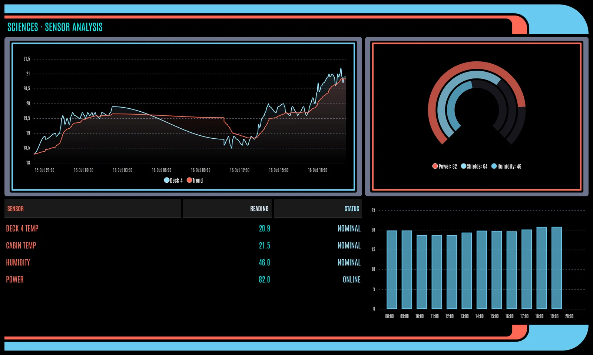
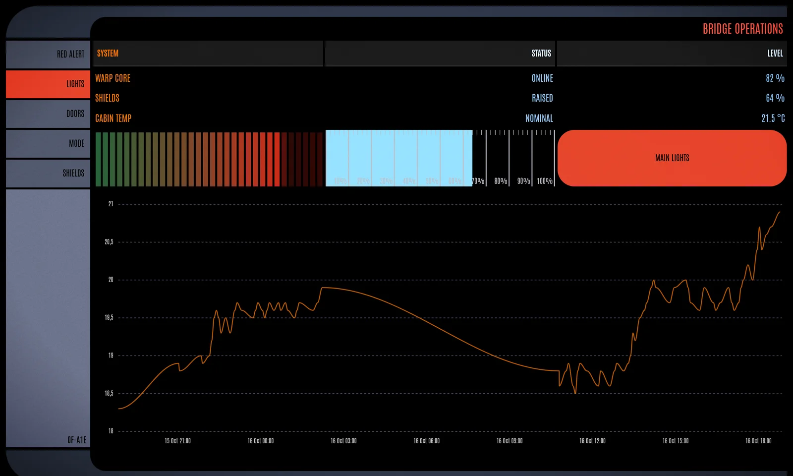

**A unified card system for Home Assistant inspired by the iconic Star Trek LCARS interfaces.
 Build your own LCARS-style dashboards and Master Systems Display (MSD) with realistic controls, reactivity and animations.**

 

### [Documentation](https://lcards.unimatrix01.ca) · [Dashboard Gallery](https://lcards.unimatrix01.ca/getting-started/dashboard-gallery) · [AI help](https://lcards.unimatrix01.ca/getting-started/ai-assistance) · [Getting help](https://lcards.unimatrix01.ca/getting-started/getting-help)

 

<table>
  <tr>
    <td></td>
    <td></td>
  </tr>
  <tr>
    <td></td>
    <td></td>
  </tr>
</table>

Every dashboard above is in the <a href="https://lcards.unimatrix01.ca/getting-started/dashboard-gallery">gallery</a>, with its YAML to copy.

## What you get

- **LCARS cards that work together:** buttons, elbows, sliders, charts, data grids, select menus and full ship displays, all sharing one look.
- **Colours that follow state:** cards light up, dim and change colour with your entities, no automations needed.
- **Alert modes:** red, yellow or blue alert repaints the whole dashboard, with sounds and a full-screen overlay.
- **Live data:** history, smoothing and statistics from data sources, in charts and in any label.
- **Animations and sounds:** LCARS beeps, pulses, cascades and line draws.
- **Visual editors:** every card has a full editor, plus studios for layouts, charts and ship displays.

## Install

1. In **HACS**, search for **LCARdS** under **Integrations** and download it.
2. Restart Home Assistant.
3. Go to **Settings > Devices & services > Add integration > LCARdS**.

Requires **Home Assistant 2026.10 or newer**, and nothing else. Pair it with an [HA-LCARS theme](https://github.com/th3jesta/ha-lcars) for the full experience. See the [installation guide](https://lcards.unimatrix01.ca/getting-started/installation) for details.

## The cards

| Card | What it does |
|------|-------------|
| `lcards-button` | LCARS buttons and labels, plus multi-part controls (D-pad, alert symbol, custom shapes) |
| `lcards-elbow` | LCARS corners and frames, including Picard-style double elbows |
| `lcards-slider` | Bars and gauges to show or set a value |
| `lcards-select-menu` | A grid of buttons for an `input_select` or `select` entity |
| `lcards-data-grid` | Tables of live values, or decorative data cascades |
| `lcards-chart` | Charts of history, statistics and data sources (ApexCharts) |
| `lcards-alert-overlay` | The full-screen overlay shown during an alert mode |
| `lcards-msd-card` | Master Systems Display: a ship blueprint with cards joined by routed lines |
| `lcards-layout-card` | A grid of cards inside one card, with a visual Layout Studio |
| `lcards-layout-view` | A dashboard view type with the same visual grid editor |

[Browse the cards](https://lcards.unimatrix01.ca/cards/) on the docs site, with live demos.

Coming from the older CB-LCARS cards? See [Coming from CB-LCARS](https://lcards.unimatrix01.ca/getting-started/cb-lcars-migration).

## Support & community

LCARdS is a hobby and passion project. If you find it useful (or just cool):

- ⭐ **Star the repo**: it helps other people find the project.
- **[Report issues](https://github.com/snootched/lcards/issues)**: open the LCARdS panel, **Welcome > Support & system info**, for a health check and a pre-filled bug report.
- **[Join discussions](https://github.com/snootched/lcards/discussions)**: questions, ideas, and showing off what you've built are all welcome.

> [!NOTE]
> LCARdS is a hobby project, not a fully commissioned Starfleet product: expect the occasional tribble. It is for personal use, and AI coding tools are used in its development (see [AI usage](#ai-usage)).

---

## AI usage

AI-Assisted Development Notice (AIG‑2)

<i>This project is heavily developed with the assistance of AI tools. Most implementation code and portions of the documentation were generated by AI models.
 All architectural decisions, design direction, integration strategy, and project structure are human-led.
 AI-generated components are reviewed, validated/tested, and refined by human contributors to ensure accuracy, coherence, and consistency with project standards.

This is a human-directed, AI-assisted project. AI acts as an implementation accelerator; humans remain responsible for decisions, testing for quality control, and final output.</i>

---

## Acknowledgements & thanks

A very sincere thanks to these projects and their authors, contributors and communities:

[**ha-lcars theme**](https://github.com/th3jesta/ha-lcars): the definitive LCARS theme for Home Assistant

[LCARSlad London](https://twitter.com/lcarslad) for excellent LCARS images and diagrams for reference.

[meWho Titan.DS](https://www.mewho.com/titan) for such a cool interactive design demo and colour reference. Such a cool UI to aspire to!

[TheLCARS.com](https://www.thelcars.com): a great LCARS design reference, and the original base reference for colours, Data Cascade and Pulsewave animations.

[lcars](https://github.com/joernweissenborn/lcars) for the SVG used inline in the D-pad control.

[**lovelace-layout-card**](https://github.com/thomasloven/lovelace-layout-card) · [**lovelace-card-mod**](https://github.com/thomasloven/lovelace-card-mod)

**All Star Trek & LCARS fans**: your passion drives this project 🖖

---

## License & disclaimers

This project is released under the [MIT License](LICENSE).

**A STAR TREK FAN PRODUCTION**

This project is a non-commercial fan production. Star Trek and all related marks, logos, and characters are solely owned by CBS Studios Inc.
This fan production is not endorsed by, sponsored by, nor affiliated with CBS, Paramount Pictures, or any other Star Trek franchise.

No commercial exhibition or distribution is permitted. No alleged independent rights will be asserted against CBS or Paramount Pictures.
This work is intended for personal and recreational use only.

---

🖖 **Live long and prosper** 🖖
