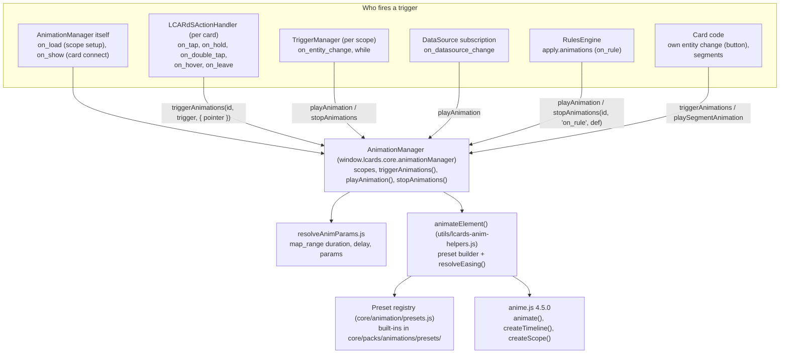

# Animation System

> **How an `animations:` entry or a rule animation becomes an anime.js v4 animation**: who fires each trigger, where scopes live, and which files to read.
> **Reference**: [Animation Manager](../subsystems/animation-manager.md) (scopes, registration, playback, API). **User docs**: [Animations](../../core/animations.md), [Triggers](../../core/animations/triggers.md), [Preset reference](../../core/animations/preset-reference.md).

---

## Quick start

A card-level animation (here on its own entity's change) and a rule animation that targets cards by tag:

```yaml
type: custom:lcards-button
entity: light.bedroom
preset: lozenge
tags:
  - bedroom_widgets
text:
  name:
    show: true
tap_action:
  action: toggle
animations:
  - trigger: on_entity_change
    entity: light.bedroom
    to_state: "on"
    preset: glow
    duration: 500
rules:
  - id: bedroom_on_pulse
    when:
      entity: light.bedroom
      state: "on"
    apply:
      animations:
        - tag: bedroom_widgets
          preset: pulse
          loop: true
```

The rule's pulse runs while the rule matches and stops when it stops matching; the `on_entity_change` glow plays once per change to `on`. To loop while a state holds without a rule, use `while` on the card's own animation ([Entity change triggers](../../core/animations/entity-change-triggers.md)).

---

## Architecture



- **One manager.** `LCARdSCore` creates the only `AnimationManager`; cards and MSD cards share it. Each animated element (a card, a card segment, an MSD overlay) gets a **scope**: an anime.js `createScope()`, a `TriggerManager`, and the instances it started.
- **Registration.** A card's scope is registered by `LCARdSActionHandler.setupActions()` (it calls `onOverlayRendered(id, element, { animations })`, also for cards without animations so rules can animate them). The slider and data grid call `onOverlayRendered()` themselves; MSD does it per overlay from `PipelineCore`. A re-render of the same id rebuilds the scope and carries running animations over. See [Registration flow](../subsystems/animation-manager.md#registration-flow).
- **Rules reach cards by id.** `_registerOverlayForRules()` stores the card's animation scope id as `animationScope` in the overlay registry, so a rule animation aimed at a card's `id` or tag finds the scope whatever the card calls it ([Scopes](../subsystems/animation-manager.md#scopes)).
- **No registry of instances.** The old `AnimationRegistry` cache (`window.lcards.core.animationRegistry`) was removed in 2026.11; playback always goes through `playAnimation()`.

---

## Trigger types

| Trigger | Fired by | Scope | Use |
|---|---|---|---|
| `on_load` | `AnimationManager.registerAnimation()`, when the scope is first set up (not on a re-render) | One element | Entrance animation |
| `on_show` | `AnimationManager._maybeFireOnShow()` / `onCardShown()`, once per connection of the card (`LCARdSNativeCard.connectedCallback()` calls `onCardShown()` after the first render) | One element | Each time the card is attached (view opened, visibility condition met) |
| `on_tap`, `on_hold`, `on_double_tap` | The card's `LCARdSActionHandler`, with the pointer position | One element | Interaction feedback |
| `on_hover`, `on_leave` | `LCARdSActionHandler` `mouseenter` / `mouseleave`; leaving stops the `on_hover` animations first | One element | Hover effects |
| `on_entity_change` | `TriggerManager` entity subscriptions (`entity`, `attribute`, `from_state`, `to_state`, `while`, `check_on_load`); for an entry without `entity` the button fires it on its own entity's state change | One element | Simple state reactions |
| `on_datasource_change` | `AnimationManager.setupDatasourceListenerForAnimation()`, on every new point of the source (the current point at subscribe time is skipped) | One element | Data source value changes |
| Rule (`on_rule`, internal) | `RulesEngine`: `apply.animations` plays when a rule starts matching; looping ones stop when it stops matching | Any element by id, tag, type or pattern | Conditions across cards |

`TriggerManager`'s file header still lists `on_load` among its triggers; it does not fire it (`finalizeRegistrations()` skips `on_load`, and `setupTriggerListener()` leaves `on_show`, `on_datasource_change` and the interactive triggers to the manager and the card).

### Rule-based or entity change

| | Rule animation | `on_entity_change` |
|---|---|---|
| Configured in | `rules[].apply.animations` | The card's `animations:` |
| Targets | Any registered element (id, `tag:`, `type:`, pattern) | The card (or segment) it is on |
| Conditions | Full rule `when` (all / any / not, numeric, time, data sources) | `from_state`, `to_state`, `attribute`, `while` |
| Stops | When the rule stops matching (looping ones) | `while` ending (with `loop: true`) |
| Across cards | Yes | No |

---

## Playback features

- **Presets and easing.** An entry's `preset` names a registered preset (`registerAnimationPreset()` in `src/core/animation/presets.js`; the built-ins are in `src/core/packs/animations/presets/` and are registered by `registerBuiltinAnimationPresets()` during pack loading). `ease` is resolved by `resolveEasing()` in `src/utils/lcards-anim-helpers.js`. Code that calls anime.js follows the project's `animejs` skill (v4 API: `animate()`, `createTimeline()`, `inOutQuad`).
- **`map_range` values.** `duration`, `delay` and params can be `map_range` descriptors on an entity (`resolveAnimParams.js`). A looping animation whose `duration` is mapped gets a **live speed binding**: when that entity changes, the running instance's `speed` is adjusted without a restart.
- **Targets.** `target` / `targets` select elements inside the scope (or through the MSD overlay's targeting API); `target: background` animates the card's background effect handles (`effect: N` for one layer).
- **Segments.** Button component segments get scopes of their own (`{cardId}:segment:{segmentId}`, `registerSegmentAnimations()`, `playSegmentAnimation()`).
- **Reduced motion.** Under `prefers-reduced-motion: reduce` an animation is settled instead of played: a finite one jumps to its end frame, a looping one is reverted. Switching the setting on settles running animations. `essential_motion: true` exempts an entry.
- **Stopping.** `stopAnimations(id, trigger?, def?)` reverts instances (anime.js `revert()` restores the captured styles and attributes); `destroyOverlayScope(id)` runs on disconnect.

Details and line references: [Playback: playAnimation()](../subsystems/animation-manager.md#playback-playanimation).

---

## Files

| File (under `src/`) | Role |
|---|---|
| `core/animation/AnimationManager.js` | The manager: scopes, triggers, playback, carry-over, reduced motion, speed bindings, segments |
| `core/animation/TriggerManager.js` | One per scope: registrations per trigger, entity subscriptions for `on_entity_change` and `while` |
| `core/animation/resolveAnimParams.js` | `map_range` in animation duration, delay and params |
| `core/animation/presets.js` | The preset registry (`registerAnimationPreset`, `getAnimationPreset`, `listAnimationPresets`, preset info for the Pack Explorer) |
| `core/packs/animations/` | The built-in presets and `registerBuiltinAnimationPresets()` |
| `utils/lcards-anim-helpers.js` | `animateElement()`, `resolveEasing()` (`window.lcards.anim`) |
| `utils/reduced-motion.js` | `prefersReducedMotion()`, `onReducedMotionChange()` |
| `base/LCARdSActionHandler.js` | Interactive triggers |
| `core/rules/RulesEngine.js` | Rule animations (`_executeRuleAnimations()`, `_stopRuleAnimations()`) |
| `core/animation/PerformanceMonitor.js` | FPS monitor for canvas backgrounds; not part of card animation playback |

Other moving visuals have their own systems: [Background Animation System](../internals/background-animation-system.md) (Canvas2D and WebGL card backgrounds), [Shape Texture System](../internals/shape-texture-system.md) (effects inside button and elbow shapes), [Screen Effect System](../subsystems/screen-effects.md) (full-screen layers) and the alert-mode palette transitions in the [Theme System](../subsystems/theme-system.md).

---

## Debugging

```javascript
window.lcards.setGlobalLogLevel('debug');
window.lcards.core.animationManager.scopes;   // Map of scope id to scope data
```

Useful log lines:

- `[RulesEngine] 🎬 Executing N animation(s) for rule: X`
- `[RulesEngine] 🛑 Stopping animations for rule: X`
- `[TriggerManager] 🎬 Triggering animation for <scope> on entity change: <entity>`
- `[TriggerManager] 🎬 while-start: ...` / `⏹️ while-stop: ...`
- `[AnimationManager] 📊 Datasource change: X`

More console helpers: [Animation Manager: Console access](../subsystems/animation-manager.md#console-access).

---

## See also

- [Animation Manager](../subsystems/animation-manager.md)
- [Entity Change Triggers](../../core/animations/entity-change-triggers.md)
- [Rule-based Animations](../../core/animations/rule-based-animations.md)
- [DataSource Buffers](../internals/datasource-buffers.md)
- [anime.js v4 documentation](https://animejs.com)
