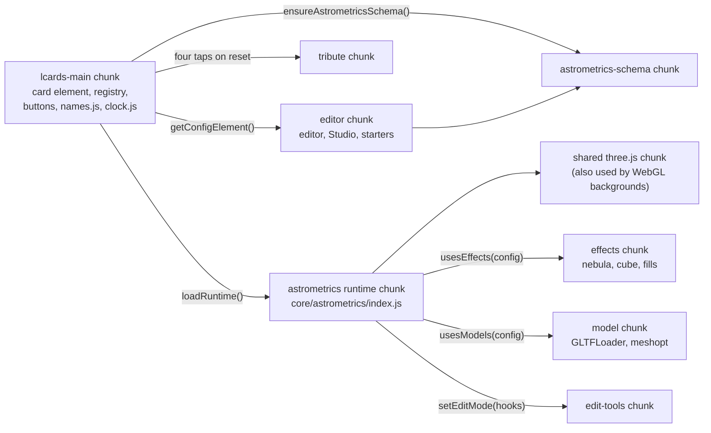
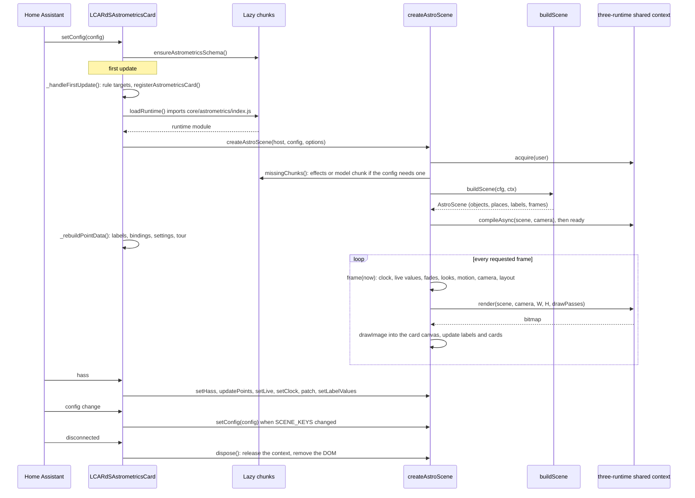
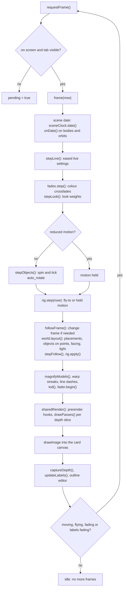
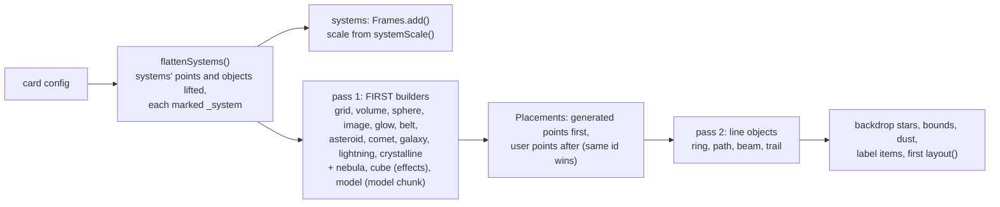
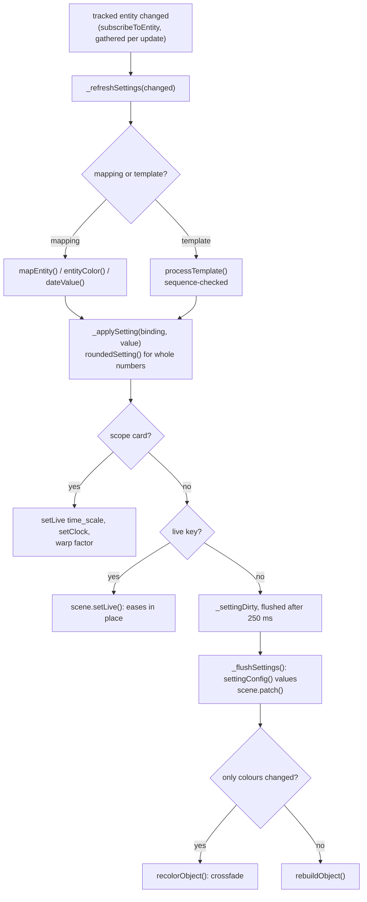
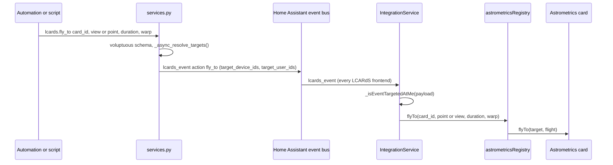

# Astrometrics Card Architecture

> **`custom:lcards-astrometrics-card`**: a 3D scene (grids, volumes, globes, orbits, routes, nebulae, models) with DOM labels on named points, rendered on demand with three.js through the page's one shared WebGL context. This page covers how the card, the lazy scene runtime and the Astrometrics Studio fit together.

The options themselves are documented for users under [Astrometrics](../cards/astrometrics/index.md) (scene, objects, points, camera, data, effects, scale, models, starters). This page links there instead of repeating option tables.

---

## Purpose and location

The card draws an astrometrics lab or stellar cartography display: a galaxy disc with territories, a sector map, a sky dome with the real sun and moon, a solar system at the scene clock's date, a station with ships at true scale inside a galaxy in light years. Points carry LCARS labels, markers and optional Lovelace cards; taps fly the camera; settings and positions can follow entities.

The work is split so that a dashboard without an astrometrics card pays almost nothing for it:

| Where | What | Loaded |
|---|---|---|
| `src/cards/lcards-astrometrics-card.js` | The card element (`LCARdSAstrometricsCard`): config, hass, actions, rules, entity bindings, label templates, on-card buttons, warp layer, background layer, Studio hooks | Main chunk |
| `src/cards/astrometrics-registry.js` | `window.lcards.cards.astrometrics` (fly-to, set-clock, set-model-scale by card `id`) | Main chunk |
| `src/cards/astrometrics-buttons.js` | Pure layout of the camera D-pad and time slider (`cameraButtonLayout`, `TIME_STOPS`, `dpadPaths`) | Main chunk |
| `src/core/astrometrics/names.js` | Every name the config can use (types, shapes, units, live keys), free of three.js so the schema, validator and registries can read it | Main chunk (small) |
| `src/core/astrometrics/clock.js`, `warp-drive.js` | Clock parsing and date formatting for the time slider; the warp streak layer | Main chunk |
| `src/cards/schemas/astrometrics-schema.js` | The card schema (one branch per object type) | Lazy chunk `astrometrics-schema-*` |
| `src/core/astrometrics/index.js` and everything it imports | The scene runtime (`createAstroScene`), scene builder, camera rig, labels, object builders | Lazy runtime chunk (with three.js in the shared three chunk) |
| `src/core/astrometrics/effects/` | Noise shaders: `nebula`, `cube`, `fill.effect` | Lazy, only when `usesEffects(config)` |
| `src/core/astrometrics/model/` | GLTFLoader, meshopt decoder, hologram material | Lazy, only when `usesModels(config)` |
| `src/core/astrometrics/edit-tools.js` | Studio edit-mode maths (drag forms, selection box) | Lazy, on the first `setEditMode(hooks)` |
| `src/core/astrometrics/tribute.js` (+ `tribute-portrait.js`) | The hidden tribute (four taps on reset) | Lazy, on first trigger |
| `src/editor/cards/lcards-astrometrics-editor.js`, `src/editor/dialogs/lcards-astrometrics-studio-dialog.js`, `src/editor/dialogs/astro-studio/` | The card editor and the Astrometrics Studio | Lazy editor chunk |
| `src/core/astrometrics/starters/` | Starter scenes and parts | Imported by the Studio only (editor chunk), the docs generator and the showcase script |

Supporting files outside `src/`:

- `scripts/make-ships.mjs`, `scripts/make-starbases.mjs`, `scripts/lib/model-kit.mjs`: the built-in GLB models, made in code.
- `scripts/render-model.mjs`: renders a GLB from fixed angles for comparison with reference plates.
- `scripts/astro-pictures.mjs` (`npm run astro:pictures`): the Studio's starter, type and shape pictures.
- `scripts/generate-astro-starters-doc.js` (`npm run docs:astro-starters`): the generated part of `doc/cards/astrometrics/starters.md`.
- `scripts/make-astro-showcase.mjs`: writes `demo/views/astro-showcase.yaml` from the starters.
- `custom_components/lcards/services.py`: the `lcards.fly_to` and `lcards.set_clock` actions; `const.py`, `frontend.py` and `media_source.py`: the user's model folder.

---

## Chunks and loading

There is no `manualChunks` setting in `vite.config.js`: every chunk boundary is a dynamic `import()` in the source.

- **Runtime.** `loadRuntime()` in `lcards-astrometrics-card.js` imports `../core/astrometrics/index.js` once per page (`runtimePromise`); a failed load is not cached, so a later render retries. `index.js` re-exports only what the card needs (`createAstroScene`, `labelSources`, `bindingValue`, `collectBindings`, `settingConfig`, `tourStop`, ...).
- **Schema.** `ensureAstrometricsSchema()` imports the schema and calls `configManager.registerCardSchema('astrometrics', ...)`. The card's static `registerSchema()` (called by `lcards-main.js` after core init) only registers the defaults (`{ height: 400 }`). `setConfig()` starts the schema load on the first config of the page; every card whose config arrives before the schema is registered (not only the first) waits for it once and re-processes its latest config then, so it is validated (`schemaReady`, `_awaitingSchema`; `tests/core/astro-card-wiring.test.js`). The editor also calls `ensureAstrometricsSchema()` (its YAML completion needs it).
- **Effects and models.** `missingChunks()` in `scene-runtime.js` checks `usesEffects(cfg)` / `usesModels(cfg)` (`names.js`) before each `build()`. When a chunk is missing, the build waits for it (`chunkWait` generation) and runs again; a failed chunk leaves `ctx.effects` / `ctx.models` null and those objects are skipped with a warning.
- **Budgets.** `tests/browser/bundle.spec.js` holds the runtime chunk under 210 KB raw / 68 KB brotli, keeps the runtime and schema out of the main chunk, and checks that `edit-tools` is a chunk of its own.

---

## Module map

### Card side (main chunk)

| Module | Role | Key exports / symbols |
|---|---|---|
| `src/cards/lcards-astrometrics-card.js` | The card. Owns the scene's lifetime, passes config and hass, resolves label templates and state colours, follows entities (positions, settings, look, warp, tour), runs actions, registers points and objects as rule targets, renders the camera buttons, time slider, pick banner and failure message | `LCARdSAstrometricsCard`, `ensureAstrometricsSchema`, `SCENE_KEYS`, `FAILURES` |
| `src/cards/astrometrics-registry.js` | The page's connected astrometrics cards by `id`; installed as `window.lcards.cards.astrometrics` | `astrometricsRegistry`, `registerAstrometricsCard`, `unregisterAstrometricsCard` |
| `src/cards/astrometrics-buttons.js` | Pure layout of `camera.buttons` and the time slider | `cameraButtonLayout`, `dpadPaths`, `padTokenStyle`, `timeMode`, `TIME_STOPS`, `BUTTONS_IDLE_MS` |
| `src/core/astrometrics/warp-drive.js` | `warp` / `warp_factor`: a `warp-starfield` background layer behind the scene; drives the scene's `setCruise` | `WarpDrive`, `warpOn`, `warpSpeed`, `ENGAGE_MS` |
| `src/core/astrometrics/clock.js` | `clock: { date, rate }` parsing and the scene clock | `SceneClock`, `parseDate`, `parseRate`, `RATE_PATTERN`, `LIVE_RATE`, `DATE_STOPS`, `formatSceneDate` |
| `src/core/astrometrics/names.js` | Names and small pure helpers shared by schema, runtime, validator and registries | `OBJECT_TYPES`, `TYPE_GUIDE`, `LIVE_TYPE_KEYS`, `WHOLE_NUMBER_KEYS`, `UNITS`, `kmPerUnit`, `systemScale`, `realScale`, `flattenSystems`, `objectIds`, `objectById`, `withObjectPatches`, `usesEffects`, `usesModels` |

### Runtime core (runtime chunk)

| Module | Role | Key exports |
|---|---|---|
| `index.js` | The lazy entry the card imports | re-exports |
| `scene-runtime.js` | The scene API: DOM wrapper and canvas, shared-context acquire and release, build and rebuild, the frame loop, input (pointer, wheel, keys), picking, fly-to, follow, frames, live values, colour fades, looks, rule patches, Studio edit tools | `createAstroScene`, `CAMERA_COMMANDS`, `MODEL_MIN_PX`; typedefs `AstroSceneApi`, `AstroSceneOptions`, `AstroEditHooks`, `AstroTapHit` |
| `scene-builder.js` | Builds a scene from config without a renderer (so node tests build it headless): systems and frames, objects in two passes, placements, label items, backdrop, per-frame `layout()` | `buildScene`, `makeLabelItem`, `disposeBuilt`, `BACKDROP_STARS`, `BACKDROP_DUST`; typedef `AstroScene` |
| `objects/common.js` | The builder contract and shared helpers | `built`, `stepObjects`, `num`, `pair`, `sub`, `isOn`, `applyRotation`, `bodyTurn`, `disposeNode`, `gridLook`, `fillFor`, `DEFAULT_COLORS`; typedefs `BuildContext`, `BuiltObject` |
| `placements.js` | Named points and their placement forms (`xyz`, `polar`, `latlon`, `altaz`, `sky`, `body`, `at`, `cell`, `part`) | `Placements`, `BINDABLE_FORMS`, `bearingXZ`, `latlonToLocal`, `altazToLocal`, `parseCell` |
| `frames.js` | Frames for systems at true scale (one frame per `type: system`) | `Frames`, `ROOT`, `ENTER`, `LEAVE` |
| `camera-rig.js` | The camera as seven keys plus a projection; drag, wheel, pinch, limits, fly-to tween | `CameraRig`, `viewToKeys`, `parseLimits`, `clampKeys`, `logFlyKeys`, `lerpKeys`, `isLogFly`, `cameraPose`, `screenRay`, `rayPlane`, `DEFAULT_KEYS` |
| `wheel-input.js` | Tells a mouse wheel, a touchpad swipe and a pinch apart (`camera.wheel`) | `classifyWheel`, `wheelAction`, `wheelZoomFactor` |
| `bindings.js` | Settings that follow entities or templates (pure): collect, map, resolve, write back into a config | `collectBindings`, `settingConfig`, `mapEntity`, `mapNumber`, `entityColor`, `templateColor`, `dateValue`, `tourStop`, `isTourView`, `easeStep`, `objectIds` (re-exported from `names.js`), `LIVE_OBJECT_KEYS`, `DEFAULT_SMOOTH_MS` |
| `point-data.js` | Point positions from entities and the label fields the card resolves (templates, state colours), with their dependencies | `labelSources`, `fieldNeedsUpdate`, `bindingEntity`, `bindingValue` |
| `looks.js` | `look: diagram / realistic / mixed` weights and part switching (pure) | `parseLook`, `lookTargets`, `stepLook`, `lookAlpha`, `partWeights`, `switchesParts`, `PART_KINDS` |
| `recolor.js` | Colour changes crossfade in place (any type, no code of its own) | `colorBase`, `colorSlots`, `ColorFades`, `RECOLOR_MS` |
| `distance-fade.js` | `fade`, `min_distance`, `max_distance` for points and objects | `ObjectFader`, `ObjectBounds`, `distanceAlpha`, `localBounds`, `FADE_MS` |
| `depth-passes.js` | Depth slices for true-scale scenes (km station, planet, Sun in one view) | `depthSlices`, `drawPasses`, `starsBehind`, `SLICE_RATIO` |
| `depth-occlusion.js` | Labels hidden behind meshes: a quarter-size depth pass, read back asynchronously | `DepthOcclusion`, `OCCLUDER_LAYER`, `DEPTH_ENCODE_GLSL` |
| `facing.js` | `face: motion` and `face: <point>` | `Facing`, `spinTangent`, `axisFacing` |
| `ephemeris.js` | Sun, planets, Pluto, Ceres and major moons at a date, and their rotation (pure) | `position`, `heliocentric`, `orbitPath`, `orientation`, `sphereAxes`, `toScene`, `BODIES`, `MOONS`, `VALID_RANGE` |
| `sky.js` | Local sun and moon from the Home Assistant location (pure) | `skyState`, `sunPosition`, `moonPosition`, `dayPath` |
| `label-layer.js` | DOM labels over the canvas, laid out per frame (projection, occlusion, distance, collisions) | `LabelLayer`, `layoutLabels`, `labelItem`, `pickLabel`, `LABEL_STYLES` |
| `label-text.js` | Which text fields a point shows and how they are styled (pure) | `resolveLabel`, `plainColor`, `selectedColor`, `fieldCss`, `LABEL_POSITIONS` |
| `card-layer.js` | Lovelace cards pinned to points (`card:`) | `CardLayer`, `pointCard`, `cardBox` |
| `markers.js` | Point markers as inline SVG in `currentColor` | `markerSvg`, `MARKER_SIZE` |
| `lines.js` | Fat lines with dashes in screen px and 64-bit anchored vertices | `FatLine`, `PxDashLineMaterial` |
| `grid-mesh-material.js`, `surface.js`, `deform.js` | Grid line shader on meshes, tessellated surfaces with `surf` coordinates, `deform:` warps | `gridFace`, `gridUniforms`, `surfaceGeometry`, `sphereGeometry`, `makeDeformer` |
| `star-field.js` | Backdrop stars and dust (px-sized quads, warp streaks) | `createStarField`, `warpTails`, `cruiseTails`, `wrapDust` |
| `loading-ring.js`, `outline-editor.js` | The ring over the scene while models load; the Studio's prism outline handles | `createLoadingRing`, `createOutlineEditor` |
| `object-samples.js` | One small scene per type and per shape (Studio pictures and per-type tests) | `TYPE_SAMPLES`, `SHAPE_SAMPLES` |
| `nebula-presets.js` | `preset: badlands / badlands_voyager / nexus` | `NEBULA_PRESET_CONFIGS`, `withNebulaPreset` |

### Object builders (`src/core/astrometrics/objects/`)

| Module | Types |
|---|---|
| `grid.js` | `grid` (plane, disc, dome, sphere, cylinder, well; lettered sector maps) |
| `volume.js` | `volume` (sector, box, prism) |
| `sphere.js` | `sphere` (globes and planets, `body:`) |
| `lines.js` | `ring`, `path`, `beam`, `trail` (built in the second pass, they read points) |
| `image.js`, `glow.js` | `image`, `glow` |
| `belt.js`, `asteroid.js`, `comet.js` | `belt`, `asteroid`, `comet` |
| `galaxy.js` | `galaxy` (the Milky Way by default) |
| `crystalline.js` | `crystalline` |
| `lightning.js` | `lightning` (strike or column; lights volume nebulae) |
| `stars.js` | `backdrop.stars`, `backdrop.dust` |
| `diagram.js` | Diagram forms (LCARS wireframes for the diagram look): `addDiagram`, `bodyGroup`, `redrawDiagram` |
| `../effects/nebula.js`, `nebula-volume.js`, `cube.js`, `fills.js` | `nebula` (puffs, or `render: volume`), `cube`, `fill.effect` (effects chunk) |
| `../model/index.js`, `hologram-material.js` | `model` (model chunk) |

`system` has no builder: it is a frame (see [Systems and frames](#systems-and-frames)).

---

## Lifecycle

### Connect and first update

- `_handleFirstUpdate()` (the card's own; `LCARdSCard` has none) registers the card as a rules overlay, which first registers every point and object with an `id` as a rule target (`_registerSceneTargets`). In the card picker (`hui-card-picker` ancestor) it stops there and renders a static SVG preview (`_renderPreview`), so a picker thumbnail never creates a WebGL scene.
- Otherwise it adds the card to the registry, notes whether it is inside the card edit dialog (`hui-dialog-edit-card`, for point cards in edit mode), and calls `_startScene()`.
- `_onConnected()` covers a view switch: the scene was disposed on disconnect, so it registers again and starts a new scene.

### Starting the scene

`_startScene()` bumps `_sceneGeneration` (a load that finishes after a disconnect or a newer start is dropped), awaits `loadRuntime()` and `updateComplete`, finds `.astro-host` and calls `createAstroScene(host, config, options)`:

- `config` is `_sceneConfig()`: only `SCENE_KEYS` (`camera`, `backdrop`, `labels`, `points`, `objects`, `units`, `time_scale`, `clock`, `look`, `model_scale`) of the flattened config (`_flatConfig()` caches `flattenSystems(this.config)` per config object), with rule patches and setting values merged (`_withScenePatches`).
- `options` carries `hass`, `resolveColor`, `onTap`, `onHold`, `onFail`, `onSky`, `onClock`, `onModelScale`, `mountCard` and `setCardHass` (`AstroSceneOptions` in `scene-runtime.js`).

After creation the card re-applies what was set on screen and must survive a new scene: the Studio's edit hooks, a model scale set by the button or the V key (`_modelScaleSet`), the time slider's speed (`_timeScale`) and a clock set by the slider or an action (`_clockSet`, advanced by the wall time since). Then `_rebuildPointData()` works out label sources, entity positions and setting bindings and resolves them once, and `_syncBackground()` starts `background_animation`.

### Inside `createAstroScene`

- Creates `div.astro-scene` (`role="application"`, keyboard focusable while controls are on), a 2D `canvas`, the `LabelLayer`, the `CardLayer` and the loading ring inside the host.
- `acquire(user)` joins the shared WebGL renderer (`src/core/packs/backgrounds/webgl/three-runtime.js`). With no WebGL, `fail('no webgl')` runs on a microtask; a context loss calls `fail('context lost')`. `fail()` releases the context and calls `onFail`, which the card maps to its `FAILURES` text.
- Builds the `BuildContext` (`ctx`): concrete colour resolution (`resolveColor(..., { concrete: true, element })`, parsed to straight sRGB 0 to 1), `sky()`, `date()`, `requestFrame()`, `loadTexture(src)` and `loadModel(src)` (both through `fileUrl()`, see [Models](#models)).
- Creates the `CameraRig`, `ObjectBounds` / `ObjectFader`, `DepthOcclusion`, `ResizeObserver`, `IntersectionObserver`, `visibilitychange`, reduced-motion and `document.fonts` listeners, the sky timer (`SKY_INTERVAL_MS`, 60 s) and the clock timer (`CLOCK_INTERVAL_MS`, 1 s).
- Calls `build()` once and returns the `AstroSceneApi`.

### `build()`

`build()` disposes the old world and builds a new one from `cfg`:

1. Waits for missing chunks (see above).
2. Works out `usesSky` (sky points, sky paths, label templates reading `sky.`) and `usesClock` (body points, body or orbit objects, a clock with a sky), applies the config's `clock` and `model_scale` only when they changed since the last build (`clockCfg`, `modelScaleCfg`), and shows the config's `look`.
3. `buildScene(cfg, ctx, { cssColor })`, then label items, markers, selection box, measure line, and everything the card resolved before (label values, entity positions) put back.
4. Keeps the camera's frame, re-reads `camera.views`, and moves the camera only when the start view changed (`cameraKey`), so adding a view in the Studio does not move the preview.
5. `resize()`, puts the live values back (`applyLive`), then `renderer.compileAsync(scene, camera)`: shaders compile off the frame, `ready` turns true, and a fly-to asked for before then (`pendingFly`, a tour's first stop) runs.

### Updates

- **Config.** `_onConfigUpdated()` and `_onRulePatchesChanged()` call `_syncConfig()`: a full `scene.setConfig()` only when the JSON of `_sceneConfig()` changed (a theme re-process with the same values rebuilds nothing). A new `time_scale` or `clock` in the config drops the slider's and the action's value.
- **Hass.** `_handleHassUpdate()` passes hass to the scene (`setHass`: point cards, the sky) and to the background; on the first hass it refreshes every binding, setting and label. After that, entity changes come through the core: `_subscribeEntities()` subscribes every tracked entity with `subscribeToEntity()` (again when the tracked set changes and on reconnect; the base drops them on disconnect), `_onEntityChange()` gathers the changes of one update and, a microtask later, refreshes only the bindings, settings and label fields that read a changed one. States are read through `getEntityState()` (`_entityState()`), never `hass.states`.
- **Alert mode and theme.** `_onAlertModeChanged()` calls `scene.recolor()`: every object crossfades to its new colours in place (see [Colour crossfades](#colour-crossfades)); labels use CSS colours (`var()` stays live) and need nothing.

### Disconnect

`_onDisconnected()` clears the button timer, leaves the registry, cancels a Studio pick and calls `_stopScene()`: bumps the generation, clears pending setting patches, `scene.dispose()`, destroys the background renderer, stops the tribute and the warp layer. `dispose()` cancels the frame and timers, removes every listener and observer, disposes the rig, depth pass, labels, cards, world (geometries and materials), textures and loading ring, releases the shared context and removes the wrapper.

---

## The frame loop

Nothing draws unless something asked for a frame (`requestFrame()`): a camera key change, motion, data, a resize, a theme change. Off screen (`IntersectionObserver`) or in a hidden tab the request is remembered (`pending`) and drawn once visible again.

All of this is `frame()` in `scene-runtime.js`. Points to note:

- **The scene clock and the motion clock are separate.** `dateNow` (the scene date, `SceneClock`) moves bodies, orbits and the sky whatever `time_scale` says. `clock` (ms of decorative motion: spin, scans, drift, flow) advances by `dt * timeScale` and holds under reduced motion, so motion resumes where it stopped.
- **Layout runs every frame** because points can stand on moving things. `world.layout()` (`scene-builder.js`) updates matrices, re-places systems, places objects on points (up to four passes so chains such as a ship on a drydock over a moving planet settle in one frame), turns `face` objects, hands lights to lit objects (`lightAt`) and redraws line objects whose ends move.
- **One render per frame** through `sharedRender(scene, camera, W, H, draw)`. Before the passes, each visible object's `prerender` hook runs (a volume nebula captures solid depth and marches its gas). `drawPasses()` draws one pass per depth slice (one pass for any scene that fits the camera's own planes).
- **Labels after the render**, so their projection uses this frame's camera. The depth readback for label occlusion is one frame late; a new depth image triggers one more layout without a new capture (`depthFresh`).

---

## Scene model

### Config to scene

- **Flattening.** `flattenSystems()` (`names.js`) lifts every `type: system`'s `points` and `objects` into the card's own lists, each marked `_system: <id>`, the system's own entry kept without them; a system without an id becomes `system#n`. Ids are card-wide, so labels, templates, bindings, rules and the runtime all read one flat list. The card, the runtime (`createAstroScene`, `setConfig`) and `buildScene` all call it; a config without systems comes back unchanged.
- **Ids.** An object without an `id` is named `type#n`, counted per type in config order. `objectIds()` (`names.js`) is the one naming: `buildScene` names its objects with it, setting bindings use it for their ids, the card finds a binding's object with `objectById()` (`_flushSettings`) and the runtime's `patch()` writes patched configs back with `withObjectPatches()`, so a setting bound on an object without an id reaches the scene and survives a full rebuild. The Studio's `scopedObjectIds()` (`systems.js`) must agree with it. Its generated points stand on that name.
- **Two passes.** Objects points can stand on are built first (`FIRST` in `scene-builder.js`, plus the chunk-built types); then `Placements` is created over them; then the line objects that read points. Line objects can still be hosts for later points (a planet on its spinning orbit ring).
- **Groups.** Each object's node goes into an outer `Group` named `at:<id>` (its `at` position and `rotation`, turned by `face`; its inner node spins) inside its frame's group. A real body (`body:` with an `onDate`) turns itself, so its group takes no `rotation`, on the first build and on `rebuildObject()` alike (`takesRotation()`). `visible: false` hides the outer group.
- **Bounds.** The bounding sphere of the first-pass objects frames the default view and sizes the dust (`bounds`).

### The builder contract

Every builder is `build<Type>(cfg, ctx)` returning a `BuiltObject` (`objects/common.js`), made with `built(cfg, node, extra)` so the defaults are filled in. The fields the rest of the system reads:

| Field | Read by | Purpose |
|---|---|---|
| `node`, `radius`, `centre`, `placeNode` | placements, fly-to, framing | What points on the object stand on and how big it is |
| `cellPoint`, `cellAt`, `warp`, `unwarpHit`, `partNode`, `partNames` | placements, picking | `cell:` on lettered grids, deformed grids, model parts |
| `points` | builder | Generated points (ring and axis labels) placed before the user's |
| `lines`, `gridFaces`, `field` | runtime `sizeObject()` | Fat lines, grid faces and star fields sized to the canvas (px widths) |
| `pickMeshes` | picking, double-tap zoom | Meshes a tap can hit |
| `occludes`, `occluder` | label layout | Hides labels behind it, as a sphere or by depth |
| `spin`, `tick(dt, t)` | `stepObjects()` | Motion; skipped entirely under reduced motion |
| `onDate(ms)` | frame loop | Follow the scene date (bodies, orbits) |
| `update`, `dynamic`, `repin` | `layout()` | Line objects drawn from points; `dynamic` redraws every frame |
| `lod({ camera, height, dpr })` | frame loop | Level of detail before the render (belt rocks to dots, crystalline to a dot) |
| `live(key, value)` | `applyLive()` | Per-type keys changed in place (see [Live keys](#live-keys)) |
| `lightAt(world)`, `setLights`, `contains` | `layout()`, lightning | Lit from a point; lightning inside a volume nebula |
| `lookParts` | frame loop | Diagram and realistic parts switched by the look |
| `prerender(renderer, scene, camera, w, h, frame)` | frame loop | Drawn before the passes (volume nebula) |
| `materials` | `recolor.js` | Materials off the node tree that colour fades must still reach |
| `isReady`, `loadState`, `drawnSize`, `realExtent`, `magnify`, `modelInfo` | runtime, Studio | Models loading, real size, `model_scale: visible` |
| `dispose` | world dispose | Cleanup beyond geometry and materials |

`buildScene` wraps every builder in `recordingColors()`, which records each colour the build asks for through `ctx.color` (`colorInputs`) and a snapshot of what the object looks like as built (`colorBase`). Builders must therefore ask for every colour through `ctx.color` and be deterministic for a config (seeded randomness), or colour crossfades cannot line up.

### Systems and frames

A `type: system` is a frame (`frames.js`): a galaxy in light years can hold a star system in km, and inside it a 1.5 km station is exact, which doubles at 26,000 ly could not hold.

- `Frames` keeps one `Group` per frame. The camera works in one frame at a time (`frames.current`): world coordinates are that frame's units, its group sits at the origin unscaled, and every other frame's group is placed and scaled relative to it (`place()`).
- `scale` is parent units per unit (`systemScale()`: the system's `scale`, else its `units` over the parent's; null and a warning when the parent names none). Systems are never rotated, so yaw and tilt mean the same in every frame. The runtime handles any depth; the schema allows one level.
- `followFrame()` runs every frame: `Frames.pick(cameraPosition)` returns the deepest system the camera is inside (it enters inside `ENTER` = 4 times a system's radius and leaves past `LEAVE` = 6), and `setFrame()` re-bases the scene, converting the camera keys, a running fly-to's ends and its landing target, the followed point and the warp streak history, so the picture does not move.
- A fly-to into a system moves into that frame first (`fly()`), then reads the target there exactly.
- `hide_in_systems` hides galaxy-scale objects while the camera is inside a system (`hiddenHere()`).

### Units

`units` (scene) and a system's `units` name what one unit is (`UNITS` in `names.js`: m, km, au, ly, pc). `buildScene` sets `ctx.kmPerUnit(system)` so builders can give real defaults in any named unit (the Crystalline Entity is 3 km tall by default, a galaxy the Milky Way's radius, an `orbit:` ring the body's real orbit), and models are drawn at their real size (`realScale(file_units, kmPerUnit)`, `modelSizing()` in `model/index.js`). A scene without named units keeps plain numbers. See [Scale](../cards/astrometrics/scale.md).

### Live keys

A setting bound to an entity or template is either **live** (changed in place, eased, no rebuild) or a **rebuild** key (the object is built again with the new value).

- Generic live keys on any object: `opacity`, `radius`, `size`, `spin` (`LIVE_OBJECT_KEYS` in `bindings.js`), top level only. `applyLive()` in the runtime multiplies opacity in through the fader, sets `spin`, and scales the node by `value / built` for `radius` and `size`.
- Per-type live keys: `LIVE_TYPE_KEYS` in `names.js`, as joined paths so either side of a pair can be one (`radius.0`):

| Type | Keys | `most` |
|---|---|---|
| `belt` | `radius`, `radius.0`, `radius.1`, `thickness`, `count` | `count: MAX_ROCKS` |
| `comet` | `nucleus.size`, `coma.size`, `tail.length`, `glow` | |
| `nebula` | `drift`, `drift.0`, `drift.1`, `density` | |
| `crystalline` | `glow`, `opacity` | |

- The built object takes them in `live(key, value)`, returning true when it did; `null` puts the built value back. `applyLive()` tries the object's own `live` first, then the generic keys.
- `most`: a key such as a belt's `count` is built once for the most it can reach (the top of the binding's `output`, capped by `most`; written into the config as `_most.count` by `settingConfig()`) and then draws fewer, so it eases instead of rebuilding.
- Card-level: `time_scale` and `clock.rate` are live (`setLive` with id `''`, `setClock`); `warp_factor` goes to the warp layer; `clock.date` to `setClock`.
- Easing: `setLive(list)` eases from the current value over the binding's `smooth` ms (default `DEFAULT_SMOOTH_MS`, 600) with `easeStep()` (smoothstep); the first value lands at once, and reduced motion steps.

### Colour crossfades

`recolor.js` makes any colour change fade in place (an alert mode, a theme, a colour bound to an entity, a rule), so nothing flashes and motion carries on.

1. A theme or alert change calls `recolorInPlace()`; a rule or setting that changes only colours (`colorOnly()`) calls `recolorObject(id, next)`.
2. An object whose recorded `colorInputs` all resolve the same as before is left alone.
3. Otherwise it is built once more off the scene (`world.buildApart(id, next)`), `colorSlots(live, fresh)` lists every value a colour drives (material colours, uniforms, colour attributes, instance colours) where the fresh build differs from the live object's `colorBase`, and `ColorFades` fades them over `RECOLOR_MS`; the fresh build is disposed.
4. When the builds do not line up (a different tree, a colour that does more than change a value), `colorSlots` returns null and the object is rebuilt (`rebuildObject`); when the backdrop cannot, the whole scene is rebuilt. Models are always rebuilt (their file loads after the build).

### Looks

`look` (card: `diagram`, `realistic`, `mixed`, or `{ entity }`) and `look` (object: `diagram`, `realistic`, `all`) are combined by `looks.js`: the runtime eases weights (`stepLook`, `LOOK_FADE_MS`) and multiplies `lookAlpha()` into each object's opacity. Objects without their own `look` that have a diagram part and a realistic part (`lookParts`, made with `addDiagram()` and `bodyGroup()` in `objects/diagram.js`) switch the parts instead (`partWeights`, `fader.scaleNodes`). See [Scene and Looks](../cards/astrometrics/scene.md).

### Rule patches

Points and objects with an `id` are rule targets (types `astrometrics-point` and `astrometrics-object`, registered with the systems manager by `_registerSceneTargets()`), as MSD overlays are. `_applyRulePatches()` sends the card's own patches the base way and the points' and objects' merged patches (`_scenePatches`) to `scene.patch()`:

- Patches per id are merged highest priority last (`deepMergeImmutable`), with the engine's metadata dropped and an MSD-style `style: { ... }` object spread (`normalizeScenePatch`); a rule's `label` replaces `text.label.content`. Only ids whose merged patch changed are sent, and the label sources of patched points are rebuilt.
- Points: a placement key (`PLACE_KEYS`) re-places the point (`places.replaceDef`), a label key (`LABEL_KEYS`) rebuilds only its label, `visible` and `opacity` set the label's alpha.
- Objects: `visible` and distance keys apply per frame; a colour-only change crossfades; anything else rebuilds just that object (`world.rebuildObject`), re-sized and with its live values put back.
- `patch()` also writes the patched configs into `cfg` by scene id (`withObjectPatches()`, so an object without an id, patched by a bound setting, is kept too), so a later full rebuild keeps them. An object sent without its own id is compared and rebuilt as its `type#n`.

---

## Camera rig and fly-to

`CameraRig` (`camera-rig.js`) makes the camera a pure function of seven keys (`tx`, `ty`, `tz`, `yaw`, `tilt`, `distance`, `fov`) plus a projection (`perspective` or `orthographic`). Yaw 0 puts the camera south of the target (+z) looking north; tilt 90 looks straight down; the camera turns with a YXZ Euler.

- **Input.** `rig.attach(canvas)` handles drag (orbit or pan), wheel and pinch (`wheel-input.js` classifies wheel events), `camera.limits` clamp every change (`clampKeys`, `parseLimits`; converted into the current frame's units by `limitsNow()`). Keys and the on-card D-pad go through `press(command)` / `release()` (`CAMERA_COMMANDS`, `KEY_COMMANDS`): one step on press, then a rate after `PRESS_REPEAT_MS`. Home resets, V toggles the model scale, F frames the selection in edit mode.
- **Fly-to.** `rig.flyTo(keys, { duration, ease, projection, warp })` is one anime.js tween of a progress value (`animate(progress, { autoplay: false })`) that the frame loop seeks (`rig.step(now)`), not anime's own clock. The keys follow the flight's two ends: `lerpKeys` for a short flight, `logFlyKeys` when the distance changes by more than `LOG_FLY_RATIO` (the distance moves evenly in log, and the target is tied to the zoom). Yaw takes the short way round (`shortestYaw`). Reduced motion or `duration: 0` jumps.
- **What a fly-to lands on.** The runtime's `fly(keys, target, opts)` records `flyRef` (a point id, re-read exactly after a frame change, or a position in a frame's units) and starts following a point target (`startFollow`). `stepFollow()` moves the target, or a running flight's landing target, by how far the followed point moved since last frame (a planet on a fast clock); `camera.follow: false` turns that off.
- **Entry points.** `flyTo(view, opts)` takes a view name, a point id, `{ point }` or keys; before the world is ready it is queued (`pendingFly`). `flyToHit()` (a tap), `flyClose()` (a double tap on a point), `zoomTo()` (a double tap in blank space), `goHome()` (reset), `frameObject()` (Studio) all go through `fly()`.
- **Warp streaks.** A flight with `warp` (the view's, the action's, else `camera.warp`, or `camera.warp` from an entity through `setFlightWarp`) stretches the backdrop stars and dust along the motion (`streaks()`, `warpTails`). The card-level `warp` (cruising at warp) is separate: the `WarpDrive` layer plus `setCruise(level, factor)` (`cruiseTails`).

User options: [Camera and Views](../cards/astrometrics/camera.md).

---

## Time: clock, ephemeris and sky

- **`SceneClock`** (`clock.js`) holds a base date at a wall time and a rate in days per second (`LIVE_RATE` = 1/86400 is real time, 0 holds, negative runs back). `set({ date, rate }, wall)` changes either and keeps the other running. `parseDate` reads `now`, ISO dates and Home Assistant's `2026-10-30 12:00:00` (local time); `parseRate` reads `live`, numbers and unit strings such as `1 h/s` (`RATE_PATTERN`, shared with the schema and the `set_clock` action's voluptuous schema).
- **Who follows it.** `body:` points (`Placements`, `ephemeris.position`), `body:` spheres and rings (`bodyTurn()` in `objects/common.js`: pole and prime meridian from `sphereAxes()`), `orbit:` rings (`orbitPath`), and the sky once the config has a `clock`. The frame loop calls `onDate(dateNow)` on every object that has it.
- **Redraws.** A fast clock (`sceneClock.fast`, more than a minute a second) redraws every frame; a slow one is redrawn by the 1 s clock timer; under reduced motion a fast clock also steps once a second.
- **Ephemeris.** `ephemeris.js` is pure maths (JPL approximate elements for the planets, JPL small-body elements for Pluto and Ceres, JPL satellite mean elements for moons, IAU WGCCRE rotation models), in km, handed out in scene axes by `toScene` (y up = ecliptic north, ecliptic +y at the bearing convention's north). `tests/core/astro-ephemeris.test.js` checks it against JPL Horizons.
- **Sky.** `sky.js` computes the local sun and moon from `hass.config.latitude/longitude` (`skyState`). Without a `clock` the sky follows real time (and `sun.sun` where available); with one it follows the scene date. `refreshSky()` runs on the sky timer and on `setHass`; a change re-draws `moon_phase` markers and calls `onSky`, which makes the card re-resolve label templates that read `sky.*` (at most every `SKY_NOTIFY_MS` while the clock runs fast).
- **`setClock`.** The card's `setClock({ date, rate })` (registry, `lcards.set_clock`, `set-clock` actions, the time slider) calls the scene's `setClock`, then records `_clockSet` so a rebuilt scene (a view switch) resumes at the right date. A change to the config's own `clock` drops it. `onClock` reports the date every frame while the clock runs; the card only re-renders the slider readout when the minute changes (`formatSceneDate`).

User options: [The scene clock](../cards/astrometrics/scale.md#the-scene-clock).

---

## Labels and card layers

Labels and point cards are DOM, not WebGL: they sit inside `div.astro-scene` over the canvas.

- **Label items.** `makeLabelItem(def, labelsCfg, cssColor)` (`scene-builder.js`) resolves a point's text fields through `resolveLabel()` (`label-text.js`: built-in style, `labels.default`, `labels.styles[style]`, the point's `color`, `text.default`, the field) and returns an item only when the point shows text, a marker or a card. Colours are CSS values, so `var(--lcars-*)` stays live under alert modes.
- **Layout per frame.** `updateLabels()` in the runtime first sets each item's world position and `alphaScale` (a rule's `opacity` or `visible: false`, `hide_in_systems`, the point's own `look`, `below_horizon` for sky and `altaz` points) and collects the occluders. `LabelLayer.update()` then calls the pure `layoutLabels(items, camera, w, h, occluders, dt)`: project, hide behind sphere occluders (an analytic ray test) and behind depth occluders (the `DepthOcclusion` snapshot, a 3x3 texel window), apply `fade` / `min_distance` / `max_distance`, then cull collisions by priority and distance. A solid object standing at a point never hides that point's label (`sitting`). Only changed transforms and opacities are written (`translate3d`); a text or colour change re-measures only that label (`style()`).
- **Depth occlusion.** Objects that occlude by depth (models, cubes) put meshes on `OCCLUDER_LAYER`; once per changed frame the runtime renders that layer into a quarter-size target and reads it back with `readRenderTargetPixelsAsync` (no stall, one frame late). A shader object can write `DEPTH_ENCODE_GLSL` to occlude correctly.
- **Runtime values.** The card resolves templates (`processTemplate` with the point's entity, `sky` and `point` as extras) and state colours (`resolveStateColor`), and pushes them with `scene.setLabelValues()`; the runtime keeps them across rebuilds. A per-field sequence number (`_labelSeq`) keeps a slow Jinja2 result from overwriting a newer one.
- **Point cards.** `CardLayer` (`card-layer.js`) shows a point's `card:` where its label would be (`show: tap` toggles one at a time, `always` keeps it). The card supplies the elements (`_mountPointCard`: a `hui-card` wrapper, so lazy card types load and visibility conditions apply; a plain element outside a dashboard) and hass (`_setPointCardHass`). Elements are kept across rebuilds while their config is the same.
- **Card-level layers.** The card's own shadow DOM stacks `.astro-bg` (`background_animation`, a `BackgroundAnimationRenderer`), `.astro-warp` (the `WarpDrive` streaks), `.astro-host` (the scene), then the camera buttons, the Studio pick banner and the failure message.

User options: [Points](../cards/astrometrics/points.md), [Scene and Looks](../cards/astrometrics/scene.md).

---

## Entity bindings

Three kinds of live data reach the scene, all resolved by the card (it owns hass and the template evaluator) and applied by the runtime:

| Kind | Config | Collected by | Applied with |
|---|---|---|---|
| Positions from entities | `xyz` / `polar` / `latlon` / `altaz` with `entity` on a point | `bindingEntity()`, `bindingValue()` (`point-data.js`) | `scene.updatePoints()` (no rebuild) |
| Label fields | templates and state colour maps in text fields, a point's `color` | `labelSources()`, `fieldNeedsUpdate()` (`point-data.js`) | `scene.setLabelValues()` (no rebuild) |
| Settings (R4b, NB2b) | any numeric key of a point or object as `{ entity, attribute, input, output, clamp, smooth }` or a template; object colours as a state map or template; `time_scale`, `warp_factor`, `clock.rate`, `clock.date`; `camera.view` as a tour; `look`, `warp`, `camera.warp` with `entity` | `collectBindings()` (`bindings.js`), `_collectSettings()` | `setLive` / `setClock` (live), else `scene.patch()` (rebuild or crossfade) |

- `collectBindings(flatConfig)` walks every point and object at any depth (deform steps, `fill.effect`, parts), skipping text, actions and references (`SKIP`), and returns `SettingBinding`s keyed by `bindingKey()` (`object:ring1:deform.0.amplitude`). An object's colour keys (`COLOR_KEYS`) are bindings of kind `color`; whole-number keys (`WHOLE_NUMBER_KEYS`) are rounded so an entity moving within one step does not rebuild; `seed` is never a setting.
- The mapping uses the shared `map_range` words: `input` defaults to the entity's `min` / `max`, else 0 to 100; no `output` means the number as it is; values outside `input` clamp unless `clamp: false`. Colours use the state-colour words of the other cards (`stateKeyFor` in `state-color-resolver.js`).
- `settingConfig(config, settings, values)` writes the current values into a copy of the config (a live `opacity` builds at 1, since the scene multiplies the value in), so every rebuild (`_withScenePatches`) builds at the current values.
- `_collectSettings()` also reads the tour (`camera.view` bound to an entity: `tourStop()` picks `views[n]` or a named view, a stop may set the clock), the card's `look` entity, `warp` and `camera.warp` entities.
- The card tracks every entity these read (`_updateTrackedEntities()`), so the base class forwards hass to the core when one changes, and subscribes each of them (`_subscribeEntities()`, see Hass above). A binding on an object without an id is keyed by its `type#n` (`object:grid#2:line_spacing`).

User options: [Live Data](../cards/astrometrics/data.md).

---

## Rendering details

- **One shared WebGL context.** Browsers keep about 16 live contexts per page, so every astrometrics card and every three.js background renders through one offscreen renderer in `three-runtime.js` (`acquire`, `release`, `render`). `render()` grows the shared canvas as needed, draws into its bottom-left `w x h`, and returns an `ImageBitmap` (`transferToImageBitmap`, the default where `OffscreenCanvas` exists) or the canvas itself (`blit` mode); the runtime copies it into the card's own 2D canvas. A context loss marks WebGL broken for the page and fails every user (`onContextLost`). `window.lcards.debug.webgl.stats()` reports users, contexts created and the canvas size.
- **On demand.** See [The frame loop](#the-frame-loop): an idle scene draws nothing, and `tests/browser/astrometrics.spec.js` checks that a static scene stops drawing. The device pixel ratio is capped at 2. `resize()` uses the layout size (`clientWidth`), not the bounding box, so a dialog opening from a CSS scale (the Studio's) does not leave a small, stretched canvas.
- **Depth slices.** A true-scale view (a station a few km away, a planet 40,000 km behind, the Sun 150 million km further) exceeds one depth buffer. `depthSlices()` splits the view into slices of at most `SLICE_RATIO` (2e4) near to far from each object's distance range; `drawPasses()` draws them far to near, clearing depth between. The star shell draws first in its own pass once objects reach past it (`starsBehind`).
- **Precision.** Fat lines keep 64-bit positions and draw relative to an anchor near the camera (`lines.js`), and frames keep a system's contents in its own units, so a route ending at Sol in a galaxy in light years does not jump when seen from inside the Sol system.
- **Volume nebula.** `nebula` with `render: volume` (`effects/nebula-volume.js`) marches the gas at half resolution in its `prerender` hook: a back-face mesh of the region into a target the size of the solid depth image, front to back, stopping at the nearest solid (`effects/solid-depth.js`: one half-resolution depth capture per frame of everything that writes depth, shared by every volume). The noise comes from a 64^3 tileable texture made once per page (`noise3-texture.js`: two reads per sample instead of hashing). The region's own mesh then lays the image over the frame. Lightning inside the region lights the gas (`setLights`, up to `MAX_LIGHTS`).
- **Level of detail.** `lod()` runs before each render: belt rocks become dots, a crystalline entity under about 10 px becomes one dot and draws fewer fork levels below 400 px, and similar.
- **Reduced motion.** `prefersReducedMotion()` / `onReducedMotionChange()` (`src/utils/reduced-motion.js`): spin, `tick`, auto-rotate and the motion clock hold; fly-tos jump; colour fades and look changes land at once; warp and warp streaks do nothing; a fast scene clock steps once a second.
- **Failures.** `FAILURES` in the card maps `no webgl`, `context lost`, `render failed` and `load failed` to a message over the scene; the runtime has its own fallback message when no `onFail` is given.
- **Headless and GPU in tests.** Headless Chromium has WebGL2 through SwiftShader, which is what `npm run test:browser` uses: correct but slow, so long astrometrics cases have generous waits. The docs-site Playwright config and `scripts/astro-pictures.mjs` pass four GPU flags (`--ignore-gpu-blocklist`, `--enable-gpu`, `--use-angle=vulkan`, `--enable-features=Vulkan`) locally to use the real GPU; CI has no GPU, so docs tests on astrometrics pages are tagged `@gpu` (`gpuTag()` in `tests/docs-site/support.js`) and skipped there (`grepInvert` in `playwright.docs.config.js`).

---

## Models

`type: model` (`src/core/astrometrics/model/index.js`, a lazy chunk) loads a glTF 2.0 binary (plain or meshopt-compressed, not Draco) with named nodes, PBR materials, textures and animation clips.

- **Node structure.** The object's node (spins) holds `fit` (scales the file to `size`, its largest extent, centred on its bounds; without `size`, to its real size in the scene's or system's units: `length` metres, else as the file measures in `file_units`), which holds `file` (the glTF scene in its own coordinates). Points on a model (`object: <model>`, `xyz`, `part`) are in file space, so `size` never moves them, and they wait until the file is in (`isReady`). A faint pulsing box stands in while it loads; the loading ring (`loading-ring.js`) shows download progress after `RING_DELAY_MS`.
- **Looks.** `material: hologram` (default) replaces materials with `hologram-material.js` (Fresnel rim, scanlines, scan band, a depth-only copy so the model is solid); `material: original` shows the file's materials lit, and becomes a hologram in the diagram look. Edges are skipped on dense files (`EDGE_TRIANGLE_BUDGET`).
- **Real size and `model_scale`.** A model at its real size can be smaller than a pixel. `model_scale: visible` (or the size button, the V key, a `set-model-scale` action) draws each real-size model at least `MODEL_MIN_PX` (40 px) across (`magnifyModels()`, `b.magnify(k)`); the card keeps an on-screen choice until the config's `model_scale` changes.
- **File URLs.** `fileUrl(src, kind)` in `scene-runtime.js` resolves `builtin:<key>` through `assetManager.resolveModelUrl()` (or `resolveImageUrl()` for textures), `media-source://...` through `assetManager.resolveMediaSourceUrl()` (the `media_source/resolve_media` websocket command), and passes anything else through. Each model file is fetched and parsed once per scene per `src` (`modelFiles`); a failed load is retried on the next build.

### Built-in models

The built-in ships and stations (`builtin:constitution_class_refit`, `galaxy_class`, `deep_space_nine`, `earth_spacedock`, `utopia_planitia_drydock`) are fan art made in code: no third-party mesh or texture ships.

- Generators: `scripts/make-ships.mjs` (ships; `--meshopt` also writes `tests/fixtures/constitution-class-refit-meshopt.glb`) and `scripts/make-starbases.mjs` (stations), on the shared geometry kit `scripts/lib/model-kit.mjs`. They write GLB to `src/assets/models/`; the build's asset copy (`scripts/copy-assets.js`, `models` in `ASSET_DIRS`) puts them in `custom_components/lcards/models/`, served at `/lcards/models/`.
- Conventions: Y up, metres, origin in the middle of the bounding box, ships' bows toward +z; parts are named nodes whose origins sit where a label belongs (part names are API once released).
- Registry: `model_assets` in `src/core/packs/lcards-images-pack.js` (url, label, description, `parts`). `scripts/lib/registries.js` publishes them as `astrometrics.builtin_models` (with parts), which the config checker uses to validate `src` and `part:`.
- Checks: `scripts/render-model.mjs <glb> <outdir> [views]` renders orthographic and perspective views for side-by-side comparison with reference plates; `tests/core/astro-model.test.js` holds each model's size within 5% (`SIZES`) and checks every pack part exists; `tests/browser/astro-model.spec.js` loads them in the card.
- The full workflow (inputs, measuring from plates, scale against ships, lessons) is the `lcards-models` project skill (`.claude/skills/lcards-models/SKILL.md`).

### User models

- `const.py`: `USER_DIR = "www/lcards"` served at `USER_URL = "/lcards-user"`; models in `MY_MODELS_DIR` (`www/lcards/models`, so `/config/www/lcards/models/`) at `/lcards-user/models`.
- `frontend.py` creates the folder at setup and registers the static path without cache headers (a replaced file shows on reload). Files there survive upgrades.
- `media_source.py` adds the LCARdS media source with a **My models** folder (`my_models`), because Home Assistant's own media folder refuses glTF; `src: media-source://lcards/my_models/<file>` resolves through it.
- The Studio's file fields use `lcards-asset-source-picker` (schema annotation `assetSource: 'model' | 'image'`).

User docs: [Your Own Models](../cards/astrometrics/models.md).

---

## Services and console API

### `window.lcards.cards.astrometrics`

`src/cards/astrometrics-registry.js` installs `astrometricsRegistry` at import time. Cards add themselves on first update and on reconnect, and leave on disconnect; a card shown twice (two views, a wall panel) acts everywhere it is open.

| Method | Does | Returns |
|---|---|---|
| `getAll()` | Every connected astrometrics card element | array |
| `get(id)` | The first connected card whose `config.id` is `id` | element or null |
| `flyTo(id, target, { duration, warp })` | `target` is a view name or point id, `{ view }` or `{ point }` (`point` wins); calls each matching card's `flyTo()` | number of cards |
| `setClock(id, { date, rate })` | Calls each matching card's `setClock()` | number of cards |
| `setModelScale(id, mode)` | `real`, `visible` or `toggle` | number of cards that took it |

The card element's own public methods: `flyTo(view, opts)` (ignored with a debug log before the scene exists), `setClock(opts)`, `setModelScale(mode)`, and the Studio hooks `attachStudio(hooks)`, `studioScene()`, `partNames(objectId)`, `pickPosition(request)`, `cancelPick()`.

For debugging, a card's scene API is reachable as `window.lcards.cards.astrometrics.get('<id>')._scene`; `_scene.debug()` returns the frame count, keys, labels, world, rig, live values, depth slices, current frame and more (the browser tests read it).

### Actions from other cards

`LCARdSActionHandler` (`src/base/LCARdSActionHandler.js`) handles `fly-to`, `set-clock` and `set-model-scale` by calling the registry with the action's `card`. Inside the astrometrics card, `_onSceneAction()` runs these on its own scene when `card` is left out or is its own id, and sends one with another `card` through the action handler. Every action it runs plays the card sound (`card_tap` / `card_hold`), a fly-to on its own scene included. See [Action Handler](subsystems/action-handler.md).

### `lcards.fly_to` and `lcards.set_clock`

- `handle_fly_to` and `handle_set_clock` in `custom_components/lcards/services.py` copy `card_id` and the given keys into the payload and fire the `lcards_event` push event through `_fire_targeted_event()`; the optional device and user targets restrict which frontends act.
- Schemas: `fly_to` needs a `view` or a `point` (`duration` 0 to 60000 ms, `warp` bool); `set_clock` needs a `date` or a `rate` (`rate` a number, `live`, or a unit string matching the same pattern as `RATE_PATTERN`).
- `IntegrationService._handleLcardsEvent` (`src/core/services/IntegrationService.js`, `case 'fly_to'` / `case 'set_clock'`) calls the registry and logs how many cards on this page took it. There is no `set_model_scale` service; that is a card action only.

See [Integration Service](subsystems/integration-service.md) for the push channel and [Home Assistant actions](../configuration/ha-actions.md) for the user side.

---

## Astrometrics Studio

The card editor (`src/editor/cards/lcards-astrometrics-editor.js`) is a thin launcher: identification and sizing fields, and a button that opens `lcards-astrometrics-studio-dialog` on a copy of the config through `mountDialogNearHomeAssistant()`. Save replaces the config whole (deleted keys must go).

The Studio (`src/editor/dialogs/lcards-astrometrics-studio-dialog.js`) is a full-screen dialog whose live preview is a real `lcards-astrometrics-card` (`_mountPreview()`), so labels, templates, state colours and point cards behave as on the dashboard:

- **Edit mode.** `card.attachStudio({ onSelect, onDrag, onView })` calls the scene's `setEditMode(hooks)`: taps select instead of acting, points can be dragged in their own placement form (`dragForm()` in `edit-tools.js`), objects are boxed (`highlight`), F frames the selection. The hooks survive scene rebuilds.
- **Scene API used by the Studio.** `studioScene()` resolves with the `AstroSceneApi` once it exists: `cameraKeys`, `viewNow` (a captured view's target as a point id when the camera looks at one), `viewIn` (the scale bar), `frameObject`, `placeAt` / `placementAt` and `pickPosition` (place mode), `measureAt` / `showMeasure`, `setHold`, `editOutline` / `finishOutline` (prism outlines), `modelInfo`, `modelState`.
- **Preview only.** The toolbar's look, isolate and quick views (`astro-studio/preview-tools.js`) change the preview's config, never the saved one.
- **Forms from the schema.** Each object's form is generated from its type's schema branch (`lcards-astro-schema-form.js`, `fieldKind()` in `schema-fields.js`), so a new object type or key needs no Studio form code. Bindings, templates and tours get their own sub-panels.
- **Scopes.** The Points and Objects tabs edit the scene's lists or one system's (`astro-studio/systems.js`; ids stay card-wide and must match the runtime's `type#n` naming).
- **History.** Every commit goes through `_commit` and `astro-studio/history.js` (undo and redo, merged within a short window per path).
- **Starters.** The Starters tab applies `src/core/astrometrics/starters/` (`applyStarter`, `fitFactor`, `unitsClash`): a scene replaces, a part merges with its ids prefixed; a starter can be tried in the preview before Keep or Discard.

User docs: [Getting Started: The Studio](../cards/astrometrics/start.md#the-studio).

---

## Starters

`src/core/astrometrics/starters/index.js` lists `STARTERS`: each is `{ id, kind: 'scene' | 'part', title, summary, description, icon, params, build(params), picture? }`, and `build` returns a fragment (`points`, `objects`, `views`, `camera`, `backdrop`, `units`, `clock`). `applyStarter()` prefixes a part's ids and every reference to them (`REF_KEYS`), fits a part to the target scene's size or units (`fitFactor`, `sceneExtent()` in `extent.js`), and the user owns every line afterwards.

- `starters/yaml.js` (`starterYaml`) writes a starter's config as the docs write scenes; the Studio's Starters tab and `scripts/lib/astro-starters-doc.js` share it.
- `npm run docs:astro-starters` (`scripts/generate-astro-starters-doc.js`, `--check` for staleness) rewrites the generated part of `doc/cards/astrometrics/starters.md`.
- `npm run astro:pictures` renders `starter-<id>.webp` (and `type-<type>.webp`, `shape-<type>-<shape>.webp` from `object-samples.js`) on the browser harness with a pinned date and seed, into `src/assets/images/astro-studio/` (served at `/lcards/images/astro-studio/`).
- `scripts/make-astro-showcase.mjs` writes `demo/views/astro-showcase.yaml` from the starters, so the showcase stays in step with them.

---

## Testing

| Layer | Files | Covers |
|---|---|---|
| Node (`npm test`) | `tests/core/astro-*.test.js` (about 38 suites), `tests/core/validation-astrometrics.test.js` | Headless scene builds under jsdom (`tests/helpers/jsdom-env.js`, `buildScene` without a renderer), each object type, placements, frames and systems, units, camera maths, fly-to keys, bindings, clock, ephemeris (against JPL Horizons), sky (against PyEphem), labels and label text, recolor (every type in `TYPE_SAMPLES` and `SHAPE_SAMPLES` must crossfade), diagram forms, models (sizes, parts), starters, the warp and tribute timelines, schema validation |
| Node, editor | `tests/editor/astro-*.test.js` | Studio fields from the schema, `TYPE_GUIDE` against the objects page table, camera views, clock fields, history, preview tools, systems scopes, starter, type and shape pictures (every type needs a `TYPE_SAMPLES` entry and a `TYPE_GROUPS` slot) |
| Node, docs | `tests/docs/astrometrics-config.test.js`, `tests/core/astro-schema-docs-audit.test.js` | Doc examples and schema against the config checker |
| Browser (`npm run test:browser`) | `tests/browser/astrometrics.spec.js`, `astro-studio.spec.js`, `astro-model.spec.js`, `astro-cards.spec.js`, `astro-deform.spec.js`, fixtures `tests/browser/fixtures/astro-*.yaml` | The lazy runtime loads; scenes draw on the shared context with labels; an idle scene stops drawing; taps, holds and drags; fly-to and follow; bindings (`window.__setState`); reconfigure; alert recolour; context loss; disconnect releases the context; picker preview; Studio flows; built-in models; point cards |
| Visual (`npm run test:visual`, local) | `tests/browser/visual.spec.js` (`astro-galaxy`, `astro-sector`, `astro-labels`, `astro-nebula-volume`, `astro-nebula-shapes`, `astro-badlands`, `astro-nexus`, `astro-crystalline`) | Screenshot baselines |
| Real Home Assistant (`npm run test:ha`) | `tests/ha/ha.spec.js` | `lcards.fly_to` flies the card on the `lcards-test` dashboard |
| Docs site (`npm run test:docs`) | `tests/docs-site/live-cards.spec.js`, `demo-board.spec.js` | Live astrometrics examples mount; tagged `@gpu`, skipped on CI |
| Bundle | `tests/browser/bundle.spec.js` | Runtime and schema are lazy chunks; runtime size ceiling; `edit-tools` chunk |

Browser tests read the scene through the card element: `document.querySelector('#mount > *')._scene.debug()` (see `sceneState()` and `pointOnPage()` at the top of `astrometrics.spec.js`). Demo views for review live in `demo/views/astro-*.yaml` (pushed with `npm run demo:push`).

---

## Extending: adding an object type

This follows how `asteroid` and `comet` (AC1, `a20a503e`) and `crystalline` (CE1, `46169ef9`) were added, plus what later sessions made every type carry (colour crossfades, `d6a8d1d6`; diagram forms, `9cfdb3c7`, `c7acc53c`). The `lcards-card-option` project skill covers the schema, docs and registry side of any new key.

1. **Name it** in `src/core/astrometrics/names.js`: add the type to `OBJECT_TYPES` and a row to `TYPE_GUIDE` (use and icon). New enums the type takes go here too, whole-number keys that can follow entities in `WHOLE_NUMBER_KEYS`, and keys it changes in place in `LIVE_TYPE_KEYS`. The registries (`scripts/lib/registries.js`) pick up `OBJECT_TYPES` themselves.
2. **Write the builder** `src/core/astrometrics/objects/<type>.js` exporting `build<Type>(cfg, ctx)` that returns `built(cfg, node, { ... })`:
   - every colour through `ctx.color(value, fallback)` and every random choice seeded from the config (recolor needs a fresh build to line up with the live one);
   - default sizes in named units through `ctx.kmPerUnit?.(cfg._system)` when the type has a real size;
   - motion as `tick(dt, t)` (held under reduced motion by the runtime) or `spin`; level of detail as `lod()`; in-place keys as `live(key, value)` returning true, with `null` restoring the built value; a light source as `lightAt()`;
   - a diagram form: put the realistic body in `bodyGroup()` and add the wireframe with `addDiagram(out, { runs, color, body })` (`objects/diagram.js`), so the diagram look has something to show;
   - `dispose()` for anything beyond geometry and materials.
3. **Register it** in `FIRST` in `src/core/astrometrics/scene-builder.js` (a type that reads points goes in the second pass with `ring`, `path`, `beam`, `trail`; one built from the effects or model chunk goes through `ctx.effects` / `ctx.models` and `usesEffects()` / `usesModels()` in `names.js`). The bounds use `b.type in FIRST`, so a first-pass type counts for the default view.
4. **Schema**: a `<type>Object` branch in `src/cards/schemas/astrometrics-schema.js` with `required: ['type']`, `allOf: [objectCommonSchema]`, `type: { const: '<type>' }`, keys made with `setting()`, `wholeSetting()`, `objectColor()` and `part()` so bindings and colours work, and a `description` on every property (`scripts/check-schema-descriptions.js`); add it to `OBJECT_SCHEMAS`. Reuse the words other cards and types use (`tests/docs/schema-vocabulary.test.js`).
5. **Studio**: put the type in a group of `TYPE_GROUPS` (`src/editor/dialogs/astro-studio/starter-gallery.js`), add a sample to `TYPE_SAMPLES` (and `SHAPE_SAMPLES` for shapes) in `src/core/astrometrics/object-samples.js`, and render its picture with `npm run astro:pictures type-<type>` (writes `src/assets/images/astro-studio/type-<type>.webp`). The form itself comes from the schema.
6. **Starter part** (optional): `src/core/astrometrics/starters/part-<name>.js`, added to `STARTERS`, then `npm run docs:astro-starters` and `npm run astro:pictures <id>`.
7. **Docs**: a section with a live example on the right objects topic page (`doc/cards/astrometrics/objects/*.md`), and the row in the objects page's "Which type for what" table matching `TYPE_GUIDE` exactly.
8. **Demo view**: `demo/views/astro-<name>.yaml` and its entry in `demo/order.yaml`, using `lcards_test_*` helpers (new helpers in `tests/ha/ha-client.mjs`).
9. **Tests**: a node suite `tests/core/astro-<type>.test.js` (shape, size in units, level of detail, live keys, schema, the starter); the per-type suites pick up `TYPE_SAMPLES` on their own (recolor, starter pictures; add the type to the list in `astro-diagram-forms.test.js`); a browser fixture `tests/browser/fixtures/astro-<type>.yaml` with a case in `astrometrics.spec.js` and, if it should have a baseline, in the `visual.spec.js` list; update the Studio tile count in `astro-studio.spec.js`.
10. Run `npm run build`, `npm test` and `npm run test:browser` (one at a time), then `npm run demo:push` for review.

---

## See also

- [Astrometrics user docs](../cards/astrometrics/index.md)
- [Action Handler](subsystems/action-handler.md): `fly-to`, `set-clock`, `set-model-scale`
- [Asset Manager](subsystems/asset-manager.md): `model_assets`, `resolveModelUrl`, `resolveMediaSourceUrl`
- [Integration Service](subsystems/integration-service.md): the `lcards_event` push channel
- [Rules Engine](subsystems/rules-engine.md): rule targets and patches
- [Background Animation System](internals/background-animation-system.md): the shared three.js runtime and `warp-starfield`
- [Colour resolution](../development/colour-resolution.md): `resolveColor` and concrete colours for WebGL
