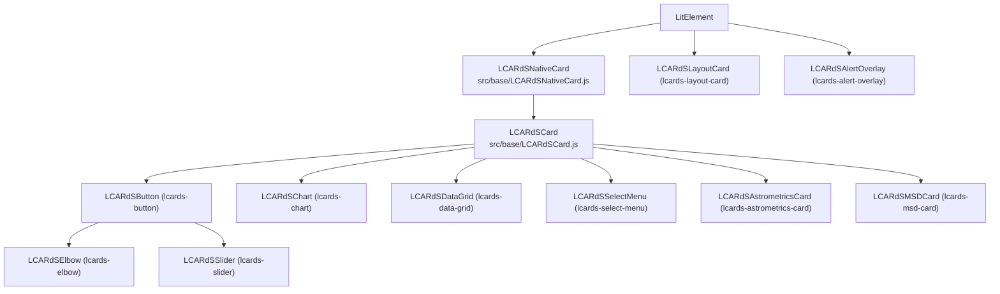
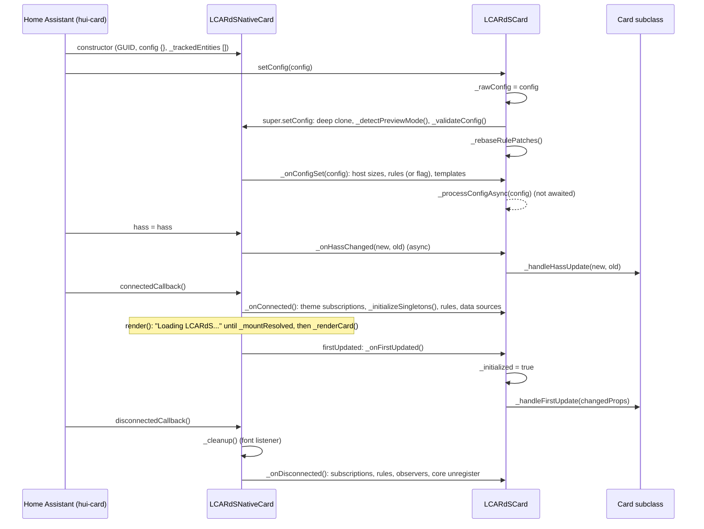
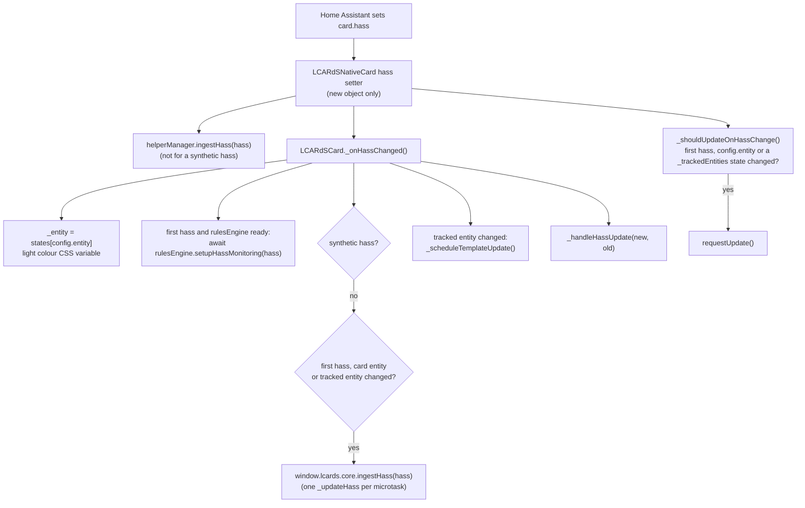
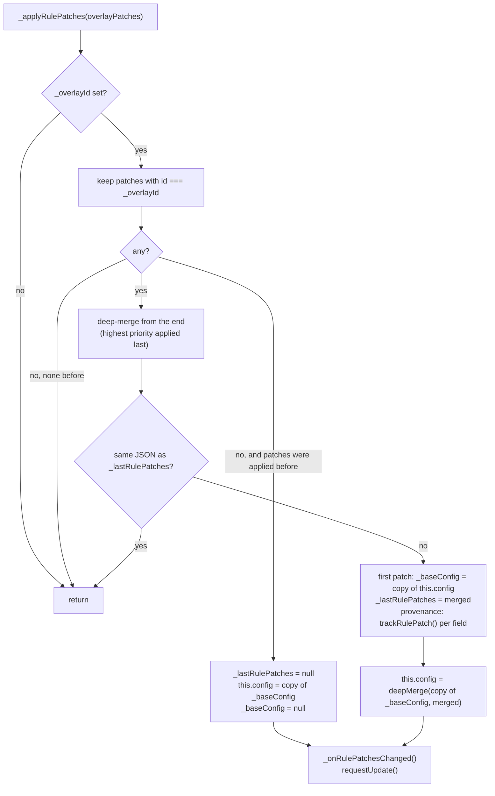

# Card Foundation

> **The base classes every LCARdS card is built on**: `LCARdSNativeCard` (the Home Assistant card contract) and `LCARdSCard` (core singletons, config processing, templates, entities, actions, rules and cleanup).
> **Source**: `src/base/LCARdSNativeCard.js`, `src/base/LCARdSCard.js`, `src/base/LCARdSActionHandler.js`
> **Rules for card code**: `.github/instructions/cards.instructions.md`

---

## Overview

A Home Assistant custom card is a custom element with `setConfig(config)`, a `hass` property and `getCardSize()`. LCARdS splits the base into two layers:

- **`LCARdSNativeCard`** (`src/base/LCARdSNativeCard.js`) extends `LitElement` and implements that contract: a deep-cloned `config`, a `hass` setter that decides whether a re-render is needed, the host size keys (`height`, `width`, `min_*`, `max_*`, `overflow*`, `z_index`), a per-instance GUID, preview-mode detection, font loading, an error state, and a set of protected hooks (`_onConfigSet`, `_onHassChanged`, `_onConnected`, `_onDisconnected`, `_onFirstUpdated`, `_onUpdated`, `_renderCard`, `_getCardSize`, `_getGridOptions`, `_validateConfig`).
- **`LCARdSCard`** (`src/base/LCARdSCard.js`) extends it with the LCARdS feature set: access to the core singletons (`this._singletons`), config processing through `CoreConfigManager`, entity subscriptions, HASS forwarding to the core, templates, theme and colour helpers, actions (a per-card `LCARdSActionHandler`), the rules integration, data source dependencies, auto-sizing, zones, segments, provenance and the cleanup on disconnect. It overrides the native hooks and exposes a second, card-facing set (`_handleFirstUpdate`, `_handleHassUpdate`, `_onConfigUpdated`, `_onRulePatchesChanged`, `_processCustomTemplates`, `_onAlertModeChanged`).

The cards on top of them:



`lcards-layout-card` and `lcards-alert-overlay` extend `LitElement` directly and use none of the foundation below (see [Layout View and Layout Card](../layout-view.md)). The layout view (`lcards-layout-view`) and the shell strategy are not cards (see [Shell Strategy](../shell-strategy.md)). The MSD card adds its own pipeline on top of `LCARdSCard` (see [MSD Pipeline](../msd/)), and the chart and astrometrics cards have pages of their own ([Charts](../charts.md), [Astrometrics](../astrometrics.md)).

---

## Required static members

```javascript
export class LCARdSMyCard extends LCARdSCard {
    /** CoreConfigManager schema and preset lookup key */
    static CARD_TYPE = 'my-card';

    /** Minimal config for the Home Assistant card picker */
    static getStubConfig() {
        return { type: 'custom:lcards-my-card', entity: 'light.example' };
    }

    /** Editors are lazy chunks: import on demand, keep them out of the main bundle */
    static async getConfigElement() {
        await import('../editor/cards/lcards-my-card-editor.js');
        return document.createElement('lcards-my-card-editor');
    }
}
```

- **`CARD_TYPE`**: `_processConfigAsync()` passes it to `configManager.processConfig(rawConfig, cardType, { hass })`; without it the card falls back to `rawConfig.type` and gets no schema validation or preset merge for its type.
- **`registerSchema()`** (optional static): `src/lcards-main.js` calls it for each card after the core has initialised, to register the card's JSON Schema with `configManager.registerCardSchema()`.
- **Registration**: the card element is defined in `src/lcards-main.js` only, behind a `customElements.get()` guard; the card picker metadata is the `LCARdSCardClasses` array in the same file, pushed once into `window.customCards`. Editors register themselves in their own file. See [Adding new cards](#adding-a-new-card).

---

## Lifecycle

Home Assistant creates a card, configures it, hands it `hass` and then attaches it. `hui-card` normally calls `setConfig()` and sets `hass` before the element is connected, so the first `_onHassChanged()` usually runs before `_onConnected()`, when `this._singletons` is still `null`. The base handles that order (rules and data sources are deferred to `_onConnected()`); card code in `_handleHassUpdate()` must not assume the singletons are there on the first call.



### Hooks on `LCARdSNativeCard`

| Hook | Called from | Base behaviour |
|---|---|---|
| `_onConfigSet(config)` | `setConfig()`, after the clone and validation | Applies `height`, `width`, `min_height`, `min_width`, `max_height`, `max_width`, `overflow`, `overflow_x`, `overflow_y` and `z_index` to the host style (a bare number is px); keeps the layout-card margin correction (`_parentMarginV`) when no height is set |
| `_validateConfig(config)` | `setConfig()` | Throws when `type` is missing. A throw from `setConfig()`'s body is caught and shown as the red "LCARdS Error" box (`_errorState`) instead of breaking the dashboard |
| `_onHassChanged(newHass, oldHass)` | The `hass` setter, when a new HASS object arrives | No-op |
| `_onConnected()` / `_onDisconnected()` | `connectedCallback()` / `disconnectedCallback()` (after `_cleanup()`) | No-op |
| `_onFirstUpdated(changedProps)` | `firstUpdated()`, after `_mountResolved = true` | No-op |
| `_onUpdated(changedProps)` | `updated()`, when `config` or `hass` changed | No-op |
| `_renderCard()` | `render()`, inside `<div class="lcards-card">`, once the mount is resolved and there is no error state | Placeholder text |
| `_getCardSize()` | `getCardSize()` | `1` |
| `_getGridOptions()` | `getGridOptions()` | `{}` |

`render()` also adds an empty `.lcards-size-ref` div after the card: `_setupAutoSizing()` observes it rather than the host, so the SVG's own pixel size never feeds back into the measured size.

Other members: `getCardGuid()`, `isPreviewMode()`, `isMountResolved()`, `getMountElement()` (the shadow root), `_configPx(value)` (a px number from `400`, `"400"` or `"400px"`, `null` for relative units), `_checkForAncestor(tags)` (walks up through shadow roots).

### Hooks on `LCARdSCard`

`LCARdSCard` implements every native hook and gives subclasses these instead. Override them, call `super` where the table says so.

| Hook | When | Notes |
|---|---|---|
| `_handleFirstUpdate(changedProps)` | Once, from `_onFirstUpdated()` after `_initialized = true` | Register for rules, set up actions, `_setupAutoSizing()`. Runs **once per element**: a reconnect does not call it again |
| `_handleHassUpdate(newHass, oldHass)` | Every new HASS object, at the end of `_onHassChanged()` | Called even when nothing the card uses changed; check the entities you care about |
| `_onConfigUpdated()` | After `_processConfigAsync()` has replaced `this.config` with the merged config | Re-resolve styles and caches from the merged config |
| `_onRulePatchesChanged()` | After `_applyRulePatches()` changed or cleared this card's patches. **No arguments** | `this.config` already carries the patches (or is restored) |
| `_processCustomTemplates()` | From `_processTemplates()`, after the icon is processed | Evaluate the card's own template fields |
| `_onAlertModeChanged(mode)` | When an alert mode rewrites the palette | Default: `_reprocessForThemeChange()` and `_refreshBackgroundAnimationColors()`; override for a cheaper repaint |
| `_getAnimationSetup()` | `setupActions()`, rules registration, disconnect | Returns `{ overlayId, elementSelector }`; the default scope id is `lcards-card-{guid}` |
| `_applyRuleResults(results)` | After every rules callback | No-op; the MSD card applies its `base_svg` filters here |
| `_onConnected()` / `_onDisconnected()` | As above | When overriding: call `super._onConnected()` **first**, `super._onDisconnected()` **last** |
| `_renderCard()` | Every render | Shows "Initializing..." until `_initialized`; subclasses must override |

`_onConnected()` is `async` (it awaits `setupHassMonitoring()`), but everything up to and including `_initializeSingletons()` and the rules load runs synchronously, so a subclass that calls `super._onConnected()` without awaiting it can use `this._singletons` on the next line.

---

## Config processing

`setConfig()` must be synchronous for Home Assistant, so `LCARdSCard.setConfig()` does the quick work and starts the rest in the background:

1. `_rawConfig = config` (the untouched, frozen config Home Assistant passed).
2. `super.setConfig(config)`: `this.config` becomes a deep clone, preview mode is detected, `_onConfigSet()` runs with the **raw** config.
3. `_rebaseRulePatches()`: when a rule patch is active, the new config becomes the unpatched base and the patch is applied to it again (see [Applying patches](#applying-patches)).
4. `_configProcessingPromise = _processConfigAsync(config)`, not awaited.

`_onConfigSet()` (LCARdSCard override) stores `_entity` when `hass` is present, sets the card's rules (or flags them for `_onConnected()`, see [Rules](#rules-integration)), registers template data source dependencies when the singletons are ready, and processes templates (`_processTemplates()` before the first update, `_scheduleTemplateUpdate()` after).

`_processConfigAsync(rawConfig)` returns at once when `core.configManager` is not initialised, and `this.config` stays the plain clone. In practice it is ready: `src/lcards-main.js` defines the card elements only after `lcardsCore.initialize()` has resolved. Otherwise it awaits `configManager.processConfig(rawConfig, CARD_TYPE, { hass })`, which merges card defaults, theme defaults, the preset, the component and the user config with provenance (see [Config Manager](../subsystems/config-manager.md)), and then:

- logs validation errors and warnings (it applies the merged config even when validation failed);
- drops the result when a newer run started meanwhile (`_configRunId`; theme override events start new runs);
- sets `this.config = result.mergedConfig`, re-scans `_trackedEntities`, records provenance, calls `_onConfigUpdated()` and `requestUpdate()`;
- creates the card's `data_sources:` (`_processDataSourcesConfig()`, which needs `dataSourceManager`; `_onConnected()` retries when the singletons were not ready).

Subclasses that need the merged config before they continue await `this._configProcessingPromise` (the chart does).

**Theme changes.** `processConfig()` bakes resolved `theme:` values into `this.config`, so a plain re-render would keep stale colours. `_subscribeThemeChanges()` (from `_onFirstUpdated()` and every `_onConnected()`) listens for `lcards:theme-overrides-changed` on `window` and subscribes to `themeManager.subscribeToAlertMode()`; both lead to `_reprocessForThemeChange()`, which re-runs `_processConfigAsync(_rawConfig)`.

---

## HASS flow



- **Re-render gate.** The setter always calls `_onHassChanged()`, but calls `requestUpdate()` only when `_shouldUpdateOnHassChange()` says so: on the first HASS, or when the state object of `config.entity` or of any `_trackedEntities` entry changed (Home Assistant replaces a state object when it changes, so `!==` is enough). An unrelated entity change costs no render.
- **Forwarding to the core** is gated the same way. One forwarded HASS updates every service, and `CoreSystemsManager.updateHass()` diffs all entities, so changes to entities no card forwarded for are still delivered. The distribution order, the microtask deduplication and the global HASS feed for pages without cards are documented in [HASS distribution](../subsystems/index.md#hass-distribution) and [Systems Manager: HASS Update Flow](../subsystems/systems-manager.md#hass-update-flow).
- **Synthetic HASS.** A parent card may hand a child a rewritten HASS copy for that child only (the select menu does for its option buttons). `isSyntheticHass()` (`src/utils/synthetic-hass.js`) marks it; such a copy never reaches the core or the helper manager.
- **Ordering.** `_onHassChanged()` is `async`: on the first HASS it awaits `setupHassMonitoring()` before it forwards and calls `_handleHassUpdate()`.

### `_trackedEntities`

`_updateTrackedEntities()` runs after every merged config and collects:

- `config.entity`;
- `entity` of `on_entity_change` animations;
- `when.entity` of rules, including the direct children of a top-level `all` / `any` (deeper nesting is not scanned; the Rules Engine has its own subscription, so this only affects forwarding and re-render);
- every Jinja2 entity reference found in any config string (`TemplateParser.extractJinja2Entities()`);
- every `map_range.entity` anywhere in the config;
- `triggers_update` entries, the escape hatch for JavaScript templates (`[[[...]]]` is never scanned).

Subclasses extend it (`super._updateTrackedEntities()` first): the elbow adds its segment entities; the slider, data grid and astrometrics card add their own.

---

## Entity access

```javascript
// Event-driven: unsubscribed automatically on disconnect
this.subscribeToEntity(entityId, (id, newState, oldState) => {
    this._value = newState?.state;
    this.requestUpdate();
});

// Snapshot (cache first, then hass.states)
const state = this.getEntityState('sensor.temperature');
const own = this.getEntityState(); // config.entity
```

- **`subscribeToEntity(entityId, callback)`** calls `systemsManager.subscribeToEntity(entityId, callback, this._cardGuid)` and keeps the unsubscribe function in `_entitySubscriptions`. It returns an unsubscribe that also removes it from that set. Without the singletons (before `_onConnected()`) it warns and returns a no-op. The callback is **not** called on subscribe: it fires when `CoreSystemsManager.updateHass()` sees the entity change (with `oldState` `null` the first time the entity enters the cache, `newState` `null` when the entity is removed). Read the current value with `getEntityState()`.
- **Reconnects.** `_onDisconnected()` drops every subscription, and `_handleFirstUpdate()` never runs again, so a card that subscribes there loses its subscriptions after the first disconnect (Home Assistant disconnects cards on edit mode, view changes and moves). Subscribe from a method you also call in `_onConnected()` when `_initialized` is true, as the elbow does for its segment entities (`_subscribeSegmentEntities()`, `src/cards/lcards-elbow.js`).
- **`this._entity`** is the state object of `config.entity`, refreshed on every HASS (and from `hass` in `_onConfigSet()`). Most cards render from it plus `_trackedEntities`, which already re-render the card.
- **Display helpers**: `_getStateDisplay(entity)`, `_getEntityName(entity)`, `_getAttributeDisplay(key, entity)` and `_getAttributeName(key, entity)` wrap `src/utils/ha-entity-display.js` (see [Home Assistant Entity Display](../internals/ha-entity-display.md)). Never call `hass.format*()` directly.
- **Exception: history.** The chart needs history for a time window, so `src/charts/chart-series-fetcher.js` subscribes to Home Assistant's `history/stream` (and `recorder/statistics_during_period`) on `hass.connection` itself and stops in `_onDisconnected()`. See [Charts](../charts.md).

The systems manager's cache, change detection and subscription semantics are in [Systems Manager](../subsystems/systems-manager.md).

---

## Templates

- **`processTemplate(template, options)`** evaluates one string with all four template types (JavaScript `[[[...]]]`, tokens `{entity.state}`, data sources `{ds:name}`, Jinja2 `{{ ... }}`) through `UnifiedTemplateEvaluator.evaluateAsync()`. Options: `displayFormat` (`friendly`, `raw`, `parts`, `unit`), `field` (provenance path), `entity` (evaluate against another entity, `null` for none) and `extra` (more names for the template).
- **`_processTemplates()`** runs `_processIcon()`, clears the style template cache (`_evaluatedStyleCache`) and calls `_processCustomTemplates()`. **`_scheduleTemplateUpdate()`** batches it into the next animation frame and re-renders afterwards; tracked entity changes, data source updates and config changes call it.
- **`_preEvaluateStyleTemplates(obj)`** / **`_resolveTemplateValue(value)`**: evaluate Jinja2 and JavaScript templates in style values ahead of time, so the synchronous SVG builders can read the results.
- **Data sources in templates.** `_registerTemplateDatasourceDependencies()` finds `{ds:...}` references in the config, waits up to 5 s for each source, registers the card as a dependent (`createDataSource()` with the source's own config) and subscribes, so a new value schedules a template update.

Syntax and evaluator internals: [Template System](../subsystems/template-system.md).

---

## Theme, colours and presets

| Member | Purpose |
|---|---|
| `getThemeToken(path, fallback, usedByField)` | `themeManager.getToken(path, fallback)`, recorded in provenance |
| `getStylePreset(type, name)` | `stylePresetManager.getPreset(type, name, themeManager)` |
| `_resolveColorValue(value, fallback)` | A concrete colour (for SVG attributes, Canvas2D, anime.js): `resolveColor(value, { concrete: true, element })` |
| `_resolveEntityStateColor(colorConfig, fallback)` | A state-keyed colour map resolved for the card's entity, kept as CSS (`var()` stays live, so alert modes recolour without a re-render) |
| `_classifyEntityState(entity)` / `_resolveStateValue(options)` | The state key (`active`, `inactive`, `unavailable`, ...) a state-keyed map is read with |

Colour syntax lives only in `src/core/themes/color-syntax.js`; see `.github/instructions/state-color.instructions.md` and [Theme System](../subsystems/theme-system.md). Theme tokens are always read through `window.lcards.core.themeManager`, never a module import.

---

## Actions, sounds and services

```javascript
_handleFirstUpdate() {
    super._handleFirstUpdate();
    const el = this.shadowRoot.querySelector('.interactive');
    this._actionCleanup?.();
    this._actionCleanup = this.setupActions(el, {
        tap_action: this.config.tap_action,
        hold_action: this.config.hold_action,
        double_tap_action: this.config.double_tap_action
    });
}
```

- **One handler per card.** The constructor creates `this._actionHandler = new LCARdSActionHandler()`; there is no shared core action handler. `setupActions(element, actions, options)` adds the card's `animations`, `getAnimationSetup`, `shadowRoot`, the entity (`options.entity` first, then `config.entity`), `getHass` and the card-level sound overrides (`_cardSoundOverride()`, from `config.sounds`), and calls `this._actionHandler.setupActions(element, actions, this.hass, options)`. It also registers the card's animation scope with the [Animation Manager](../subsystems/animation-manager.md), so rules can animate the card even when it has no `animations:`.
- **Cleanup.** `setupActions()` returns a function that removes the listeners. The base class does not keep or call it: the listeners live on the card's own shadow DOM elements. A card that rebuilds the element or rebinds (the button does on config changes) calls the previous cleanup first.
- **`_playSound(eventType)`** plays a sound for direct call sites (slider drags, toggles), honouring `config.sounds`.
- **`callService(domain, service, data)`** wraps `hass.callService()` with logging and error handling. Use it instead of `this.hass.callService()`.

Gestures, dispatch and the supported actions: [Action Handler](../subsystems/action-handler.md).

---

## Rules integration

Rules are page-wide: every card's `rules:` go into the one shared [Rules Engine](../subsystems/rules-engine.md), and any rule can patch any registered card. A card takes part in two separate ways: it **owns** the rules in its config, and it **registers** itself as a target.

### Owning rules

- `_onConfigSet()` calls `_loadRulesFromConfig(config.rules)` on every config change when the singletons are ready, and with `[]` when a card that had rules has none left. Before `_onConnected()` it sets `_hasRulesToLoad` instead, and `_onConnected()` loads them.
- `_loadRulesFromConfig()` calls `rulesEngine.setCardRules(this._cardGuid, rules, { sourceCardId, sourceCardType })`: the card **instance** owns its rules, so a config change replaces them and an empty list removes them. `_ownsRules` records whether it holds any.
- On disconnect, `_scheduleRulesRelease()` removes them with `removeCardRules(this._cardGuid)` after `RULES_RELEASE_MS` (3000 ms, exported from `LCARdSCard.js`) if the card is still disconnected. `_onConnected()` and a later `_loadRulesFromConfig()` cancel the timer (`_cancelRulesRelease()`), so a card that Home Assistant moves or re-attaches keeps its rules; a released card sets them again on its next connect.
- The card also calls `rulesEngine.setupHassMonitoring(hass)` on its first HASS, and again in `_onConnected()` right after loading rules when HASS is already there, so the engine's `state_changed` subscription is made once rule entities are known.

### Being a target

```javascript
_handleFirstUpdate() {
    super._handleFirstUpdate();
    this._registerOverlayForRules(this.config.id || `my-card-${this._cardGuid}`, 'my-card', this.config.tags || []);
}

_onRulePatchesChanged() {
    this._resolveStyle(); // this.config now carries the patches; must end in requestUpdate()
}
```

`_registerOverlayForRules(overlayId, type, tags = [])` takes **positional** arguments. It:

1. remembers them in `_rulesRegistration`, so `_onConnected()` registers again after a reconnect (the disconnect unregistered the card, and `_handleFirstUpdate()` will not run again);
2. returns when the singletons are missing or the card is already registered (`_overlayRegistered`): one registration per card;
3. registers the overlay with `systemsManager.registerOverlay(overlayId, { id, type, tags, sourceCardId, animationScope })`, where `animationScope` is `_getAnimationSetup().overlayId`, so a rule animation aimed at the card's `id` reaches the card's animation scope;
4. registers one callback with `rulesEngine.setReEvaluationCallback()`. The callback awaits `evaluateDirty({ entity, getEntity })`, then calls `_applyRulePatches(results.overlayPatches)` and `_applyRuleResults(results)`;
5. with HASS present, calls `markAllDirty()` and runs the callback once, so a rule that already matches applies on load.

Rule YAML targets the id, a tag, the type or a pattern under `apply.overlays`:

```yaml
type: custom:lcards-button
id: bedroom_light
preset: lozenge
entity: light.bedroom
tags:
  - bedroom
rules:
  - id: bedroom_light_on
    when:
      entity: light.bedroom
      state: "on"
    apply:
      overlays:
        tag:bedroom:
          style:
            card:
              color:
                background: var(--lcars-green)
```

### Applying patches

`_applyRulePatches(overlayPatches)` (base behaviour; the MSD card overrides it for all its overlays):



- A patch can change any config key (`style`, `text`, `icon`, ...), not only `style`, because it is merged onto the whole config. Every cycle starts from the `_baseConfig` snapshot, so patches never accumulate.
- When no rule patches the card any more, `this.config` is restored from the snapshot.
- **A new config keeps the patch.** Whenever `this.config` is replaced while a patch is active (`setConfig()`, and `_processConfigAsync()` committing its merged config: a theme override change, an alert mode re-process), `_rebaseRulePatches()` takes the new config as `_baseConfig`, merges the active patch onto a copy and calls `_onRulePatchesChanged()`. Without it the next rules callback would see the same patch, return early, and the rule styling would be gone until the patch changed.
- `_getMergedStyleWithRules(style)` deep-merges the patch's **`style`** (`_lastRulePatches.style`) onto `style` and returns it (unchanged when there is no patch). The button, slider, chart and data grid call it as the last step of style resolution, so a rule also wins over defaults the card added after reading `this.config.style` (theme tokens, state opacity). Other patched keys (`text`, `icon`, ...) are read from `this.config`. The select menu merges `this._lastRulePatches?.style` itself.
- `_unregisterOverlayFromRules()` (from `_onDisconnected()`) removes the callback and unregisters the overlay; when a patch is applied it restores `this.config` from `_baseConfig` first and calls `_onRulePatchesChanged()`. A reconnect registers again and snapshots that unpatched config, so a patch never sticks after the rule stops matching.
- **Removed rules.** Removing a card's rules from the shared engine (`setCardRules()`, also on a config edit that takes a rule out) runs the rules callbacks even when no rule is left dirty, so cards the rule patched restore their config.

**Rendering rules for patched styles**: write patched values as inline styles or attributes, not into a static `<style>` block, and never use `!important` in static CSS for properties a rule may patch.

---

## Sizing

- **Card size.** Override `_getCardSize()` when the card is taller than one row, e.g. `return Math.ceil((this._configPx(this.config?.height) || 200) / 50);` (the chart and MSD do this).
- **Host size keys.** `height`, `width`, `min_*`, `max_*`, `overflow*` and `z_index` are applied to the host by `LCARdSNativeCard._onConfigSet()`; an explicit `height` / `width` sets the matching `min-*` to `0px`.
- **`_setupAutoSizing(onResize)`** (call from `_handleFirstUpdate()`): a `ResizeObserver` on `.lcards-size-ref` stores `this._containerSize = { width, height }` and calls `onResize(width, height)` (default: `requestUpdate()`). The first measurement waits one animation frame (parents such as the layout card inject margins in their own first update); later ones are debounced (150 ms) with a 2 px hysteresis. It also detects a parent `card_margin` and sets `calc(100% - Npx)` on the host (`_parentMarginV`). Inside an MSD `foreignObject` it locks `_containerSize` to the design size instead. `_onConnected()` re-creates the observer after a reconnect.
- Sizing inside nested grids (`hui-card`, layout card and view tracks) follows the rules in `.github/instructions/cards.instructions.md` ("Sizing in Nested Grids").

---

## Preview mode

`this._isPreviewMode` is set by `_detectPreviewMode()`: `true` when `hui-card` set `.preview` or `.editMode` on the card, the dashboard is in edit mode, the card is inside `hui-card-picker` or `hui-dialog-edit-card`, or the URL contains `edit=1`. It runs in `setConfig()` and again in `LCARdSNativeCard.connectedCallback()` on every connect; when the result changed, the card re-renders.

`hui-card` calls `setConfig()` (inside `tryCreateCardElement()`) before it sets `preview` on the card and before it attaches it (`src/panels/lovelace/cards/hui-card.ts` in the Home Assistant frontend), so on a card's **first** config the detection in `setConfig()` finds no parent and no `preview` property and returns `false`; the check on connect sees both. Subclasses that override `_detectPreviewMode()` (the MSD's tiers) get the same second check. Because `hui-view` sets `preview` on every card while the dashboard is in edit mode, `true` also means "dashboard edit mode": the select menu shows its picker placeholder only for `_checkForAncestor(['hui-card-picker'])` (`_isInCardPicker`), not for every preview.

Use it for work that is decided again later (the background renderer skips its off-screen `IntersectionObserver` in previews). Do not skip one-time setup in `_handleFirstUpdate()` on it: that hook runs once per element, and a dashboard card leaves edit mode without being created again. To skip setup only in the card picker, which a card never leaves:

```javascript
_handleFirstUpdate() {
    super._handleFirstUpdate();
    if (this._checkForAncestor(['hui-card-picker'])) return;
    this._startExpensiveSetup();
}
```

The MSD card overrides `_detectPreviewMode()` and returns `'picker'` / `'editor'` instead of `true`; only `lcards-msd.js` relies on that form.

---

## Zones and segments

- **Zones** are named rectangles text fields are placed in (`zone: <name>`). Cards override `_calculateZones(width, height)` and call `_rebuildZones(width, height)` at the top of each render, which recalculates and merges user zones (`_mergeUserZones()`). `_generateZoneTextMarkup()`, `_generateZoneDebugMarkup()` and `_injectTextFieldsToElement()` are defined on `LCARdSButton` (so the button, elbow and slider have them), not on `LCARdSCard`.
- **Segments**: `_extractSegmentIds()`, `_processSegmentConfig()`, `_setupSegmentInteractivity()` and `_attachSegmentActions()` give each SVG element with an id its own style and actions (button component mode).

See `.github/instructions/cards.instructions.md` ("Zone System") for the rules.

---

## Cleanup on disconnect

`LCARdSNativeCard.disconnectedCallback()` calls `_cleanup()` (removes the font `loadingdone` listener), then `_onDisconnected()`. `LCARdSCard._onDisconnected()` then:

- removes the card from `LCARdSCard.findByConfig()`'s set of connected cards;
- unsubscribes data source subscriptions and removes the card from each data source it registered with (`removeCardFromSource()`);
- unsubscribes every `subscribeToEntity()` subscription;
- unregisters from rules (`_unregisterOverlayFromRules()`) and schedules the release of its own rules (`_scheduleRulesRelease()`);
- removes the light colour CSS variable;
- disconnects the `ResizeObserver` and the window resize fallback;
- drops the theme override listener and the alert-mode subscription;
- calls `core.unregisterCard(this._cardGuid)` (which also unregisters it from the systems manager);
- destroys the default animation scope (`animationManager.destroyOverlayScope(_getAnimationSetup().overlayId)`); cards with more scopes (button, slider) destroy their own.

Cards override `_onDisconnected()` only for their own resources (timers, `AbortController`s, third-party instances, the chart's series fetcher) and call `super._onDisconnected()` last. They must not repeat the calls above.

Everything set up in `_handleFirstUpdate()` that the list removes must be set up again in `_onConnected()` when `_initialized` is true. The base already does this for rules registration, auto-sizing, theme subscriptions, data sources and singletons; card-level entity subscriptions are the card's job (see [Entity access](#entity-access)).

---

## Adding a new card

1. Create `src/cards/lcards-mycard.js` extending `LCARdSCard`, with `static CARD_TYPE`, `static getStubConfig()` and a lazy `static getConfigElement()`.
2. Create the editor at `src/editor/cards/lcards-mycard-editor.js` extending `LCARdSBaseEditor`; it registers its own element behind a `customElements.get()` guard.
3. Register the card element in `src/lcards-main.js` with the guard, add `{ type, name, description, ... }` to `LCARdSCardClasses` there, and call your `registerSchema()` with the others.
4. Add the schema to `scripts/lib/card-schemas.js` (doc validation, description check, published schema); every property needs a `description`.
5. Override `_getCardSize()` when the card has a pixel height.
6. Run `npm run build` and test in Home Assistant.

---

## Debugging

```javascript
window.lcards.setGlobalLogLevel('debug');      // every [LCARdSCard] / [RulesEngine] log line
window.lcards.core.systemsManager.getEntityState('light.bedroom');
window.lcards.core.rulesManager.rules;         // every loaded rule, with _sourceCardId
```

- A card's merged config and where each value came from: `card.getProvenance()`, `card.debugProvenance()`, `card.printConfigTree()` (see [Config Manager](../subsystems/config-manager.md)).
- The rules a card currently receives: `card._lastRulePatches`; its registration: `card._overlayId`, `card._rulesRegistration`.
- Rule evaluation traces and the console API are in [Rules Engine: Console access](../subsystems/rules-engine.md#console-access).

---

## API reference

### `LCARdSCard` state

| Property | Type | Description |
|---|---|---|
| `config` | Object | The working config: the deep clone from `setConfig()`, replaced by the merged config, then patched by rules |
| `_rawConfig` | Object | The config Home Assistant passed (frozen) |
| `_entity` | Object \| null | State object of `config.entity` |
| `_singletons` | Object \| null | `{ systemsManager, themeManager, rulesEngine, animationManager, dataSourceManager, validationService, stylePresetManager }`, set in `_onConnected()` (`_initializeSingletons()`). `rulesEngine` is `core.rulesManager` |
| `_initialized` | boolean | `true` from the first update on |
| `_trackedEntities` | `string[]` | Entities that re-render the card and forward HASS to the core |
| `_entitySubscriptions` | `Set<Function>` | Unsubscribe functions of `subscribeToEntity()` |
| `_actionHandler` | `LCARdSActionHandler` | This card's action handler |
| `_overlayId`, `_overlayTags` | string, `string[]` | The rules registration of this card |
| `_overlayRegistered` | boolean | Registered as a rules target |
| `_rulesRegistration` | Object \| null | The last `_registerOverlayForRules()` arguments, for reconnects |
| `_ownsRules`, `_hasRulesToLoad` | boolean | This card's rules are in the engine / are waiting for `_onConnected()` |
| `_lastRulePatches` | Object \| null | The merged rule patch currently applied |
| `_baseConfig` | Object \| null | `config` without the active patch (taken on the first patch, renewed when the config is replaced), restored when patches clear or the card disconnects |
| `_containerSize` | `{ width, height }` | Last measured size (with `_setupAutoSizing()`) |
| `_configProcessingPromise` | Promise | The running `_processConfigAsync()` |

### `LCARdSCard` methods

| Method | Returns | Description |
|---|---|---|
| `getEntityState(entityId?)` | Object \| null | Cached state (systems manager), else `hass.states`; defaults to `config.entity` |
| `subscribeToEntity(entityId, callback)` | Function | Subscribe; auto-unsubscribed on disconnect |
| `callService(domain, service, data?)` | Promise | Service call with logging |
| `setupActions(element, actions, options?)` | Function | Tap, hold, double-tap, hover; returns the cleanup |
| `processTemplate(template, options?)` | `Promise<string>` | Evaluate all four template types |
| `getThemeToken(path, fallback?, usedByField?)` | any | Theme token, recorded in provenance |
| `getStylePreset(type, name)` | Object \| null | A style preset |
| `_registerOverlayForRules(overlayId, type, tags?)` | void | Register as a rules target (once per card) |
| `_getMergedStyleWithRules(style)` | Object | `style` deep-merged with the current rule patch's `style` (see [Applying patches](#applying-patches)) |
| `_rebaseRulePatches()` | void | After `this.config` was replaced: new base snapshot, active patch applied again |
| `_applyRulePatches(overlayPatches)` | void | Apply this card's patches to `config` (see above) |
| `_setupAutoSizing(onResize?)` | void | Container size tracking |
| `_rebuildZones(width, height)` | void | Recalculate zones before rendering |
| `getProvenance(path?)`, `debugProvenance()`, `printConfigTree()` | various | Provenance inspection |
| `static findByConfig(config)` | LCARdSCard \| null | The connected card rendered from this config (the editor preview when there are two) |

---

## See also

- [Core Subsystems](../subsystems/) (initialization order, HASS distribution)
- [Systems Manager](../subsystems/systems-manager.md)
- [Rules Engine](../subsystems/rules-engine.md)
- [Action Handler](../subsystems/action-handler.md)
- [Animation Manager](../subsystems/animation-manager.md)
- [Config Manager](../subsystems/config-manager.md)
- [Template System](../subsystems/template-system.md)
- [Theme System](../subsystems/theme-system.md)
