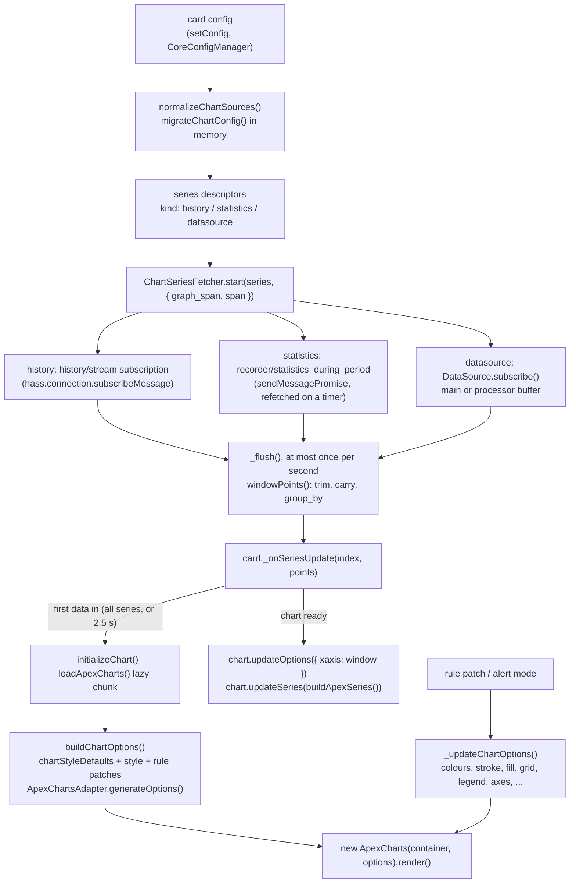

# Chart Pipeline

> Internal architecture of `lcards-chart`: how `sources[]` become an ApexCharts chart that follows Home Assistant history live.

---

## Overview

The chart card (`src/cards/lcards-chart.js`, `LCARdSChart extends LCARdSCard`, `CARD_TYPE = 'chart'`) draws with [ApexCharts](https://apexcharts.com) 7 (`apexcharts` `^7.8.0` in `package.json`). Everything that is not the card element lives in `src/charts/`, as small modules that are mostly pure functions and are unit-tested in `tests/charts/`:

| Module | Role |
|---|---|
| `chart-config-migration.js` | `migrateChartConfig()`: rewrites legacy chart configs into the canonical `sources[]` form. Pure, idempotent, no imports |
| `chart-sources.js` | `normalizeChartSources()`: migrates, then turns `sources[]` into series descriptors with a `kind` (`history`, `statistics`, `datasource`); `arrayChartProblem()` for range, box and candlestick types |
| `chart-span.js` | `parseDuration()`, `computeSpan()`: the time window from `graph_span` and `span` |
| `chart-group-by.js` | `groupBy()`: buckets points (`avg`, `min`, `max`, `first`, `last`, `sum`, `median`, `delta`, `diff`, and the array functions `minmax`, `box`, `ohlc`) |
| `chart-series-fetcher.js` | `ChartSeriesFetcher`: loads every series, keeps it live, trims it to the window, throttles delivery |
| `chart-options-builder.js` | `buildChartOptions()`, `buildApexSeries()`, `windowAxis()`, `timeAxisData()`, `chartStyleDefaults()`: the complete ApexCharts options, shared by the card and the docs demos (`doc/.vitepress/theme/ChartDemo.vue`) |
| `chart-time-labels.js` | `toWallClock()`, `pointsToWallClock()`, `chartTimeZone()`, `datetimeFormats()`, `tooltipTimeFormatter()`: time labels in Home Assistant's zone and clock |
| `ApexChartsAdapter.js` | `ApexChartsAdapter.generateOptions()`: maps the card's `style` tree to ApexCharts options (per-type defaults, axes, legend, annotations, formatters, `chart_options` last) |

User-facing configuration: [Chart card](../cards/chart/) (series and time: [Series and Time](../cards/chart/series.md); old configs: [Upgrading](../cards/chart/upgrading.md)).

---

## Flow



1. **Config.** `setConfig()` tears down any existing chart (`chart.destroy()`, generation counter bumped so a stale async init is dropped), calls `LCARdSCard.setConfig()` (CoreConfigManager merges `CHART_CARD_DEFAULTS`: `chart_type: line`, `height: 300`), and restarts loading once the card has had its first update.
2. **First update.** `_handleFirstUpdate()` registers the card for rules (`_registerOverlayForRules(config.id || 'chart-<guid>', 'chart', tags)`) and calls `_startLoading()`.
3. **Loading.** `_startLoading()` (`lcards-chart.js:233`) normalizes the sources, shows the static SVG preview instead when there are no series or the card is inside `hui-card-picker`, waits for config processing (card-local `data_sources` must exist before a datasource series attaches), and starts a `ChartSeriesFetcher`. A run counter makes sure only the latest call starts a fetcher.
4. **First draw.** The chart is not created on the first series: drawing one series and adding the others as they arrive rescales the axis mid-animation. `_onSeriesUpdate()` waits until every series has delivered once, or `FIRST_DATA_WAIT_MS` (2500 ms) with whatever arrived, then sets `_dataArrived`; `updated()` calls `_initializeChart()` once `.chart-container` has a real size.
5. **Init.** `_initializeChart()` builds the options, awaits `loadApexCharts()`, checks the card was not reconfigured or disconnected meanwhile, creates and renders the chart, and starts a `ResizeObserver` on the card container (100 ms debounce, 2 px hysteresis) that re-sends size, `plotOptions` and `grid`.
6. **Live.** Later updates go straight to `chart.updateOptions({ xaxis: windowAxis() })` (the moving window) and `chart.updateSeries(buildApexSeries())`, with animations off for both calls.

---

## The `sources[]` model

Each `sources[]` item is one series. `normalizeChartSources()` (`src/charts/chart-sources.js:40`) drops items with neither `entity` nor `datasource` and gives the rest a `kind`:

| Item | `kind` | Data |
|---|---|---|
| `{ entity, attribute? }` | `history` | Recorder state history for the window, then live changes |
| `{ entity, statistics: { type, period } }` | `statistics` | Long-term statistics (`type` default `mean`, `period` default `hour`). For `chart_type: rangeArea` without `group_by`, `fetchMinMax` fetches `min` and `max` per period instead |
| `{ datasource, buffer? }` | `datasource` | An LCARdS DataSource: its main buffer, or the processor buffer named by `buffer`. The source can be card-local (`data_sources`) or defined by another card |

Every kind also takes `group_by: { func, duration, fill }` and the display keys (`name`, `unit`, `float_precision`, `type`, `curve`, `stroke_width`, `stroke_dash`, `color`, `opacity`, `yaxis_id`). The `ChartSeries` typedef in `chart-sources.js` lists them.

**Array chart types.** `rangeArea`, `rangeBar`, `boxPlot` and `candlestick` need array points (`ARRAY_CHART_TYPES`). `arrayChartProblem()` returns the message the card shows over the chart when a series cannot produce them: `rangeArea` needs `group_by.func: minmax` (or statistics, which fetch min/max), `boxPlot` needs `box`, `candlestick` needs `ohlc`, and `rangeBar` has no builder yet.

**Display.** `_seriesDisplay()` names a series `name`, else the entity's `friendly_name`, else the entity id, else `<datasource> (<buffer>)`; the unit is `unit`, else the entity's `unit_of_measurement` (not for an attribute series).

---

## Series fetcher (`ChartSeriesFetcher`)

`src/charts/chart-series-fetcher.js`. Constructed by the card with `getHass`, `getDataSourceManager`, `onUpdate(index, points)`, a log id, and the default `throttleMs` of 1000.

### Entity history: `history/stream`

`_startHistory()` (`:191`) subscribes with `hass.connection.subscribeMessage(callback, message, { resubscribe: false })`:

```javascript
{
  type: 'history/stream',
  entity_ids: [series.entity],
  start_time: <window start, ISO>,
  end_time: <window end, ISO>,            // only when the window is not live
  minimal_response: !needsAttributes,
  significant_changes_only: !needsAttributes,
  no_attributes: !needsAttributes
}
```

`needsAttributes` (`historyNeedsAttributes()`, `src/core/data-sources/ha-history-utils.js:96`) is true for an `attribute` series. The first message replaces the series' points (the history for the window); every later one appends the new states (re-sorting if one arrives out of order). `historyStatesToPoints()` converts states to numeric `{ t, v }` points through `toNumericValue()` (numbers parse, on/off style states become 1/0, anything else is dropped).

Reconnects: the subscription is made with `resubscribe: false`, and the fetcher listens for the connection's `ready` event itself, recomputes the window and subscribes again, so a reconnect never replays a stale start time (the same approach as Home Assistant's own history stream helper). The `ready` listener is removed in a microtask, because removing a listener while the connection dispatches `ready` skips the next listener ([issue #381](https://github.com/snootched/lcards/issues/381)).

### Long-term statistics: `recorder/statistics_during_period`

`_startStatistics()` (`:262`) sends `{ type: 'recorder/statistics_during_period', start_time, end_time (now at the latest), statistic_ids: [entity], period, types }` with `sendMessagePromise`, maps each row's `start` and the chosen type (or `[min, max]`) to points, and refetches on a timer: every 5 minutes for `5minute` and `hour`, every hour for `day`, `week` and `month` (`STATISTICS_REFRESH_MS`).

### DataSource series

`_startDataSource()` (`:309`) looks the source up in the shared `DataSourceManager`, subscribes, and on every emit reads the whole buffer again (`getProcessorBuffer(buffer)` or the main `buffer`, `getAll()`). A source that does not exist yet (another card defines it) is retried once after 2 s. See [Data Source System](./subsystems/datasource-system.md) and [Datasource Buffers](./internals/datasource-buffers.md).

### Window and delivery

- **Window** (`computeSpan(config, now, calendar)`, `src/charts/chart-span.js`): `graph_span` (default `24h`) ending now, or aligned with `span.start` / `span.end` to the current minute, hour, day, week, month or year, shifted by `span.offset`. `live` is true when the window contains now.
- **Calendar** (`localeCalendar(hass)`, `src/utils/ha-locale.js`): the fetcher's `_computeSpan()` reads hass on every call and passes `{ timeZone, weekStart }`, resolved as Home Assistant's frontend does (`resolve-time-zone.ts`, `first_weekday.ts`). `hass.locale.time_zone: server` gives `hass.config.time_zone`, `local` (or no hass, or an unknown zone) gives undefined, meaning the browser's zone. `hass.locale.first_weekday: language` derives the day from `hass.locale.language` (`Intl.Locale` week info, else a CLDR region table), `monday`..`sunday` are explicit, and anything else is Monday. With a zone, `startOfUnit()` / `endOfUnit()` read wall-clock fields with `Intl.DateTimeFormat` and convert midnights back with a two-pass offset lookup (correct across DST changes); hours and minutes are counted back from `now`, so half-hour zones and a repeated DST hour stay right. Without a zone they use local `Date` setters, as before. The docs `ChartDemo.vue` calls `computeSpan()` without a calendar (browser zone, Monday).
- **Time labels** (`src/charts/chart-time-labels.js`, applied by `timeAxisData()` in `chart-options-builder.js`): x-axis ticks and tooltip times are in the same zone as the window. ApexCharts 7 reads datetime values only in UTC or the browser's zone, and picks its own calendar ticks only while `xaxis.labels.formatter` is unset (its `Core.js` skips the `TimeScale` otherwise and falls back to evenly divided ticks from the window start), so a label formatter cannot do it. Instead, with hass and a datetime axis (not horizontal `bar` or `rangeBar`), every point and the window `min`/`max` move to the zone's wall clock written as UTC (`toWallClock()`: 22:30 in New York becomes 22:30Z; offsets cached per quarter hour) and the axis gets `datetimeUTC: true`, so ApexCharts places and names ticks as it would in that zone. `chartTimeZone(hass)` is the profile's zone (`resolveTimeZone()`), else the browser's. `xaxis.labels.datetimeFormatter` is ApexCharts' own per-unit set, with `h:mm TT` times when `useAmPm(hass)` (`hass.locale.time_format`, as `use_am_pm.ts`); `tooltip.x.formatter` writes the date and time with `Intl.DateTimeFormat` in the user's language and clock (date only over 90 days, seconds under 10 minutes). In a DST fall-back the repeated hour would run backwards, so `pointsToWallClock()` keeps each series monotonic (that hour sits at the changeover instant). Date formats that see these values (`style.formatters.xaxis_label`, `{x|format}` in `style.formatters.tooltip`, horizontal bar time labels) go through `_formatDate(timestamp, format, hass, timeZone)`, which reads `context.timeZone`: `UTC` for wall-clock values, the zone itself for horizontal bars. User `chart_options` (such as `xaxis.labels.datetimeFormatter` or `tooltip.x`) still win. The card's live updates (`_windowAxis()`, `_buildApexSeries()`) call `timeAxisData()` too, so they match the full build. Without hass (`ChartDemo.vue`) nothing moves and ApexCharts keeps its defaults.
- **Ticks**: every 60 s (`WINDOW_TICK_MS`) the window is recomputed and every series re-delivered; an aligned window that rolled over (midnight for `span.start: day`) restarts every series.
- **Throttle**: points mark a series dirty; `_flush()` runs at most once per `throttleMs`. A rolling window is recomputed on every flush, so a point that just arrived is inside it.
- **Points per series** (`windowPoints()`): with `group_by`, `groupBy()` buckets from the window start to now; statistics are cut to the window; history and datasource series keep the last point before the window re-stamped at its start (`trimToWindow()`) and the last value carried to now (`carryToEnd()`), so lines reach both edges and an unchanged value still draws. History that scrolled out of a rolling window is dropped from memory on each flush.

`stop()` ends every subscription and timer. The card calls it from `_stopLoading()` (config change, disconnect).

---

## Options and the ApexCharts adapter

`_buildChartOptions(width, height)` (`lcards-chart.js:519`):

1. `chartStyleDefaults(getToken)` reads the theme's `components.chart.*` tokens (`colors`, `gridColor`, `axisColor`, `strokeWidth`, `fontFamily`, `fontSize`) through `themeManager.getToken()`. The card records them as `built-in` provenance for every field the config does not set.
2. The card's `style`, with rule patches (`_getMergedStyleWithRules()`), is deep-merged over those defaults: user config always wins.
3. `buildChartOptions()` (`chart-options-builder.js:121`) puts the x-axis type (`xaxis_type`, else `category` for horizontal `bar`, `datetime` for time charts) and the window `min`/`max` into `style.chart_options` (user `chart_options` still win), gives scatter series visible markers, resolves `theme:` tokens (`resolveThemeTokensRecursive`), and calls `ApexChartsAdapter.generateOptions(style, size, { hass, series, yaxis, span, timeZone })`. On a datetime axis with hass, the points, window and time label options are first moved to Home Assistant's wall clock (`timeAxisData()`, see [Window and delivery](#window-and-delivery)).
4. `generateOptions()` (`ApexChartsAdapter.js:84`) maps `style.*` (colours, stroke, fill, grid, axes, legend, markers, data labels, tooltip, theme, typography, animation presets) to ApexCharts options, applies per-type defaults (`_getChartTypeDefaults()`; radar and half gauges are fitted to the size), builds the zero line and threshold annotations, the locale (`_buildApexLocale(hass)`) and number formatting through `haFormatNumber()` ([Home Assistant Entity Display](./internals/ha-entity-display.md)), deep-merges `style.chart_options` last, and resolves every remaining CSS variable to a concrete colour (`_resolveAllCssVariables()`): ApexCharts computes shades and gradients from colour strings in JavaScript, so `var()` cannot reach it.
5. `buildApexSeries()` adds `series`: `{ name, data: [{ x: t, y: v }] }` per series for time charts (a series `type: column` becomes ApexCharts `bar`), the latest finite value per series for `pie`, `donut`, `radialBar` and `polarArea` (labelled with the series names), one entry per series for `treemap` and `radar`.

### The lazy chunk and the licence

`loadApexCharts()` (`lcards-chart.js:63`) is a dynamic `import('apexcharts')` cached in a module-level promise (a failed load is not cached, so the next chart retries). Rollup puts ApexCharts in its own chunk under `custom_components/lcards/chunks/`, so a dashboard without a chart never downloads it. The editor's processor preview (`src/editor/components/datasources/lcards-processor-preview.js:289`) and the docs demos (`ChartDemo.vue`, `ProcessorLab.vue`) import it the same way.

ApexCharts is not MIT: it is dual-licensed, and LCARdS uses it under the free ApexCharts Community License (`scripts/data/third-party.json`; the licence text ships in `custom_components/lcards/THIRD_PARTY_NOTICES.txt`). See [About: Bundled Libraries](../credits.md#bundled-libraries).

---

## Migration and upgrade-on-open

Older chart configs used `source`, `data_source`, `series_names`, `history_hours`, `show_legend`, `max_points`, a root `attribute`, and `series_N` entries in `data_sources` generated by the old editor. `migrateChartConfig(config)` (`src/charts/chart-config-migration.js:96`) returns `{ config, changed, notes }`:

- A canonical config comes back unchanged (same object, `changed: false`), so the card's per-render call is cheap.
- Series come from `source`, then `data_source`, then `sources` (the old precedence). A `series_N` data source used by one series and holding only `entity`, `attribute`, `history`, `name`, `type`, `yaxis` is inlined as `{ entity, attribute }`; other named sources become `{ datasource, buffer }` (old `buffer`/`key`/`buffer.key` selectors normalized, `main` meaning the main buffer); a bare entity id becomes `{ entity }`.
- Unused `series_N` entries and old-editor placeholders are removed; `name`, `type` and `yaxis` are stripped from data sources; `history_hours` (or the largest inlined `history.hours`) becomes `graph_span`; `show_legend` becomes `style.legend.show`.
- `notes` lists every change in plain words (shown by the editor).

Two places run it:

- **The card, in memory** (`normalizeChartSources()` on every `_startLoading()`): legacy YAML keeps working and is never written back. The schema keeps the legacy keys, marked with `x-replacement` (`src/cards/schemas/chart-schema.js`), so they still validate.
- **The editor, on open** (`LCARdSChartEditor.setConfig()`, `src/editor/cards/lcards-chart-editor.js:45`): only the first `setConfig()` after the editor opens may upgrade. If it changed anything, the editor fires `config-changed` once after its first render, so Home Assistant's Save stores the upgrade and Cancel discards it. Later `setConfig()` calls (Home Assistant re-sends the config on every keystroke in its code editor) migrate for display only and never fire, so legacy YAML being typed is not rewritten. The Chart Studio dialog and the series list editor migrate their working copy the same way (`lcards-chart-studio-dialog.js:151`, `lcards-chart-series-list-editor.js:143`).

`tests/charts/chart-config-migration.test.js` covers the cases.

---

## Entity access: the documented exception

Cards normally read entities through `subscribeToEntity()` (see `.github/instructions/cards.instructions.md`). That delivers current state only, and a chart needs history for a time window, so the chart is the one card that talks to the websocket directly: `ChartSeriesFetcher` subscribes to `history/stream` and calls `recorder/statistics_during_period` on `hass.connection`. It owns its cleanup (`stop()`, from `_onDisconnected()` through `_stopLoading()`) and its reconnect handling (the `ready` listener above). New cards that need history should reuse this fetcher rather than open their own raw subscriptions.

The card still uses the normal paths for everything else: `getEntityState()` for series names and units, the shared `DataSourceManager` for datasource series, and `LCARdSCard`'s HASS handling for templates in `style` (`_processCustomTemplates()` pre-evaluates them for `_resolveTemplateValue()`).

---

## Rules, alert mode and lifecycle

- **Rule patches**: `_onRulePatchesChanged()` calls `_updateChartOptions()` when the chart is ready.
- **Alert mode**: `LCARdSCard` calls `_onAlertModeChanged()` as soon as the alert palette's CSS variables are written. Because the adapter resolved every colour to a concrete value, the chart cannot follow the variables by itself, so the card rebuilds the options and sends colours, stroke, fill, grid, legend, markers, data labels, tooltip and both axes to `chart.updateOptions()` (`_updateChartOptions()`, `lcards-chart.js:591`), without re-creating the chart.
- **Disconnect** (`_onDisconnected()`): stops the fetcher, disconnects the resize observer, destroys the chart, resets `_dataArrived`. **Reconnect** (`_onConnected()`): restarts loading if the card had its first update and has no fetcher.
- **Sizing**: `_getCardSize()` is `ceil(height / 50)` (default height 300); `getGridOptions()` defaults to 6 columns by 4 rows (minimum 4 by 2). Charts size to 100% of their container, so tests mount them with a definite height.
- **Editor**: `getConfigElement()` imports `lcards-chart-editor.js` on demand (a lazy chunk); visual editing is in the Chart Studio dialog (`src/editor/dialogs/lcards-chart-studio-dialog.js`).

---

## Tests

| File | Covers |
|---|---|
| `tests/charts/chart-config-migration.test.js` | Every legacy form, idempotence, notes |
| `tests/charts/chart-series-fetcher.test.js` | `normalizeChartSources()`, `history/stream` messages and reconnect, statistics requests, datasource series, windowing |
| `tests/charts/chart-span-groupby.test.js` | `computeSpan()`, `parseDuration()`, `groupBy()` functions and fills |
| `tests/charts/chart-span-locale.test.js` | `ha-locale.js` time zone and first weekday; zoned day/week/month/year/hour windows (DST, UTC+5:30); the fetcher's window from hass. Fixed UTC instants, so it passes under any `TZ` |
| `tests/charts/chart-time-labels.test.js` | Wall-clock values, `datetimeUTC`, 12/24 hour tick formats and tooltip times, `local` profile zone, no hass, user formats winning, DST fall-back, horizontal bars, the card's live path |
| `tests/charts/chart-options-builder.test.js` | Options and series per chart type, window axis |
| `tests/charts/apex-adapter.test.js` | `ApexChartsAdapter` mapping |
| `tests/charts/chart-style-precedence.test.js` | Theme defaults < style < rule patches |

Rendering is checked in the browser layer (`tests/browser/`, fixtures under `tests/browser/fixtures/`) and the docs demos.

---

## See Also

- [Chart card](../cards/chart/) (user docs)
- [Card Foundation](./cards/lcards-card-foundation.md)
- [Data Source System](./subsystems/datasource-system.md)
- [Theme System](./subsystems/theme-system.md)
- [Rules Engine](./subsystems/rules-engine.md)
