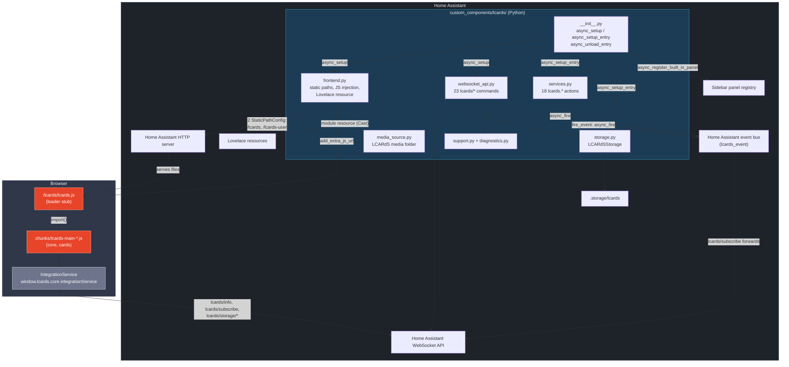
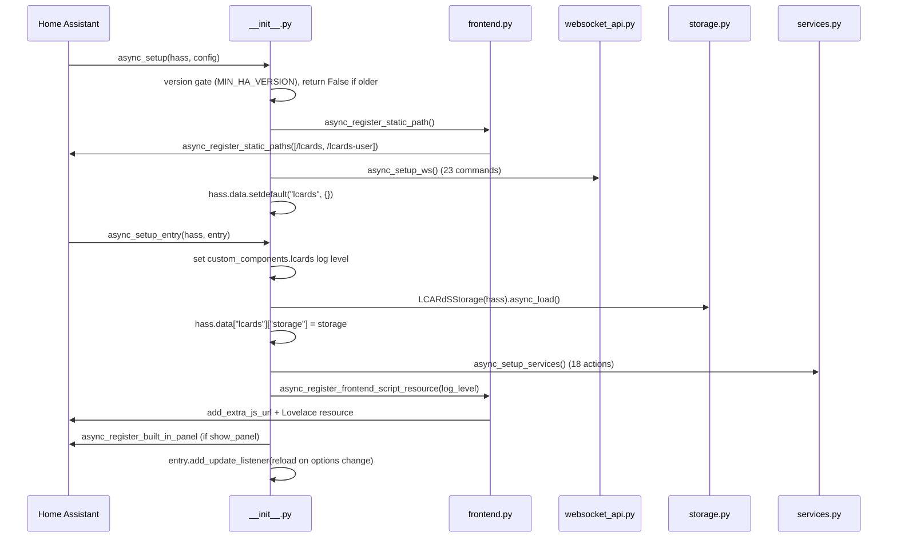
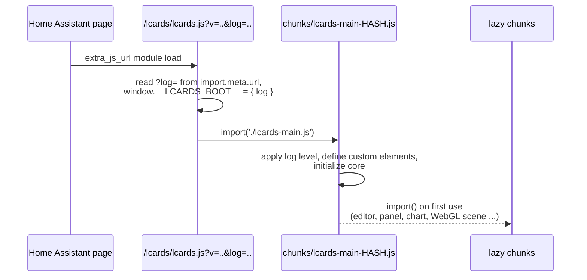
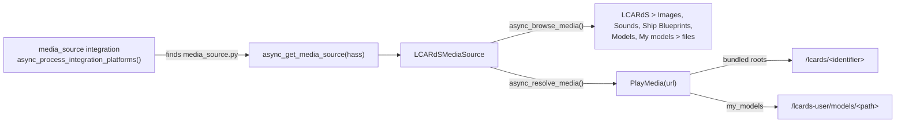
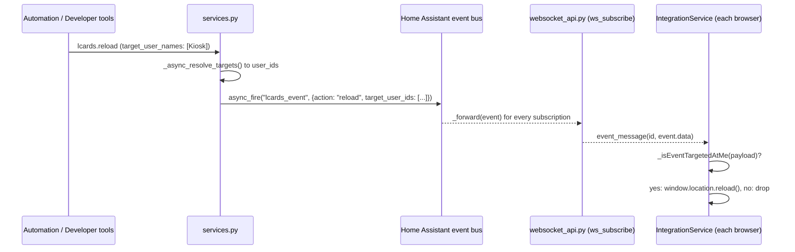

# Home Assistant Integration Architecture

LCARdS ships as a **HACS integration** (`custom_components/lcards/`). This page is the Python-side view: how the integration boots, what it registers in Home Assistant (static paths, WebSocket commands, actions, the sidebar panel, a media source), how the browser bundle is served and loaded, and how the backend talks to the browser.

The browser side of the same conversation has its own pages; this page links them instead of repeating them:

- [Integration Service](subsystems/integration-service): the `lcards/info` probe, capabilities, the push channel and the event handlers in the browser.
- [Scoped Settings](subsystems/scoped-settings): the per-user and per-device settings built on the storage commands.
- [Connection Overlay](subsystems/connection-overlay) and [Borg Assimilation](subsystems/borg-assimilation): the two features that use `lcards/fire_event` and the Borg actions.
- [Persistent Storage](internals/storage) and [Home Assistant Services: Implementation Notes](internals/ha-services): the storage and action internals of the backend.
- [Backend API](../development/backend-api): calling the WebSocket commands from card code.

---

## Two-Layer Architecture



`media_source.py` is not wired up by `__init__.py`: Home Assistant's `media_source` integration discovers it (see [Media Source Platform](#media-source-platform)). `diagnostics.py` is discovered the same way by Home Assistant's diagnostics integration.

---

## Python Component Files

| File | Responsibility |
|------|---------------|
| `__init__.py` | Entry point: the minimum Home Assistant version gate, static paths and WebSocket commands (`async_setup`), then log level, storage, actions, JS injection, sidebar panel and the options listener (`async_setup_entry`), and the matching cleanup (`async_unload_entry`) |
| `frontend.py` | Registers the two static paths, injects `lcards.js?v=<version>&log=<level>` with `add_extra_js_url`, keeps one Lovelace module resource for Cast, and removes legacy resource entries |
| `config_flow.py` | Single-instance setup flow (no input) and the options flow (panel, title, icon, log level, preview features) |
| `websocket_api.py` | Registers the 23 `lcards/*` WebSocket commands (probe, global storage, push channel, scoped storage, event relay, diagnostics) |
| `services.py` | Registers the 18 `lcards.*` actions: alert modes, frontend control, screen effects, sound, astrometrics, portal overlays and the Borg Easter egg |
| `services.yaml` | Action names, descriptions and field selectors shown in Developer tools > Actions and the automation editor |
| `storage.py` | `LCARdSStorage`: a flat key/value store on Home Assistant's `Store` helper (`.storage/lcards`), with the `_user_<id>` / `_device_<id>` record helpers |
| `media_source.py` | `LCARdSMediaSource`: a read-only "LCARdS" folder in Home Assistant's media browser (bundled images, sounds, ship blueprints, models, and the user's own models) |
| `support.py` | `async_collect_backend_diagnostics()`: the backend facts shared by `lcards/diagnostics` and Download diagnostics |
| `diagnostics.py` | `async_get_config_entry_diagnostics()`: Home Assistant's Download diagnostics for the config entry, returns the `support.py` facts |
| `const.py` | `DOMAIN`, `MIN_HA_VERSION`, `DOMAIN_VERSION`, the user folder paths, option keys and defaults, storage namespaces, `_LOG_LEVEL_MAP` |
| `manifest.json` | Domain, version (Home Assistant CalVer, no suffix), `dependencies: [http, lovelace]`, `after_dependencies: [media_source]`, `single_config_entry: true`, `iot_class: local_push` |
| `strings.json`, `translations/en.json` | Text of the setup and options dialogs |
| `THIRD_PARTY_NOTICES.txt` | Licence notices of the libraries built into the bundle (generated, see [Bundle and loading](#bundle-and-loading)) |

`hacs.json` (repository root) tells HACS to install the release asset `lcards.zip` (`zip_release`, `filename`) and sets the minimum Home Assistant version HACS checks before installing (`"homeassistant": "2026.11.0"`).

---

## Minimum Home Assistant Version

LCARdS needs **Home Assistant 2026.11** or newer. The value lives in three places that must agree:

| Where | Value | Effect |
|---|---|---|
| `const.py:9` `MIN_HA_VERSION` | `(2026, 11)` | `async_setup()` compares it with `homeassistant.const` `MAJOR_VERSION, MINOR_VERSION` and, when the running version is older, logs an error ("LCARdS requires Home Assistant 2026.11 or newer ...") and returns `False` (`__init__.py:61-67`). Nothing is registered: no static paths, no WebSocket commands, and the config entry does not set up |
| `hacs.json` `homeassistant` | `2026.11.0` | HACS refuses to install or update on an older Home Assistant |
| `src/utils/support-info-format.js:16` `MIN_HA_VERSION` | `[2026, 11]` | The Welcome tab health check marks an older Home Assistant as an error (see [Support and diagnostics](#support-and-diagnostics)) |

`tests/support/min-ha-version.test.js` fails when the three differ (and when `manifest.json` grows a `homeassistant` key of its own: custom integrations cannot declare a minimum there). `support.py` reports the Python value as `versions.min_home_assistant`.

---

## Boot Sequence

Home Assistant calls the integration in two phases.



### Phase 1: `async_setup()` (Home Assistant start, before the config entry)

`__init__.py:54-76`. Runs once per Home Assistant start, whether or not the integration has been set up yet:

1. **Version gate**: returns `False` below `MIN_HA_VERSION` (see above).
2. **Static paths**: `async_register_static_path(hass)` registers `/lcards` and `/lcards-user` (see [Static Paths](#static-paths)). It creates `<config>/www/lcards/models` first if it is missing.
3. **WebSocket commands**: `async_setup_ws(hass)` registers all 23 `lcards/*` commands (`websocket_api.py:123-164`), so `lcards/info` answers even before a config entry exists. Commands that need storage answer `storage_unavailable` until Phase 2 has run.
4. **`hass.data["lcards"]`** is created (`setdefault`), so storage and `frontend.py` can write into it later.

### Phase 2: `async_setup_entry()` (config entry active)

`__init__.py:133-176`. Runs after the setup flow and on every start or reload with the entry configured:

1. **Log level**: maps the `log_level` option through `_LOG_LEVEL_MAP` and calls `setLevel()` on the `custom_components.lcards` logger, so every child logger follows.
2. **Storage**: `await LCARdSStorage(hass).async_load()` reads `.storage/lcards`; the instance goes to `hass.data["lcards"]["storage"]`.
3. **Actions**: `await async_setup_services(hass)` registers the 18 `lcards.*` actions.
4. **JS injection**: `async_register_frontend_script_resource(hass, log_level)` (`frontend.py:82-163`):
   - builds `resource_url = /lcards/lcards.js?v=<DOMAIN_VERSION>&log=<level>` and keeps it in `hass.data["lcards"]["resource_url"]` (unload needs the exact string);
   - `add_extra_js_url(hass, resource_url)` loads the script on every Home Assistant page;
   - in the Lovelace resources collection: deletes legacy entries whose URL starts with `/hacsfiles/lcards/lcards.js` or `/local/community/lcards/lcards.js` (the old HACS frontend-plugin install, which would load the bundle twice); updates an existing `/lcards/lcards.js...` entry when its URL differs (new version or log level); otherwise creates one `module` resource. The resource is there for Cast and kiosk views that do not run `extra_js_url`.
5. **Sidebar panel**: when `show_panel` is on, `_register_panel()` registers a `custom` panel at `/lcards-config` with the configured title and icon, element `lcards-config-panel`, `module_url` = the same `resource_url`, and `require_admin=False` (`__init__.py:79-119`). The panel reuses the injected URL on purpose: a different URL (for example the bare `/lcards/lcards.js`) is a different ES module to the browser, which would run a second copy of the bundle with its own singletons.
6. **Options listener**: `entry.add_update_listener(_async_options_updated)` reloads the entry when options are saved, so changes apply without a restart.

### Unload: `async_unload_entry()`

`__init__.py:179-197`. Called on restart, on reload (including an options change) and before removal:

1. `async_remove_services(hass)` removes the 18 actions.
2. `async_remove_frontend_script_resource(hass)` calls `remove_extra_js_url` with the stored URL, clears it from `hass.data`, and deletes every `/lcards/lcards.js...` Lovelace resource (it loops over a copy of the items: in YAML resource mode `async_items()` is the collection's own list, and removing from it while looping skipped the next entry).
3. `async_remove_panel(hass, "lcards-config")` (errors ignored during shutdown).

The static paths, the WebSocket commands and the storage instance in `hass.data` stay until Home Assistant stops: Home Assistant cannot unregister them. A reload creates a fresh `LCARdSStorage` from disk and overwrites the stored instance. `async_remove_entry()` does nothing.

---

## Static Paths

`frontend.py:43-79` registers two paths in one `hass.http.async_register_static_paths()` call (a `RuntimeError` for an already registered path, after removing and re-adding the integration without a restart, is ignored):

| URL | Folder | Cache headers | Purpose |
|---|---|---|---|
| `/lcards` | `<config>/custom_components/lcards/` | yes (`public, max-age` of 31 days) | The whole integration folder: the bundle and everything it loads |
| `/lcards-user` | `<config>/www/lcards/` (`USER_DIR`) | no | The LCARdS user folder: files users add themselves, today `models/` (`MY_MODELS_URL` = `/lcards-user/models`) |

What `/lcards` serves (everything except the Python files, `brand/` and `translations/` is build output and gitignored, so a fresh checkout has none of it until `npm run build` runs):

| URL | From | Notes |
|---|---|---|
| `/lcards/lcards.js` (+ `.br`, `.gz`) | Vite entry `src/lcards.js` | Loader stub, under 2 KB (see [Bundle and loading](#bundle-and-loading)) |
| `/lcards/chunks/*.js` (+ `.br`, `.gz`, `.map`) | Vite chunks | `lcards-main-<hash>.js` plus every lazy chunk |
| `/lcards/lcards.js.map`, `chunks/*.js.map` | Vite | Source maps; left out of stable release zips |
| `/lcards/fonts/`, `/lcards/sounds/`, `/lcards/msd/`, `/lcards/images/`, `/lcards/models/` | `src/assets/<dir>/` copied by `scripts/copy-assets.js` | Fonts, sound packs, ship blueprint SVGs, the image library, built-in GLB models |
| `/lcards/brand/` | committed | Integration icons and logo |
| `/lcards/THIRD_PARTY_NOTICES.txt` | `scripts/generate-third-party-notices.js` | Licence texts |

Static paths in Home Assistant are served without authentication, so everything in both folders can be fetched by anyone who can reach the Home Assistant HTTP server (including the Python sources in the integration folder). The user folder is also public on `/local/lcards/...`, since it is inside `<config>/www`, whenever `www` existed at Home Assistant start. The user folder is outside `custom_components/` on purpose: HACS replaces `custom_components/lcards/` on every update, but never touches `www/`, so no `persistent_directory` is needed (`const.py:12-23`). It has its own path instead of `/local/lcards` because `/local/` only exists if `<config>/www` existed when Home Assistant started. The `/lcards-user` path is not registered (and "My models" is unavailable) when the models folder cannot be created; a warning is logged.

---

## Bundle and Loading

The frontend is one Vite library build (`vite.config.js`), written straight into `custom_components/lcards/` by `vite build --mode integration` (other modes write to the gitignored `tmp/vite-build/`; there is no `dist/`).



**Loader stub.** `src/lcards.js` (the Vite entry, about 20 lines) reads `log` from its own URL, stores it on `window.__LCARDS_BOOT__`, and dynamically imports `./lcards-main.js`, which Vite emits as `chunks/lcards-main-<hash>.js`. `src/lcards-main.js` then applies the level (and the `?lcards_log_level=` page URL override), registers every card element and initializes the core. The split exists because lazy chunks import shared code from the main chunk by its plain URL: if that code lived in the entry, they would request `lcards.js` without `?v=&log=`, a second module URL, and the browser would run a second copy of the bundle (a second core).

**Lazy chunks.** Rarely needed code is split out with native `import()`, resolved relative to the importing chunk (no global chunk registry that could collide with other bundled cards). `chunkFileNames: 'chunks/[name]-[hash].js'`. The main ones:

| Chunk(s) | Loaded by |
|---|---|
| Card editors (`lcards-*-editor-*.js`, shared editor components) | each card's `static async getConfigElement()` (`await import('../editor/cards/...')`) |
| Studio dialogs (for example `lcards-alert-overlay-studio-dialog-*.js`) | their editors |
| Config panel (`lcards-config-panel-*.js`) | `lcards-config-panel` is a light shell element in the main chunk (`src/panels/lcards-config-panel-shell.js`) that imports the real panel on first connect |
| Grid edit overlay (`lcards-grid-edit-overlay-*.js`) | `src/views/lcards-layout-view.js` when dashboard edit mode starts |
| Theme generator (`lcards-theme-generator-view-*.js`) | the theme token browser tab |
| Alert preview (`lcards-alert-preview-*.js`) | `window.lcards.loadAlertPreview()` (docs demos, Alert Studio) |
| ApexCharts (`apexcharts.esm-*.js`) | `src/cards/lcards-chart.js` when a chart renders, and the processor preview |
| three.js and WebGL scenes (`three.module-*`, `three-runtime-*`, `warp-starfield-*`, `holo-sphere-*`, `nebula-*`, ...) | `ThreeSceneEffect` (`src/core/packs/backgrounds/webgl/`) for WebGL background presets |
| Astrometrics runtime and schema (`scene-runtime`, `astrometrics-schema-*`, ...) | `src/cards/lcards-astrometrics-card.js` (`import('../core/astrometrics/index.js')`) |

**Minification and maps.** esbuild minify with `keepNames: true` (logs and `BaseService` use `constructor.name`), plus a post pass that strips whitespace (`minifyWhitespace` plugin; Vite does not in library mode). Source maps map back to `src/`; with `LCARDS_SOURCEMAP=hidden` (stable releases) they are written but not referenced.

**Pre-compression.** The `lcards-precompress` plugin writes `.br` (quality 11) and `.gz` (level 9) next to `lcards.js` and every `chunks/*.js`. Home Assistant's static handler (aiohttp `FileResponse`) sends the compressed sibling when the browser accepts it. `lcards-clean-chunks` deletes `chunks/` and the old `lcards.js.br/.gz` at build start (`emptyOutDir` is off because the Python files live in the same folder).

**Why a hard refresh.** `/lcards` is served with month-long cache headers. The stub URL changes only with `DOMAIN_VERSION`, but every build deletes the previous chunks, so after a rebuild with the same version a cached stub (or cached main chunk) points at chunk files that no longer exist (404). Hashed chunk names make everything else safe to cache. After `npm run build` during development, reload with Ctrl+Shift+R.

**Size budget.** `tests/browser/bundle.spec.js` (Layer A, after a build) checks that the stub is loaded once with its query and the main chunk once, that loading an editor reuses the same core, that rendering cards loads no editor code, and the budgets: `lcards.js` at most 2 KB, the main chunk at most 2,300,000 bytes raw and 500,000 bytes Brotli, three.js and the anime.js three adapter out of the main chunk, and the astrometrics runtime and schema in chunks of their own. Raise a ceiling only for a deliberate addition, with a dated comment as the test does.

**Licence notices.** `scripts/generate-third-party-notices.js` runs after the Vite build in `npm run build`, `build:integration` and `docs:bundle`, and writes `custom_components/lcards/THIRD_PARTY_NOTICES.txt` from the packages found in the build, so the release zip carries the licence texts. The release workflow fails without it. `tests/docs/third-party.test.js` keeps `scripts/data/third-party.json` in step with the imports in `src/`.

---

## Media Source Platform

`media_source.py` exposes bundled assets and the user's own models as a browsable, read-only **"LCARdS"** folder in Home Assistant's media browser: the Media sidebar panel, media picker dialogs, and every `ha-selector` of type `media` (including the ones LCARdS editors use, see [Asset Manager: media-source:// Resolution Flow](subsystems/asset-manager#media-source-resolution-flow)).

**Discovery is automatic.** Home Assistant's `media_source` integration scans loaded integrations for a `media_source.py` with `async_get_media_source(hass)` (`async_process_integration_platforms`). `manifest.json` lists `media_source` under `after_dependencies` only to order setup.



| Root (identifier prefix) | Folder | Title | Lists files whose MIME type starts with |
|---|---|---|---|
| `images` | `custom_components/lcards/images/` | Images | `image` |
| `sounds` | `custom_components/lcards/sounds/` | Sounds | `audio` |
| `msd` | `custom_components/lcards/msd/` | Ship Blueprints | `image` |
| `models` | `custom_components/lcards/models/` | Models | `model` |
| `my_models` | `<config>/www/lcards/models/` | My models | `model` |

(`media_source.py:47-56`.) `.glb` and `.gltf` get `model/gltf-binary` / `model/gltf+json` by extension because not every Python's `mimetypes` table knows them; everything else uses `mimetypes.guess_type`. `async_resolve_media()` does not serve files: it returns a URL on one of the two static paths. Browsing and resolving run in the executor and resolve the requested path, then check it stays under its root (`Path.relative_to()`), the same traversal guard as Home Assistant core's `local_source.py`. There is no upload or delete: users copy their models into `www/lcards/models/` themselves (File editor, Samba).

---

## Config and Options Flow

`config_flow.py`. `LCARdSConfigFlow.async_step_user()` enforces one instance (`async_set_unique_id(DOMAIN)`, and `single_config_entry` in the manifest) and creates the entry with no input. Options are edited under **Settings > Devices & services > LCARdS > Configure** (`LCARdSOptionsFlow.async_step_init`):

| Option key | `const.py` constant | Default | Effect |
|------------|---------------------|---------|--------|
| `show_panel` | `CONF_SHOW_PANEL` | `True` | Register the sidebar panel or not |
| `sidebar_title` | `CONF_SIDEBAR_TITLE` | `"LCARdS Config"` | Sidebar label |
| `sidebar_icon` | `CONF_SIDEBAR_ICON` | `"mdi:space-invaders"` | Sidebar icon |
| `log_level` | `CONF_LOG_LEVEL` | `"warn"` | Frontend and backend verbosity (`off`, `error`, `warn`, `info`, `debug`, `trace`), see [Logging](#logging) |
| `enable_previews` | `CONF_ENABLE_PREVIEWS` | `False` | Preview features in the frontend; read from `lcards/info` `options` (for example `integrationService.options.enable_previews` in the sound tab) |

Saving reloads the entry (unload, then setup), so every option applies without a restart. `lcards/info` returns the current values with defaults filled in.

---

## WebSocket API

`async_setup_ws()` (`websocket_api.py:123-164`) registers 23 commands in `async_setup()`. Each handler is `@websocket_api.async_response`; schemas use `probatio` (imported as `vol`, the voluptuous successor Home Assistant uses since 2026.10). Two error codes are LCARdS's own: `unauthorized` ("Admin access required", from `_require_admin()`) and `storage_unavailable` ("LCARdS storage is not initialised", from `_check_storage()`, before `async_setup_entry` has run). Admin checks always run before the storage check.

| Command | Auth | Handler (`websocket_api.py`) | Request fields | Result |
|---|---|---|---|---|
| `lcards/info` | any user | `ws_lcards_info` (`:167-217`) | none | `{ available, version, storage_key_count, options, capabilities }` |
| `lcards/diagnostics` | admin | `ws_lcards_diagnostics` (`:220-238`) | none | `async_collect_backend_diagnostics()` (see [Support and diagnostics](#support-and-diagnostics)) |
| `lcards/subscribe` | any user | `ws_subscribe` (`:407-436`) | none | empty result, then one event message per `lcards_event` |
| `lcards/fire_event` | admin; non-admin: own-user `reload_connection_config` only | `ws_fire_event` (`:467-510`) | `action`, `target_device_ids?`, `target_user_ids?`, `data?` | empty result |
| `lcards/storage/get` | any user for plain (global) keys; a `_device_*` key as `device/get`; admin for the full store (no `key`) and `_user_*` keys | `ws_storage_get` (`:245-274`) | `key?` | `{ key, value }` |
| `lcards/storage/set` | admin | `ws_storage_set` (`:277-300`) | `data` | `{ ok, keys }` |
| `lcards/storage/delete` | admin | `ws_storage_delete` (`:303-325`) | `key` | `{ ok, existed }` |
| `lcards/storage/delete_many` | admin | `ws_storage_delete_many` (`:328-351`) | `keys` | `{ ok, removed }` (count) |
| `lcards/storage/reset` | admin | `ws_storage_reset` (`:354-375`) | none | `{ ok }` |
| `lcards/storage/dump` | admin | `ws_storage_dump` (`:378-400`) | none | `{ version, data }` |
| `lcards/storage/user/get` | any user (own record) | `ws_storage_user_get` (`:518-545`) | `key?` | `{ user_id, key, value }` |
| `lcards/storage/user/set` | any user (own record) | `ws_storage_user_set` (`:548-574`) | `data`, `replace?` | `{ ok, user_id, keys }` |
| `lcards/storage/user/delete` | any user (own record) | `ws_storage_user_delete` (`:577-600`) | `key` | `{ ok, user_id, existed }` |
| `lcards/storage/users/list` | admin | `ws_storage_users_list` (`:607-633`) | none | `{ users: { <id>: { key_count } } }` |
| `lcards/storage/users/get` | admin | `ws_storage_users_get` (`:636-661`) | `user_id` | `{ user_id, value }` |
| `lcards/storage/users/set` | admin | `ws_storage_users_set` (`:664-693`) | `user_id`, `data`, `replace?` | `{ ok, user_id, keys }` |
| `lcards/storage/users/clear` | admin | `ws_storage_users_clear` (`:783-807`) | `user_id` | `{ ok, removed, user_id }` |
| `lcards/storage/device/get` | admin, or the record's current owner (a record with no owner: any user) | `ws_storage_device_get` (`:704-735`) | `device_id`, `key?` | `{ device_id, key, value }` |
| `lcards/storage/device/set` | any user (a non-admin becomes the owner; an admin claims only an unowned record) | `ws_storage_device_set` (`:738-776`) | `device_id`, `data`, `replace?` | `{ ok, device_id, keys }` (without `owner_user_id`) |
| `lcards/storage/devices/list` | admin | `ws_storage_devices_list` (`:840-874`) | none | `{ devices: { <id>: { display_name, last_seen, user_agent, owner_user_id, key_count } } }` |
| `lcards/storage/devices/get` | admin | `ws_storage_devices_get` (`:877-902`) | `device_id` | `{ device_id, value }` |
| `lcards/storage/devices/set` | admin (`data.owner_user_id` sets the owner) | `ws_storage_devices_set` (`:905-934`) | `device_id`, `data`, `replace?` | `{ ok, device_id, keys }` |
| `lcards/storage/devices/clear` | admin | `ws_storage_devices_clear` (`:810-834`) | `device_id` | `{ ok, removed, device_id }` |

The user commands always take the user ID from `connection.user.id`, never from the request. A device ID is a routing key the browser chooses (a UUID in `localStorage`), not a credential. What each storage command does to the store, and the `replace` semantics, are in [Persistent Storage](internals/storage); the client wrapper is [Scoped Settings](subsystems/scoped-settings#websocket-commands); call examples are in [Backend API](../development/backend-api).

### `lcards/info`

The backend probe. `IntegrationService` sends it on the first HASS update with a connection, retries after 1, 3 and 8 seconds, and settles into degraded mode only when all four attempts fail (see [Integration Service: Lifecycle](subsystems/integration-service#lifecycle)).

| Field | Value |
|---|---|
| `available` | always `true` (a failed or missing command is how "not available" shows) |
| `version` | `DOMAIN_VERSION`, the full version with any `-dev.N` suffix |
| `storage_key_count` | number of top-level keys in the store (scoped records included), or `null` before `async_setup_entry` |
| `options` | the five options with defaults filled in, or `null` when there is no config entry |
| `capabilities` | `["scoped_storage", "scoped_storage_replace", "own_user_reload"]` |

| Capability | Meaning |
|---|---|
| `scoped_storage` | The `storage/user/*`, `users/*`, `device/*` and `devices/*` commands exist |
| `scoped_storage_replace` | The four scoped `set` commands accept `replace: true`; `ScopedSettingsService.write()` sends it only when this is advertised |
| `own_user_reload` | A non-admin may send `reload_connection_config` to their own sessions through `lcards/fire_event` |

Capabilities let a newer frontend run against an older backend: the frontend checks for a capability before using the feature ([Integration Service: capabilities](subsystems/integration-service#capabilities)).

### `lcards/subscribe`

`ws_subscribe` listens on the Home Assistant event bus for `lcards_event` and forwards each event's `data` dict as an event message on the subscription (`websocket_api.event_message(msg["id"], event.data)`). The bus listener's unsubscribe function goes into `connection.subscriptions[msg["id"]]`, so Home Assistant removes it when the client unsubscribes or the WebSocket closes. It exists because Home Assistant's own `subscribe_events` is admin-only for custom event types; this one is open to every user. See [Python to JS Push Channel](#python-to-js-push-channel).

### `lcards/fire_event`

Relays an event from one browser to every subscribed browser: it fires `lcards_event` with `{ action, ...data }` plus `target_device_ids` / `target_user_ids` when given. Admin only, because the event can act on other users' sessions. The single non-admin exception (`_own_user_event_allowed()`, `websocket_api.py:450-464`, capability `own_user_reload`) requires all of:

- `action` is `reload_connection_config`;
- `target_user_ids` is exactly `[<caller's user id>]`;
- no `target_device_ids` (a device ID is not tied to a user);
- `data` has only `origin_device_id`, with string values (data is spread into the payload, so any other key could widen the targets).

`ConnectionOverlayService.saveConfig()` uses it after an own-user save, and the connectivity tab sends `reload_connection_config` and `reload` broadcasts (admin). See [Connection Overlay: Remote Config Sync](subsystems/connection-overlay#remote-config-sync). Layer C tests: `tests/ha/ha.spec.js` "a non-admin may relay reload_connection_config to their own sessions only".

### Storage commands

Global (`storage/*`) and scoped (`storage/user/*`, `users/*`, `device/*`, `devices/*`) commands are in the table above. Since 2026-11 (D3a) every global write, the full read and `dump` are admin-only, and `storage/get` refuses non-admins for `_user_*` keys; non-admins keep their own user record and device records. Layer C: "global storage is admin-only; a non-admin keeps their own user and device storage" and "storage/delete_many removes the given keys with one call and leaves the rest" in `tests/ha/ha.spec.js`. Details: [Persistent Storage](internals/storage).

---

## Logging

All Python files use `logging.getLogger(__name__)` under `custom_components.lcards`.

The `log_level` option controls both sides:

- **Frontend**: `frontend.py` appends `&log=<level>` to the injected URL; the loader stub reads it from `import.meta.url` before it imports the main chunk, and `src/lcards-main.js` applies it before the banner. Static imports are hoisted, so the modules `lcards-main.js` imports are evaluated first: their few module-level logs use the level saved in `localStorage` (else `info`); everything after that, core init included, uses the new level. The page URL parameter `?lcards_log_level=` overrides it for that page load.
- **Backend**: `async_setup_entry()` maps the level through `_LOG_LEVEL_MAP` (`const.py:54-61`) and calls `setLevel()` on `custom_components.lcards`.

| LCARdS level | Python level |
|---|---|
| `off` | `CRITICAL + 1` (silent, without touching `logging.disable()`) |
| `error` | `ERROR` |
| `warn` | `WARNING` |
| `info` | `INFO` |
| `debug` | `DEBUG` |
| `trace` | `DEBUG` (Python has no TRACE) |

The `lcards.set_log_level` action changes both at runtime without saving the option: the Python level (process-wide, even for a targeted call; a target that matches nobody fails the call and leaves it unchanged) until the next entry reload, and the browsers it reaches until their next page load. Home Assistant's `logger:` configuration can also set `custom_components.lcards` directly.

---

## Home Assistant Services (Actions)

`async_setup_services()` (`services.py:255-696`) registers 18 actions in `async_setup_entry()`; `async_remove_services()` removes the names in `_ALL_SERVICES` on unload. Field schemas use `probatio`.

| Action | Fields (besides targeting) | Without targeting | With targeting |
|---|---|---|---|
| `lcards.set_alert_mode` | `mode` (one of the six alert modes) | `input_select.select_option` on `input_select.lcards_alert_mode` | `lcards_event` `set_alert_mode` |
| `lcards.red_alert`, `yellow_alert`, `blue_alert`, `gray_alert`, `black_alert` | none | sets that mode on the helper | `set_alert_mode` event |
| `lcards.clear_alert` | none | sets `green_alert` on the helper | `set_alert_mode` event with `green_alert` |
| `lcards.reload` | none | `lcards_event` `reload` to all | same, targeted |
| `lcards.set_log_level` | `level` | Python level plus `set_log_level` event | same, event targeted |
| `lcards.trigger_effect` | `layers`, `duration?` (ms, at least 100) | `trigger_effect` event | same, targeted |
| `lcards.clear_effect` | `slot?` (`backdrop`, `canvas`, `color`; empty = all) | `clear_effect` event | same, targeted |
| `lcards.play_sound` | `event_type` or `asset_key` (one is required) | `play_sound` event | same, targeted |
| `lcards.fly_to` | `card_id`, `view` or `point`, `duration?`, `warp?` | `fly_to` event | same, targeted |
| `lcards.set_clock` | `card_id`, `date` and/or `rate` | `set_clock` event | same, targeted |
| `lcards.show_portal_card` | `content`, `layers?`, `position?`, `width?`, `height?`, `duration?`, `dismiss?` | `show_portal_card` event | same, targeted |
| `lcards.clear_portal_card` | none | `clear_portal_card` event | same, targeted |
| `lcards.borg_assimilate` | `intro_duration?`, `transition_style?`, `site_count?`, `tendrils_per_site?`, `tendril_length?`, `particle_count?`, `renderer?`, `cube?`, `corruption?`, `overrun?`, `suppress_persistent?`, `font_swap?`, `palette_hue?` (0-359), `sound?`, `intro_layers?`, `persistent_layers?` | `borg_assimilate` event | same, targeted |
| `lcards.borg_deassimilate` | `with_outro?`, `outro_layers?`, `revert_transition_style?`, `sound?` | `borg_deassimilate` event | same, targeted |

Per-field validation, the payload each handler builds and every error are in [Home Assistant Services: Implementation Notes](internals/ha-services). The user reference with examples is [Home Assistant Actions](/configuration/ha-actions).

### Targeting (all services)

Every action accepts four optional list fields, resolved in `_async_resolve_targets()` (`services.py:105-168`) and combinable:

| Field | Resolves to |
|---|---|
| `target_device_ids` | Browser device UUIDs (the `lcards_device_id` `localStorage` key), used as given |
| `target_device_names` | Device display names (config panel or `?lcards_device=`), matched case-insensitively against `display_name` in the `_device_*` storage records; a name shared by several devices hits all of them |
| `target_user_ids` | Home Assistant user IDs, used as given |
| `target_user_names` | Home Assistant user names, matched case-insensitively against `hass.auth.async_get_users()` |

- **No targeting fields**: a broadcast (or, for the alert actions, the shared helper write).
- **Targeting that resolves to at least one ID**: the event carries `target_device_ids` / `target_user_ids` and each browser keeps only events addressed to it (union of both lists).
- **Targeting that matches nobody** (for example a misspelt name): `ServiceValidationError` ("LCARdS: no device or user matches the target (names: [...])"). It never falls back to a broadcast.

The alert actions write `input_select.lcards_alert_mode` only without targeting: that helper is the shared alert state, and the browsers follow it through their HelperManager subscriptions. A targeted alert is a transient, local change on the matched browsers (`setAlertMode(mode, { skipHelperSync: true })`). Without targeting and without the helper, the call fails with `ServiceValidationError` telling the user to create the LCARdS helpers. How a browser then applies the mode: [Theme System: Alert Mode Integration](subsystems/theme-system.md#alert-mode-integration).

---

## Python to JS Push Channel

Eleven actions (`reload`, `set_log_level`, `trigger_effect`, `clear_effect`, `play_sound`, `fly_to`, `set_clock`, `show_portal_card`, `clear_portal_card`, `borg_assimilate`, `borg_deassimilate`) always reach the browsers through `_fire_targeted_event()` (`services.py:171-188`). The seven alert actions use it only when targeting is given. `lcards/fire_event` puts browser-originated events on the same channel.



Transport is always a broadcast to every subscription; the targeting is enforced in the browser. Payloads leave the target keys out when they are empty.

| `action` | Fired by | Extra payload fields |
|---|---|---|
| `reload` | `lcards.reload`, connectivity tab (`lcards/fire_event`) | none |
| `set_log_level` | `lcards.set_log_level` | `level` |
| `set_alert_mode` | targeted alert actions | `mode` |
| `trigger_effect` | `lcards.trigger_effect` | `layers`, `duration?` |
| `clear_effect` | `lcards.clear_effect` | `slot?` (left out for all slots) |
| `play_sound` | `lcards.play_sound` | `event_type` or `asset_key` |
| `fly_to` | `lcards.fly_to` | `card_id`, `view?`, `point?`, `duration?`, `warp?` |
| `set_clock` | `lcards.set_clock` | `card_id`, `date?`, `rate?` |
| `show_portal_card` | `lcards.show_portal_card` | `content`, `layers`, `position`, `width`, `height`, `duration`, `dismiss` (always all keys; `null` when not given) |
| `clear_portal_card` | `lcards.clear_portal_card` | none |
| `borg_assimilate` | `lcards.borg_assimilate` | normalised options: `intro_duration`, `transition_style`, `intro_layers`, `persistent_layers`, `fontSwap`, `paletteHue`, `sound` |
| `borg_deassimilate` | `lcards.borg_deassimilate` | `with_outro`, `outro_layers`, `revert_transition_style`, `sound` |
| `reload_connection_config` | `lcards/fire_event` only (`ConnectionOverlayService`, connectivity tab) | `origin_device_id?` |

What each browser does with each action is the [Integration Service: Handled actions](subsystems/integration-service#handled-actions) table.

### Subscription lifecycle

```
Browser                                      Home Assistant
-------                                      --------------
first HASS update with a connection
  IntegrationService.updateHass()
    initialize() ----- lcards/info --------> ws_lcards_info()
    <------------------ { available, ... } --
    _startEventListener()
      subscribeMessage(cb) - lcards/subscribe -> ws_subscribe():
                                                 hass.bus.async_listen("lcards_event", _forward)
                                                 connection.subscriptions[id] = unsub
      _eventUnsubscribe = unsub fn

lcards_event fired (action or fire_event)
    <------------- event_message(id, data) -- _forward(event)
    _handleLcardsEvent(data)

WebSocket closes (tab closed, page reload, connection lost)
                                             Home Assistant calls every
                                             connection.subscriptions[...] unsub
```

The probe and the subscription happen once per page load (the `_probed` and `_eventUnsubscribe` guards in `src/core/services/IntegrationService.js`). After a lost connection (a Home Assistant restart, for example) `home-assistant-js-websocket` sends `lcards/subscribe` again on reconnect (`subscribeMessage` re-subscribes by default), so events keep arriving without a page reload. Unloading the config entry does not touch existing subscriptions: `ws_subscribe` is registered in `async_setup()` and stays.

---

## Support and Diagnostics

One collector, two consumers: `async_collect_backend_diagnostics(hass)` in `support.py` serves both the `lcards/diagnostics` WebSocket command (admin) and Home Assistant's **Download diagnostics** for the config entry (`diagnostics.py`, `async_get_config_entry_diagnostics`; Home Assistant adds its own system information to that file). It reports environment facts only; stored data is reported as counts, never contents.

| Field | Content |
|---|---|
| `versions` | `integration` (`DOMAIN_VERSION`), `home_assistant`, `min_home_assistant` (`"2026.11"`) |
| `safe_mode`, `recovery_mode` | from `hass.config` |
| `resources` | Lovelace resource `mode`, and only the LCARdS and card-mod `entries` (`url`, `type`, `legacy`), `lcards_count`, `legacy_lcards` (an entry on the old `/hacsfiles/lcards/` or `/local/community/lcards/` path), `card_mod` |
| `extra_module_urls` | `frontend: extra_module_url` entries, minus LCARdS's own URL |
| `card_mod_in_extra_module_url` | whether one of those is card-mod |
| `components` | whether `uix`, `hacs` and `card_mod` are loaded |
| `config_entry` | `present`, `options` |
| `storage` | `schema_version`, `key_count` |

**Welcome tab health check.** The config panel's Welcome tab (`src/panels/components/lcards-about-tab.js`, Support and system info section) calls `buildSupportReport()` (`src/utils/support-info.js`). `collectSupportInfo()` waits for the `lcards/info` probe, gathers browser-side facts (versions, capabilities, options, theme, UIX and card-mod detection, recent log entries) and, for admins, the `lcards/diagnostics` result; a non-admin, or an `unauthorized` reply, gives `backend.status: 'admin_required'`. `evaluateSupportChecks()` (`src/utils/support-info-format.js`) turns that into checks:

| Check `id` | Uses the backend facts? | Flags |
|---|---|---|
| `ha_version` | no (`hass.config.version`) | Home Assistant older than 2026.11 (error) |
| `integration` / `version_match` | no (`lcards/info`) | integration not responding (error); frontend and integration versions differ (warn: hard refresh) |
| `safe_mode` | `safe_mode`, `recovery_mode` | safe or recovery mode (warn) |
| `styling` | `components`, `resources.card_mod`, `card_mod_in_extra_module_url` | UIX and card-mod together (error), card-mod (warn), HA-LCARS without UIX (warn) |
| `extra_module_url` | `extra_module_urls` | card-mod left in `extra_module_url` (warn) |
| `layout_card` | `resources.entries` | `custom:layout-card` installed (info) |
| `resources` | `resources` | a legacy LCARdS resource, or more than one LCARdS resource (warn) |
| `backend` | status | backend checks skipped (needs an admin) or unavailable (info) |
| `ha_lcars` | no | HA-LCARS theme active or not (info) |

The tab can copy the report as Markdown or open a prefilled GitHub issue (`openIssueForReport()`); the console has the same through `window.lcards.support.collect/report/copy/openIssue` (`src/lcards-main.js:142-147`). The user-facing side is described in [Getting Help](/getting-started/getting-help).

---

## Build and Dev Workflow

Use `npm run build` for every build, development included. It runs the validators first (doc examples, schema descriptions, em dashes, "Home Assistant" naming, CSS variables, Home Assistant compatibility lint, `tsc`), then `scripts/set-version.js` (copies `package.json`'s version into `manifest.json` as Home Assistant CalVer and into `const.py` in full), `vite build --mode integration`, `scripts/copy-assets.js` and `scripts/generate-third-party-notices.js`. `npm run build:integration` is the last three steps only, for CI and the release workflow.

Output in `custom_components/lcards/`:

```
lcards.js, lcards.js.br, lcards.js.gz, lcards.js.map   loader stub
chunks/*.js (+ .br, .gz, .map)                         main chunk and lazy chunks
fonts/ msd/ sounds/ images/ models/                    from src/assets/ (copy-assets.js)
THIRD_PARTY_NOTICES.txt                                licence notices
```

In the devcontainer `custom_components/lcards/` is bind-mounted into Home Assistant, so a build is live after a hard refresh (Ctrl+Shift+R, see [Bundle and loading](#bundle-and-loading)). Python changes need a Home Assistant restart. The maintainer runbook for every script and workflow is `COOKBOOK.md` in the repository root.

---

## CI and Release Pipeline

`.github/workflows/validate-integration.yml` runs on pushes and pull requests to `main`, `dev` and `develop`, nightly, and as the release gate: the CSS variable validator, the strict doc-example validator, the schema description and em-dash checks, `npm test`, `npm run typecheck`, `npm run test:browser` on a `build:integration` bundle, and a plain build. `.github/workflows/release.yml` is started by hand (`workflow_dispatch`): `main` gives a stable release, any other branch a pre-release (overridable).

1. Runs the validate workflow first.
2. Reads the version from `package.json` and exports the release notes from `doc/releases/<version>.md` (`scripts/release-notes.mjs export`) as the release body, with links to the schema and skill assets. A stable release fails without the page or while it is still `status: testing`; a pre-release without a page gets GitHub's generated notes only. This runs before tagging, so a failed check leaves no tag.
3. Creates and pushes the tag if it does not exist.
4. Stamps the version: `manifest.json` gets Home Assistant CalVer (suffix stripped, no leading zero in the month), `const.py` the full string.
5. `npm run build:integration` with `LCARDS_SOURCEMAP=hidden` for stable releases (maps written, not referenced) and linked maps for pre-releases, then checks the output: `lcards.js` and its `.br`/`.gz`, compressed chunks, the main chunk, `THIRD_PARTY_NOTICES.txt`, and the `fonts`, `msd` and `sounds` folders.
6. Zips `custom_components/lcards/` as `lcards.zip` (without `__pycache__`, `*.pyc`, and for stable releases without `*.map`; it fails if a stable zip holds a map or a stable file still points at one).
7. Builds `lcards-schema.json`, `lcards-schema.zip`, `lcards-validate.mjs`, `lcards-skill.zip` and `lcards-plugin.zip`, and creates the GitHub release with all six files.
8. For a stable release, archives that version's docs (`docs.yml`, `/v/<version>/`).

HACS downloads `lcards.zip` and unpacks it into `custom_components/lcards/`.
