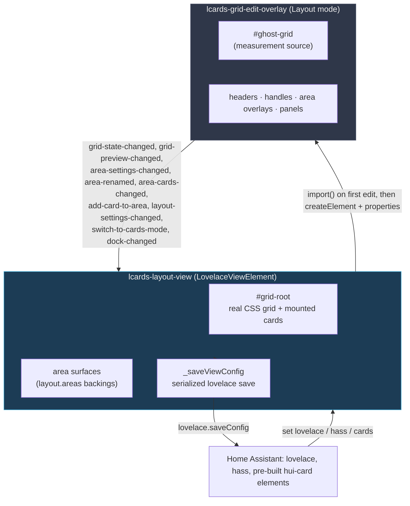
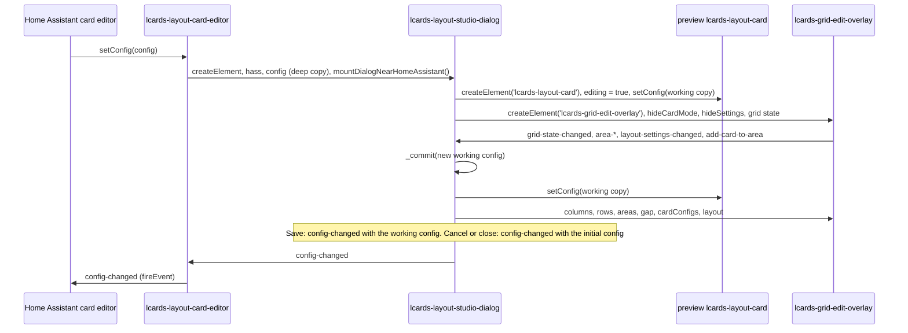

# Layout View and Layout Card

LCARdS has one CSS Grid layout engine with three front ends:

- **The layout view** (`custom:lcards-layout-view`, `src/views/lcards-layout-view.js`): a Lovelace view type (a `LovelaceViewElement`) that renders the grid for a whole view and has an in-view WYSIWYG editor in dashboard edit mode.
- **The layout card** (`custom:lcards-layout-card`, `src/cards/lcards-layout-card.js`): the same grid as a card, to nest a sub-grid in one area of a view (or in any view or stack). It is read-only on the dashboard.
- **The Layout Studio** (`src/editor/dialogs/lcards-layout-studio-dialog.js`): the full-screen dialog the layout card's GUI editor opens, with a live preview and the same grid editor on a large canvas.

This page covers how they are built and the non-obvious constraints behind the design. The user docs are [Layout View](../cards/layout-view/) and [Layout Card](../cards/layout-card/); the [Shell Strategy](shell-strategy.md) generates a whole dashboard on top of both.

The view and the shared pieces live in `src/views/`:

| File | Role |
|------|------|
| `lcards-layout-view.js` | The view element: renders the grid, mounts Home Assistant cards, owns config and persistence, manages the editor overlay. |
| `lcards-grid-edit-overlay.js` | The editor chrome (Layout mode): track handles, headers, area overlays, toolbars, settings panels. A lazy chunk: the view imports it on first edit, the studio imports it with itself. |
| `layout-edit-chrome.js` | Shared edit-mode chrome for the view and the overlay: mdi icon paths, the toolbar strip and panel styles, the Layout / Cards toggle, the dock width and breakpoint. |
| `layout-grid-utils.js` | Pure, DOM-free functions: track-list parsing and serialising, 2D area manipulation, area-settings reconciliation. |
| `layout-render.js` | Shared render helpers (`buildGridStyle`, `applyCardPlacement`, `applyGridItemHeight`, `renderAreaSurfaces`, `measureGridFrame`, `resolveColorValue`) used by the view, the card and the studio. |
| `layout-edit-dialogs.js` | Shared `ha-dialog` helpers: confirm (destructive actions), info and prompt. |

The card side:

| File | Role |
|------|------|
| `cards/lcards-layout-card.js` | Container card (a plain `LitElement`, not an `LCARdSCard`): renders the same grid, builds its own children as `hui-card` wrappers (so native Visibility works) and passes `hass` down. Read-only on the dashboard. |
| `cards/schemas/layout-card-schema.js` | The card's JSON Schema (registered by `LCARdSLayoutCard.registerSchema()`; also the studio's YAML tab schema). |
| `editor/cards/lcards-layout-card-editor.js` | The card's GUI editor: a thin launcher that shows a summary and opens the Layout Studio, then relays the studio's `config-changed` to Home Assistant. |
| `editor/dialogs/lcards-layout-studio-dialog.js` | The full-screen studio: one live preview card plus one grid overlay on a large canvas, a Layout tab (global and per-area settings), a tab per card (inline `hui-card-element-editor` plus placement) and a YAML tab. |

---

## Component model

The view holds the parsed grid state (`_columns`, `_rows`, `_areas`, `_gap`) and the raw `_config`. The overlay is **stateless about persistence**: it edits a copy of the grid passed in as properties and emits events; the view is the single writer.

---

## Imperative overlay creation (scoped-registry constraint)

The view does **not** put `<lcards-grid-edit-overlay>` in its Lit template. Home Assistant builds custom view elements through a *scoped* custom-element registry (`create-view-element.ts`). A globally-registered element nested via a Lit template tag inside that view throws:

> `Failed to construct 'HTMLElement': This instance is already constructed`

So `_syncEditOverlay()` (called from `updated()`) starts `import('./lcards-grid-edit-overlay.js')` (the overlay and the editor components it uses are a lazy chunk, which keeps them out of the main chunk's size budget), creates the overlay with `document.createElement('lcards-grid-edit-overlay')` (the **global** registry; the element upgrades when its definition arrives and keeps the properties set before then), wires events with `addEventListener`, sets state via properties, and appends it to `renderRoot`. It is removed when leaving Layout mode and on disconnect.

The **layout card** uses the same imperative pattern, but inside the **Layout Studio** dialog rather than Home Assistant's cramped card-edit dialog: the studio creates a single preview card *and* a single grid overlay via `document.createElement` on a large canvas. Because the studio owns one of each for its lifetime (and is destroyed on close), the duplicate-overlay/alignment problems of in-dialog editing don't arise. Editing needs **no edit-mode detection** and no nested-path `saveConfig`; overlay events update the studio's working config, and **Save** fires one `config-changed`, which the card's GUI editor relays to Home Assistant (see [The Layout Studio](#the-layout-studio)).

---

## The ghost-grid measurement pattern

The editor chrome is **not** laid out with CSS grid. Instead the overlay renders a transparent `#ghost-grid` with the same `grid-template-*`, and after each render `_measure()` (in a `requestAnimationFrame`) calls `getBoundingClientRect()` on every ghost cell to build `_cells[r][c]` pixel rects. All chrome (column/row headers, resize handles, area overlays, cell targets, popovers) is then **positioned absolutely** from those measurements via `_positionElements()`.

This avoids the offset bug that occurs when header/ruler tracks consume grid space. A `ResizeObserver` on the overlay re-measures whenever the view resizes (e.g. the Home Assistant sidebar expands/collapses), keeping the chrome aligned with the real grid.

### Header gutter

In edit mode the grid reserves room for the editor chrome so it never covers cards: `buildGridStyle(..., { editMode })` pads `#grid-root` by `editReserve(mode)` (`layout-grid-utils.js`): `EDIT_BAR_HEIGHT` (48px) on top for the toolbar strip in both modes, plus `GRID_EDIT_GUTTER` (28px) on top and left in Layout mode for the column/row headers. The view passes its edit sub-mode; the layout card passes `'grid'` while the Layout Studio sets `editing`. `_applyVisibilityRowHeights()` subtracts the grid's padding before sizing `fr` rows.

The overlay's ghost grid starts where the real grid's first cell starts: the parent calls `measureGridFrame(grid, overlay)` (`layout-render.js`), which returns the resolved px tracks (`measureColumns` / `measureRows`) and the first cell's offset (`measureOffset`, covering the reserve, `padding`, `margin` and border). Headers are positioned in the gutter (`cell.top - GUTTER`), so they cannot overlap area controls.

### Stacking order and hit targets

The overlay keeps one z-index scale (`Z` at the top of the file): cell targets < area tiles < resize segments < headers < gutter resize segment < area grips < selection / area preview < toolbar < dock and popups < drag chip. Resize handles are split into one segment per cell along a boundary plus one in the gutter (inserting a track is in the track menu, so nothing covers the handle); a segment whose two cells belong to the same area is hidden, so the middle of a spanning area stays the area. Menus (`ha-dropdown`) render in the top layer, so the host's `overflow: hidden` never clips them; `ha-dropdown` is `display: contents`, so the trigger `ha-icon-button` is what gets positioned.

### Docked inspector

Grid settings, a track's settings and an area's settings share one `.edit-dock` (`editDockStyles` in `layout-edit-chrome.js`): `_openDock({ settings | track | area })` shows one subject and replaces any other; while it shows an area it follows `_selectArea()`. The overlay fires `dock-changed` (`{ open }`) when it opens or closes. The view sets its `dock-open` attribute (`:host([dock-open])` pads the host by `EDIT_DOCK_WIDTH`, so `#grid-root` narrows) and the layout studio toggles `.dock-open` on its canvas; below `DOCK_SHEET_BREAKPOINT` the dock is a bottom sheet over the grid instead. In card mode the view shows a card's placement in its own dock (`_renderPlacementPanel`). The overlay's ResizeObserver re-measures when the grid narrows.

### Area move and resize

The selected area gets four edge grips (`_renderAreaGrips`), and its name chip is a move handle. `_areaDragStart/Move/End` hit-test cells with `_cellAtPoint`, build the target bounds (edges clamp to at least one cell; a move clamps to the grid) and validate them with `setAreaBounds()` (`layout-grid-utils.js`: frees the area's own cells, refuses overlaps with other areas). `.area-preview` shows the target, `.blocked` in the error colour. Only a drag that ends on a valid target commits (`grid-state-changed`); cards and `layout.areas` refer to the area by name, so they follow it unchanged.

### Stacked cards (card mode)

When several cards share a `grid-area`, `_placeCards()` adds a `.stack-picker` (one pill per card) to that area. The picked card (`_stackFocus[area]`, default the top one) gets a z-index above the stack's own and the others `pointer-events: none`, so its edit controls can be reached.

### Unified pointer dispatch

`connectedCallback` binds `pointermove` / `pointerup` / `pointercancel` to the overlay element (not `document`, because of shadow-DOM boundaries). Every drag captures its pointer (`setPointerCapture`), so a release outside the view still arrives and ends the drag; `pointercancel` ends any drag (a resize keeps the size reached). `_onAnyPointerMove`/`_onAnyPointerUp`/`_onAnyPointerCancel` route to whichever drag is active: track resize, header reorder, rubber-band area selection, or an area move / resize. The rubber-band hit-tests the measured cell rects (`_cellAtPoint`), so capturing on the first cell is safe; a click without a drag on an empty cell creates a one-cell area (handled in `_selUp`, since the captured pointer sends the click to the cell).

---

## Card placement & per-area surfaces

`_placeCards()` rebuilds `#grid-root` whenever cards or layout change:

1. **Area surfaces** (`renderAreaSurfaces()`, from `layout-render.js`): for each entry in `layout.areas`, a non-interactive `.area-surface` div is appended first (so cards paint above it by DOM order), styled by `applyAreaSurfaceStyle()`. `theme:` tokens in colors are resolved via `window.lcards.core.themeManager.resolver`.
2. **Cards**: each Home Assistant card element gets placement applied by `applyCardPlacement(gridItem, cardEl, viewLayout, cardMargin, cardOverflow, areaSettings, { cellFits })` (also from `layout-render.js`). `cellFits` comes from `cellHeightDefinite()` (`layout-grid-utils.js`): when the card's area has a definite height, the grid item gets `data-lcards-cell-fits` and an LCARdS button in it follows the cell instead of its preset's minimum height. `applyGridItemHeight()` forwards a card's own `height` to the grid item.

**Precedence:** global (`card_margin` / `card_overflow`) → per-area (`layout.areas[name]`) → per-card (`view_layout`). Grid placement and alignment land on the *grid item* (the card, or its edit-mode wrapper); `overflow` lands on the card so content clips regardless of the wrapper.

In edit mode every card element is `inert` (as Home Assistant does in its own views), so a click never runs a card's tap action. In Card mode each card is wrapped in a `.card-edit-wrap` (the grid item, `isolation: isolate`) with Home Assistant's `hui-card-edit-mode` controls rendered by `_renderCardControls()`: the whole card is the edit target (scrim + pencil, `ll-edit-card`), and a ⋮ `ha-dropdown` offers Edit, Placement & spacing and Delete (`ll-delete-card`, so Home Assistant shows its *Undo* toast). Controls show on hover, focus, or a first tap on touch screens (`_onDocPointerDown`). Empty areas get an **Add card** placeholder.

Every edit is a `lovelace.saveConfig`, and Home Assistant's `hui-root` commits each config change to its undo stack, so the dashboard toolbar's Undo / Redo covers the view's edits. Multi-key changes (alignment, overflow, per-area settings) are sent as one patch, so each is one save and one undo step.

Saves are serialized by `_saveViewConfig()`, which also waits for the previous config change's `lovelace_updated` event before saving (`_waitForSaveEvent()`, 2s fallback) and merges saves requested in the same tick. Home Assistant's panel ignores only **one** update event per `saveConfig` (a boolean flag); two saves before the first event arrives make the second event look external, and Home Assistant shows "Dashboard updated in another session". The classic trigger is saving from the `lovelace` setter right after Home Assistant saved a card (adding `grid-area` to a new card, restoring a stripped `view_layout`).

Cards are **always placed**; per-card visibility is not the view's concern. Home Assistant hands the view `hui-card` wrappers, which evaluate each card's native **Visibility** conditions and hide themselves reactively. The view therefore implements no `view_layout.show` handling (unlike upstream layout-card, whose card mode bypasses the `hui-card` wrapper).

---

## Visibility-driven row sizing

Home Assistant's `hui-card` wrapper hides cards by setting `display: none`. In a standard CSS Grid, a `display: none` item does not contribute to track sizing, so a row with only hidden cards collapses to `0px` naturally. In practice, Home Assistant's layout context does not provide the grid engine with a definite available block-size, so `fr` tracks expand to the max-content of their items rather than filling the remaining space. This makes `minmax(0,auto)` tracks collapse correctly but `1fr` tracks wrong.

The view solves this entirely in JS:

### `_baseRows` and `_visibilityRows`

`_baseRows` holds the row tracks as parsed from config (never modified at runtime). After every card placement, `_collectVisibilityRows()` scans the placed cards for a non-empty `visibility` array, any condition type or shape; conditions are **not** parsed. For each card with a definite `layout.height` and a `grid-area` it records `{ rowIndex, cardEl, targetHeight }` in `_visibilityRows`.

The view deliberately never evaluates conditions itself. Home Assistant's `hui-card` owns that (since Home Assistant 2026.10 stateful conditions are evaluated by core over a `subscribe_condition` websocket subscription, and Home Assistant's Visibility editor rewrites `state`/`numeric_state` conditions from lovelace `entity` shape into core `entity_id` shape). The view reads the outcome: `hui-card` toggles its `hidden` attribute and fires a bubbling, composed `card-visibility-changed` event, the same signal `hui-section` uses.

### `_applyVisibilityRowHeights()`

Called from: end of `_placeCards()`, every `updated()` (after Lit renders), and (rAF-debounced via `_scheduleRowHeights()`) every `card-visibility-changed` event and every host resize. It is **not** called from `set hass()`: entity updates reach it only through hui-card's visibility event, so ordinary state changes cost no layout reads.

1. **Build candidate rows**: start from `_baseRows`; a visibility row gets `targetHeight` if the view is in edit mode or **any** of its registered cards is not `hidden`, otherwise `'0px'`.
2. **Identify `fr` tracks**: locate all `Nfr` tracks in the candidate rows.
3. **Resolve non-fr sizes**: temporarily write the rows with every `fr` replaced by `0px` and force a reflow (`getComputedStyle`), so the browser evaluates all `clamp()`, `vh`, `px`, and `min()`/`max()` tracks to their actual pixel sizes.
4. **Compute fr allocation**: `frSpace = hostHeight - sum(non-fr rows) - sum(gaps)`. This is exact regardless of what the CSS Grid engine would have done.
5. **Final write**: replace every `Nfr` track with `round(frSpace × N / totalFR)px` and write `grid.style.gridTemplateRows` directly (bypassing Lit to avoid a re-render feedback loop).

Nested `hui-card`s (inside an MSD control, `lcards-layout-card` child, or elbow symbiont) never reach the view's listener: the enclosing top-level `hui-card` catches and stops `card-visibility-changed` from its own inner element.

### `ResizeObserver`

A `ResizeObserver` on the host element (created in `connectedCallback`, torn down in `disconnectedCallback`) fires `_applyVisibilityRowHeights()` via a `requestAnimationFrame` debounce whenever the host's bounding box changes: window resize, Home Assistant sidebar toggle, devtools open/close. This keeps row allocations correct across all viewport changes without polling.

### Debugging row sizing

`scripts/lcards-layout-debug.js` is a console paste script: run it on a dashboard with a layout view (or with the view selected in the DevTools Elements panel) to print each row's configured track against its computed height, the `_baseRows` / `_visibilityRows` state, unexpected `0px` rows and whether the host `ResizeObserver` is connected.

---

## Persistence & event flow

Home Assistant hands the view three inputs via setters: `hass`, `lovelace`, and `cards` (pre-built card elements). The view never pushes config to Home Assistant except through one funnel.

### Serialized saves

`_saveViewConfig()` coalesces concurrent edits into a single in-flight chain and **always rebases on the latest `lovelace.config`** at the moment each write runs. This prevents the *"Dashboard updated in another session"* error that stale-snapshot saves caused when several edits (resize commit, area create, card add) fired in quick succession.

### Card add / edit interception

Home Assistant's create-card and edit-card dialogs save **directly via `lovelace.saveConfig()`**, bypassing events. The view's `lovelace` setter diffs `prevCards` against the new cards:

- **Add** (length grew) with a pending area → injects `view_layout.grid-area` into the new card, then re-saves.
- **Edit** (same length) with a pending edit → restores `view_layout` if Home Assistant stripped it.

### Area lifecycle reconciliation

Per-area settings (`layout.areas`) are keyed by area name, so they must track renames and deletions:

- **Rename**: the overlay emits `area-renamed {from,to}` *before* `grid-state-changed`; the view migrates the key (`renameAreaSettings`) without saving, and the following grid-state save persists it.
- **Delete / track removal**: `_onGridStateChanged` prunes orphans via `pruneAreaSettings` against the current area names.

All of these route back through `_saveViewConfig`.

---

## The layout card

`LCARdSLayoutCard` (`src/cards/lcards-layout-card.js`) is a plain `LitElement` with `CARD_TYPE = 'layout-card'`, a schema, a lazy `getConfigElement()` and no `LCARdSCard` features (no rules, templates or entity subscriptions of its own; its children have theirs).

- **Children.** Home Assistant gives a *view* pre-built card elements, but not a card, so the card builds them. `setConfig()` deep-clones the config, parses the layout (`parseLayoutConfig()`) and rebuilds the children only when `cards` changed (a layout-only change re-places the existing ones). `_createChild()` prefers a `hui-card` wrapper (native Visibility, lifecycle, `preview`), falls back to `loadCardHelpers().createCardElement()`, then to a registered `custom:` element (outside Home Assistant: docs live demos and the browser test harness), and finally to `hui-error-card`.
- **HASS.** The `hass` setter passes the object to every child (`_propagateHass()`).
- **Placement.** `updated()` calls `_placeCards()` when the config, the grid state or `editing` changed: it empties `#grid-root`, appends the area surfaces (`renderAreaSurfaces()`), and appends every child with `applyCardPlacement()` and `applyGridItemHeight()`. The host height mirrors `layout.height` (default `100%`), because a percentage host in a content-sized row would collapse to 0.
- **Media queries.** `layout.mediaquery` overrides are matched with `matchMedia()` listeners (`_setupMediaQueries()`) and merged into the drawn grid by `_activeGrid()`; while `editing` is set (in the studio) the base layout is always drawn, because that is what the studio edits.
- **Edit mode.** `preview` (set by `hui-card` in dashboard edit mode) is passed to the children, so like `hui-stack-card` they stay visible when their Visibility conditions are not met. `editing` (set by the studio) reserves the overlay gutter (`buildGridStyle(..., { editMode: 'grid' })`).
- **Not in the card:** the view's visibility-driven row sizing and its in-place editor. A row of a layout card holding only hidden cards follows plain CSS Grid rules.

---

## The Layout Studio

- **Mounting.** The editor creates the dialog on **Open Layout Studio** and mounts it with `mountDialogNearHomeAssistant()` (inside `home-assistant`, so Home Assistant's Lit contexts reach `ha-dialog` and the pickers). The editor removes it on `closed` and on its own disconnect.
- **Working copy.** The `config` setter keeps `_initialConfig` and `_workingConfig` (both deep copies). Overlay events (`grid-state-changed`, `area-renamed`, `area-settings-changed`, `layout-settings-changed`, `area-cards-changed`, `add-card-to-area`) and the tabs change the working copy through `_commit()`, which re-renders the studio and pushes the copy to the preview and the overlay (`_syncCanvas()`). `grid-preview-changed` (a drag in progress) only writes the preview's `grid-template-*` styles.
- **Save and Cancel.** Nothing reaches Home Assistant while you edit. **Save** dispatches one `config-changed` with the working config; **Cancel**, Escape or closing the dialog dispatches `config-changed` with the initial config, so the card is never left in an intermediate state. `_handled` makes sure only the first of them fires (the dialog's asynchronous `closed` event follows a save).
- **Measuring.** A `ResizeObserver` on the preview's `#grid-root` feeds `measureGridFrame()` (resolved px tracks and the first cell's offset) to the overlay, so its ghost grid matches content-sized (`auto`) rows; the overlay is refreshed again one frame and 250 ms after opening, after the dialog animation.
- **Tabs.** *Layout*: grid and per-area settings (the overlay's own settings panel is hidden with `hideSettings`). *One tab per card*: placement (area, alignment, overflow, written to `view_layout`) and an inline `hui-card-element-editor`; its changes are committed quietly (`_commitQuiet()`, the preview updates without re-rendering the studio, so the editor keeps its input state). *YAML*: `lcards-studio-yaml-tab` with the layout card schema.
- **Adding cards.** The overlay's per-area **Add card** opens Home Assistant's `hui-card-picker` in an `ha-dialog`. Home Assistant registers the picker only after its own create-card dialog has opened once; when it is missing the studio shows an info dialog instead.
- **Removing cards** asks first (`showConfirmDeleteDialog()`) and can be undone by cancelling the studio.

---

## Drop-in compatibility

The schema mirrors `custom:grid-layout` (lovelace-layout-card): `layout.{grid-template-*, grid-gap, height, margin, padding, card_margin, card_overflow, mediaquery}` plus flat `cards[]` with `view_layout`. The grid renderer is ~50 lines of CSS plumbing replicated trivially; the value-add is the visual editor. Two intentional differences:

- **`layout.areas`** (surface decoration) is an LCARdS-only, optional, additive namespace that `custom:grid-layout` ignores, so configs stay portable in both directions.
- **`view_layout.show` is not implemented.** Per-card conditions defer to Home Assistant's native card Visibility (`hui-card`); a migrated config using `show` ignores that key.
