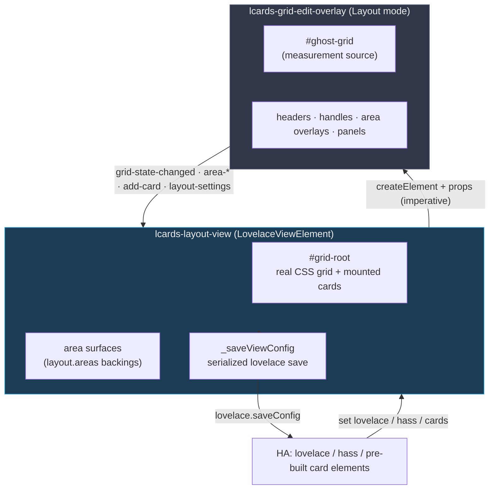

# Layout View Architecture

The **Layout View** (`custom:lcards-layout-view`) is a `LovelaceViewElement` that renders a CSS Grid and provides an in-view WYSIWYG editor. This page covers how it's built and the non-obvious constraints behind its design.

All code lives in `src/views/`:

| File | Role |
|------|------|
| `lcards-layout-view.js` | The view element: renders the grid, mounts HA-provided cards, owns config + persistence, manages the editor overlay. |
| `lcards-grid-edit-overlay.js` | The in-view editor chrome (Layout mode): track handles, headers, area overlays, toolbars, settings panels. |
| `layout-edit-chrome.js` | Shared edit-mode chrome for the view and the overlay: mdi icon paths, the toolbar strip and panel styles, the Layout / Cards toggle. |
| `layout-grid-utils.js` | Pure, DOM-free functions: track-list parsing, 2D area manipulation, area-settings reconciliation. |
| `layout-render.js` | Shared render helpers (`buildGridStyle`, `applyCardPlacement`, `renderAreaSurfaces`, `resolveColorValue`) used by both the view and the card. |
| `layout-edit-dialogs.js` | Shared `ha-dialog` confirmation helper (destructive actions). |

The **card** version (`custom:lcards-layout-card`) reuses all of the above:

| File | Role |
|------|------|
| `cards/lcards-layout-card.js` | Container card: renders the same grid, builds its own children as `hui-card` wrappers (so native Visibility works), propagates hass. Read-only on the dashboard. |
| `editor/cards/lcards-layout-card-editor.js` | The card's GUI editor: a thin launcher that opens the Layout Studio and relays its `config-changed` to HA. |
| `editor/dialogs/lcards-layout-studio-dialog.js` | Full-screen studio: a single live preview + grid overlay on a large canvas, a Layout tab (global settings), and a tab per card with an inline `hui-card-element-editor` + placement. |

---

## Component model

The view holds the parsed grid state (`_columns`, `_rows`, `_areas`, `_gap`) and the raw `_config`. The overlay is **stateless about persistence**: it edits a copy of the grid passed in as properties and emits events; the view is the single writer.

---

## Imperative overlay creation (scoped-registry constraint)

The view does **not** put `<lcards-grid-edit-overlay>` in its Lit template. HA builds custom view elements through a *scoped* custom-element registry (`create-view-element.ts`). A globally-registered element nested via a Lit template tag inside that view throws:

> `Failed to construct 'HTMLElement': This instance is already constructed`

So `_syncEditOverlay()` (called from `updated()`) creates the overlay with `document.createElement('lcards-grid-edit-overlay')` (the **global** registry), wires events with `addEventListener`, sets state via properties, and appends it to `renderRoot`. It is removed when leaving Layout mode and on disconnect.

The **layout card** uses the same imperative pattern, but inside the **Layout Studio** dialog rather than HA's cramped card-edit dialog: the studio creates a single preview card *and* a single grid overlay via `document.createElement` on a large canvas. Because the studio owns one of each for its lifetime (and is destroyed on close), the duplicate-overlay/alignment problems of in-dialog editing don't arise. Editing needs **no edit-mode detection** and no nested-path `saveConfig`; overlay events recompute a working config and the studio fires `config-changed`, which the card's GUI editor relays to HA. New cards use HA's `hui-card-picker`; each card is edited inline with `hui-card-element-editor` in its tab.

---

## The ghost-grid measurement pattern

The editor chrome is **not** laid out with CSS grid. Instead the overlay renders a transparent `#ghost-grid` with the same `grid-template-*`, and after each render `_measure()` (in a `requestAnimationFrame`) calls `getBoundingClientRect()` on every ghost cell to build `_cells[r][c]` pixel rects. All chrome (column/row headers, resize handles, area overlays, cell targets, popovers) is then **positioned absolutely** from those measurements via `_positionElements()`.

This avoids the offset bug that occurs when header/ruler tracks consume grid space. A `ResizeObserver` on the overlay re-measures whenever the view resizes (e.g. the HA sidebar expands/collapses), keeping the chrome aligned with the real grid.

### Header gutter

In edit mode the grid reserves room for the editor chrome so it never covers cards: `buildGridStyle(..., { editMode })` pads `#grid-root` by `editReserve(mode)` (`layout-grid-utils.js`): `EDIT_BAR_HEIGHT` (48px) on top for the toolbar strip in both modes, plus `GRID_EDIT_GUTTER` (28px) on top and left in Layout mode for the column/row headers. The view passes its edit sub-mode; the layout card passes `'grid'` while the Layout Studio sets `editing`. `_applyVisibilityRowHeights()` subtracts the grid's padding before sizing `fr` rows.

The overlay's ghost grid starts where the real grid's first cell starts: the parent calls `measureGridFrame(grid, overlay)` (`layout-render.js`), which returns the resolved px tracks (`measureColumns` / `measureRows`) and the first cell's offset (`measureOffset`, covering the reserve, `padding`, `margin` and border). Headers are positioned in the gutter (`cell.top - GUTTER`), so they cannot overlap area controls.

### Stacking order and hit targets

The overlay keeps one z-index scale (`Z` at the top of the file): cell targets < area tiles < resize segments < headers < gutter resize segment < area grips < selection / area preview < toolbar < dock and popups < drag chip. Resize handles are split into one segment per cell along a boundary plus one in the gutter (inserting a track is in the track menu, so nothing covers the handle); a segment whose two cells belong to the same area is hidden, so the middle of a spanning area stays the area. Menus (`ha-dropdown`) render in the top layer, so the host's `overflow: hidden` never clips them; `ha-dropdown` is `display: contents`, so the trigger `ha-icon-button` is what gets positioned.

### Docked inspector

Grid settings, a track's settings and an area's settings share one `.edit-dock` (`editDockStyles` in `layout-edit-chrome.js`): `_openDock({ settings | track | area })` shows one subject and replaces any other; while it shows an area it follows `_selectArea()`. The overlay fires `dock-changed` (`{ open }`) when it opens or closes. The view sets its `dock-open` attribute (`:host([dock-open])` pads the host by `EDIT_DOCK_WIDTH`, so `#grid-root` narrows) and the layout studio toggles `.dock-open` on its canvas; below `DOCK_SHEET_BREAKPOINT` the dock is a bottom sheet over the grid instead. In card mode the view shows a card's placement in its own dock (`_renderPlacementPanel`). The overlay's ResizeObserver re-measures when the grid narrows.

### Area move and resize

The selected area gets four edge grips (`_renderAreaGrips`), and its name chip is a move handle. `_areaDragStart/Move/End` hit-test cells with `_cellAtPoint`, build the target bounds (edges clamp to at least one cell; a move clamps to the grid) and validate them with `setAreaBounds()` (`layout-grid-utils.js`: frees the area's own cells, refuses overlaps with other areas). `.area-preview` shows the target, `.blocked` in the error colour. Only a drag that ends on a valid target commits (`grid-state-changed`); cards and `layout.areas` refer to the area by name, so they follow it unchanged.

### Stacked cards (card mode)

When several cards share a `grid-area`, `_placeCards()` adds a `.stack-picker` (one pill per card) to that area. The picked card (`_stackFocus[area]`, default the top one) gets a z-index above the stack's own and the others `pointer-events: none`, so its edit controls can be reached.

### Unified pointer dispatch

`connectedCallback` binds `pointermove` / `pointerup` / `pointercancel` to the overlay element (not `document`, because of shadow-DOM boundaries). Every drag captures its pointer (`setPointerCapture`), so a release outside the view still arrives and ends the drag; `pointercancel` ends any drag (a resize keeps the size reached). `_onAnyPointerMove`/`_onAnyPointerUp`/`_onAnyPointerCancel` route to whichever drag is active: track resize, header reorder, rubber-band area selection, or an area move / resize. The rubber-band hit-tests the measured cell rects (`_cellAtPoint`), so capturing on the first cell is safe; a click without a drag on an empty cell creates a one-cell area (handled in `_selUp`, since the captured pointer sends the click to the cell).

---

## Card placement & per-area surfaces

`_placeCards()` rebuilds `#grid-root` whenever cards or layout change:

1. **Area surfaces** (`renderAreaSurfaces()`, from `layout-render.js`): for each entry in `layout.areas`, a non-interactive `.area-surface` div is appended first (so cards paint above it by DOM order), styled by `applyAreaSurfaceStyle()`. `theme:` tokens in colors are resolved via `window.lcards.core.themeManager.resolver`.
2. **Cards**: each HA-provided card element gets placement applied by `applyCardPlacement(gridItem, cardEl, viewLayout, cardMargin, cardOverflow, areaSettings)` (also from `layout-render.js`).

**Precedence:** global (`card_margin` / `card_overflow`) → per-area (`layout.areas[name]`) → per-card (`view_layout`). Grid placement and alignment land on the *grid item* (the card, or its edit-mode wrapper); `overflow` lands on the card so content clips regardless of the wrapper.

In edit mode every card element is `inert` (as HA does in its own views), so a click never runs a card's tap action. In Card mode each card is wrapped in a `.card-edit-wrap` (the grid item, `isolation: isolate`) with HA's `hui-card-edit-mode` controls rendered by `_renderCardControls()`: the whole card is the edit target (scrim + pencil, `ll-edit-card`), and a ⋮ `ha-dropdown` offers Edit, Placement & spacing and Delete (`ll-delete-card`, so HA shows its *Undo* toast). Controls show on hover, focus, or a first tap on touch screens (`_onDocPointerDown`). Empty areas get an **Add card** placeholder.

Every edit is a `lovelace.saveConfig`, and HA's `hui-root` commits each config change to its undo stack, so the dashboard toolbar's Undo / Redo covers the view's edits. Multi-key changes (alignment, overflow, per-area settings) are sent as one patch, so each is one save and one undo step.

Saves are serialized by `_saveViewConfig()`, which also waits for the previous config change's `lovelace_updated` event before saving (`_waitForSaveEvent()`, 2s fallback) and merges saves requested in the same tick. HA's panel ignores only **one** update event per `saveConfig` (a boolean flag); two saves before the first event arrives make the second event look external, and HA shows "Dashboard updated in another session". The classic trigger is saving from the `lovelace` setter right after HA saved a card (adding `grid-area` to a new card, restoring a stripped `view_layout`).

Cards are **always placed**; per-card visibility is not the view's concern. HA hands the view `hui-card` wrappers, which evaluate each card's native **Visibility** conditions and hide themselves reactively. The view therefore implements no `view_layout.show` handling (unlike upstream layout-card, whose card mode bypasses the `hui-card` wrapper).

---

## Visibility-driven row sizing

HA's `hui-card` wrapper hides cards by setting `display: none`. In a standard CSS Grid, a `display: none` item does not contribute to track sizing, so a row with only hidden cards collapses to `0px` naturally. In practice, HA's layout context does not provide the grid engine with a definite available block-size, so `fr` tracks expand to the max-content of their items rather than filling the remaining space. This makes `minmax(0,auto)` tracks collapse correctly but `1fr` tracks wrong.

The view solves this entirely in JS:

### `_baseRows` and `_visibilityRows`

`_baseRows` holds the row tracks as parsed from config (never modified at runtime). After every card placement, `_collectVisibilityRows()` scans the placed cards for a non-empty `visibility` array, any condition type or shape; conditions are **not** parsed. For each card with a definite `layout.height` and a `grid-area` it records `{ rowIndex, cardEl, targetHeight }` in `_visibilityRows`.

The view deliberately never evaluates conditions itself. HA's `hui-card` owns that (since HA 2026.10 stateful conditions are evaluated by core over a `subscribe_condition` websocket subscription, and HA's Visibility editor rewrites `state`/`numeric_state` conditions from lovelace `entity` shape into core `entity_id` shape). The view reads the outcome: `hui-card` toggles its `hidden` attribute and fires a bubbling, composed `card-visibility-changed` event, the same signal `hui-section` uses.

### `_applyVisibilityRowHeights()`

Called from: end of `_placeCards()`, every `updated()` (after Lit renders), and (rAF-debounced via `_scheduleRowHeights()`) every `card-visibility-changed` event and every host resize. It is **not** called from `set hass()`: entity updates reach it only through hui-card's visibility event, so ordinary state changes cost no layout reads.

1. **Build candidate rows**: start from `_baseRows`; a visibility row gets `targetHeight` if the view is in edit mode or **any** of its registered cards is not `hidden`, otherwise `'0px'`.
2. **Identify `fr` tracks**: locate all `Nfr` tracks in the candidate rows.
3. **Resolve non-fr sizes**: temporarily write the rows with every `fr` replaced by `0px` and force a reflow (`getComputedStyle`), so the browser evaluates all `clamp()`, `vh`, `px`, and `min()`/`max()` tracks to their actual pixel sizes.
4. **Compute fr allocation**: `frSpace = hostHeight - sum(non-fr rows) - sum(gaps)`. This is exact regardless of what the CSS Grid engine would have done.
5. **Final write**: replace every `Nfr` track with `round(frSpace × N / totalFR)px` and write `grid.style.gridTemplateRows` directly (bypassing Lit to avoid a re-render feedback loop).

Nested `hui-card`s (inside an MSD control, `lcards-layout-card` child, or elbow symbiont) never reach the view's listener: the enclosing top-level `hui-card` catches and stops `card-visibility-changed` from its own inner element.

### `ResizeObserver`

A `ResizeObserver` on the host element (created in `connectedCallback`, torn down in `disconnectedCallback`) fires `_applyVisibilityRowHeights()` via a `requestAnimationFrame` debounce whenever the host's bounding box changes: window resize, HA sidebar toggle, devtools open/close. This keeps row allocations correct across all viewport changes without polling.

---

## Persistence & event flow

HA hands the view three inputs via setters: `hass`, `lovelace`, and `cards` (pre-built card elements). The view never pushes config to HA except through one funnel.

### Serialized saves

`_saveViewConfig()` coalesces concurrent edits into a single in-flight chain and **always rebases on the latest `lovelace.config`** at the moment each write runs. This prevents the *"Dashboard updated in another session"* error that stale-snapshot saves caused when several edits (resize commit, area create, card add) fired in quick succession.

### Card add / edit interception

HA's create-card and edit-card dialogs save **directly via `lovelace.saveConfig()`**, bypassing events. The view's `lovelace` setter diffs `prevCards` against the new cards:

- **Add** (length grew) with a pending area → injects `view_layout.grid-area` into the new card, then re-saves.
- **Edit** (same length) with a pending edit → restores `view_layout` if HA stripped it.

### Area lifecycle reconciliation

Per-area settings (`layout.areas`) are keyed by area name, so they must track renames and deletions:

- **Rename**: the overlay emits `area-renamed {from,to}` *before* `grid-state-changed`; the view migrates the key (`renameAreaSettings`) without saving, and the following grid-state save persists it.
- **Delete / track removal**: `_onGridStateChanged` prunes orphans via `pruneAreaSettings` against the current area names.

All of these route back through `_saveViewConfig`.

---

## Drop-in compatibility

The schema mirrors `custom:grid-layout` (lovelace-layout-card): `layout.{grid-template-*, grid-gap, height, margin, padding, card_margin, card_overflow, mediaquery}` plus flat `cards[]` with `view_layout`. The grid renderer is ~50 lines of CSS plumbing replicated trivially; the value-add is the visual editor. Two intentional differences:

- **`layout.areas`** (surface decoration) is an LCARdS-only, optional, additive namespace that `custom:grid-layout` ignores, so configs stay portable in both directions.
- **`view_layout.show` is not implemented.** Per-card conditions defer to HA's native card Visibility (`hui-card`); a migrated config using `show` ignores that key.
