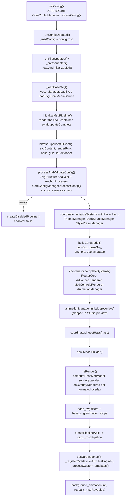

# MSD Rendering Pipeline

> Internal architecture of the `lcards-msd-card`: how config becomes a rendered Master Systems Display.

---

## Overview

The MSD card has a dedicated rendering pipeline in `src/msd/`. It composes a base SVG with any number of positioned overlays (embedded cards, routed lines, shapes), routes SVG lines between them, and applies per-overlay animations and rules. The card element itself (`LCARdSMSDCard`, `src/cards/lcards-msd.js`) extends `LCARdSCard` like every other card; the pipeline is what it adds on top.

Non-MSD cards use `LCARdSCard` directly; the MSD pipeline is purposely isolated. The rules for working in `src/msd/` (overlay types, z-order, animations, Studio conventions, anti-patterns) live in `.github/instructions/msd.instructions.md`; this page explains how the pieces fit.

The entry point is `initMsdPipeline()` (`src/msd/pipeline/PipelineCore.js:34`, re-exported by `src/msd/index.js`). It returns the pipeline API object the card stores on `this._msdPipeline`.

---

## Pipeline Stages

What happens between `setConfig()` and a visible MSD, in call order:



Step by step, with the code that does it:

1. **Card config processing.** `LCARdSCard.setConfig()` runs the card config (with `msd:` nested inside it) through `CoreConfigManager.processConfig()` like every card. `_onConfigUpdated()` (`lcards-msd.js:265`) stores `this._msdConfig = config.msd` and `this._fullConfig = config`; a `view_box` with no `base_svg.source` becomes `source: none` here. On a live `setConfig()` of an already running pipeline it also calls `_reconcileViewBoxIfChanged()` (`:323`), which pushes a changed view box into `cardModel` and `router.setViewBox()` and re-renders.
2. **Load.** `_loadAndInitializeMsd()` (`:398`, a dedup wrapper so the first-mount and reconnect entry points never run twice at once) awaits config processing, loads the SVG through `AssetManager` (`_loadBaseSvg()`, `:1089`; `media-source://` sources take the async resolve path), and picks the instance GUID (`msd-<config.id>` or `msd-<cardGuid>`). Card picker and editor-dialog previews (`_isPreviewMode` `picker`/`editor`) skip the pipeline entirely and render a placeholder.
3. **Mount the SVG.** `_initializeMsdPipeline()` (`:1152`) sets `_msdInitialized = true` so `_renderCard()` switches from the loading spinner to `_renderSvgContainer()`, awaits `updateComplete`, and checks that an `<svg>` exists in the render root. The container stays at opacity 0 until the reveal in step 9.
4. **Config processing and anchors** (`processAndValidateConfig()`, `src/msd/pipeline/ConfigProcessor.js:24`). Resolves the effective view box (explicit `view_box` > the SVG's own > default), computes landmark anchors with `SvgStructureAnalyzer` (unless `base_svg.harvest_landmarks: false`), harvests SVG element anchors with `AnchorProcessor` (unless `base_svg.harvest_svg_elements: false`), runs the config through `CoreConfigManager.processConfig(config, 'msd')` again, flattens the result to the `msd` object (`mergedConfig`), resolves percentage coordinates in anchors and in overlay `position`/`anchor`/`attach_to`, and checks every string anchor reference. A missing or self-referencing anchor is an error (`anchor.missing`, `anchor.self_reference`); any error returns a disabled pipeline (`createDisabledPipeline()`, `PipelineCore.js:466`) with `enabled: false`.
5. **Coordinator, phase one** (`initializeSystemsWithPacksFirst()`, `MsdCardCoordinator.js:87`). Takes the shared core `ThemeManager`, `StylePresetManager` and `DataSourceManager` (the MSD creates no data sources of its own: card-root `data_sources` are created by `LCARdSCard._processDataSourcesConfig()`, and the core feeds the manager HASS). `PipelineCore` then points the core `CoreValidationService` at the theme and data source managers.
6. **Card model** (`buildCardModel()`, `src/msd/model/CardModel.js:16`). Builds `{ viewBox, baseSvg: { source, filters, animations }, anchors, overlaysBase, animations, __raw }`. `overlaysBase` holds one normalized entry per overlay (`id`, `type`, `style`, `raw`, plus the position, size and line keys it copies); a line's `anchor` becomes its `position` here.
7. **Coordinator, phase two** (`completeSystems()`, `MsdCardCoordinator.js:151`). Creates one `RouterCore` per card (config `{ ...msd.routing, channels: msd.channels }`, the card model's anchors and view box), the `AdvancedRenderer` and the `MsdControlsRenderer`, and takes the shared core `AnimationManager`.
8. **Animations, HASS, first render.** `AnimationManager.initialize(overlays)` only registers animation definitions per overlay id; it runs before `ModelBuilder` exists and long before any DOM. `coordinator.ingestHass()` pushes the first HASS. `new ModelBuilder()` is stored as `coordinator.modelBuilder`, `reRender()` is handed to the coordinator (`setReRenderCallback`) and run once. After it: `applyBaseSvgFilters()` on `#__msd-base-content`, and the `base_svg.animations` scope (`__msd_base_svg:<guid>`) is registered once, since the base SVG group never changes after the first parse.
9. **Card wiring.** Back in the card: `setCardInstance(this)` (actions and state colours reach the card through `coordinator.cardInstance`), `_registerOverlaysWithRulesEngine()` (`:547`), an await of the rules re-render that registration may start, `_processCustomTemplates()` (pre-evaluates Jinja2/JavaScript templates in overlay styles), then the `background_animation` layer and the reveal (`_msdRevealed = true`).

In MSD Studio's live preview (`isEditMode`, the card's `_isStudioPreview`) the pipeline skips every animation registration and the background animation: that preview card is destroyed and rebuilt on every edit and every HASS tick (`lcards-msd-live-preview.js`), so starting them is wasted work.

### Each render (`reRender()`)

`reRender()` (`PipelineCore.js:211`) is the full structural render. It is serialized: a call while one is running sets `coordinator._queuedReRender` and returns `{ success: false, reason: 'render_in_progress', queued: true }`; the queued render runs 50 ms after the running one finishes.

1. `ModelBuilder.computeResolvedModel()` (`ModelBuilder.js:21`) builds each overlay from `overlaysBase` (`{ ...raw, ...base, style, finalStyle, _raw }`, `theme:` tokens in `style` resolved through the component-scoped `ThemeManager.resolver`), hands the overlays to `router.setOverlays()`, and returns `{ viewBox, anchors, overlays, animations, config }` (`animations` is always empty: overlay animations are read from each overlay's own `animations` list).
2. `AdvancedRenderer.render(resolvedModel)` draws everything (next section).
3. `cardInstance._onMsdRendered()` re-applies the last style-only rule patches to the fresh DOM.
4. For every overlay with registered animations, `AnimationManager.onOverlayRendered(id, element, overlay, coordinator)`, where `element` is `[data-overlay-id="<id>"]`. Then the card-level `msd.animations` scope (`__msd_animations:<guid>`) on `#msd-overlay-container`; it re-registers every render because that group's children are rebuilt.

### Inside `AdvancedRenderer.render()`

`src/msd/renderer/AdvancedRenderer.js:85`:

1. Finds the `<svg>` in the mount element, gets or creates `<g id="msd-overlay-container">`, empties it (`innerHTML = ''`) and clears `overlayElementCache`.
2. **Pass 2a, everything but lines**, awaited one by one so each control's attachment points exist before any line routes. Controls whose `position` names another control render after the independent ones (one level of dependency). Shapes render through `ShapeOverlay` and register their attachment points right after (bbox points plus kebab-case corner aliases, or `<id>.vertex<N>` per polyline vertex). Controls go to `MsdControlsRenderer.renderControlOverlay()`.
3. Waits two animation frames for embedded cards to settle, then builds virtual anchors from every overlay's attachment points and the static anchors.
4. **Route discovery** (`_discoverLineRoutes()`, `:899`): routes every line in id order, discarding the markup, until RouterCore's registry version stops changing or `trunk_discovery_max_passes` (default 4) is reached, so bundling and crossing results do not depend on YAML order.
5. **Pass 2b, lines** in declaration order, through `LineOverlay` with the complete anchor set (static plus virtual).
6. **Z-order pass**: every cached overlay element (lines, shapes and the control `<foreignObject>`s, which `MsdControlsRenderer` puts in the cache) is re-appended to `#msd-overlay-container` sorted by `OverlayUtils.compareByZIndex()` (`z_index`, else the type default from `DEFAULT_Z_BY_TYPE`: control 200, line 100, shape 50; declaration order breaks ties).

(The renderer still carries an empty "pass 1" for early overlay types; no type uses it.)

### DOM produced

```
#msd-v1-comprehensive-wrapper           aspect-ratio from the view box; opacity 0 until revealed
├─ div[data-msd-background-layer]       background_animation canvas (z-index -1), when configured
└─ div
   └─ svg[viewBox]                      the base SVG (or an empty one for source: none)
      ├─ g#__msd-base-content           base SVG children; display:none with render_visual: false
      ├─ g#msd-overlay-container        after the z-order pass: every overlay, sorted
      │  ├─ g[data-overlay-id]          line / shape markup
      │  └─ foreignObject#<id>[data-overlay-id][data-overlay-type="control"]
      │     └─ div.msd-control-wrapper
      │        └─ hui-card              wraps the embedded card (visibility: support)
      └─ g#msd-controls-container       where controls are first inserted; emptied by the z-order pass
```

---

## Key Classes

| Class / function | File | Role |
|---|---|---|
| `initMsdPipeline()` | `src/msd/pipeline/PipelineCore.js` | Entry point: runs the stages above, defines `reRender()`, returns the pipeline API (`createPipelineApi()`) or a disabled pipeline |
| `processAndValidateConfig()` | `src/msd/pipeline/ConfigProcessor.js` | A module function, not a class: view box, anchor harvesting and merging, `CoreConfigManager.processConfig()`, percentage resolution, anchor reference errors |
| `AnchorProcessor` | `src/msd/pipeline/AnchorProcessor.js` | Static helpers: harvests SVG element anchors (through `window.lcards.findSvgAnchors`), resolves percentage coordinates, merges the three anchor layers |
| `SvgStructureAnalyzer` | `src/msd/pipeline/SvgStructureAnalyzer.js` | Rasterizes the base SVG to a mask and derives landmark anchors (`analyzeAnchors()`); the MSD Studio Shield Bubble flow uses its boundary tracing (`analyzeShieldBubbleRaw()`, `splitBoundaryIntoSections()`) |
| `MsdCardCoordinator` | `src/msd/pipeline/MsdCardCoordinator.js` | Per-card owner of the router and renderers; holds the single per-card HASS (`ingestHass()` / `getHass()`), applies rule `base_svg` filter updates (`_applyBaseSvgUpdate()`), tears down in `destroy()` |
| `buildCardModel()` | `src/msd/model/CardModel.js` | Resolves `base_svg` source, filters and animations, the view box, anchors, and normalizes the overlay list (`overlaysBase`) |
| `ModelBuilder` | `src/msd/pipeline/ModelBuilder.js` | Builds the resolved model on every `reRender()`: merges each overlay's raw config with its card-model entry, resolves `theme:` tokens in `style` |
| `AdvancedRenderer` | `src/msd/renderer/AdvancedRenderer.js` | Render orchestrator: phased render, route discovery, z-order pass, attachment points; the targeted update path `updateLineEntityColors()` |
| `MsdControlsRenderer` | `src/msd/controls/MsdControlsRenderer.js` | Control overlays: builds the embedded card (inside `hui-card`), positions it in a `<foreignObject>` in view box space, registers its attachment points, forwards HASS to the controls whose entities changed |
| `OverlayBase` | `src/msd/overlays/OverlayBase.js` | Base class of the instance renderers (`LineOverlay`, `ShapeOverlay`): lifecycle (`initialize`, `render`, `destroy`), animation targets. Overlays have no data subscriptions: a change re-renders the card or patches the DOM (see the table under Rendering). Extends `BaseRenderer`. Controls do not use it |
| `LineOverlay` | `src/msd/overlays/LineOverlay.js` | Per-line renderer: resolves endpoints, asks `RouterCore` for the route, builds the SVG path and markers, resolves the line's colour |
| `ShapeOverlay` | `src/msd/overlays/ShapeOverlay.js` | `shape` overlays (`polyline`/`rect`/`circle`); a sibling of `LineOverlay`, not a subclass |
| `RouterCore` | `src/msd/routing/RouterCore.js` | Pathfinding engine, one instance per card. See [Routing Engine](./routing.md) |
| `AttachmentPointManager` | `src/msd/renderer/AttachmentPointManager.js` | Per-render store of overlay attachment points and named anchors used as line endpoints |
| `BaseRenderer` | `src/msd/renderer/BaseRenderer.js` | Shared helpers for overlay renderers: theme manager lookup, defaults, style-resolution provenance, scaling context |
| `OverlayUtils` | `src/msd/renderer/OverlayUtils.js` | Position resolution, 9-point bbox attachment points, z-index defaults and comparison (`DEFAULT_Z_BY_TYPE`, `compareByZIndex()`) |
| `RendererUtils` | `src/msd/renderer/RendererUtils.js` | Lower-level geometry and SVG helpers used by `OverlayUtils` and the overlays |
| `BaseSvgFilters` | `src/msd/utils/BaseSvgFilters.js` | `applyBaseSvgFilters()`, `transitionBaseSvgFilters()`, `clearBaseSvgFilters()` on `#__msd-base-content` |

---

## Overlay Types

| Type | Rendered by | Description |
|---|---|---|
| `control` | `MsdControlsRenderer` | Any Home Assistant card (including LCARdS cards) in a `<foreignObject>` at view box coordinates. The card config comes from the overlay's `card:`; LCARdS cards get the overlay id as their `id` and the overlay's `tags` |
| `line` | `LineOverlay` | Routed SVG path from an anchor, overlay or `[x, y]` to another |
| `shape` | `ShapeOverlay` | `kind: polyline` (a path through `RouterCore` forced to `manual`), `rect`/`circle` (native `<rect>`/`<ellipse>` with controls' `position` + `size`) |

`AdvancedRenderer._getRendererForOverlay()` (`:963`) decides: `line` and `shape` get a cached instance renderer; `control` (and any `custom:`, `hui-` or known Home Assistant card type) returns `null`, which sends the overlay to `MsdControlsRenderer`.

### Control overlays (`MsdControlsRenderer`)

- **Building the card.** `createControlElement()` (`:824`) wraps the card config in `hui-card` (`createHuiCardWrapper()` from `src/utils/ha-card-factory.js`) so Home Assistant's own `visibility:` evaluation runs; Studio passes `editMode` so the preview always shows. Without `hui-card` it falls back to `createCardElement()`. The config is the overlay's `card:` (or its nested `config:`), with `_msdGenerated: true`.
- **Positioning** (`positionControlElement()`, `:1272`). Resolves `position` (anchor name, another control's id with `position_side`, or `[x, y]`) and `size`, applies the `attachment` offset, and creates a `<foreignObject>` with `id`, `data-msd-control-id`, `data-overlay-id` and `data-overlay-type="control"`. `data-overlay-id` is what PipelineCore's animation lookup needs. The card gets `data-msd-design-size="W,H"` so `LCARdSCard` sizes to the design size and scales with the SVG.
- **Attachment points.** `_computeAttachmentPointsFromBox()` registers the 9-point box (with kebab-case corner aliases) in the renderer's `AttachmentPointManager`, so lines can attach to the control.
- **HASS forwarding** (`setHass()`, `:266`). Cards in a `<foreignObject>` inside the MSD's shadow root do not get HASS from Home Assistant's tree, so the renderer forwards it. It tracks each control's entities (`_controlEntityMap`, from the card config strings and the overlay's `triggers_update`) and only updates controls whose entities changed. A control with `triggers_update: all` always updates; card-wide `msd.triggers_update: all` updates every control on every tick.
- **Locked** controls get `pointer-events: none` only in Studio (`_resolvePointerEvents()`); on a dashboard `locked` has no effect.

---

## Base SVG & Anchors

The MSD renders a base SVG (`base_svg.source`: a `builtin:` key, a `/local/` path, a URL or a `media-source://` item; or `none` for a blank canvas sized by `view_box`). The card wraps its children in `<g id="__msd-base-content">` (`_wrapSvgContentForRender()`, `lcards-msd.js:1971`), the group filters, rule `base_svg` updates and `base_svg.animations` target.

**Anchors** are named points that overlays reference by name (`position`, `anchor`, `attach_to`, polyline `points`). Three layers, lowest precedence first (`AnchorProcessor.processAnchors()`):

| Layer | Source | Turned off by |
|---|---|---|
| Landmark anchors | `SvgStructureAnalyzer.analyzeAnchors()`: rasterizes the SVG (at most 960 px on the long side, cached by content hash), closes small gaps, and finds `lateral_a`, `lateral_b`, `extremity_bow`, `extremity_stern`, `extremity_top`, `extremity_bottom`, `hull_center` | `base_svg.harvest_landmarks: false` |
| SVG element anchors | `findSvgAnchors()` (`src/utils/lcards-anchor-helpers.js:28`): **any** `<circle>`, `<ellipse>`, `<text>` or `<rect>` with an `id` becomes an anchor named by that id (circles and ellipses at `cx,cy`, text at `x,y`, rects at the centre of their box, mapped through the element's transform). A `<g>` with an `id` is placed at the centre of its bounding box (`getBBox()`, mapped through the group's transform); where there is no layout engine, at the centre of the anchors inside it, and a group with neither is left out, so a reference to it is reported as a missing anchor. Ids starting with `__` or `msd-internal-` are skipped | `base_svg.harvest_svg_elements: false` |
| Config anchors | `msd.anchors`: `[x, y]`, numbers or percentages of the view box (`"50%"`) | - |

Overlay ids are anchors too: a line can `anchor`/`attach_to` any overlay id, and a control's `position` can name another control. Percentages in an overlay's own `position`/`anchor`/`attach_to` arrays are resolved against the view box in `processAndValidateConfig()`.

```yaml
type: custom:lcards-msd-card
msd:
  base_svg:
    source: builtin:ncc-1701-a-blue
  overlays:
    - id: warp_status
      type: control
      position: warp_core      # an anchor harvested from the SVG (e.g. <circle id="warp_core">)
      size: [200, 90]
      card:
        type: custom:lcards-button
        preset: lozenge
```

Changing anchors at runtime: `pipelineApi.setAnchor(id, [x, y])` writes the anchor into the card model and the current resolved model, invalidates every cached route and calls `renderer.render()` directly.

---

## Line Routing

All pathfinding lives in **`RouterCore`** (one instance per MSD card, shared by every line and polyline shape). `LineOverlay` resolves a line's endpoints and asks `RouterCore` for the path; `AdvancedRenderer` runs the pre-render discovery loop described above so the router's shared trunk and crossing registries settle before the real pass consumes the cached routes.

The engine provides: A* grid routing with obstacle avoidance, cardinal `anchor_side`/`attach_side` guarantees, trunk-and-branch bundling (parallel lines share evenly spaced lanes; channels are pre-seeded trunks), crossing avoidance, and corner rounding, beveling and smoothing.

Full internals (registries, derived lane assignment, convergence discipline, caching): [Routing Engine (RouterCore)](./routing.md). User-facing configuration: [Line Routing](../../cards/msd/routing.md). Manual waypoints: [Manual Routing](../../cards/msd/manual-routing.md).

---

## Shape Attachment Points

`shape` overlays register into `AttachmentPointManager` the same way controls do, so a `line` can `attach_to` one. This happens inline in `AdvancedRenderer`'s pass 2a, right after each shape renders (before any line that might target it):

- **`rect`/`circle`**: `OverlayUtils.computeAttachmentPoints()` (the same box math controls use) registers the standard 9-point grid, plus kebab-case aliases for the 4 corners (`top-left`, `top-right`, `bottom-left`, `bottom-right`) alongside the camelCase keys. The alias matters: `LineOverlay._resolveAttachTo()` lowercases `attach_side` before building its virtual-anchor lookup key, and `'topLeft'.toLowerCase()` gives `'topleft'`, which matches neither casing; only the kebab-case alias survives. Controls register the same aliases in `MsdControlsRenderer._computeAttachmentPointsFromBox()`.
- **`polyline`**: each resolved vertex is registered on its own as `<overlayId>.vertex<N>` (`AttachmentPointManager.setAnchor()`), since the fixed 9-key box cannot represent any number of vertices.

The MSD Studio editor's Connect Mode overlay (`_renderAttachmentPointsOverlay()` in the Studio dialog) and its drag-snap detector (`_getAttachmentTargetAt()`) render and detect shape attachment points with the same convention, so clicking or snapping onto a shape in the editor produces an `attach_side` that resolves at runtime.

---

## Delta Updates

`reRender()` rebuilds every overlay: the overlay group is emptied, controls are recreated, every line is routed again and `on_load` animations run again. To avoid that, most live changes take a targeted path instead:

| Change | Path | What it touches |
|---|---|---|
| HASS update (every tick) | `MsdCardCoordinator.ingestHass()` -> `_propagateHassToSystems()` | `MsdControlsRenderer.setHass()` (controls whose entities changed), then `AdvancedRenderer.updateLineEntityColors(hass)`: lines and shapes with an `entity` or a template colour get their stroke, fill and `match_line` markers re-resolved and patched in place |
| Alert mode change | `LCARdSMSDCard._onAlertModeChanged()` | `updateLineEntityColors(hass, { all: true })` (every line and shape, since plain colours were resolved to concrete values at paint time) and the background animation colours |
| Template colour inputs change | `_handleHassUpdate()` -> `_processCustomTemplates()` | Re-evaluates the templates, then `coordinator.ingestHass()`, which reaches `updateLineEntityColors()`; deliberately no `reRender()` |
| Style-only rule patch | `_applyRulePatches()` -> `_onRulePatchesChanged()` -> `_applyStylePatchesToDOM()` | Writes stroke, fill, opacity and similar attributes on the line, shape or control element; no re-render. `_onMsdRendered()` re-applies them after any later full render |
| Rule `apply.base_svg` | `_applyRuleResults()` -> `coordinator._applyBaseSvgUpdate()` | Transitions the filters on `#__msd-base-content` (`transition` ms, default 1000); restores the configured filters when no rule matches |
| Rule patch with non-style keys | `_onRulePatchesChanged()` | Writes patched overlays into `coordinator.mergedConfig.overlays` and `cardModel.overlaysBase`, then a full `reRender()` |
| Live `view_box` change | `_reconcileViewBoxIfChanged()` | `cardModel.viewBox`, `router.setViewBox()`, then a full `reRender()` |

Embedded cards update themselves: an LCARdS card inside a control registers with the rules engine under its overlay id (the MSD skips registering LCARdS controls itself) and receives HASS from `MsdControlsRenderer`.

---

## Rules Integration

The MSD uses the core rules engine like other cards (see [Rules Engine](../subsystems/rules-engine.md)), with one difference: patches are keyed per overlay.

- `_registerOverlaysWithRulesEngine()` (`lcards-msd.js:547`) registers the card itself with `_registerOverlayForRules(this._cardGuid, 'msd-card')`, then every overlay that is not an LCARdS control directly with `systemsManager.registerOverlay(id, { id, type, tags: ['msd-overlay', type, ...tags], sourceCardId })`, so `tag:` and `type:` selectors reach lines, shapes and non-LCARdS controls. It clears `this.hass` during registration so evaluation runs once at the end, marks every rule dirty, and runs the card's rules callback when HASS is present.
- `_applyRulePatches(overlayPatches)` (`:653`) merges the patches into `{ overlayId: patch }` (`mergeOverlayPatches()`: highest priority wins per key) and skips unchanged maps.
- Do not call `_getMergedStyleWithRules()` in MSD overlay renderers: rule patches reach overlays through the paths in the table above.

---

## Lifecycle and Teardown

- **First mount**: `_onFirstUpdated()` -> `_loadAndInitializeMsd()`.
- **Reconnect** (edit mode toggle, view change): `disconnectedCallback()` called `_cleanupMsdPipeline()`, so `_onConnected()` sees `_initialized && !_msdInitialized` and runs `_loadAndInitializeMsd()` again. The loaded SVG text (`_svgContent`) and the instance GUID are kept across reconnects.
- **Teardown** (`_cleanupMsdPipeline()`, `lcards-msd.js:1332`): `coordinator.destroy()`, then clears `_msdPipeline`, `_msdInitialized`, `_msdRevealed` and destroys the background renderer.
- **`MsdCardCoordinator.destroy()`** (`MsdCardCoordinator.js:237`) never destroys the `DataSourceManager` (it is the shared core singleton), runs the controls renderer's `cleanup()` (removes the control `foreignObject`s and the controls container, clears its entity maps and HASS), destroys the renderer's cached overlay instances, clears timers and drops the per-card references (`renderer`, `controlsRenderer`, `router`). The shared singletons (`themeManager`, `dataSourceManager`, `animationManager`, `stylePresetManager`) are left alone.

---

## Pipeline API

`initMsdPipeline()` returns this object (`createPipelineApi()`, `PipelineCore.js:696`), stored on the card as `_msdPipeline`:

| Member | Description |
|---|---|
| `enabled` | `true` (`false` on a disabled pipeline) |
| `version` | `mergedConfig.version` or `1` |
| `config` | The full card config passed in (deep clone, with `__provenance`) |
| `msdConfig` | The processed, flat `msd` config (`mergedConfig`, with `__issues`) |
| `coordinator` | The `MsdCardCoordinator` |
| `router`, `renderer` | `coordinator.router` (RouterCore), `coordinator.renderer` (AdvancedRenderer) |
| `dataSourceManager`, `validationService` | The shared core services as the coordinator holds them. Rules: `window.lcards.core.rulesManager` |
| `reRender()` | Full re-render (serialized, see above); returns the renderer result or `{ success: false, ... }` |
| `getResolvedModel()` | The last resolved model (`ModelBuilder.getResolvedModel()`) |
| `setAnchor(id, [x, y])` | Sets an anchor, invalidates routes, renders; returns `false` for bad input |
| `getAnchors()` | Copy of the card model's anchors |
| `routingInspect(id)`, `routingInspectAll()` | Read-only `RouterCore.inspect()` / `inspectAll()` of the route cache; never routes |
| `ingestHass(hass)` | Forwards to `coordinator.ingestHass()` |
| `getDataSourceManager()` | Same as `dataSourceManager` |
| `setCardInstance(card)` | Stores the card on `coordinator.cardInstance` (actions, state colours, `_onMsdRendered()`) |
| `updateEntities()`, `getActiveProfiles()` | Leftovers: `updateEntities()` only logs, `getActiveProfiles()` returns `[]` |

A disabled pipeline (`enabled: false`) carries `issues` (`{ errors, warnings }`, what the card's error panel shows), the same lists as `errors` / `warnings`, `html` (an error panel), `config`, `msdConfig` and no-op versions of the getters. Each issue's text is in `message` (`msdIssueText()` in `lcards-msd.js` also reads the older `msg` and plain strings).

For console debugging use `window.lcards.debug.msd.*` (`src/api/MsdDebugAPI.js`; `pipeline.getInstance()`, `pipeline.rerun()`, `overlays.tree()`, `routing.inspect()`, `routing.trunks()`): see [Debug API](../../development/debug-api.md).

---

## See Also

- [MSD Card: User Guide](../../cards/msd/)
- [Control Overlay](../../cards/msd/control-overlay.md)
- [Line Overlay](../../cards/msd/line-overlay.md)
- [Shape Overlay](../../cards/msd/shape-overlay.md)
- [Manual Routing](../../cards/msd/manual-routing.md)
- [Routing Engine (RouterCore)](./routing.md)
- [Card Foundation](../cards/lcards-card-foundation.md)
- Core services the pipeline uses: [Config Manager](../subsystems/config-manager.md), [Asset Manager](../subsystems/asset-manager.md), [Theme System](../subsystems/theme-system.md), [Data Source System](../subsystems/datasource-system.md), [Animation Manager](../subsystems/animation-manager.md), [Rules Engine](../subsystems/rules-engine.md), [Systems Manager](../subsystems/systems-manager.md)
- [Background Animation System](../internals/background-animation-system.md) (the `background_animation` layer)
