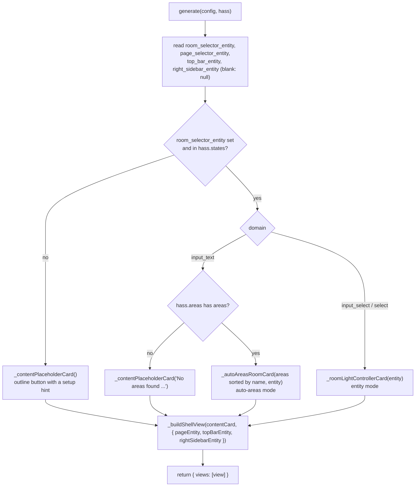

# Shell Strategy

> **`custom:lcars-shell`**: a Home Assistant dashboard strategy that generates a complete LCARS shell (frame, sidebars, header and footer, content panel) as one `custom:lcards-layout-view`, built from LCARdS cards only.
> **Source**: `src/strategies/lcards-shell-strategy.js`, `src/cards/schemas/shell-strategy-schema.js`, registration in `src/lcards-main.js`
> **Test**: `tests/docs/shell-strategy-output.test.js`

---

## Overview

A dashboard strategy is a class Home Assistant asks for a dashboard config: the stored dashboard holds only `strategy: { type: ..., <options> }`, and the frontend calls the class's static `generate(config, hass)` each time the dashboard loads and uses the views it returns. Nothing generated is saved.

The LCARS shell strategy returns one view (`path: lcars`, type `custom:lcards-layout-view`) whose grid draws the LCARS frame. Its nested panels are `custom:lcards-layout-card`s, its chrome is `lcards-elbow` and `lcards-button` cards, navigation is an `lcards-select-menu`, and the content panel is a room light controller. The grid machinery it relies on (visibility-driven row sizing, media queries, per-area surfaces) is described in [Layout View and Layout Card](layout-view.md).

The user-facing page is [Dashboard Strategies](../getting-started/dashboard-strategies.md) (the picker entry's `documentationURL`); the docs also mention it on [Layout View](../cards/layout-view/), [Select Menu: Layout](../cards/select-menu/layout.md) (the sidebar pattern) and [LCARS Patterns](../getting-started/lcars-patterns.md). The published schema is in `lcards-schema.json` ([AI Assistance](../getting-started/ai-assistance.md)).

---

## Registration

`src/lcards-main.js` does three things at **module top level** (not inside the async core initialization), because Home Assistant waits at most 5 s (`MAX_WAIT_STRATEGY_LOAD` in the frontend's `get-strategy.ts`) for a strategy element before it fails the dashboard:

| What | Code |
|---|---|
| The strategy element | `customElements.define('ll-strategy-dashboard-lcars-shell', LCARdSShellDashboardStrategy)` |
| Its configure form | `customElements.define('lcards-shell-strategy-editor', LCARdSShellStrategyEditor)` |
| The picker entry | `window.customStrategies.push({ type: 'lcars-shell', strategyType: 'dashboard', name: 'LCARS Dashboard', description, documentationURL })`, guarded against a second push |

Home Assistant turns `strategy.type: custom:lcars-shell` of a dashboard into the tag `ll-strategy-dashboard-lcars-shell` (it also accepts the legacy `ll-strategy-lcars-shell`). The New Dashboard dialog lists `window.customStrategies` entries of `strategyType: 'dashboard'` and creates `{ strategy: { type: 'custom:lcars-shell' } }` for this one.

`LCARdSShellDashboardStrategy` (extends `HTMLElement`; only its statics are used):

| Static | Value |
|---|---|
| `configRequired` | `true`: creating the dashboard opens the configure dialog first |
| `getCreateSuggestions(hass)` | `{ title: 'LCARS', icon: 'mdi:view-dashboard-variant' }` for the new dashboard's title and icon |
| `getConfigElement()` | `document.createElement('lcards-shell-strategy-editor')` |
| `generate(config, hass)` | `Promise<{ views: [shellView] }>` |

---

## Configuration

The schema (`shellStrategySchema`, `additionalProperties: false`) is the single source of the options. `shellStrategyEditorSchema()` derives the configure dialog's `ha-form` schema from it (name, `title` as label, `description` as helper, the `x-ui-hints.selector`), so the form and the published schema cannot drift. `scripts/lib/card-schemas.js` registers it with `kind: 'strategy'` for the published schema, the config checker and the doc example validator (the example on [Dashboard Strategies](../getting-started/dashboard-strategies.md#settings)).

| Key | Selector | What it does |
|---|---|---|
| `type` | | `custom:lcars-shell` (required) |
| `room_selector_entity` | `input_select`, `select` or `input_text` | Chooses the content panel mode (see below); blank shows a placeholder |
| `page_selector_entity` | `input_select`, `select` | The sidebar select menu's entity; blank shows a placeholder button |
| `top_bar_entity` | `input_boolean` | Shows or hides the header bar row; also the entity of the first header-left button |
| `right_sidebar_entity` | `input_boolean` | Shows or hides the right sidebar; also the entity of the second header-left button |

`LCARdSShellStrategyEditor` is a small `LitElement`: `setConfig(config)` stores the strategy config, and an `ha-form` `value-changed` is re-dispatched as `config-changed` with the new values. Home Assistant calls `generate()` again with them.

---

## Generation



`generate()` reads `hass.states`, `hass.areas`, `hass.entities` and `hass.devices` once. Home Assistant generates a strategy dashboard again whenever the entity, device, area or floor registry changes (`checkStrategyShouldRegenerate`, the default dependencies), so a new area or a light added to a room shows up without a reload. A changed helper shows up after a reload or a change in the configure dialog; state changes never regenerate (the room picked is a Visibility condition).

### Content panel modes

Both room controllers are a `lcards-layout-card` in the `content-panel` area (`view_layout.margin: '20'`), with a header elbow, a selector column (a select menu plus a `panel-light` filler), a scrollable light list and a footer elbow:

| Mode | Room list | Selection stored in | Light list |
|---|---|---|---|
| Entity (`input_select` / `select`) | The entity's own options (the select menu reads them) | The entity (the select menu's default action) | One single-column `lcards-layout-card` per area with lights, holding one `lcards-slider` per light (`pills-left-border`, `match-light` gradient, toggle and more-info actions), shown by a Visibility condition while the entity's state is the area's id or name; a "No lights in this room" note shown by `state_not` over the areas with lights (so also for an option that names no area, or nothing picked). All in one wrapper `lcards-layout-card` with no condition, so the list column keeps its width |
| Auto-areas (`input_text`) | `hass.areas`, as explicit select menu `options` (`value: area_id`, `label: name`, `icon`) | The `input_text`, through each option's `tap_action` (`input_text.set_value`; `select_option` for the select domains) | The same lists, conditioned on the `input_text`'s state |
| Placeholder | | | An `outline` button with a hint |

The lights per area come from `roomLightsFromRegistries(hass)`: every `light.*` registry entry with an area of its own, or else its device's area; hidden lights and lights with an entity category are left out. (Before 2026.11 the lists were `custom:auto-entities` cards with a Jinja2 `area_entities()` filter, which needed HACS.)

### The shell view

```
"header-border  header-border  header-border  header-border  header-border  header-border  header-border  header-border"
"border-left    header-left    .              header         header         header         header         sidebar-right"
"border-left    header-left    .              .              .              .              .              sidebar-right"
"border-left    header-left    .              content-panel  content-panel  content-panel  .              sidebar-right"
"sidebar-left   sidebar-left   .              content-panel  content-panel  content-panel  .              sidebar-right"
"footer-left    footer-left    footer-left    content-panel  content-panel  content-panel  .              sidebar-right"
"footer-left    footer-left    footer-left    .              .              .              .              sidebar-right"
"footer-left    footer-left    footer-left    .              footer         footer         footer         sidebar-right"
"footer-left    footer-left    footer-left    .              footer-border  footer-border  footer-border  sidebar-right"
```

- **Tracks.** Columns `45px clamp(100px, 12vw, 180px) 5px 40px 1fr 40px 5px minmax(0, auto)`; rows `<header-border> clamp(25px, 5vh, 95px) 5px 40px 1fr 40px 5px clamp(25px, 5vh, 95px) 45px`, where the first row is `auto`: it takes the top bar card's height, and is 0 when there is no top bar or it is hidden (the layout view collapses a row whose only cards are hidden). `layout.height` is `calc(100dvh - var(--header-height, 56px))`; `grid-gap` 5px, no margins or padding.
- **Narrow screens.** `layout.mediaquery['(max-width: 1010px)']` narrows the column before the right sidebar to 1px.
- **Surfaces.** `layout.areas['content-panel']` sets a 20px margin.

| Area | Cards |
|---|---|
| `header-border` | Only with `top_bar_entity`: a `lcards-layout-card` (`height: 10vh`) with a segmented `header-left` elbow and a two-row banner (a `panel-light` strip and a text button), with `visibility: state on` of `top_bar_entity`; the `auto` row follows it |
| `header-left` | An `lcards-alert-overlay` (`dismiss_mode: dismiss`, blur backdrop, no canvas; visible only during an alert) and a `lcards-layout-card` with two `panel-dark` buttons on `top_bar_entity` and `right_sidebar_entity` (their default tap action toggles them) |
| `border-left` | A `panel-light` strip button |
| `header` | An `outline` button labelled "header" |
| `sidebar-left` | A 2 by 2 `lcards-layout-card`: `panel-light` strips in the 45px column, the page `lcards-select-menu` (`grid.height: fit`, so it publishes a definite height for the `minmax(0, max-content)` row) or a placeholder button, and a `panel-dark` filler in the `minmax(40px, 1fr)` row. The strip in the `max-content` row sets `min_height: 1` (that row is not definite); the others follow their definite rows |
| `content-panel` | The room controller or the placeholder |
| `sidebar-right` | An `outline` button (`width: clamp(100px,16vw,230px)`), with `visibility: state on` of `right_sidebar_entity` when set |
| `footer-left` | A segmented `footer-left` elbow (`outer_curve: 160`, `inner_curve: 115`, `var(--lcars-ui-primary)` / `var(--lcars-ui-quaternary)`) |
| `footer` | A `lcards-layout-card` with two `filled` toggle buttons (the second pulses on hover) |
| `footer-border` | A `lcards-layout-card` with one `panel-light` button |

The sizing choices (definite heights for content-sized tracks, `minmax(0, ...)` tracks, buttons following definite cells and `min_height: 1` only in content-sized rows) follow the rules in `.claude/rules/cards.md`, "Sizing in Nested Grids".

---

## The Picard shell (`custom:lcars-shell-picard`)

A second strategy with the same four options and the same settings form (`shellPicardStrategySchema` spreads `shellStrategySchema` with its own `type`; `getConfigElement()` returns `lcards-shell-strategy-editor`), registered as `ll-strategy-dashboard-lcars-shell-picard` and listed as "LCARS Dashboard (Picard)". Source `src/strategies/lcards-shell-picard-strategy.js`, test `tests/docs/shell-picard-output.test.js`, plan `reports/shell-picard-plan.md` (in review: the design is graded against the "Check a screen" list before it ships).

- **Shape:** the "display with side columns" archetype: `"code top top pills" "code centre side pills" "strip strip strip pills"`, columns `134px minmax(0, 1fr) 220px 116px`, rows `auto minmax(0, 1fr) 48px`. The `top` card (title bar) has a Visibility condition on `top_bar_entity` and the `side` card on `right_sidebar_entity`, so their row and column collapse.
- **Rooms:** lights from `roomLightsFromRegistries()` (shared with v1), sensors from `roomSensorsFromRegistries()` (device classes temperature, humidity, illuminance, carbon dioxide, pressure, power, battery, in that order, at most seven per area). Per room, a light bank (ALL ON / ALL OFF on the area, a `picard-gauge-column` per light, a lighting readings table) in the display and a readings table plus up to three gauges (temperature, humidity, battery) in the side column, each shown by Visibility on the room selector; a note for every other state (`state_not`). Names drop the words they share with the area name.
- **Chrome:** a code-block column with one number cascade, a display sweep (frame open on the right) round the room panel, utility pills (top bar, sidebar, red alert) in a bracket at the right edge, `toggle-tab` page tabs. Colours are theme roles only.

---

## Editing a strategy dashboard

Because the views are generated, the layout view's own editor cannot save into them. Opening edit mode on a strategy dashboard makes Home Assistant show its strategy editor dialog (`hui-root` `_enableEditMode()` calls `showDashboardStrategyEditorDialog()`), which hosts `lcards-shell-strategy-editor` for the options and offers **Take control**: that saves the generated config as an ordinary dashboard, after which the strategy no longer runs and the view is edited like any other layout view.

---

## Adding an option

A new strategy option follows the `lcards-card-option` skill: add it to `shellStrategySchema` with a `title`, a `description` and an `x-ui-hints.selector` (the form picks it up), read it in `generate()`, and extend `tests/docs/shell-strategy-output.test.js`, which runs the config checker over every generated variant and expects no errors or warnings.

---

## See also

- [Layout View and Layout Card](layout-view.md)
- [Card Foundation](cards/lcards-card-foundation.md)
- [Systems Architecture](systems-arch.md)
- Home Assistant developer docs: [Custom strategies](https://developers.home-assistant.io/docs/frontend/custom-ui/custom-strategy/)
