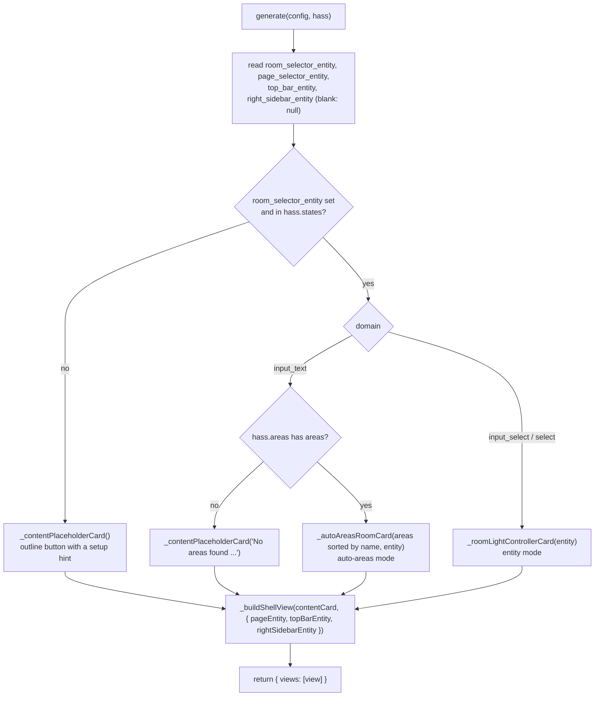

# Shell Strategy

> **`custom:lcars-shell`**: a Home Assistant dashboard strategy that generates a complete LCARS shell (frame, sidebars, header and footer, content panel) as one `custom:lcards-layout-view`, built from LCARdS cards only (plus auto-entities for the room light list).
> **Source**: `src/strategies/lcards-shell-strategy.js`, `src/cards/schemas/shell-strategy-schema.js`, registration in `src/lcards-main.js`
> **Test**: `tests/docs/shell-strategy-output.test.js`

---

## Overview

A dashboard strategy is a class Home Assistant asks for a dashboard config: the stored dashboard holds only `strategy: { type: ..., <options> }`, and the frontend calls the class's static `generate(config, hass)` each time the dashboard loads and uses the views it returns. Nothing generated is saved.

The LCARS shell strategy returns one view (`path: lcars`, type `custom:lcards-layout-view`) whose grid draws the LCARS frame. Its nested panels are `custom:lcards-layout-card`s, its chrome is `lcards-elbow` and `lcards-button` cards, navigation is an `lcards-select-menu`, and the content panel is a room light controller. The grid machinery it relies on (visibility-driven row sizing, media queries, per-area surfaces) is described in [Layout View and Layout Card](layout-view.md).

The user-facing description is the strategy's entry in Home Assistant's New Dashboard picker ("LCARS Dashboard") and its configure dialog; the docs mention it on [Layout View](../cards/layout-view/), [Select Menu: Layout](../cards/select-menu/layout.md) (the sidebar pattern) and [LCARS Patterns](../getting-started/lcars-patterns.md). The published schema is in `lcards-schema.json` ([AI Assistance](../getting-started/ai-assistance.md)).

---

## Registration

`src/lcards-main.js` does three things at **module top level** (not inside the async core initialization), because Home Assistant waits at most 5 s (`MAX_WAIT_STRATEGY_LOAD` in the frontend's `get-strategy.ts`) for a strategy element before it fails the dashboard:

| What | Code |
|---|---|
| The strategy element | `customElements.define('ll-strategy-dashboard-lcars-shell', LCARdSShellDashboardStrategy)` |
| Its configure form | `customElements.define('lcards-shell-strategy-editor', LCARdSShellStrategyEditor)` |
| The picker entry | `window.customStrategies.push({ type: 'lcars-shell', strategyType: 'dashboard', name: 'LCARS Dashboard', description, documentationURL })`, guarded against a second push |

Home Assistant turns `strategy.type: custom:lcars-shell` of a dashboard into the tag `ll-strategy-dashboard-lcars-shell` (it also accepts the legacy `ll-strategy-lcars-shell`). The New Dashboard dialog lists `window.customStrategies` entries of `strategyType: 'dashboard'` and creates `{ strategy: { type: 'custom:lcars-shell' } }` for this one.

`LCARdSShellDashboardStrategy` (extends `HTMLElement`; only its statics are used):

| Static | Value |
|---|---|
| `configRequired` | `true`: creating the dashboard opens the configure dialog first |
| `getCreateSuggestions(hass)` | `{ title: 'LCARS', icon: 'mdi:view-dashboard-variant' }` for the new dashboard's title and icon |
| `getConfigElement()` | `document.createElement('lcards-shell-strategy-editor')` |
| `generate(config, hass)` | `Promise<{ views: [shellView] }>` |

---

## Configuration

The schema (`shellStrategySchema`, `additionalProperties: false`) is the single source of the options. `shellStrategyEditorSchema()` derives the configure dialog's `ha-form` schema from it (name, `title` as label, `description` as helper, the `x-ui-hints.selector`), so the form and the published schema cannot drift. `scripts/lib/card-schemas.js` registers it with `kind: 'strategy'` for the published schema and the config checker; the doc example validator skips strategies, because doc examples never contain a dashboard `strategy:` block.

| Key | Selector | What it does |
|---|---|---|
| `type` | | `custom:lcars-shell` (required) |
| `room_selector_entity` | `input_select`, `select` or `input_text` | Chooses the content panel mode (see below); blank shows a placeholder |
| `page_selector_entity` | `input_select`, `select` | The sidebar select menu's entity; blank shows a placeholder button |
| `top_bar_entity` | `input_boolean` | Shows or hides the header bar row; also the entity of the first header-left button |
| `right_sidebar_entity` | `input_boolean` | Shows or hides the right sidebar; also the entity of the second header-left button |

`LCARdSShellStrategyEditor` is a small `LitElement`: `setConfig(config)` stores the strategy config, and an `ha-form` `value-changed` is re-dispatched as `config-changed` with the new values. Home Assistant calls `generate()` again with them.

---

## Generation



`generate()` reads `hass.states` and `hass.areas` once. A new area, or a changed helper, shows up the next time Home Assistant generates the dashboard (a reload, or a change in the configure dialog).

### Content panel modes

Both room controllers are a `lcards-layout-card` in the `content-panel` area (`view_layout.margin: '20'`), with a header elbow, a selector column (a select menu plus a `panel-light` filler), a scrollable light list and a footer elbow:

| Mode | Room list | Selection stored in | Light list |
|---|---|---|---|
| Entity (`input_select` / `select`) | The entity's own options (the select menu reads them) | The entity (the select menu's default action) | `custom:auto-entities` with a Jinja2 filter over `area_entities(states(entity))`, one `lcards-slider` (`pills-left-border`, `match-light` gradient, toggle and more-info actions) per light, inside a single-column `lcards-layout-card` |
| Auto-areas (`input_text`) | `hass.areas`, as explicit select menu `options` (`value: area_id`, `label: name`, `icon`) | The `input_text`, through each option's `tap_action` (`input_text.set_value`; `select_option` for the select domains) | The same auto-entities list on the `input_text`'s state |
| Placeholder | | | An `outline` button with a hint |

The light list needs the auto-entities card from HACS; without it Home Assistant shows its "custom element doesn't exist" error card in that cell.

### The shell view

```
"header-border  header-border  header-border  header-border  header-border  header-border  header-border  header-border"
"border-left    header-left    .              header         header         header         header         sidebar-right"
"border-left    header-left    .              .              .              .              .              sidebar-right"
"border-left    header-left    .              content-panel  content-panel  content-panel  .              sidebar-right"
"sidebar-left   sidebar-left   .              content-panel  content-panel  content-panel  .              sidebar-right"
"footer-left    footer-left    footer-left    content-panel  content-panel  content-panel  .              sidebar-right"
"footer-left    footer-left    footer-left    .              .              .              .              sidebar-right"
"footer-left    footer-left    footer-left    .              footer         footer         footer         sidebar-right"
"footer-left    footer-left    footer-left    .              footer-border  footer-border  footer-border  sidebar-right"
```

- **Tracks.** Columns `45px clamp(100px, 12vw, 180px) 5px 40px 1fr 40px 5px minmax(0, auto)`; rows `<header-border> clamp(25px, 5vh, 95px) 5px 40px 1fr 40px 5px clamp(25px, 5vh, 95px) 45px`, where the first row is `minmax(0,auto)` with a `top_bar_entity` and `0px` without one (a definite `0px`, so the view's row measurement cannot mistake it for free space). `layout.height` is `calc(100dvh - var(--header-height, 56px))`; `grid-gap` 5px, no margins or padding.
- **Narrow screens.** `layout.mediaquery['(max-width: 1010px)']` narrows the column before the right sidebar to 1px.
- **Surfaces.** `layout.areas['content-panel']` sets a 20px margin.

| Area | Cards |
|---|---|
| `header-border` | Only with `top_bar_entity`: a `lcards-layout-card` (`height: 10vh`) with a segmented `header-left` elbow and a two-row banner (a `panel-light` strip and a text button), with `visibility: state on` of `top_bar_entity`; the view's visibility row sizing then writes that row as `10vh` or `0px` |
| `header-left` | An `lcards-alert-overlay` (`dismiss_mode: dismiss`, blur backdrop, no canvas; visible only during an alert) and a `lcards-layout-card` with two `panel-dark` buttons on `top_bar_entity` and `right_sidebar_entity` (their default tap action toggles them) |
| `border-left` | A `panel-light` strip button |
| `header` | An `outline` button labelled "header" |
| `sidebar-left` | A 2 by 2 `lcards-layout-card`: `panel-light` strips in the 45px column, the page `lcards-select-menu` (`grid.height: fit`, so it publishes a definite height for the `minmax(0, max-content)` row) or a placeholder button, and a `panel-dark` filler in the `minmax(40px, 1fr)` row. The strips and the filler set `min_height: 1`, so they do not paint past a collapsed row |
| `content-panel` | The room controller or the placeholder |
| `sidebar-right` | An `outline` button (`width: clamp(100px,16vw,230px)`), with `visibility: state on` of `right_sidebar_entity` when set |
| `footer-left` | A segmented `footer-left` elbow (`outer_curve: 160`, `inner_curve: 115`, `var(--lcars-ui-primary)` / `var(--lcars-ui-quaternary)`) |
| `footer` | A `lcards-layout-card` with two `filled` toggle buttons (the second pulses on hover) |
| `footer-border` | A `lcards-layout-card` with one `panel-light` button |

The sizing choices (definite heights for content-sized tracks, `minmax(0, ...)` tracks, `min_height: 1` fillers) follow the rules in `.github/instructions/cards.instructions.md`, "Sizing in Nested Grids".

---

## Editing a strategy dashboard

Because the views are generated, the layout view's own editor cannot save into them. Opening edit mode on a strategy dashboard makes Home Assistant show its strategy editor dialog (`hui-root` `_enableEditMode()` calls `showDashboardStrategyEditorDialog()`), which hosts `lcards-shell-strategy-editor` for the options and offers **Take control**: that saves the generated config as an ordinary dashboard, after which the strategy no longer runs and the view is edited like any other layout view.

---

## Adding an option

A new strategy option follows the `lcards-card-option` skill: add it to `shellStrategySchema` with a `title`, a `description` and an `x-ui-hints.selector` (the form picks it up), read it in `generate()`, and extend `tests/docs/shell-strategy-output.test.js`, which runs the config checker over every generated variant and expects no errors or warnings.

---

## See also

- [Layout View and Layout Card](layout-view.md)
- [Card Foundation](cards/lcards-card-foundation.md)
- [Systems Architecture](systems-arch.md)
- Home Assistant developer docs: [Custom strategies](https://developers.home-assistant.io/docs/frontend/custom-ui/custom-strategy/)
