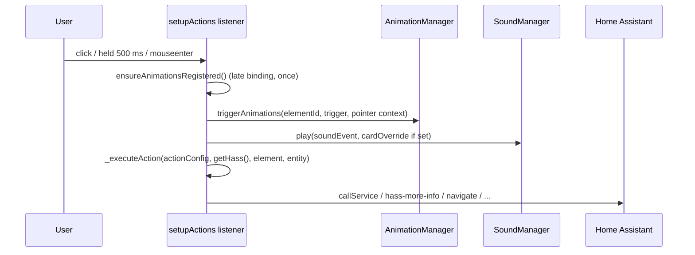

# Action Handler

> **Per card (`card._actionHandler`)**: Gesture listeners, Home Assistant action dispatch, card sounds and animation triggers for card elements.

---

## Overview

`LCARdSActionHandler` (`src/base/LCARdSActionHandler.js`) turns a card's `tap_action`, `hold_action` and `double_tap_action` into event listeners on an element. For each gesture it fires the matching animation trigger (with the pointer position), plays the card sound and runs the configured action. It is a plain class (not a `BaseService`) and receives no HASS from the core: every call is given the HASS to act with.

### Instances

Every `LCARdSCard` creates its own handler in its constructor (`this._actionHandler = new LCARdSActionHandler()`, `src/base/LCARdSCard.js`). `LCARdSCard.setupActions()`, segment actions, the elbow's segment handlers, the button's segment `runAction()` calls and the astrometrics card's `runAction()` calls all go through `this._actionHandler`. The class keeps no state of its own: everything a `setupActions()` call needs lives in its closure, and the returned cleanup removes the listeners.

There is no page-wide handler. A core singleton (`window.lcards.core.actionHandler`, also handed to cards as `_singletons.actionHandler`) came with the unified action handling of ed2436d8 (2025-11-08), but that same work moved `setupActions()` to the per-card instance, so nothing used it; it was removed in 2026.11 with its debug entry.

---

## Module Exports

| Export | Description |
|---|---|
| `LCARdSActionHandler` | The class |
| `TOGGLE_OFF_STATES` | `['closed', 'locked', 'off']`: states a toggle turns **on** from (Home Assistant's `STATES_OFF`); any other state turns off |
| `SPECIAL_TOGGLE_ACTIONS` | Domains whose toggle is not `turn_on` / `turn_off` (Home Assistant's `SPECIAL_TOGGLE_ACTIONS`): `button` and `input_button` press, `cover` opens/closes, `lock` unlocks/locks, `valve` opens/closes, `scene` turns on both ways, and so on |
| `toggleService(entityId, state)` | `{ domain, service }` a toggle calls, chosen from the state and domain like Home Assistant's own toggle; a `group` goes through the `homeassistant` domain; with no known state, the domain's `toggle` service |
| `actionSoundEvent(actionConfig, state, fallback)` | The sound event for a gesture: `toggle_on` / `toggle_off` for a toggle with a known state, `fallback` (e.g. `card_tap`) for other actions, `null` for no action or `action: none`. Used by the button card's segments |
| `pointerOf(event)` | `{ clientX, clientY }` of a mouse, pointer or touch event (first touch, or first changed touch), or `null` for a keyboard activation (a click at 0,0 with `detail === 0`) or a non-finite position. Also used by the data grid |

---

## `setupActions(element, actions, hass, options) → cleanup`

Attaches the listeners and returns a function that removes them. With no `element` it returns a no-op.

Cards call the `LCARdSCard.setupActions(element, actions, options)` wrapper rather than the handler directly. The wrapper adds `animations: this.config.animations`, `getAnimationSetup`, `shadowRoot`, `entity` (the caller's, else `config.entity`), `getHass: () => this.hass` and the card's `sounds:` overrides as `soundOverride` (`_cardSoundOverride()`).

| Option | Description |
|---|---|
| `elementId` | ID used for animation targeting; falls back to `element.id`, then the `data-overlay-id` attribute. Without one, no animation triggers fire and no hover listeners are attached |
| `animationManager` | When given (with an `elementId`), the overlay's animation scope is registered at once |
| `getAnimationManager` | Getter used at gesture time and for late binding; falls back to `window.lcards.core.getAnimationManager()` |
| `animations` | Animation configs registered on the scope |
| `getAnimationSetup` | Returns `{ overlayId, elementSelector }`; `elementSelector` (default `[data-overlay-id]`) picks the animation target inside `shadowRoot` |
| `shadowRoot` | Where `elementSelector` is looked up; the element itself otherwise |
| `entity` | Default entity for actions that name none |
| `getHass` | Returns the card's current HASS at action time (a handler set up once, such as a data grid cell, must not act on the states it was set up with); falls back to the `hass` argument |
| `soundOverride` | `{ [soundEvent]: assetKey \| null }`; `null` silences that event |
| `disableHover` | No pointer cursor and no hover / leave listeners (non-interactive cards, elbow segments) |
| `segmentsOwnHold` | A hold that starts inside a `[data-lcards-segment]` child is left to that segment's own handler |

### Animation scope

With an `elementId` and an `animationManager`, `setupActions()` always calls `animationManager.onOverlayRendered(overlayId, targetElement, { animations })`, even with no animations, so rule-triggered animations have a scope to run in. `overlayId` is the explicit `elementId` (so several handlers on one card, like the slider's four border sides, do not overwrite each other's scope), else `getAnimationSetup().overlayId`.

Without an `animationManager` but with `animations`, the setup is kept as pending. The first gesture then runs `ensureAnimationsRegistered()`: it resolves the manager through `getAnimationManager()` or the core, creates the scope (`createScopeForOverlay()`), a `TriggerManager`, registers each animation with `registerAnimation()` and calls `triggerManager.finalizeRegistrations()` once the whole batch is registered.

### Gestures

| Gesture | Listener | Behaviour |
|---|---|---|
| Tap | `click` (capture) | Ignored when the click came from inside a `[data-lcards-segment]` child (the segment handles it) or right after a completed hold. Otherwise `stopPropagation()` and `preventDefault()`. With no `double_tap_action`, runs at once |
| Double tap | same `click` listener | With a `double_tap_action`, the first click waits 300 ms: a second click inside that window runs the double tap at once; otherwise the single tap runs (only if there is a `tap_action`). `dblclick` is not used: it is unreliable on touch devices |
| Hold | `pointerdown` (capture), ended by `pointerup`, `pointercancel`, `pointerleave` | Runs after 500 ms held; releasing earlier cancels it. A completed hold blocks the click that follows |
| Hover | `mouseenter` (capture) | Desktop only (`(hover: hover) and (pointer: fine)`), needs an `elementId`, not with `disableHover` |
| Leave | `mouseleave` (capture) | Same conditions; stops running `on_hover` animations, then fires `on_leave` |

When there is at least one action and `disableHover` is not set, the element gets `cursor: pointer`. The element also gets `data-lcards-actions-attached="true"` and `data-lcards-handler-count`; cleanup removes them.

### What one gesture does

Hover differs: it fires `on_hover` without a pointer context, plays `card_hover`, and runs no action.

---

## Sound Hooks

The handler plays through `window.lcards.core.soundManager.play(eventType)`, or `play(eventType, { cardOverride })` when `soundOverride` has the event (`null` silences it, a string plays that asset).

| Gesture | Sound event |
|---|---|
| Tap | `card_tap` |
| Double tap | `card_double_tap` |
| Hold | `card_hold` |
| Any of those with `action: toggle` and a known entity state | `toggle_on` when the state is in `TOGGLE_OFF_STATES`, else `toggle_off` (replaces the gesture's event) |
| Hover | `card_hover` |

A gesture whose action is missing or `action: none` plays nothing. `LCARdSCard._cardSoundOverride()` builds `soundOverride` from the card's `sounds:` block: `sounds.enabled: false` silences all six events, otherwise each event key present is passed on.

---

## Pointer Context

Tap, double tap and hold capture `{ pointer: pointerOf(event) }` from the triggering event (for a hold, the `pointerdown`) and pass it to `animationManager.triggerAnimations(elementId, trigger, context)`, which hands it to `playAnimation()`. Stagger animations with `from: 'pointer'` (the tap-ripple) start at that point. A keyboard activation gives `pointer: null`.

---

## Action Dispatch

`_executeAction(actionConfig, hass, element, defaultEntity)` does nothing without an `actionConfig` or HASS. The entity is `actionConfig.entity`, else `defaultEntity`, else `element.dataset.entity`.

| `action` | What happens |
|---|---|
| `toggle` | `toggleService(entityId, state)`, then `hass.callService(domain, service, { entity_id })`. Needs an entity |
| `more-info` | Dispatches `hass-more-info` (`{ entityId }`, bubbling and composed) from the element, or the document. Needs an entity |
| `call-service`, `perform-action` | Service from `perform_action`, else the older `service` (`domain.service`); data from `data`, else `service_data`; `hass.callService(domain, service, data, target)`, the target passed separately as Home Assistant's `handle-action` does. The older names log at debug level |
| `fire-dom-event` | Dispatches `ll-custom` (the action config as `detail`, bubbling and composed) from the element, as Home Assistant does; browser_mod listens for it |
| `navigate` | `history.pushState(null, '', navigation_path)` and a `location-changed` window event |
| `url` | `window.open(url_path, '_blank')` |
| `assist` | Dispatches `show-dialog` for `ha-voice-command-dialog` with `pipeline_id` (default `preferred`) and `start_listening` (default `true`) |
| `fly-to` | `window.lcards.cards.astrometrics.flyTo(card, { point } or { view }, { duration, warp })` |
| `set-clock` | `window.lcards.cards.astrometrics.setClock(card, { date, rate })` |
| `set-model-scale` | `window.lcards.cards.astrometrics.setModelScale(card, model_scale ?? 'toggle')` |
| `none` | Nothing |
| anything else | Logged as a warning |

The user-facing action reference is [Actions](../../core/actions.md).

### `runAction(actionConfig, hass, element, defaultEntity?)`

Runs one action now, for things that are not elements with listeners: an astrometrics point picked on the canvas, a button segment. It first checks `_validateActionConfig()` (an `action` is required; `call-service` / `perform-action` need a service, `navigate` a `navigation_path`, `url` a `url_path`, the astrometrics actions a `card` plus their target) and then calls `_executeAction()`. It plays no sound and fires no animation: the caller does that. The listener path of `setupActions()` does not run this validation; the individual handlers log a warning and return when a required field is missing.

---

## Debug

A card's handler is `card._actionHandler` (for instance `document.querySelector('lcards-button')._actionHandler` on a page without shadow roots in the way). It has no debug snapshot; to see whether an element has listeners, look for `data-lcards-actions-attached` on it.

---

## See Also

- [Animation Manager](animation-manager.md)
- [Sound System](sound-system.md)
- [Rules Engine](rules-engine.md)
- [Actions (user guide)](../../core/actions.md)
- [Card foundation](../cards/lcards-card-foundation.md)
