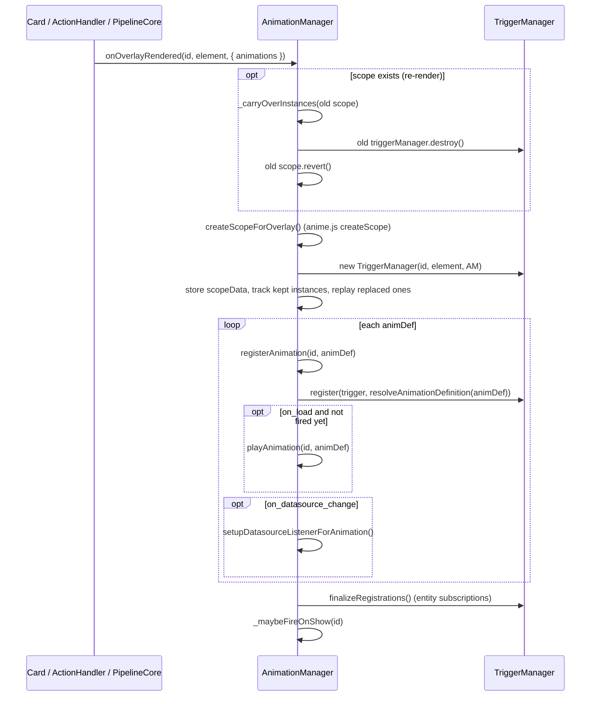

# Animation Manager

> **`window.lcards.core.animationManager`**: the one anime.js v4 (4.5.0) coordinator for card, segment and MSD overlay animations.
> **Source**: `src/core/animation/` (`AnimationManager.js`, `TriggerManager.js`, `PerformanceMonitor.js`, `resolveAnimParams.js`, `presets.js`)
> **User docs**: [Animations](../../core/animations.md), [Triggers](../../core/animations/triggers.md), [Preset reference](../../core/animations/preset-reference.md)

---

## Overview

`AnimationManager` extends `BaseService`. There is **one instance for the whole page**: `LCARdSCore._performInitialization()` creates it with the core `CoreSystemsManager` (`src/core/lcards-core.js:185`) and calls `initialize([], { suppressMountWarning: true })`. Every card uses it, and every MSD card uses it too: `MsdCardCoordinator` takes `lcardsCore.animationManager` (`src/msd/pipeline/MsdCardCoordinator.js:188`) and `PipelineCore` calls `initialize(mergedConfig.overlays, { suppressMountWarning: true })` on it for each MSD card (`src/msd/pipeline/PipelineCore.js:169`).

It manages:

- **Scopes**: one per animated element (a card, a card segment, an MSD overlay), each with an anime.js scope, a `TriggerManager` and the instances it started.
- **Triggers**: `on_load` and `on_show` fire from the manager; `on_tap`, `on_hold`, `on_double_tap`, `on_hover`, `on_leave` come from the card's action handler; `on_entity_change` from `TriggerManager`'s entity subscriptions; `on_datasource_change` from a DataSource subscription; rule animations (`on_rule`) from the [Rules Engine](rules-engine.md).
- **Playback**: target resolution (overlay targeting API, CSS selectors inside the scope element, `target: background`), `map_range` parameters, reduced motion, stop bookkeeping, and carrying running animations over a card re-render.

`initialize()` also sets the legacy alias `window.lcards.animationManager` (`AnimationManager.js:519-522`).

---

## Key classes

| Class / module | File | Role |
|---|---|---|
| `AnimationManager` | `core/animation/AnimationManager.js` | Scopes, trigger coordination, playback, lifecycle |
| `TriggerManager` | `core/animation/TriggerManager.js` | One per scope: holds the registrations per trigger (`registrations: Map<trigger, animDef[]>`), subscribes to entities for `on_entity_change` (including `while` conditions); interactive triggers are left to the card |
| `resolveAnimParams` | `core/animation/resolveAnimParams.js` | `resolveAnimCommandParams()` / `resolveAnimParam()`: turn `map_range` descriptors (entity-driven duration, delay, params) into numbers or blended colours (`mapRangeOutput()` in `utils/linearMap.js`) |
| Preset registry | `core/animation/presets.js` | `registerAnimationPreset(name, builder, { pack, category })`, `getAnimationPreset()`, `listAnimationPresets()`, `getAnimationPresetInfo()` / `listAnimationPresetInfo()` (pack and category, for the Pack Explorer); the built-ins are in `core/packs/animations/presets/` |
| `animateElement` | `utils/lcards-anim-helpers.js` (`window.lcards.anim.animateElement`) | Builds the anime.js animation from a preset and the resolved options; `resolveEasing()` turns config easing into anime.js eases |
| `AnimationPerformanceMonitor` | `core/animation/PerformanceMonitor.js` | FPS monitor for background renderers; see [PerformanceMonitor](#performancemonitor). Not used by `AnimationManager` |

---

## Scopes

```
AnimationManager
    ├─ scopes: Map<scopeId, scopeData>
    │   scopeData = { scope (anime.js createScope()), element, cardHost, overlay,
    │                 triggerManager, runningInstances: Map<trigger, instance[]>,
    │                 liveSpeedBindings: Map<trigger, binding>, activeAnimations: Set,
    │                 onLoadFired, shownOnce, createdAt, systemsManager, (isSegment, cardId, segmentId) }
    ├─ registeredAnimations: Map<overlayId, animDef[]>   (MSD overlays, from initialize())
    ├─ datasourceSubscriptions: Map<"overlayId:datasource", unsubscribe>
    └─ _entityToSpeedBindings: Map<entityId, Set<"scopeId::trigger">>
```

Scope ids:

| Who | Scope id |
|---|---|
| `LCARdSCard` default | `lcards-card-{guid}` (`_getAnimationSetup()`, `src/base/LCARdSCard.js:3733-3739`) |
| Button | `button-{guid}` (`src/cards/lcards-button.js:3527`) |
| Button segments | `{cardId}:segment:{segmentId}` (`registerSegmentAnimations()`) |
| Slider, data grid, chart, ... | their own `_getAnimationSetup()` id (the slider adds `slider-{guid}-border-{side}` for its borders) |
| MSD overlay | the overlay `id` |

**How rules and other callers find a scope.** `_resolveScopeFromOverlay(id)` (`AnimationManager.js:1108-1146`) tries, in order:

1. `scopes.get(id)`: the id is a scope id.
2. The SystemsManager overlay registry entry for `id`: its `animationScope` field. Cards register it in `_registerOverlayForRules()` as `this._getAnimationSetup().overlayId` (`src/base/LCARdSCard.js:1545-1553`), so a rule that targets a card by its config `id` reaches the card's scope whatever the card names it.
3. `{type}-{sourceCardId}` from the same registry entry (the older naming), with a warning when that scope does not exist either.

`playAnimation()` and `stopAnimations()` resolve through this; `triggerAnimations()` and `inspectOverlay()` take scope ids only.

---

## Registration flow

A card scope is registered by `LCARdSActionHandler.setupActions()`, which calls `onOverlayRendered(overlayId, element, { animations })` for every card that has an id and the manager, even without animations, so rules can animate it (`src/base/LCARdSActionHandler.js:160-176`). Cards that render outside the action handler call `onOverlayRendered()` themselves (slider, data grid), and MSD does it per overlay from `PipelineCore`.



- **`enabled: false`** skips the definition entirely (`registerAnimation()`, `:705-711`).
- **`on_load` once.** The fire decision is taken once per batch (`shouldFireOnLoad`), so every `on_load` animation of the batch plays, and `onLoadFired` is set after the loop. A rebuild within 500 ms of the scope's creation counts as initial setup; a later rebuild keeps `onLoadFired`, so a re-render does not replay `on_load`.
- **`finalizeRegistrations()`** runs after the whole batch so `TriggerManager` sees every `on_entity_change` entry before it subscribes (#386).
- **`on_show`** plays once per connection of the LCARdS card the scope sits in: `_maybeFireOnShow()` records the scope in the card's `_lcardsShown` set, which `LCARdSNativeCard` clears on every connect; `LCARdSNativeCard` calls `onCardShown(card)` after its first render following a connect (`src/base/LCARdSNativeCard.js:285-288`), which plays `on_show` for the scopes that were not rebuilt. Scopes outside an LCARdS card play once (`shownOnce`). An `on_show` entrance cut short by a rebuild right after attach plays again on the new scope.

### Re-render carry-over

Cards re-render often (a state change re-colours a button, a tap toggles its entity). `onOverlayRendered()` on an existing scope splits the old scope's running instances (`_carryOverInstances()`, `:292-331`) per animation definition:

- `while`-gated and `on_show` animations, and `on_load` ones when `on_load` is not considered fired, are reverted (the new scope restarts them as needed; `while` animations are re-seeded by the new `TriggerManager` when they were running, `_isRecreation`).
- An animation whose targets are all still connected keeps running and moves to the new scope.
- Otherwise it is reverted and replayed on the new elements from where it was (`playAnimation(id, def, { seek })`). The split is per animation, not per instance, so a stagger with one instance per element is replayed once.

---

## Trigger types

| Trigger | Fired by |
|---|---|
| `on_load` | `registerAnimation()` when the scope is first set up |
| `on_show` | `_maybeFireOnShow()` / `onCardShown()`, once per connection of the card |
| `on_tap` | `LCARdSActionHandler` tap handler: `triggerAnimations(id, 'on_tap', { pointer })` (also the data grid, for a tap anywhere on it) |
| `on_double_tap` | `LCARdSActionHandler`, with `{ pointer }` |
| `on_hold` | `LCARdSActionHandler`, with `{ pointer }` |
| `on_hover` / `on_leave` | `LCARdSActionHandler` `mouseenter` / `mouseleave`; leaving first calls `stopAnimations(id, 'on_hover')` (`src/base/LCARdSActionHandler.js:500-511`) |
| `on_entity_change` | `TriggerManager` entity subscriptions (`entity`, `attribute`, `from_state`, `to_state`, `while`, `check_on_load`); a card's own entity change also calls `triggerAnimations(id, 'on_entity_change', { fromState, toState })` for definitions without `entity` (`src/cards/lcards-button.js:331-333`) |
| `on_datasource_change` | `setupDatasourceListenerForAnimation()`: plays on every new point of `datasource` (see the note below) |
| `on_rule` | Internal: the Rules Engine plays `apply.animations` with `playAnimation()` and stops them with `stopAnimations(id, 'on_rule', def)` (`src/core/rules/RulesEngine.js:1286`, `:1376`). Never set it in config |

`TriggerManager.setupTriggerListener()` also accepts `on_state_change` as a stub (logs and does nothing, `TriggerManager.js:140-143`); it is not in the schema's trigger enum (`src/cards/schemas/common-schemas.js:447`). Interactive triggers are skipped by `TriggerManager`: the card's handlers call `triggerAnimations()` (or `playSegmentAnimation()` for segments).

`triggerAnimations()` (`:916-967`) skips `while`-gated definitions (their start and stop belong to `TriggerManager`) and, for a card entity change, definitions that name an `entity` or whose `from_state` / `to_state` do not match.

**`on_datasource_change` and the core manager.** `setupDatasourceListenerForAnimation()` and `resolveDatasourceParams()` get the page's DataSourceManager from `_getDataSourceManager()`: `systemsManager.dataSourceManager` if there is one, else `window.lcards.core.dataSourceManager`. The core singleton is built with the `CoreSystemsManager`, which has no `dataSourceManager`, so until 2026.11 the trigger never subscribed ("DataSourceManager not available for datasource triggers"). `DataSource.subscribe()` hands a new subscriber the current point straight away; the listener skips that point (same timestamp `t`), so the animation plays on changes only. `resolveDatasourceParams()` reads the value as `getCurrentData().v`. Tests: `tests/core/animation-manager-datasource.test.js`.

---

## Playback: playAnimation()

`playAnimation(id, animDef, { seek?, pointer? })` (`:1159-1476`):

1. **Resolve the scope** (`_resolveScopeFromOverlay`). Take a stop token now: a stop that lands while this call is still awaiting reverts the instance as soon as it exists.
2. **Template params** (`resolveDatasourceParams`, the `{{ datasource.value }}` replacement; see the note above).
3. **Targets**: `targets` (array; the overlay renderer's `getAnimationTarget(spec)` first, then `querySelector` inside the scope element), `target: 'background'` (the card's background effect handles, `effect: N` for one, via `_resolveBackgroundTargets()`), `target` (element or selector, all matches), or the overlay's `getDefaultAnimationTarget()`, falling back to the scope element. Disconnected targets are dropped; if all are gone the call returns `null` (debug log, or a warning when `target`/`targets` was explicit).
4. **`map_range`**: `resolveAnimCommandParams(animDef, hass)` resolves duration, delay and params.
5. **Ease**: `ease` (or `easing`, or the same in `params`), combined with `params.ease_params` into `{ type, params }` for parametric eases; `animateElement()` hands it to `resolveEasing()`.
6. **Run** `window.lcards.anim.animateElement(scopeData, options, hass, onInstanceCreated)`. Preset params stay nested in `options.params` (spreading them leaked preset fields to anime.js as bogus attributes).
7. **`onInstanceCreated`**: revert if stopped meanwhile; if the scope was rebuilt meanwhile, track it on the new scope or replay it; under reduced motion settle it (below); otherwise track it under its trigger and `seek()` when asked.
8. **Live speed binding**: a looping animation whose `duration` is a `map_range` on an entity gets a binding; `updateHass()` re-resolves it when that entity changes and sets the running instances' `speed` to `baseDuration / newDuration`, without a restart (`_refreshEntitySpeedBindings()`, `:418-457`). Only the tempo changes live; other mapped values apply on the next play.

It returns the resolved definition, or `null`.

**Stopping.** `stopAnimations(id, trigger?, animDef?)` (`:983-1014`) reverts the tracked instances of the scope, of one trigger, or of one definition under a trigger (a `while` ending stops its own animation only), and clears the matching speed bindings. anime.js 4.4+ `revert()` restores inline styles and SVG/DOM attributes as captured at creation, so a stopped `fill` loop goes back to its colour. `stopAnimation(id)` reverts the whole anime.js scope.

**Reduced motion.** With `prefers-reduced-motion: reduce`, an instance is settled instead of tracked (`_settleForReducedMotion()`, `:87-97`): a finite animation jumps to its end (`complete()`, so entrances still leave the content visible and `onComplete` fires), a looping one is reverted. Turning the setting on while animations run settles all of them (`_settleAllForReducedMotion()`). A definition with `essential_motion: true` is exempt.

---

## Presets

Built-in presets (about 30 single presets plus the timeline, stagger, text and effect preset groups) are registered with `registerAnimationPreset()` in `src/core/packs/animations/presets/index.js` through `registerBuiltinAnimationPresets()` during pack loading (`src/core/packs/loadBuiltinPacks.js:70`), then copied into `window.lcards.anim.presets` after core init (`src/lcards-main.js:331-334`). `resolveAnimationDefinition()` warns about a `preset` missing there. The list with every parameter is the [Preset reference](../../core/animations/preset-reference.md).

There are no user-defined presets: an animation's `preset` names a registered one (the old CB-LCARS MSD `animation_presets` map was removed in 2026.11; it was never in the MSD schema). `PackManager.registerPack()` does nothing with animation presets.

**Built-in preset origin.** `registerBuiltinAnimationPresets()` records every built-in as pack `core` with a category (`basic` for `presets/index.js`, `timeline`, `stagger`, `text`, `effect` for the group files). The config panel's Pack Explorer lists them under the core pack from `listAnimationPresetInfo()`, with the params from `src/cards/schemas/animation-preset-params-schemas.js`.

Screen-wide effects are a separate system with its own `registerPreset()`: see [Screen Effect System](screen-effects.md) (for instance `lcards.trigger_effect`, which sets each screen effect slot on its own with a per-slot timer).

---

## Removed: AnimationRegistry

`AnimationRegistry` (`window.lcards.core.animationRegistry`, `animationManager.registry`, `MsdCardCoordinator.animRegistry`, `window.lcards.debug.msd.animations.registryStats()`) was a hash-keyed anime.js instance cache from the MSD `animation_ref` system. That system was removed in 53568c52 (2026-01-11) and nothing filled the cache after that, so it was removed in 2026.11 together with the never-called `AnimationConfigProcessor`. Playback always went through `AnimationManager.playAnimation()` and the presets in `core/animation/presets.js`.

---

## PerformanceMonitor

`AnimationPerformanceMonitor` (`src/core/animation/PerformanceMonitor.js`) measures the page's **frame rate** so canvas and 3D backgrounds can degrade; it does not count animations and `AnimationManager` does not use it. Core creates it (`window.lcards.core.performanceMonitor`, `lcards-core.js:190`); it starts only when a renderer subscribes.

- **Subscribers.** `Canvas2DRenderer.start()` calls `performanceMonitor.start()` and listens for `lcards:performance-check` on `window` (`src/core/packs/backgrounds/renderers/Canvas2DRenderer.js:191-196`), unless the renderer is built with `monitorPerformance: false` (the canvas texture effects, `CanvasTextureRenderer.js:105`). `start()` / `stop()` are reference-counted: the loop runs while any subscriber is active, and each `start()` restarts the 5 s settle window.
- **Measurement.** A `requestAnimationFrame` loop keeps the last 60 frame times. Once every 60 frames it computes `currentFPS` from their average and, after the settle window, dispatches `lcards:performance-check` with `{ fps, shouldDisable3D, shouldReduceEffects }`. A `start()` that restarts the loop begins a new window, so the time it was stopped never counts as a frame.
- **Thresholds.** `shouldReduceEffects` when `fps < 24`; `shouldDisable3D` after 3 consecutive checks below 12. A check comes every 60 frames, so below 12 fps three checks take at least 15 s (60 frames at under 12 fps is over 5 s each). `setThresholds({ disable3D, reduceEffects })` changes them.
- **Reaction.** `Canvas2DRenderer._onPerfCheck()` ignores checks while it is paused or suspended (no frames drawn would read as near-zero FPS), skips work in reduced-quality mode, and on `shouldDisable3D` stops and schedules a recovery probe with backoff (5, 10, 20 minutes, capped at 30). A hidden tab pauses its monitor subscription.

Console: `window.lcards.debug.perf.fps()`, `.status()` (`{ fps, isMonitoring, settled, settleMs, consecutiveLow, lowRequiredCount, thresholds }`), `.thresholds` (`src/lcards-main.js:273-295`).

---

## Public API

| Method | Returns | Description |
|---|---|---|
| `initialize(overlays?, { suppressMountWarning? })` | `Promise<void>` | Register MSD overlay animations; also registers an empty entry for overlays a rule targets by `overlay:` id. Called once by core and once per MSD card |
| `onOverlayRendered(id, element, overlayConfig?, systemsManager?)` | `Promise<void>` | Create or rebuild a scope and register its animations (see [Registration flow](#registration-flow)) |
| `registerAnimation(id, animDef, { batchShouldFire? })` | `Promise<void>` | Register one definition on an existing scope (fires `on_load`, sets up `on_datasource_change`) |
| `onCardShown(card)` | `void` | Play `on_show` for the card's scopes that have not played this connection |
| `triggerAnimations(id, trigger, { pointer?, fromState?, toState? })` | `Promise<void>` | Play every definition registered for a trigger on a scope. `pointer` (`{ clientX, clientY }`) reaches stagger `from: 'pointer'` (`tap-ripple`) |
| `playAnimation(id, animDef, { seek?, pointer? })` | `Promise<Object\|null>` | Resolve and play one definition; returns the resolved definition or `null` |
| `stopAnimations(id, trigger?, animDef?)` | `void` | Revert running instances for a scope, a trigger or one definition |
| `stopAnimation(id)` | `void` | Revert the scope's whole anime.js scope |
| `pauseOverlay(id)` / `resumeOverlay(id)` | `void` | Pause / resume the anime.js scope |
| `resolveAnimationDefinition(animDef)` | `Object` | Copy the definition; warn about an unknown preset |
| `createScopeForOverlay(id, element)` | `Object\|null` | `anime.createScope()`, also stored in `window.lcards.anim.scopes` |
| `destroyOverlayScope(id)` | `void` | Run element clean-ups, destroy the `TriggerManager`, revert the scope, drop speed bindings and datasource subscriptions of the scope |
| `registerSegmentAnimations(cardId, segmentId, animations, element)` | `Promise<void>` | Create a segment scope `{cardId}:segment:{segmentId}` and register its animations |
| `playSegmentAnimation(cardId, segmentId, trigger)` | `Promise<void>` | Play a segment's definitions for a trigger (skips a disconnected element) |
| `stopSegmentAnimations(cardId, segmentId, trigger?)` | `void` | `stopAnimations()` on the segment scope |
| `destroyCardSegmentScopes(cardId)` | `void` | Destroy every segment scope of a card |
| `updateHass(hass)` | `void` | Called by core every HASS tick; refreshes live speed bindings of changed entities |
| `getActiveAnimations()` | `Object` | `{ [scopeId]: [{ preset, trigger, duration }] }` for scopes with recorded plays |
| `getAllAnimationDefinitions()` | `Array` | Definitions from `initialize()` (MSD), each tagged with `overlayId` |
| `inspectOverlay(id)` | `Object\|null` | `{ overlayId, hasScope, activeAnimations, registeredAnimations, hasTriggerManager }` |
| `getDebugInfo()` | `Object` | Counts (see below) |
| `dispose()` | `void` | Tear everything down |
| `scopes` | `Map` | Scope registry |

---

## Example

Animations are normally config, but the manager can be driven from code; targets are elements or selectors inside the scope element, never document-level selectors (cards live in shadow DOM):

```javascript
const am = window.lcards.core.animationManager

// A one-off pulse on a card scope (find ids with [...am.scopes.keys()])
await am.playAnimation('button-abc123', {
  trigger: 'on_tap',
  preset: 'pulse',
  duration: 600,
  ease: 'inOutQuad',          // anime.js v4 ease name, not v3 'easeInOutQuad'
})

// A looping colour shift that stops on demand
await am.playAnimation('button-abc123', {
  trigger: 'on_rule',
  preset: 'color-shift',
  loop: true,
  alternate: true,
  params: { color_to: '#ff3300' },  // anime.js interpolates concrete colours
})
am.stopAnimations('button-abc123', 'on_rule')
```

---

## Console access

::: code-group
```javascript [Snapshot]
window.lcards.debug.singleton('animationManager')
// → { type: 'AnimationManager', initialized: true, scopesCount: 4,
//      activeAnimationsCount: 0, registeredAnimationsCount: 3,
//      hasMountEl: true, hasSystemsManager: true }
// activeAnimationsCount counts the ad-hoc map, not running instances
```
```javascript [Live object]
const am = window.lcards.core.animationManager

[...am.scopes.keys()]                        // every scope id
am.scopes.get('button-abc123').runningInstances   // Map<trigger, instance[]>
am.scopes.get('button-abc123').triggerManager.registrations
am.getActiveAnimations()
am.inspectOverlay('button-abc123')
am.stopAnimations('button-abc123')

window.lcards.debug.perf.status()           // PerformanceMonitor state
```
:::

---

## See also

- [Triggers](../../core/animations/triggers.md) and [Entity change triggers](../../core/animations/entity-change-triggers.md)
- [Rule-based animations](../../core/animations/rule-based-animations.md)
- [Timing and easing](../../core/animations/timing-and-easing.md)
- [Animation API (`window.lcards.anim`)](../../development/anim-api.md)
- [Screen Effect System](screen-effects.md)
