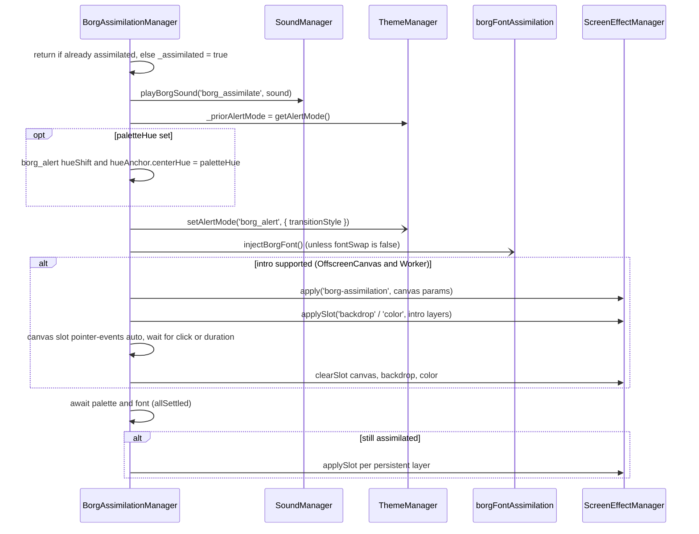

# Borg Assimilation

> **Singleton**: `window.lcards.core.borgAssimilationManager`
> **Class**: `BorgAssimilationManager` (`src/core/borg/BorgAssimilationManager.js`), extends `BaseService`
> **Console API**: `window.lcards.borg.*` (`src/lcards-main.js:735-739`)
> **User docs**: [Borg Assimilation](../../core/borg.md) (options, layers, examples) and [Borg actions](../../core/borg-actions.md)

---

## Overview

`BorgAssimilationManager` runs the Borg assimilation Easter egg on one browser: it swaps the palette to the `borg_alert` alert mode, swaps the LCARS font for the Borg typeface, plays the `borg-assimilation` screen effect as an intro until it is dismissed, then leaves persistent screen effects on the page. `deassimilate()` plays an outro and reverts all of it, returning the palette to the alert mode that was active before.

It is an orchestrator only. The work is done by:

| Step | Done by |
|---|---|
| Palette | `ThemeManager.setAlertMode('borg_alert', { transitionStyle })` and the `borg_alert` transform in `src/core/themes/alertModeTransform.js` |
| Palette hue | `setAlertModeTransformParameter()` / `getAlertModeTransform()` / `resetAlertModeTransform()` (`alertModeTransform.js`) |
| Font | `injectBorgFont()` / `revertBorgFont()` (`src/core/themes/borgFontAssimilation.js`) |
| Intro, persistent and outro effects | `ScreenEffectManager` (`apply`, `applySlot`, `clearSlot`, `clear`) and the `borg-assimilation` preset (`src/core/screen-effects/effects/BorgAssimilationEffect.js`) |
| Sounds | `SoundManager.play()` / `playSource()` |

This page describes how it works. What each option does, with examples, is in the user docs; they are not repeated here.

---

## Location and setup

| What | Where |
|---|---|
| Class | `src/core/borg/BorgAssimilationManager.js` |
| Created | `LCARdSCore._performInitialization()`, `src/core/lcards-core.js:300`, right after `ScreenEffectManager`, and assigned to `window.lcards.core.borgAssimilationManager` at once (`:301`) |
| HASS | none: core does not call its `updateHass()` |
| State | `_assimilated` (`isAssimilated` getter), `_introDismiss` (the pending intro's dismiss function), `_fontWasSwapped`, `_priorAlertMode` (the alert mode to return to) |

Who calls it:

| Caller | How |
|---|---|
| Console | `window.lcards.borg.assimilate(opts)`, `.deassimilate(opts)`, `.status`; `window.lcards.alert.borg(opts)` is a shortcut for `assimilate` (`src/lcards-main.js:724`) |
| `lcards.borg_assimilate` / `lcards.borg_deassimilate` actions | `custom_components/lcards/services.py` (`handle_borg_assimilate`, `handle_borg_deassimilate`) fires a targeted `lcards_event`; `IntegrationService._handleLcardsEvent()` (`src/core/services/IntegrationService.js:549-581`) maps the payload to options (below) |
| Connection overlay, Borg mode | `ConnectionOverlayService._onDisconnected()` calls `assimilate(borgOptsFromLayers(message.borgLayers))` after the disconnect tolerance; `_doReconnected()` calls `deassimilate()` (see [Disconnect tolerance](#disconnect-tolerance)) |
| Connectivity tab, Test button | `src/panels/components/lcards-connectivity-tab.js` uses the same `borgOptsFromLayers()` |

### Action payload to options

`handle_borg_assimilate` normalises the action fields before they reach the browser: the flat shortcuts (`site_count`, `tendrils_per_site`, `tendril_length`, `particle_count`, `renderer`, `corruption`, `overrun`, `cube`) become `intro_layers.canvas` params (snake_case keys in `intro_layers.canvas` are converted to camelCase, and win on overlap); `cube: none | detailed | classic` becomes `cube: false` or `cube: true` plus `cubeStyle`; `suppress_persistent` becomes `persistent_layers: {}` unless `persistent_layers` is set; `font_swap` is sent as `fontSwap` and `palette_hue` as `paletteHue`. `IntegrationService` then maps:

| Payload key | `assimilate()` option |
|---|---|
| `intro_duration` | `duration` |
| `transition_style` | `transitionStyle` |
| `intro_layers` | `intro` |
| `persistent_layers` | `persistentLayers` |
| `fontSwap` | `fontSwap` |
| `paletteHue` | `paletteHue` |
| `sound` | `sound` |

| Payload key | `deassimilate()` option |
|---|---|
| `with_outro` | `withOutro` |
| `outro_layers` | `outroLayers` |
| `revert_transition_style` | `revertTransitionStyle` |
| `sound` | `sound` |

`paletteHue` is set by the action (`palette_hue`), the console API and the connection overlay (`message.borgLayers.paletteHue`).

---

## assimilate() flow

`assimilate(opts)` (`BorgAssimilationManager.js:151-266`):



1. **Guard.** A second call while assimilated logs a warning and returns, so the alert mode recorded by the first call is kept.
2. **Prior alert mode.** `_priorAlertMode = themeManager.getAlertMode()`, read before the `borg_alert` swap (`null` without a ThemeManager).
3. **Sound.** `playBorgSound('borg_assimilate', sound)` (`:80-85`): `sound` as a string plays through `soundManager.playSource(sound, 'borg_assimilate')` (asset key, `media-source://` id or URL; the master switch and the `alerts` category apply, the scheme does not); `'none'` or `null` is silent; left out, `soundManager.play('borg_assimilate')` resolves it through overrides and the scheme (the default scheme maps it to nothing).
4. **Palette hue.** With `paletteHue` set, the runtime `borg_alert` transform gets `hueShift` and `hueAnchor.centerHue` set to it (the rest of `hueAnchor` kept). The built-in `borg_alert` transform is hue 110, strength 0.95, saturation x0.65, lightness x0.72, anchor range 35 (`alertModeTransform.js:101-113`).
5. **Palette and font start together**, not awaited yet: `ThemeManager.setAlertMode('borg_alert', { transitionStyle })` (default `blur_fade`) and, unless `fontSwap: false`, `injectBorgFont()`. The palette change is local to this browser: `ThemeManager.setAlertMode()` never writes `input_select.lcards_alert_mode` (that is `window.lcards.setAlertMode()`'s job).
6. **Intro.** Skipped when `borgIntroSupported()` is false (no `HTMLCanvasElement.transferControlToOffscreen` or no `Worker`), because an intro that cannot draw would still take every click. Otherwise:
   - The intro layers are `{ ...DEFAULTS.intro, ...intro }`, with `canvas` merged key by key over the default canvas params. A `backdrop` or `color` left out of `intro` keeps its default; pass `null` to drop it.
   - The canvas always plays `borg-assimilation` via `sem.apply()`: any `preset` in `intro.canvas` is removed and ignored.
   - `backdrop` and `color` layers with a `preset` go through `sem.applySlot()`.
   - The canvas slot element (`[data-lcards-se-slot="canvas"]` in `sem.portal`) gets `pointer-events: auto` and a click listener. The method waits on a promise resolved by that click, by `duration` ms when `duration > 0`, or by `deassimilate()` through the stored `_introDismiss`.
   - Then all three slots are cleared.
7. **Wait** for the palette and font promises (`Promise.allSettled`, so a failed font load does not stop the sequence).
8. **Persistent layers.** If `deassimilate()` ran in the meantime, stop here. Otherwise every layer of `persistentLayers ?? DEFAULTS.persistentLayers` with a `preset` is applied with `sem.applySlot()`. `{}` applies nothing.

The defaults (`DEFAULTS`, `:38-71`):

| Stage | Default |
|---|---|
| `intro.canvas` | `siteCount: 8, tendrilsPerSite: 5, tendrilLength: 600, particleCount: 2, color: 'var(--lcars-martian)', glowColor: 'var(--lcards-yellow)'` (the rest from the preset's own defaults, see [Screen Effect System](screen-effects.md#built-in-presets)) |
| `intro.backdrop` | `saturate`, `amount: '200%'` |
| `intro.color` | `color-tint`, `rgba(0,60,0,0.25)` |
| `persistentLayers` | canvas `glitch` (`intensity: 0.08, maxShift: 400, bandHeight: 3, fps: 20`), color `color-tint` `rgba(0, 60, 0, 0.10)`, backdrop `saturate` `200%` |
| `outroLayers` | canvas `glitch` (`duration: 1200, intensity: 0.4, opacity: 0.7`) |
| `outroDuration` | 1200 ms |

---

## deassimilate() flow

`deassimilate(opts)` (`:287-350`):

1. **Guard.** Not assimilated: warning, return.
2. `_assimilated = false` first, so an `assimilate()` still waiting on its intro skips its persistent layers.
3. A pending intro is dismissed at once through `_introDismiss()`.
4. **Sound**: `playBorgSound('borg_deassimilate', sound)`.
5. **Outro** (unless `withOutro: false`): every layer of `outroLayers ?? DEFAULTS.outroLayers` with a `preset` is applied with `sem.applySlot()`, then the method waits `Math.max(1200, ...layer.duration)` ms: `outroDuration` is a minimum. The `duration` key also reaches the preset as a param; the outro slots are not timed by SEM and stay until step 7.
6. **Palette**: `resetAlertModeTransform('borg_alert')` drops any `paletteHue`, then `ThemeManager.setAlertMode(mode, { transitionStyle: revertTransitionStyle })` (default `fade_only`), where `mode` is `_priorAlertMode`, the alert mode active when `assimilate()` started. It is `green_alert` when none was recorded (no ThemeManager, an empty value) or when the recorded mode is itself a Borg alert (its name contains `borg`). `_priorAlertMode` is reset, so the next assimilation records afresh.
7. **Font** (only if it was swapped): `revertBorgFont()` removes the `<style id="lcards-borg-font-override">`. **Effects**: `sem.clear()` clears every slot, including effects started separately (a `trigger_effect`).

---

## Font swap

`injectBorgFont()` (`src/core/themes/borgFontAssimilation.js:25-49`) loads the `lcards_borg` font through `assetManager.loadFont('lcards_borg')`, then appends one `<style id="lcards-borg-font-override">` to `document.head`:

```css
:root {
    --lcars-font:          'lcards_borg', monospace !important;
    --lcars-fallback-font: 'lcards_borg', monospace !important;
}
```

`!important` beats the HA-LCARS theme's own values. Text in a font other than these two variables keeps its font. The call is idempotent (one style tag at most); `revertBorgFont()` removes it.

---

## Disconnect tolerance

In the connection overlay's Borg mode (`message.mode: 'borg'`), assimilation is the "connection lost" display. `ConnectionOverlayService._onDisconnected()` (`src/core/services/ConnectionOverlayService.js:700-758`) treats it exactly like the standard overlay:

- It waits `disconnect_delay_ms` (default 2500) first. If the connection is back before the timer fires, nothing is shown: `_doReconnected()` cancels the timer, and the timer callback also checks `_isDisconnected`.
- Then `activate()` calls `borgAssimilationManager.assimilate(borgOptsFromLayers(message.borgLayers))`.
- `borgOptsFromLayers()` (`ConnectionOverlayService.js:165-172`) splits `borgLayers`: `paletteHue` (only when not null) and `fontSwap` (default `true`) become options, everything else (`canvas`, `backdrop`, `color`) becomes `intro`. The Test button in the connectivity tab uses the same function, so the test and a real disconnect honour the same settings.
- Reconnects go through the same 1 second debounce as the standard overlay (`_onReconnected()`), so a flapping connection during a Home Assistant restart does not assimilate and restore repeatedly. `_doReconnected()` then calls `deassimilate()` only when `isAssimilated` is true, and the `reconnected` banner is not used in this mode.

See [Connection Overlay System](connection-overlay.md#borg-mode).

---

## API

| Member | Returns | Description |
|---|---|---|
| `assimilate(opts?)` | `Promise<void>` | Run the sequence above. Resolves after the persistent layers are applied (or skipped). |
| `deassimilate(opts?)` | `Promise<void>` | Revert. Resolves after the font and effects are cleared. |
| `isAssimilated` | `boolean` | True from the start of `assimilate()` until the start of `deassimilate()`. |

`assimilate()` options: `duration` (ms, `0` = click only), `transitionStyle` (`flash`, `fade_only`, `blur_fade`, `off`; default `blur_fade`), `intro`, `persistentLayers`, `paletteHue` (0 to 359, default `null`), `fontSwap` (default `true`), `sound`. `deassimilate()` options: `withOutro` (default `true`), `outroLayers`, `revertTransitionStyle` (default `fade_only`), `sound`. Layer maps use the `trigger_effect` shape `{ slot: { preset, ...params } }`. Full tables: [Borg Assimilation, Console API](../../core/borg.md#console-api).

---

## Debugging

The manager has no `getDebugInfo()`. Use:

```javascript
window.lcards.borg.status                       // true while assimilated
window.lcards.borg.assimilate({ duration: 5000, fontSwap: false })
window.lcards.borg.deassimilate({ withOutro: false })

window.lcards.core.themeManager.currentAlertMode   // 'borg_alert' while assimilated
document.getElementById('lcards-borg-font-override') // the font style tag, or null
window.lcards.core.screenEffectManager._slots       // which SEM slots are active
```

The intro draws on its own canvas, inserted right after the SEM canvas slot with `pointer-events: none` (so the click still reaches the slot); that canvas carries `data-lcards-renderer` (`webgl` or `canvas`), which tells which worker draws it (`BorgAssimilationEffect.js:89-111`). Logs are tagged `[BorgAssimilationManager]` and `[BorgFont]`.

---

## See also

- [Borg Assimilation](../../core/borg.md) and [Borg actions](../../core/borg-actions.md): the user docs
- [Screen Effect System](screen-effects.md): the `borg-assimilation` preset and its renderers
- [Connection Overlay System](connection-overlay.md): Borg mode on disconnect
- [Theme System](theme-system.md): alert modes and palette transforms
- [Sound System](sound-system.md): the `borg_assimilate` / `borg_deassimilate` events
