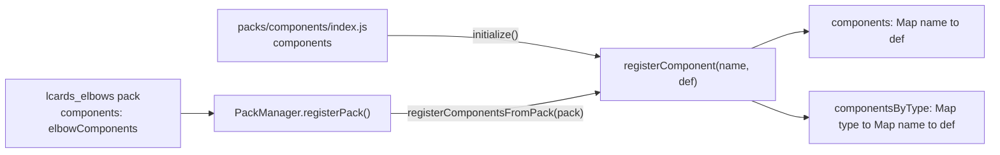

# Component Manager

> **`window.lcards.core.componentManager`**: registry of structural component definitions for the button (component mode), slider and elbow cards.

---

## Overview

`ComponentManager` (`src/core/components/ComponentManager.js`) holds named component definitions: SVG shells with named segments for button component mode, render functions for slider components, and path generators for elbow types. Cards look components up by name at render time instead of importing the data files. It is a plain class (it does not extend `BaseService`); `LCARdSCore` creates it and also exposes it through `core.getComponentManager()`.

---

## Loading

Components reach the registry twice:

1. **Bootstrap.** `LCARdSCore._performInitialization()` calls `componentManager.initialize()` before `PackManager` runs. `initialize()` imports `src/core/packs/components/index.js` and calls `registerComponent(name, def)` for every entry of its `components` object, which spreads `dpadComponents`, `dpadVoyagerComponents`, `sliderComponents`, `elbowComponents`, `alertComponents`, `bracketsComponents` and `radarComponents`. This is where every built-in component comes from.
2. **Packs.** `PackManager.registerPack()` passes any pack with a `components` key to `registerComponentsFromPack(pack)`, which re-registers each entry as `{ ...def, pack: pack.id }`. Among the built-in packs only `lcards_elbows` has `components` (it re-exports `elbowComponents`), so for elbows this only adds the `pack` field; it is also the path a new pack's components take.



`registerComponent()` files each definition under `metadata.type` (`_inferComponentType()`); a definition without one is filed under `'unknown'` with a warning. Registering a name again replaces the entry; when its type changed it moves to the new type's group, and a group left empty is dropped, so a name is only ever listed under one type.

`src/core/packs/components/buttons/index.js` (`BUTTON_COMPONENTS`) is not in the index and is not registered.

---

## Built-in Components

From `src/core/packs/components/index.js`, grouped by `metadata.type`:

| Type | Component names | Used by | Source |
|---|---|---|---|
| `dpad` | `dpad` | Button (`component: dpad`) | `components/dpad/index.js` |
| `dpad_voyager` | `dpad_voyager` | Button | `components/dpad_voyager/index.js` |
| `alert` | `alert` | Button (and the alert overlay) | `components/alert/index.js` |
| `brackets` | `brackets` | Button | `components/brackets/index.js` |
| `radar` | `radar` | Button | `components/radar/index.js` |
| `slider` | `default`, `picard`, `demo`, `shaped`, `ring` | Slider (`component:`) | `components/sliders/index.js` |
| `elbow` | `header-left`, `header-right`, `footer-left`, `footer-right`, `header-contained`, `footer-contained`, `header-open`, `footer-open`, `diagonal-cap-left`, `diagonal-cap-right`, `diagonal-cap-footer-left`, `diagonal-cap-footer-right`, `bar-slant-left`, `bar-slant-right`, `bar-parallelogram`, `frame` | Elbow (`elbow.type`) | `components/elbows/index.js` |

`window.lcards.core.componentManager.getAllComponentNames()` is the authoritative list at runtime.

---

## Component Definition Shapes

All definitions carry `metadata` with at least `type`. The rest depends on the card that renders them.

**Button components** (`dpad`, `dpad_voyager`, `alert`, `brackets`, `radar`): an SVG shell with named segments. Example (`dpad`, abbreviated):

```javascript
{
  // Inline SVG; each segment is an element with a matching id
  svg: dpadSvg,
  orientation: 'square',
  features: ['multi-segment', 'state-based-styling', 'zones', 'text-overlay'],

  // Named rectangles in viewBox units, for text placement
  zones: {
    up: { x: 34, y: 0.5, width: 12, height: 9.5 },
    // ... down, left, right, center and the four diagonals
  },

  // Default per-segment style (theme tokens, not literal colours)
  segments: {
    up: {
      style: {
        fill: 'theme:components.dpad.segment.directional.fill',
        stroke: 'theme:components.dpad.segment.directional.stroke',
        'stroke-width': 'theme:components.dpad.segment.directional.stroke-width'
      }
    }
    // ...
  },

  // Named presets the card can pick (config `preset:`); alert has
  // default and condition_red / _blue / _yellow / _green / _gray / _black
  presets: { default: {} },
  validatePreset(presetName) { return presetName in this.presets; },
  getPresetNames() { return Object.keys(this.presets); },

  metadata: {
    type: 'dpad',          // required: the getComponentsByType() group
    card_type: 'button',   // which card editor offers it
    pack: 'lcards_buttons',
    id: 'dpad',
    name: 'D-Pad Control',
    description: 'Interactive directional control with 9 segments',
    version: '1.0.0'
  }
}
```

`alert` also has `text` and `animations`; `brackets` and `radar` have no `validatePreset` / `getPresetNames` helpers (the button card checks `presets` itself).

**Slider components**: `{ render(context), calculateZones(...), metadata }`. `metadata` carries `orientation`, `supportsOrientation`, `defaultOrientation`, `features` and either `configSchema` or `textZones`; there is no `card_type`. The slider calls `render()` to build its SVG (`src/cards/lcards-slider.js`, `getComponent(componentName)`).

**Elbow components**: `{ orientation, features, layout: { position, side }, pathGenerator(config), metadata }`. `pathGenerator()` receives `{ geometry, container }` and returns an SVG path string (`src/core/packs/components/elbows/index.js`); the elbow card reads them through `_getElbowComponent(type)` (`src/cards/lcards-elbow.js`).

---

## How Cards Use Components

**Button component mode** (`component: dpad` and so on):

1. `CoreConfigManager._getComponentDefaults()` adds `{ [component]: { segments: componentPreset.segments } }` as the component layer of the config merge (behavioral, theme, preset, component, user). It reads the definition with `getComponent()` from `src/core/packs/components/index.js` directly, not from the manager.
2. `LCARdSButton._processComponentPresetFromMergedConfig(componentName)` (`src/cards/lcards-button.js`) gets the definition from `core.getComponentManager().getComponent(componentName)`, picks the preset (range-driven preset, then `config.preset`, then `default`; user `custom_presets` under the component key are deep-merged over the built-in ones without mutating the registry), and builds the segment SVG with per-segment style, text and actions from config merged over the definition's defaults.
3. Component animations (`componentDef.animations`) are registered after the DOM is rendered, with the SVG container as scope.

Per-segment actions (`tap_action` and so on) are never part of a definition; they come from the card config (for example `dpad.segments.up.tap_action`).

**Slider**: `getComponent(name)` for rendering; `getComponentsByType('slider')` for the list of choices. **Elbow**: `getComponent(type)` for the path generator and layout. **Editors**: the slider editor reads `getComponentMetadata()`, the elbow editor `getComponent()`, the Pack Explorer `getAllComponentNames()`.

User-facing docs: [Button: Components](../../cards/button/components.md).

---

## Public API

| Method | Returns | Description |
|---|---|---|
| `initialize()` | `Promise<void>` | Register everything from `packs/components/index.js`; no-op when already initialized |
| `registerComponent(name, component)` | `void` | Add or replace one definition, grouped by `metadata.type` |
| `registerComponentsFromPack(pack)` | `void` | Register `pack.components`, each tagged with `pack: pack.id` |
| `getComponent(name)` | `Object\|undefined` | Full definition |
| `getComponentMetadata(name)` | `Object\|null` | The `metadata` block, or `{ name, features, orientation, description }` built from a definition without one |
| `hasComponent(name)` | `boolean` | Whether the name is registered |
| `getAllComponentNames()` | `string[]` | All names, in registration order |
| `getComponentsByType(type)` | `string[]` | Names in one `metadata.type` group (names only) |
| `getComponentTypes()` | `string[]` | All type groups |
| `getDebugInfo()` | `Object` | `{ initialized, totalComponents, componentsByType: { type: count }, componentNames }` |
| `destroy()` | `void` | Clear both maps |

```javascript
const cm = window.lcards.core.componentManager;

cm.getComponent('dpad');              // full definition
cm.hasComponent('dpad');              // true
cm.getComponentsByType('elbow');      // ['header-left', 'header-right', ...]
cm.getComponentsByType('dpad');       // ['dpad'] (dpad_voyager has its own type)
cm.getComponentTypes();               // ['dpad', 'dpad_voyager', 'slider', 'elbow', 'alert', 'brackets', 'radar']
```

---

## Console Access

::: code-group
```javascript [Snapshot]
window.lcards.debug.singleton('componentManager')
// → { initialized: true, totalComponents: 26,
//      componentsByType: { dpad: 1, dpad_voyager: 1, slider: 5, elbow: 16, alert: 1, brackets: 1, radar: 1 },
//      componentNames: ['dpad', 'dpad_voyager', 'default', 'picard', ...] }
```
```javascript [Live object]
const cm = window.lcards.core.componentManager

cm.getAllComponentNames()          // all registered names
cm.getComponent('dpad')            // full definition with segments/zones/metadata
cm.getComponentMetadata('ring')    // metadata only
cm.getComponentsByType('slider')   // ['default', 'picard', 'demo', 'shaped', 'ring']
```
:::

---

## See Also

- [Button: Components](../../cards/button/components.md)
- [Pack System](pack-system.md)
- [Asset Manager](asset-manager.md)
