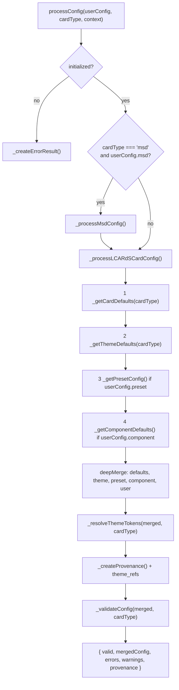
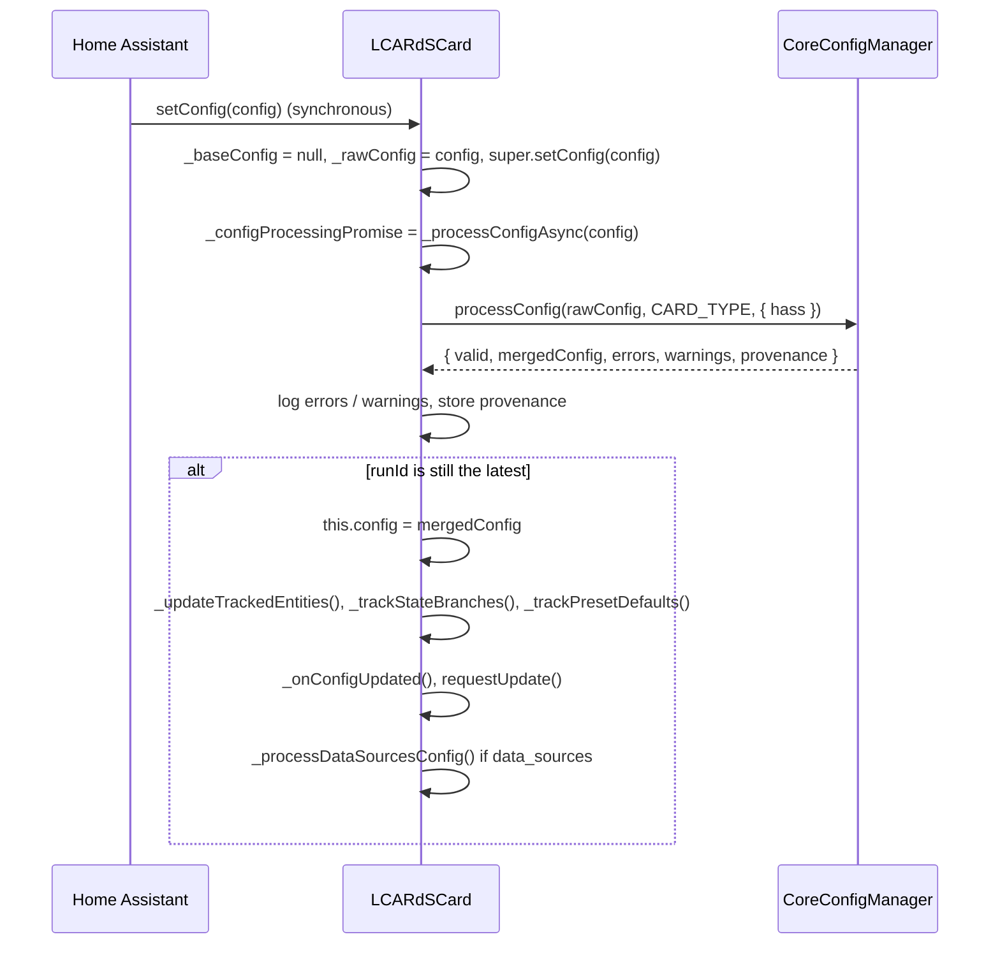

# Config Manager

> **`window.lcards.core.configManager`**: turns a card's raw YAML config into the merged config the card renders from, with provenance and schema validation.

---

## Overview

`CoreConfigManager` (`src/core/config-manager/index.js`) is the one config pipeline for every LCARdS card type. Each card hands it the config Home Assistant gave it; it returns the config merged with behavioural defaults, theme defaults, a style preset and component defaults, with whole-value `theme:` tokens resolved, a record of where every field came from, and the schema validation result.

It is a plain class (it does not extend `BaseService` and receives no hass updates). It holds two registries, keyed by the card's `CARD_TYPE`:

- `_cardSchemas`: the schema each card registers (validation, see [Validation Service](validation-service.md));
- `_cardDefaults`: behavioural defaults each card may register.

Rule patches are **not** part of this pipeline. They are applied later, at runtime, by the card (`LCARdSCard._applyRulePatches()`, see [Rules Engine](rules-engine.md)), on top of the merged config.

---

## Files

| File | Role |
|---|---|
| `src/core/config-manager/index.js` | `CoreConfigManager` |
| `src/core/config-manager/merge-helpers.js` | `deepMerge()`, `trackFieldSources()`, plus `shallowClone`, `isPlainObject`, `getNestedValue`, `setNestedValue` |
| `src/core/config-manager/README.md` | A pointer to this page |
| `src/base/LCARdSCard.js` | The card side: `setConfig()`, `_processConfigAsync()`, `_reprocessForThemeChange()` |
| `src/msd/pipeline/ConfigProcessor.js` | The MSD pipeline's second pass (`processAndValidateConfig()`) |
| `src/utils/provenance-tracker.js` | `ProvenanceTracker.trackConfig()`: where a card keeps the config provenance |

---

## Initialisation

In `LCARdSCore._performInitialization()` (`src/core/lcards-core.js`):

1. `validationService` is created and initialised.
2. `this.configManager = new CoreConfigManager()`, then `await configManager.initialize({ validationService })`. It is created this early because cards call `processConfig()` as soon as they get a config. `initialize()` throws without a validation service; theme and preset managers may be missing at this point.
3. The style preset manager, packs and themes load, and `lcards-default` is activated.
4. `await configManager.updateContext({ themeManager, stylePresetManager })` adds them.

`src/lcards-main.js` then calls every card's `registerSchema()` (the list is on the [Validation Service](validation-service.md#schema-registration) page). Cards that have behavioural defaults register them in the same method:

| `CARD_TYPE` | `registerCardDefaults()` |
|---|---|
| `chart` | `CHART_CARD_DEFAULTS`: `{ chart_type: 'line', height: 300 }` (`src/charts/chart-options-builder.js`) |
| `slider` | `{ orientation: 'horizontal' }` |
| `astrometrics` | `{ height: 400 }` |
| `msd` | `{}` |

The other cards register no defaults (the layer is then empty).

---

## The merge pipeline



An exception anywhere in `processConfig()` is caught and returned as an error result (`stats.validationErrors` is counted).

### The layers, lowest first

| Layer | Source | Notes |
|---|---|---|
| Card defaults | `_cardDefaults.get(cardType)` | Behavioural only: `registerCardDefaults()` drops a `style` key with a warning |
| Theme defaults | `themeManager.getDefault(cardType, 'base')`, nested as `{ style: { ... } }` | Reads the token `components.<cardType>.base`; empty when the theme manager is missing or not initialised. The built-in `lcards-default` theme has no `base` entry under any component (`src/core/packs/themes/tokens/lcardsDefaultTokens.js`), so this layer is empty unless a pack theme provides one |
| Preset | `stylePresetManager.getPreset(cardType, userConfig.preset, themeManager)` | Presets have the same shape as a card config. The registry-only keys `extends`, `description` and `compatibleComponents` are removed. A preset not found warns, except when `component` is also set: then the name is a component preset that the card resolves itself, logged at trace |
| Component | `getComponent(userConfig.component)` from `src/core/packs/components/index.js` (dynamic import) | Returns `{ [component]: { segments } }`; an unknown component warns |
| User config | the config as written | Always last, so it wins |

Preset and component are both applied when both are set (preset for style, component for segments), in that order. The class and method comments still call them "mutually exclusive"; the code applies both.

### `deepMerge(target, source)`

`merge-helpers.js`. Returns a new object; neither input is mutated (Home Assistant freezes card configs):

| Source value | Result |
|---|---|
| `null` or `undefined` | Written as is (so a user `null` clears a lower layer's value) |
| array | Replaces the target's value with a shallow copy (arrays never merge) |
| plain object (`constructor === Object`) | Merged recursively |
| anything else (string, number, class instance) | Replaces the target's value |

### Theme tokens

`_resolveThemeTokens(config, cardType)` uses `themeManager.resolver.forComponent(cardType)` and walks the merged config:

- a string value that **starts with** `theme:` is replaced in place by the resolved value; when the token does not resolve, the fallback is the original `theme:...` string, so it stays;
- token paths outside the shared categories (`colors.`, `typography.`, `spacing.`, `borders.`, `effects.`, `animations.`, `components.<cardType>.`) are read relative to `components.<cardType>` (`ThemeTokenResolver.componentPath()`);
- values inside **arrays are not resolved** (cards resolve those themselves, often with element context) but are recorded with `deferred: true`;
- every token is recorded in `theme_refs` as `{ field, ref, path, value }` (or `{ field, ref, path, deferred: true }`), and `stats.tokensResolved` is counted.

Tokens are resolved after the merge and before validation, so the schema sees concrete values. Without a theme resolver this step is skipped.

---

## Provenance

`_createProvenance()` returns:

```javascript
{
  card_type: 'button',
  merge_order: ['theme_defaults', 'preset_lozenge', 'user_config'],
  field_sources: {
    'style.color': {
      layers: { preset_lozenge: 'theme:colors.ui.primary', user_config: 'var(--lcars-red)' },
      final: 'user_config'
    },
    'entity': { layers: { user_config: 'light.bedroom' }, final: 'user_config' }
  },
  timestamp: 1762700000000,
  theme_refs: [ /* see above */ ]
}
```

- `merge_order` lists only layers that contributed something, in merge order: `card_defaults`, `theme_defaults`, `preset_<name>`, `component_<name>`, and always `user_config`.
- `field_sources` (`trackFieldSources()`) has one entry per leaf path, keyed by the dotted path as a single string (`'style.color'`); objects are walked, arrays are leaves. `layers` is every layer's value for that path, `final` the last layer that set it.
- The layer values are the raw ones, before token resolution; `theme_refs` holds the resolved values.

The card stores it in two places: `this._provenance = result.provenance` and `this._provenanceTracker.trackConfig(provenance)`, which keeps `merge_order`, `field_sources`, `card_type` and `timestamp`. Each `theme_refs` entry is also recorded as a token use (`_trackTokenUse(path, field, ref)`).

---

## The card path



- `setConfig()` must stay synchronous for Home Assistant, so the raw config is set first and the processing runs in the background. Subclasses that need the merged config await `this._configProcessingPromise`.
- The card type is `this.constructor.CARD_TYPE`, else `rawConfig.type`, else `'simple-card'`.
- A run id (`_configRunId`) guards against an older run finishing after a newer one: stale results are dropped.
- The merged config is applied **even when validation fails**; errors are only logged (`lcardsLog.error` / `lcardsLog.warn`).
- Without an initialised config manager the card keeps the raw config.
- A theme override or alert-mode change calls `_reprocessForThemeChange()`, which runs `_processConfigAsync(this._rawConfig)` again: resolved `theme:` values are baked into `this.config`, so a re-render alone would keep the old ones.

---

## The MSD path

MSD configs nest their settings: `{ type, id, grid_options, rules, data_sources, msd: { base_svg, overlays, anchors, ... } }`. `processConfig()` recognises `cardType === 'msd'` with an `msd` key and calls `_processMsdConfig()`, which checks that `msd` is an object, runs the **whole** config through `_processLCARdSCardConfig(userConfig, 'msd', context)` (the MSD schema expects the nested shape), and attaches `mergedConfig.__provenance` and `mergedConfig.__validation` (`{ errors, warnings, valid }`).

An MSD config goes through the pipeline twice:

1. **Card pass**: `LCARdSCard._processConfigAsync()` as above. `LCARdSMSDCard._onConfigUpdated()` (`src/cards/lcards-msd.js`) keeps `this._fullConfig = this.config` and `this._msdConfig = this.config.msd` (a `view_box` without a `base_svg.source` becomes `source: 'none'`).
2. **Pipeline pass**: `initMsdPipeline(this._fullConfig, svgContent, ...)` (`src/msd/pipeline/PipelineCore.js`) calls `processAndValidateConfig()` (`src/msd/pipeline/ConfigProcessor.js`), which:
   - resolves the view box and extracts anchors from the SVG (`resolveEffectiveViewBox()`, `SvgStructureAnalyzer.analyzeAnchors()`, `AnchorProcessor.processAnchors()`);
   - adds `view_box`, `anchors` and `_svgMetadata` at the top level and calls `configManager.processConfig(enhancedConfig, 'msd', { hass: window.hass })` again;
   - takes `mergedConfig = fullConfig.msd`, carries `view_box` over, merges the extracted anchors under the user's (user anchors win, their percentages resolved against the view box), resolves percentage positions of overlays;
   - adds anchor checks (`anchor.missing`, `anchor.self_reference`) to the issues.

   If any error remains, the pipeline is disabled (`createDisabledPipeline()`).

Packs are not merged per card: `PackManager` registers them globally at startup.

---

## API

| Member | Description |
|---|---|
| `initialize({ validationService, themeManager?, stylePresetManager? })` | Stores the dependencies; throws without a validation service; warns if already initialised |
| `updateContext({ themeManager?, stylePresetManager? })` | Adds late dependencies; warns if not initialised |
| `processConfig(userConfig, cardType, context = {})` | `Promise<{ valid, mergedConfig, errors, warnings, provenance }>`. `context` is accepted but only `cardType` reaches the validator (`{ context: cardType }`) |
| `registerCardSchema(cardType, schema, { version? })` | Schema for validation; `version` defaults to `'1.0'` |
| `registerCardDefaults(cardType, defaults)` | Behavioural defaults; a `style` key is dropped with a warning |
| `getCardSchema(cardType)` | The schema or `null` |
| `getDebugInfo()` | `{ initialized, stats, registeredCards: { schemas, defaults }, dependencies: { hasValidationService, hasThemeManager, hasStylePresetManager } }` |
| `stats` | `{ configurationsProcessed, validationErrors, presetsResolved, tokensResolved }` |
| `destroy()` | Clears both registries |

The error result (`_createErrorResult()`) is `{ valid: false, mergedConfig: userConfig, errors: [{ type: 'processing_error', message, formattedMessage }], warnings: [], provenance: null }`.

---

## Debugging

::: code-group
```javascript [Snapshot]
window.lcards.debug.singleton('configManager')
// { initialized: true,
//   stats: { configurationsProcessed, validationErrors, presetsResolved, tokensResolved },
//   registeredCards: { schemas: ['button', 'elbow', ...], defaults: ['chart', 'slider', ...] },
//   dependencies: { hasValidationService: true, hasThemeManager: true, hasStylePresetManager: true } }
```
```javascript [One card]
// A card element (from the editor preview, or by its config)
const card = window.lcards.findCardByConfig(cardConfig);

card.getProvenance('config');                          // merge_order, field_sources, card_type
card.getProvenance('config').field_sources['style.color']; // { layers, final }
card.getProvenance('config.tree');                     // the same, as a nested tree
card._provenance.theme_refs;                           // theme: values the merge resolved
```
```javascript [Run the pipeline]
const cm = window.lcards.core.configManager;
const result = await cm.processConfig(
  { type: 'custom:lcards-button', preset: 'lozenge', entity: 'light.bedroom' },
  'button'
);
result.provenance.merge_order;
result.errors;
```
:::

---

## See also

- [Validation Service](validation-service.md)
- [Style Preset Manager](style-preset-manager.md)
- [Theme System](theme-system.md)
- [Rules Engine](rules-engine.md): runtime patches on top of the merged config
- [Card Foundation](../cards/lcards-card-foundation.md)
