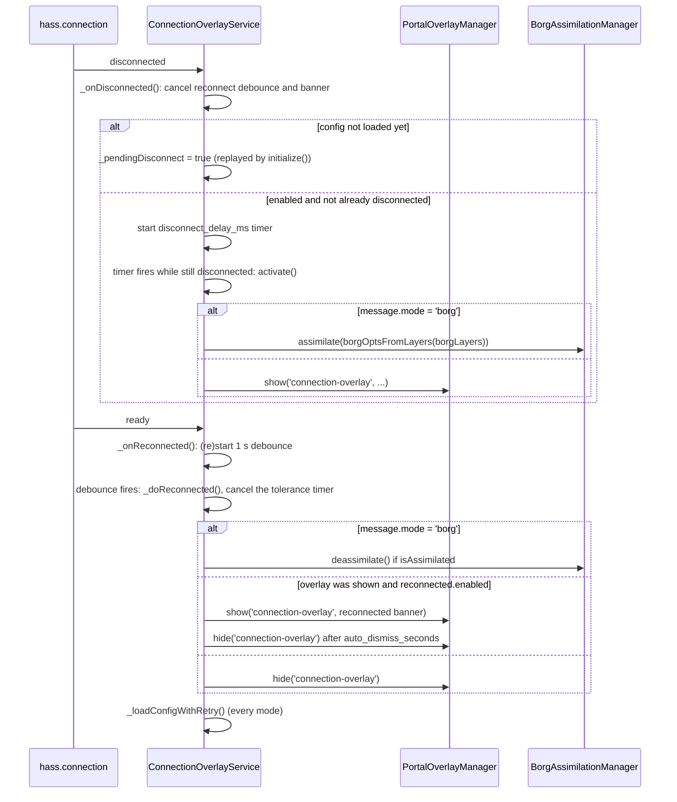

# Connection Overlay System

> **Singleton**: `window.lcards.core.connectionOverlayService`
> **Console API**: `window.lcards.connectionOverlay.*`
> **Source**: `src/core/services/ConnectionOverlayService.js`
> **Config UI**: LCARdS Config Panel → Connectivity tab

---

## Overview

The Connection Overlay Service monitors the Home Assistant WebSocket connection and displays a full-screen overlay whenever the frontend loses contact with the Home Assistant server. It is a `BaseService` singleton that is active on every page the LCARdS module is loaded; no card placement is required.

Key capabilities:

- **Automatic detection** from the WebSocket `disconnected` / `ready` events (the `hass.connected` flag only until those are subscribed)
- **Per-scope config** via the ScopedSettings waterfall: device, user, or global overrides
- **Disconnect tolerance and reconnect debounce**: a disconnect shows nothing for `disconnect_delay_ms` (default 2500 ms), and a reconnect only counts once it has held for 1 second, so blips and a flapping connection during a Home Assistant restart don't flash the overlay
- **Config auto-refresh**: re-reads config from the scoped waterfall after every Home Assistant reconnect (with two retries), so settings saved just before a Home Assistant restart are picked up without a page reload
- **Three display modes**: simple text message, a full custom Home Assistant card, or a Borg-assimilation takeover
- **Optional reconnection banner**: brief confirmation overlay that auto-dismisses after reconnection
- **SEM integration**: backdrop, canvas, and colour effect layers via `ScreenEffectManager`
- **Stackable with alert overlay**: both overlays can be visible simultaneously; the connection overlay renders on top when both are active

---

## Architecture

```
ConnectionOverlayService (BaseService singleton)
    │
    ├─ Detection
    │   ├─ hass.connection events 'disconnected' / 'ready'   ← authoritative once subscribed
    │   └─ hass.connected flag in updateHass()                ← only before the subscription
    │
    ├─ Timing
    │   ├─ disconnect_delay_ms tolerance timer   (_disconnectDelayTimer)
    │   └─ 1 s reconnect debounce                (_reconnectDebounceTimer)
    │
    ├─ Config waterfall per flat key (ScopedSettingsService.read)
    │   device scope → user scope → global scope → current in-memory value → DEFAULT_CONFIG
    │
    ├─ Standard display: PortalOverlayManager slot 'connection-overlay'
    │   └─ ScreenEffectManager portal (inside <home-assistant>, position:fixed, z:9100)
    │
    └─ Borg display (message.mode = 'borg'): BorgAssimilationManager.assimilate() / deassimilate()
```

### Key Files

| File | Purpose |
|------|---------|
| `src/core/services/ConnectionOverlayService.js` | Core singleton service |
| `src/core/services/PortalOverlayManager.js` | Shared portal DOM lifecycle engine ([Portal Overlay Manager](portal-overlay-manager.md)) |
| `src/core/borg/BorgAssimilationManager.js` | Borg mode display ([Borg Assimilation](borg-assimilation.md)) |
| `src/core/services/storage-permissions.js` | `canWriteGlobalStorage()`, `defaultSettingsScope()`: who may write the global scope |
| `src/core/services/ScopedSettingsConstants.js` | Flat storage key constants (`CONN_OVERLAY_*`) |
| `src/panels/components/lcards-connectivity-tab.js` | Config Panel UI |
| `src/lcards-main.js` | `window.lcards.connectionOverlay` console API shim |

---

## Detection Strategy

1. **`hass.connection` WebSocket events** (authoritative): `home-assistant-js-websocket` fires `'disconnected'` on close and `'ready'` on (re)connect on the `Connection` object. The library has **no** `'reconnected'` event; `'ready'` is the correct reconnect signal, and it fires after auth completes on both the initial connection and every subsequent reconnect. These fire regardless of dashboard activity, avoiding false positives from idle dashboards (no state changes → no `updateHass` calls is normal and is **not** a disconnect signal).

2. **`hass.connected` flag** (only before the subscription): `updateHass()` (`ConnectionOverlayService.js:246-282`) reads the flag's transitions **only while no connection is subscribed yet**. Once the events are subscribed it just records the flag and never acts on it, because a stale `hass` object captured before a disconnect still carries `connected: true` and would cause a false reconnect.

`updateHass()` subscribes (`_subscribeConnectionEvents()`) whenever it sees a `connection` object different from the one it holds, removing the listeners from the old one first; the same object is never subscribed twice. Core calls `updateHass(hass)` right after creating the service (`src/core/lcards-core.js:337`), so there is no window in which a disconnect has no listener.

### Disconnect and reconnect timing



- **Queued disconnect.** Until `initialize()` has loaded the scoped config (`_configLoaded`), the real `enabled` setting is unknown, so `_onDisconnected()` only sets `_pendingDisconnect`. `initialize()` (run by core after `integrationService.onReady()`, `lcards-core.js:355-359`) replays it if the connection is still down (`ConnectionOverlayService.js:293-310`).
- **Deduplication.** A second `disconnected` while `_isDisconnected` is set is ignored.
- **Tolerance.** `disconnect_delay_ms > 0` starts `_disconnectDelayTimer`; a reconnect before it fires cancels it, and the callback also checks `_isDisconnected`. The banner is shown only if the overlay was actually shown (`wasActive`), so a suppressed blip shows nothing at all. The Borg mode waits for the same timer.
- **Reconnect debounce.** `_onReconnected()` (`:773-786`) restarts a 1 second timer on every `ready`; a new `disconnected` cancels it. During a Home Assistant restart the socket can open and close several times, and the overlay stays up until the connection holds.
- **Post-reconnect config.** `_loadConfigWithRetry()` (`:868-879`) calls `loadConfig()` at once and again after 3 s and 8 s: on a full restart the browser can reconnect before the LCARdS integration has registered its `lcards/*` commands, and the first read then fails.

---

## Config Schema

### Resolved config shape

This mirrors `DEFAULT_CONFIG` in `ConnectionOverlayService.js`: the built-in defaults before any scoped-settings overrides are applied. **`enabled` defaults to `false`**: the overlay is opt-in and must be explicitly turned on per scope.

```js
{
  enabled:  false,          // Opt-in - must be explicitly enabled per scope
  dismiss:  true,           // Whether clicking the backdrop dismisses it
  position: 'center',       // Content anchor: 'center' | 'top' | 'top-left' | 'bottom-right' | ...
  width:    'auto',         // CSS width for the content container ('auto' = size to content)
  height:   'auto',         // CSS height for the content container

  // Milliseconds to wait after a disconnect event before showing the overlay.
  // 0 = show immediately. Absorbs brief blips (mobile WiFi handoff, HA restart transients).
  disconnect_delay_ms: 2500,

  message: {
    mode:      'text',         // 'text' | 'card' | 'borg'
    text:      'Connection Lost',
    color:     'var(--error-color)',
    font:      'Antonio',      // lcards font registry key
    size:      42,             // px
    weight:    '400',          // CSS font-weight
    transform: 'uppercase',    // CSS text-transform
    // SEM layers used only when mode = 'borg' - mirrors the connectivity tab's
    // Borg-mode editor defaults (borg-assimilation canvas preset + saturate/tint).
    borgLayers: {
      canvas:   { preset: 'borg-assimilation', siteCount: 8, tendrilsPerSite: 5, tendrilLength: 600, particleCount: 2, color: 'var(--lcars-martian)', glowColor: 'var(--lcards-yellow)' },
      backdrop: { preset: 'saturate', amount: '200%' },
      color:    { preset: 'color-tint', color: 'rgba(0,60,0,0.25)' },
      paletteHue: 110,
      fontSwap:   true,
    },
  },

  reconnected: {
    enabled:              true,
    text:                 'Connection Established',
    color:                'var(--primary-color)',
    auto_dismiss_seconds: 3,
    font:      'Antonio',
    size:      42,
    weight:    '400',
    transform: 'uppercase',
    content:   null,           // Optional HA card config (card mode)
  },

  layers: {
    backdrop: null,            // null = disabled, or { preset, ...params }
    color:    { preset: 'color-tint', color: 'rgba(0,0,0,0.55)' },
    canvas:   { preset: 'static', opacity: 0.55 },
  },

  content: null,               // Optional HA card config when mode = 'card'
}
```

### Position values

| Value | Anchor |
|-------|--------|
| `center` *(default)* | Centred horizontally and vertically |
| `top` / `top-center` | Top edge, horizontally centred |
| `top-left` | Top-left corner |
| `top-right` | Top-right corner |
| `left` / `left-center` | Left edge, vertically centred |
| `right` / `right-center` | Right edge, vertically centred |
| `bottom` / `bottom-center` | Bottom edge, horizontally centred |
| `bottom-left` | Bottom-left corner |
| `bottom-right` | Bottom-right corner |

---

## Config Resolution: Scoped Waterfall

Config is stored as **25 flat keys** in `ScopedSettingsService` (one per independently overridable field). Resolution order, first non-null wins:

```
Device scope → User scope → Global scope → current in-memory value → Built-in defaults
```

Every `sss.read()` passes `null` as the fallback, so a failed read (all scopes `null`) keeps the value already in memory (for instance the optimistic patch from a save) instead of resetting it to the default (`loadConfig()`, `ConnectionOverlayService.js:320-427`). When the overlay is showing, `loadConfig()` re-renders it with the new config; in Borg mode it removes a standard overlay left from a text or card setup and starts the assimilation if none is running (unless the overlay was dismissed).

Flat keys are independent: a device-scoped colour does **not** clobber a global-scoped text value. This allows kiosks or individual users to override only the fields they care about.

Config is re-read from the full waterfall after every Home Assistant reconnect (`_doReconnected()` → `_loadConfigWithRetry()` → `loadConfig()`, in every mode including [Borg mode](#borg-mode)), so settings saved just before a Home Assistant restart are picked up automatically without a page reload. A brief in-memory optimistic patch is also applied immediately after a successful save so that `_onDisconnected()` sees the correct flags even if the subsequent `loadConfig()` WS reads are interrupted by a Home Assistant restart.

### Flat key constants (from `ScopedSettingsConstants.js`)

| Constant | Key string | Field |
|----------|-----------|-------|
| `CONN_OVERLAY_ENABLED` | `conn_overlay_enabled` | `enabled` |
| `CONN_OVERLAY_DISMISS` | `conn_overlay_dismiss` | `dismiss` |
| `CONN_OVERLAY_POSITION` | `conn_overlay_position` | `position` |
| `CONN_OVERLAY_WIDTH` | `conn_overlay_width` | `width` |
| `CONN_OVERLAY_HEIGHT` | `conn_overlay_height` | `height` |
| `CONN_OVERLAY_CONTENT` | `conn_overlay_content` | `content` |
| `CONN_OVERLAY_SEM` | `conn_overlay_sem` | `layers` (entire object) |
| `CONN_OVERLAY_MSG_MODE` | `conn_overlay_msg_mode` | `message.mode` |
| `CONN_OVERLAY_MSG_TEXT` | `conn_overlay_msg_text` | `message.text` |
| `CONN_OVERLAY_MSG_COLOR` | `conn_overlay_msg_color` | `message.color` |
| `CONN_OVERLAY_MSG_FONT` | `conn_overlay_msg_font` | `message.font` |
| `CONN_OVERLAY_MSG_SIZE` | `conn_overlay_msg_size` | `message.size` |
| `CONN_OVERLAY_MSG_WEIGHT` | `conn_overlay_msg_weight` | `message.weight` |
| `CONN_OVERLAY_MSG_TRANSFORM` | `conn_overlay_msg_transform` | `message.transform` |
| `CONN_OVERLAY_RECON_ENABLED` | `conn_overlay_recon_enabled` | `reconnected.enabled` |
| `CONN_OVERLAY_RECON_TEXT` | `conn_overlay_recon_text` | `reconnected.text` |
| `CONN_OVERLAY_RECON_COLOR` | `conn_overlay_recon_color` | `reconnected.color` |
| `CONN_OVERLAY_RECON_DISMISS_SECS` | `conn_overlay_recon_dismiss_secs` | `reconnected.auto_dismiss_seconds` |
| `CONN_OVERLAY_RECON_FONT` | `conn_overlay_recon_font` | `reconnected.font` |
| `CONN_OVERLAY_RECON_SIZE` | `conn_overlay_recon_size` | `reconnected.size` |
| `CONN_OVERLAY_RECON_WEIGHT` | `conn_overlay_recon_weight` | `reconnected.weight` |
| `CONN_OVERLAY_RECON_TRANSFORM` | `conn_overlay_recon_transform` | `reconnected.transform` |
| `CONN_OVERLAY_RECON_CONTENT` | `conn_overlay_recon_content` | `reconnected.content` |
| `CONN_OVERLAY_BORG_SEM` | `conn_overlay_borg_sem` | `message.borgLayers` (entire object) |
| `CONN_OVERLAY_DISCONNECT_DELAY` | `conn_overlay_disconnect_delay` | `disconnect_delay_ms` |

---

## Portal Structure

The overlay is managed entirely by `PortalOverlayManager` (POM) under the named slot `'connection-overlay'`. `ConnectionOverlayService` calls `pom.show('connection-overlay', options)` and `pom.hide('connection-overlay')`; it does not manage any DOM directly.

POM injects the following structure into `ScreenEffectManager`'s shared `position:fixed` portal (`z-index:9100`, mounted inside `<home-assistant>`'s shadow root; see [Portal Overlay Manager](portal-overlay-manager.md#mounting)):

```
ScreenEffectManager portal  (position:fixed, inset:0, z:9100)
  ├─ SEM slot elements          (backdrop, canvas, color)
  │
  ├─ [slot: 'alert-overlay']    ← when alert overlay is also active
  │   ├─ dismissEl  (z:10)
  │   └─ wrapperEl  (z:11)
  │
  └─ [slot: 'connection-overlay']
      ├─ dismissEl              (position:absolute, inset:0, z:10) - click-to-dismiss
      └─ wrapperEl              (position:absolute, inset:0, z:11, display:flex)
          └─ contentContainer   (flex child - width/height from config)
              └─ content card element  OR  text <div>
```

Slots are independent DOM subtrees. When both overlays are active, the connection overlay renders on top because its elements are appended after the alert overlay's elements.

---

## SEM Layer Ownership

When the overlay is visible with `layers` configured, `PortalOverlayManager` applies each configured layer on behalf of the `'connection-overlay'` slot and remembers it. Only one POM slot owns SEM effects at a time (last-in-wins). When the slot hides, POM clears only the SEM slots it applied, and only while they still run its effect: a screen effect started with `lcards.trigger_effect` on another slot, or on the same slot after the overlay showed, keeps running (see [Portal Overlay Manager](portal-overlay-manager.md#screen-effect-ownership)).

POM calls `sem.setOverlayOccupied(true)` as soon as any slot is shown, and `sem.setOverlayOccupied(false)` when all slots have been hidden.

---

## Alert Overlay Co-existence

Both the connection overlay and the alert overlay use `PortalOverlayManager` with independent named slots (`'connection-overlay'` and `'alert-overlay'`). They stack freely: there is no suppression logic. If an alert is active and Home Assistant disconnects, the connection overlay appears on top of the alert overlay (last `appendChild` wins at equal z-index).

The SEM effects are shared (last-in-wins): showing the connection overlay with `layers` evicts the alert overlay's SEM effects (the ones the alert overlay applied) if both are active simultaneously. If the connection overlay is configured without `layers` (text or card mode only), the alert backdrop effects are unaffected. When a connection overlay with `layers` hides, POM clears the effects it applied; the alert overlay's effects are not restored until it shows again. (The defaults have `layers` set: a `color-tint` and `static`.)

---

## Reconnection Banner

When `config.reconnected.enabled` is `true` and the disconnect overlay was actually shown, `_doReconnected()` (`ConnectionOverlayService.js:788-847`) shows a brief confirmation instead of removing the overlay at once:

1. `pom.show('connection-overlay', ...)` replaces the disconnect slot (last in wins), with `dismiss: false` and the same `position`, `width`, `height` and `layers`.
2. The content is `reconnected.content` when `message.mode` is `'card'` and a reconnected card is set; otherwise the `reconnected` object is the text fallback (`text`, `color`, `font`, `size`, `weight`, `transform`).
3. `_startReconnectedTimer()` calls `portalOverlayManager.hide('connection-overlay')` after `auto_dismiss_seconds` (default 3).

A new disconnect during the banner cancels its timer (`_clearReconnectedTimer()`) before the disconnect overlay shows again.

---

## Display Modes

### Text mode (`message.mode = 'text'`)

A plain `<div>` is rendered in the content container using inline styles only (no CSS custom properties). This ensures the overlay remains styled correctly while disconnected, when the Home Assistant theme system may not be fully operational.

Styling fields: `text`, `color`, `font` (a font registry key, resolved by POM's `_resolveFontCssFamily()`), `size` (px), `weight`, `transform`.

### Card mode (`message.mode = 'card'`)

An arbitrary Home Assistant card config (`config.content`) is passed to `pom.show()` as `content`. Mounting is POM's: `createCardElement()` / `applyCardConfig()` from `src/utils/ha-card-factory.js`, and `applyHassToCard()` on every `PortalOverlayManager.updateHass()` (see [Portal Overlay Manager](portal-overlay-manager.md#content-mounting)). `width` and `height` from config size the content container.

`_showDisconnectOverlay()` passes `content` only when `message.mode` is `'card'` (and a card is set), otherwise `content: null`, with `text: cfg.message` as the fallback; the reconnect banner checks the mode the same way. So a card saved in one scope never shows when the resolved mode is text, for instance `message.mode: 'text'` on a device and a `content` card at global scope.

### Borg mode (`message.mode = 'borg'`) {#borg-mode}

Instead of the standard portal overlay, a disconnect hands over to `BorgAssimilationManager.assimilate(borgOptsFromLayers(message.borgLayers))` (see [Borg Assimilation](borg-assimilation.md)).

- **Same tolerance.** Assimilation is the `activate()` step of `_onDisconnected()`, so it waits `disconnect_delay_ms` like the standard overlay, and a connection back within that time shows nothing (`ConnectionOverlayService.js:718-771`).
- **One switch for every path.** `_activateDisconnectView()` picks the display by `message.mode`: `assimilate()` in Borg mode (skipped when `isAssimilated` is already true), `_showDisconnectOverlay()` otherwise. A real disconnect calls it after the tolerance; the forced paths call it at once: `show()` / `showWith()`, and `loadConfig()` while the overlay is active. Until 2026.11 the forced paths always showed the standard overlay, even in Borg mode.
- **Forced hide and reconnect.** `hide()` and `simulateReconnect()` call `_deassimilate()` in Borg mode (`deassimilate()` when `isAssimilated`), and `simulateReconnect()` then only fires `lcards-connection-overlay-dismissed`: no banner, as on a real reconnect. The connectivity tab's Borg-mode Test buttons call `BorgAssimilationManager` directly and do not go through these methods.
- **Options.** `borgOptsFromLayers()` (exported, `:165-172`) turns `borgLayers` into options: `paletteHue` (when not `null`) and `fontSwap` (default `true`) become options of their own, the remaining keys (`canvas`, `backdrop`, `color`) become `intro`. The connectivity tab's Test button calls the same function, so a test and a real disconnect behave the same.
- **Reconnect.** After the 1 second debounce, `_doReconnected()` calls `_deassimilate()` (`deassimilate()` when `isAssimilated` is true) (the palette goes back to the alert mode from before the assimilation), then runs `_loadConfigWithRetry()` as in the other modes and returns: the `reconnected.*` banner is not used.

---

## Console API

```js
// Force-show the overlay at once, no tolerance (Borg mode: the assimilation)
window.lcards.connectionOverlay.show()

// Show with a temporary preview config (not persisted; restored on hide)
window.lcards.connectionOverlay.showWith({ message: { text: 'Testing...' } })

// Hide the overlay (Borg mode: deassimilate)
window.lcards.connectionOverlay.hide()

// Play the reconnect sequence (banner, auto-dismiss), optionally with a preview config
window.lcards.connectionOverlay.simulateReconnect()
window.lcards.connectionOverlay.simulateReconnect({ reconnected: { text: 'Back online' } })

// Read the currently active resolved config
window.lcards.connectionOverlay.getConfig()

// Save config: with no scope, global for a Home Assistant admin and the user's own scope
// otherwise (defaultSettingsScope() in storage-permissions.js). Resolves to true or false
const ok = await window.lcards.connectionOverlay.saveConfig({
  message: { text: 'No Connection', color: '#ff9900' }
})

// Save to device scope only (overrides for this browser)
await window.lcards.connectionOverlay.saveConfig(
  { enabled: false },
  'device'
)

// Remove all overrides from device scope (falls back to user/global); true or false
await window.lcards.connectionOverlay.clearConfig('device')

// Reload config from the scoped waterfall
await window.lcards.connectionOverlay.loadConfig()
```

---

## Relationship to Other Systems

| System | Relationship |
|--------|-------------|
| **PortalOverlayManager** | Owns all portal DOM for the connection overlay. `ConnectionOverlayService` calls `pom.show/hide('connection-overlay')` and has no direct DOM dependencies. |
| **ScreenEffectManager** | Provides the shared `position:fixed` portal and named effect slots. POM acquires/releases SEM slots on behalf of the connection overlay. |
| **ScopedSettingsService** | Stores the 25 flat config keys at device/user/global scope. Waterfall resolution is done in `loadConfig()` via parallel `sss.read()` calls. |
| **Alert overlay** (`lcards-alert-overlay`) | Both overlays use POM and stack independently. The connection overlay renders on top when both are active. SEM effect slots are last-in-wins. |
| **AssetManager** | Font keys in config (e.g. `'Antonio'`) are resolved to CSS `font-family` strings by `PortalOverlayManager._resolveFontCssFamily()` via `assetManager.getRegistry('font')`. Falls back to `<key>, sans-serif` if the registry is unavailable. |
| **BorgAssimilationManager** | The display in Borg mode: `assimilate()` after the tolerance (at once for `show()`), `deassimilate()` after the reconnect debounce or on `hide()` / `simulateReconnect()`. |
| **Config Panel** (`lcards-connectivity-tab`) | UI tab that reads/writes config via the `window.lcards.connectionOverlay` API. Supports scope switching and per-field override badges; the Global scope is offered to Home Assistant admins only, and non-admins start on their User scope (`defaultSettingsScope()`, `src/core/services/storage-permissions.js`). A refused save shows an error. Includes "Simulate Disconnect" / "Clear Test" buttons and admin broadcast controls. |
| **IntegrationService** | Receives `reload_connection_config` lcards_events and calls `loadConfig()` to update the runtime config and re-render the active overlay. |

---

## Remote Config Sync

When an admin saves connectivity settings for a remote device or user from the Config Panel, or any user saves their own user scope, the affected browsers automatically pick up the new settings via the `lcards_event` push channel:

```
Admin browser
  → save to device/user/global scope
    → ConnectionOverlayService.saveConfig() fires lcards/fire_event
      → Python hass.bus.async_fire("lcards_event", { action: "reload_connection_config", target_device_ids: [...] })
        → Matching browsers receive event via lcards/subscribe
          → IntegrationService._handleLcardsEvent() → case 'reload_connection_config'
            → connectionOverlayService.loadConfig()
              → Updates runtime config and re-renders active overlay immediately
              → Dispatches 'lcards-connection-config-changed' DOM event
                → Config Panel tab auto-refreshes badge state (or shows stale-data banner)
```

**Targeting rules** (set by `saveConfig()` automatically):

| Scope saved | Broadcast target |
|---|---|
| Remote device scope | Only that device UUID |
| Remote user scope | All sessions logged in as that user |
| Own-user scope | All sessions logged in as the saving user (allowed for non-admins too, see below) |
| Global scope | All connected browsers (no target filter) |
| Own-device scope | No broadcast needed: `loadConfig()` runs locally |

- The broadcast carries `origin_device_id`; `IntegrationService` skips a `reload_connection_config` whose origin is this device, so the saving browser does not reload twice or show the "updated from another device" banner for its own save.
- `lcards/fire_event` is admin-only on the backend (`websocket_api.py`, `ws_fire_event`), with one narrow exception for the own-user save: a non-admin may send `reload_connection_config` with `target_user_ids` set to exactly their own user id, no `target_device_ids`, and only `origin_device_id` in `data` (`_own_user_event_allowed()`). So a non-admin's other open sessions reload at once too, while a non-admin still cannot reach other users or devices (anything wider gets `unauthorized`). The backend advertises this as the `own_user_reload` capability; an older backend refuses the broadcast (logged at debug level and ignored), and the other sessions then see the change on their next `loadConfig()`.

### Saving

`saveConfig(config, scope = 'global', opts = {})` (`ConnectionOverlayService.js:436-546`) writes only the keys present in `config` (one `sss.write()` per flat key, in parallel) and resolves to a boolean:

- **`false`** when the ScopedSettingsService is missing or any write failed or was refused (`sss.write()` refuses `scope: 'global'` before sending when the user is not a Home Assistant admin, `ScopedSettingsService.js:143-146`). It then re-runs `loadConfig()` so memory matches what is stored, and does not broadcast.
- **`true`** after all writes succeeded: the in-memory config gets an optimistic patch of the saved values (so a disconnect right after the save already uses them, even if the following reads fail because Home Assistant restarted), the broadcast above goes out, `loadConfig()` re-reads the waterfall, and a pending `showWith()` preview config is dropped.

`clearConfig(scope = 'global', opts = {})` (`:554-564`) clears all 25 keys in that scope, re-runs `loadConfig()`, and resolves to `true` only if every clear succeeded. `opts.targetDeviceId` / `opts.targetUserId` write another device's or user's scope (admin features of the Config Panel).

### Admin buttons in Config Panel action row

| Button | Action |
|---|---|
| **Reload Config** | Broadcasts `reload_connection_config` to all browsers; they call `loadConfig()` without a page reload |
| **Reload Pages** | Broadcasts `action: reload`; all browsers call `window.location.reload()` (nuclear option for deep state drift) |

### Config Panel live update

When a `reload_connection_config` event fires on a browser that has the Config Panel open:

- **No unsaved edits**: the panel silently re-loads `_scopedValues` and rebuilds its form; badges update to reflect the new scope state.
- **Unsaved edits present**: a blue info banner appears: "Settings were updated from another device. [Discard edits & refresh]", preserving the in-progress work until the user decides.
