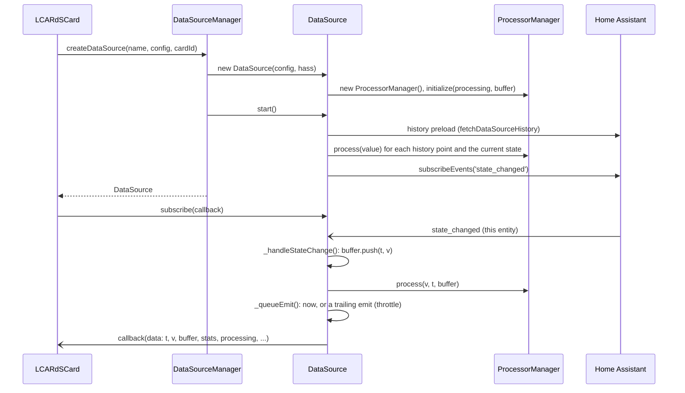

# DataSource System

> **`window.lcards.core.dataSourceManager`**: Named entity data buffers with history and processing pipelines.

---

## Overview

`DataSourceManager` extends `BaseService` and manages a collection of named `DataSource` instances. Each source follows a single Home Assistant entity (its state, or one attribute), converts each value to a number, records a rolling history, runs a named processor pipeline and notifies its subscribers.

Data sources are the path for **derived and historical** data: processor outputs, history buffers for charts, `{ds:...}` template values. Plain entity state goes through the [Systems Manager](systems-manager.md) (`subscribeToEntity()` on `LCARdSCard`), not through a data source.

Names are global: there is one `DataSourceManager` for the page, and a source called `temp_sensor` is shared by every card that declares or references that name. The first config to create a name wins; a later card with the same name and a different config gets the existing source.

User-facing configuration is documented in [Data Sources](../../core/datasources/index.md) and the [Processor Reference](../../core/datasources/processor-reference.md); buffer access is in [DataSource Buffer Reference](../internals/datasource-buffers.md). This page covers the runtime.

---

## Key Classes

| Class | File | Role |
|---|---|---|
| `DataSourceManager` | `src/core/data-sources/DataSourceManager.js` | Creates and indexes sources, tracks which cards use each, entity-style lookups |
| `DataSource` | `src/core/data-sources/DataSource.js` | One entity subscription, history preload, main buffer, processor chain, subscribers |
| `RollingBuffer` | `src/core/data-sources/RollingBuffer.js` | Fixed-capacity circular `{ t, v }` history (capped at 1000 points) |
| `ProcessorManager` | `src/core/data-sources/ProcessorManager.js` | Builds the processors, orders them by dependency, runs them, keeps one buffer per processor |
| `Processor` and subclasses | `src/core/data-sources/processors/*.js` | One class per processor `type` |
| `fetchDataSourceHistory()` | `src/core/data-sources/history-fetch.js` | History preload (shared with the editor's processor preview) |
| `toNumericValue()` | `src/core/data-sources/ha-history-utils.js` | State or attribute value to number |

---

## Lifecycle

### How sources are created

- **Cards (`LCARdSCard`)**: after `CoreConfigManager` has processed the config, `_processDataSourcesConfig()` calls `dataSourceManager.createDataSource(name, config, cardId, false)` for every entry under `data_sources:` and subscribes to each source; the callback re-runs the card's `_processCustomTemplates()` when it has one (`src/base/LCARdSCard.js`). Separately, `_registerTemplateDatasourceDependencies()` scans the config for `{ds:name}`, `{datasource:name}` and bare `{name}` references, waits up to 5 s for each source to exist, registers the card as a dependent and subscribes, scheduling a template update on every emit.
- **MSD**: `MsdCardCoordinator` calls `dataSourceManager.initializeFromConfig(config.data_sources)` (`src/msd/pipeline/MsdCardCoordinator.js`), which creates every source and then waits up to 10 s for history preloads (`_waitForHistoryPreloading()`).
- **Code**: call `createDataSource()` directly (see [Public API](#public-api)).

Card authors do not wire any of this by hand: declaring `data_sources:` or writing a `{ds:...}` template is enough.

### `createDataSource(name, config, cardId, autoCreated)`

1. If the name is new and the manager's HASS has no `connection` yet (the core starts with a stub), wait for the first connected HASS (`_whenConnected()`, released in `ingestHass()`).
2. If the name exists, add `cardId` to its dependents, cancel a pending release (see [Cleanup](#cleanup)) and return the existing source. A call without `cardId` (MSD and other config sources) marks the name as config-owned, which is never released.
3. Otherwise build `new DataSource({ ...config, _autoCreated, _sourceCard: cardId }, hass)`, store it in `sources` and `entityIndex`, and add one internal subscriber that keeps the manager's own `hass.states` copy current and calls the global entity change listeners.
4. `await source.start()`. The current state is loaded once, by `start()`; the manager does not replay it.
5. On failure the source is removed again and the error is rethrown.

### `DataSource.start()`

1. **History preload** (`_preloadHistory()`): unless `history.enabled` (or the older `history.preload`) is `false`, fetch `history.hours` (or `history.days` × 24; default 6, clamped to 1-168) through `fetchDataSourceHistory()`: websocket state history first, hourly long-term statistics when that has no points, the REST API when the websocket request fails. Each point is pushed into the main buffer and through the processors.
2. **Current state**: read `hass.states[entity]`, store its metadata (`_extractMetadata()`) and the state object, read the value the same way the live path does (`_readRawValue()`: `attribute_path`, `attribute` or the state), push it and run the processors.
3. **Live subscription**: `hass.connection.subscribeEvents(..., 'state_changed')`, filtered to this entity, calling `_handleStateChange()`.
4. **Initial emit** (`_emitInitialData()`): send the latest point (or an empty structure) to any subscribers already attached, flagged `isInitialEmission: true`.
5. **Periodic updates** (`_startPeriodicUpdates()`): only when a processor has `type: duration` or `requires_periodic_update`, emit the last value every `periodic_update_interval` ms (default 1000) so elapsed times keep counting.



### Value conversion

Every value goes through `toNumericValue(raw, cfg.enum_mapping)`: `enum_mapping` first, then a numeric parse, then `on`/`true`/`active`/`open` as 1 and `off`/`false`/`inactive`/`closed` as 0, then booleans. Anything else (including `unavailable` and `unknown`) is skipped: no buffer point, no processor run, no emit. `attribute` reads one attribute instead of the state (`'state'`, `''` and `'__state__'` mean the state); `attribute_path` reads a nested attribute (`forecast[0].temperature`). The initial state and live changes use the same reader.

### Cleanup

When a card disconnects, `LCARdSCard._onDisconnected()` calls every stored unsubscribe function and `removeCardFromSource(name, cardId)` for each source it registered. When the last card leaves a source, the manager schedules a release after `SOURCE_RELEASE_DELAY_MS` (30 s, exported from `DataSourceManager.js`). When the timer fires, `_releaseSource()` stops the source (`destroy()`: Home Assistant subscription, periodic timer, subscribers, buffer) and removes it from `sources` and `entityIndex`, unless:

- a card asked for the name again in the meantime (`createDataSource()` cancels the timer; this covers edit mode and view switches, where Home Assistant disconnects and reconnects cards),
- the name is config-owned: it was ever requested without a `cardId` (MSD `initializeFromConfig()`, code), or it is `autoCreated`,
- the source still has subscribers other than the manager's own forwarder (a chart series, an animation, an MSD overlay subscribed directly).

A source kept for one of the last two reasons keeps running until `dataSourceManager.destroy()`, which stops every source. A card that comes back after a release gets a fresh source (history preloaded again).

---

## Timing Options

These keys are read in the `DataSource` constructor (snake_case wins; the older camelCase spellings still work and are marked deprecated in the schema):

| Key | Older spelling | Default | Resolved field |
|---|---|---|---|
| `window_seconds` | `windowSeconds` | 60 | `windowSeconds`; buffer capacity = max(60, window × 10), capped at 1000 by `RollingBuffer` (`dataSourceBufferSize()`) |
| `min_emit_ms` | `minEmitMs`, `sampleMs` | 100 | `minEmitMs` (never below 10) |
| `coalesce_ms` | `coalesceMs` | 40% of `min_emit_ms` | `coalesceMs` (never below 20) |
| `max_delay_ms` | `maxDelayMs` | 3 × `coalesce_ms` | `maxDelayMs` (never below `min_emit_ms`) |
| `emit_on_same_value` | `emitOnSameValue` | `true` | `emitOnSameValue` |
| `periodic_update_interval` | | 1000 | Interval of the duration refresh (only with a `duration` processor) |

`update_interval` is deprecated and never had an effect (`x-replacement: min_emit_ms` in `src/cards/schemas/common-schemas.js`).

### Emit throttle

`_handleStateChange()` puts every accepted value into the main buffer and through the processors, then hands it to `_queueEmit()`, which decides when subscribers hear about it:

- **Leading emit**: when no emit is waiting and at least `min_emit_ms` has passed since the last one, subscribers are called at once. Sparse updates (the usual sensor) therefore reach cards with no added delay.
- **Trailing emit**: otherwise the value waits. A timer fires `coalesce_ms` after the latest waiting value (each new value restarts it), never sooner than `min_emit_ms` after the last emit and never later than `max_delay_ms` after the first waiting value. Only the latest value is sent; the earlier ones are counted in `stats.coalesced`.
- **Same value**: with `emit_on_same_value: false`, an emit whose value equals the last one sent is skipped (`stats.skipsSameValue`). The first live value is compared with the initial state.
- **Not throttled**: the initial emit, `subscribe()` hydration and periodic updates go out directly.

With the defaults (100 / 40 / 120 ms) a burst of changes inside 100 ms becomes one emit at once and one trailing emit at most 120 ms after the burst began. `stop()` cancels a waiting emit. Independently, `RollingBuffer.push()` overwrites the last point instead of adding one when two pushes arrive within 10 ms with timestamps less than 1 s apart.

---

## Data Object Structure

The live update that the emit throttle (`_flushEmit()`, built by `_buildEmitData()`) sends to every subscriber:

```javascript
{
  t: 1707580800000,            // Date.now() when the change arrived (ms)
  v: 72.5,                     // the converted value (main buffer)
  buffer: RollingBuffer,       // the main history buffer (use its methods: last(), getRecent(n), getArrays())
  stats: { emits, coalesced, skipsSameValue, received, invalid, historyLoaded, updates, lastUpdate, currentValue },
                               // received: state changes seen; invalid: those with no numeric value;
                               // updates: accepted values; emits: subscriber calls from the throttle
  processing: {                // processor outputs keyed by their name under `processing:`
    celsius: 22.5,
    rolling_avg: 71.8
  },
  entity: 'sensor.temperature',
  unit_of_measurement: '°F',   // the entity's unit, copied into cfg on each change
  historyReady: true           // stats.historyLoaded > 0
}
```

Processor outputs are nested under `processing`, never spread onto the top level.

The other emit sites send the same core fields with small differences:

| Source | Differences |
|---|---|
| `_emitInitialData()` (end of `start()`) | `isInitialEmission: true`; `t`/`v` are `null` when the buffer is empty |
| Periodic update (duration processors) | `isPeriodicUpdate: true`; `t` is the current time, `v` the last buffered value |
| `subscribe()` hydration | Sent once with `setTimeout(0)` when the buffer has a point |
| `getCurrentData()` | No `unit_of_measurement`; adds `metadata` (copy), `bufferSize` and `started` |

`metadata` (from `getMetadata()` or `getCurrentData().metadata`) holds `unit_of_measurement`, `device_class`, `friendly_name`, `area`, `device_id`, `entity_id`, `state_class`, `icon`, `last_changed` and `last_updated`, refreshed from each new state; `metadata:` in the config overrides fields.

---

## Processors

`processing:` is a map: each key names a processor and is the key of its output in `processing`, in templates (`{ds:source.key}`) and in `getProcessorBuffer(key)`. `ProcessorManager._getProcessorClass()` maps these types:

| Type | Class | Main options | Output |
|---|---|---|---|
| `convert_unit` | `ConvertUnitProcessor` | `from`, `to` (unit codes) | Converted number |
| `scale` | `ScaleProcessor` | `input_range`, `output_range`, `curve` (`linear`, `exponential`, `logarithmic`, `sigmoid`) | Mapped number |
| `smooth` | `SmoothProcessor` | `method` (`exponential`, `moving_average`, `gaussian`), `window`, `alpha` | Smoothed number |
| `expression` | `ExpressionProcessor` | `expression`, optional `sources: [...]` | Expression result |
| `statistics` | `StatisticsProcessor` | `window` (duration or `session`), `stats`, `max_points` | Object of the requested stats (`min`, `max`, `mean`, `median`, `std_dev`, `q1`, `q3`, `range`, `count`; default `min, max, mean`), or an array of `{ t, ...stats }` with `max_points` |
| `rate` | `RateProcessor` | `unit` (`per_second`, `per_minute`, `per_hour`), `smoothing` | Rate of change |
| `trend` | `TrendProcessor` | `samples`, `threshold` | `"increasing"`, `"decreasing"` or `"stable"` |
| `duration` | `DurationProcessor` | `condition` (e.g. `"> 20"`), `reset_on` | `{ duration_ms, duration_human, in_condition }` |
| `threshold` | `ThresholdProcessor` | `threshold`, `above` (default 1), `below` (default 0), `hysteresis` | The `above` or `below` value |
| `clamp` | `ClampProcessor` | `min`, `max` | Clamped number |
| `round` | `RoundProcessor` | `precision`, `method` (`round`, `floor`, `ceil`) | Rounded number |
| `delta` | `DeltaProcessor` | `absolute` | Change from the previous value (0 for the first) |

Every option, with live examples, is in the [Processor Reference](../../core/datasources/processor-reference.md). Processors share the base class `Processor` (`processors/BaseProcessor.js`): `enabled: false` passes the input through unchanged, and an exception inside `_doProcess()` returns the processor's fallback (by default its input).

### Execution order and chaining

`ProcessorManager._resolveDependencies()` builds a graph from each processor's `getDependencies()` and orders it with a topological sort (Kahn's algorithm) at construction. The order is logged at `debug` level.

- **No `input_source`**: the processor reads the converted entity value.
- **`input_source: other_key`**: it reads the output of `other_key` from the same run.
- **`expression` with `sources: [a, b]`**: every listed processor is a dependency too and runs first; their outputs are available to the expression as the `sources` array. An expression therefore can read several processors.

An unknown dependency or a cycle throws when the `DataSource` is constructed, so `createDataSource()` fails for that source. If one processor throws during a run, `ProcessorManager.process()` keeps its previous result (or `null`) and the rest still run.

```yaml
data_sources:
  temp_sensor:
    entity: sensor.outdoor_temp
    processing:
      celsius:            # reads the entity value
        type: convert_unit
        from: f
        to: c
      smoothed:           # reads celsius
        type: smooth
        input_source: celsius
        method: moving_average
        window: 5
      display:            # reads smoothed
        type: round
        input_source: smoothed
        precision: 1
```

`convert_unit`'s `from` / `to` are unit codes, not processor references; chaining always uses `input_source` (the base class reads only `input_source`).

Each processor also has its own `RollingBuffer` of the same capacity as the main buffer, holding every result it produced, for charts (`getProcessorBuffer(key)`, `getProcessorHistory(key, n)`).

---

## Template Access

`DataSourceTemplateEvaluator` (`src/core/templates/DataSourceTemplateEvaluator.js`) reads `getCurrentData()`:

```yaml alternatives
text: "{ds:temp_sensor}"                      # main value, no format: Home Assistant number format + the entity's unit
text: "{ds:temp_sensor.celsius}"              # processor output, no format: the value as is, no unit
text: "{ds:temp_sensor.celsius:.1f}"          # with a format: the number only
text: "{ds:temp_sensor.celsius:.1f} °C"       # add the unit yourself
text: "{datasource:temp_sensor.rolling_avg}"  # the long prefix works the same way
```

`name.key` is short for `name.processing.key`. Without a format spec the main value is formatted with `haFormatNumber()` and the unit from `metadata`; processor outputs get no unit. With a format spec the caller owns the output. See [Template System](template-system.md).

---

## Public API

### DataSourceManager

| Property / Method | Returns | Description |
|---|---|---|
| `sources` | `Map<name, DataSource>` | All sources |
| `entityIndex` | `Map<entityId, DataSource>` | Last source created for each entity |
| `createDataSource(name, config, cardId?, autoCreated?)` | `Promise<DataSource>` | Create and start a source, or return the existing one and add `cardId` as a dependent. `autoCreated` is reserved for automatic entity promotion; card code passes `false` |
| `initializeFromConfig(dsConfig)` | `Promise<number>` | Create every source of a `data_sources` block and wait for history preloads; resolves to the number of sources the manager now holds (used by MSD) |
| `getSource(name)` | `DataSource \| undefined` | A source by name |
| `getAllSources()` | `DataSource[]` | Every source |
| `listIds()` | `string[]` | Entity IDs in `entityIndex` |
| `getEntity(path)` | entity-like object \| `null` | `name` (current value), `name.processing.key` (or any dotted path into `getCurrentData()`; `null` when it does not resolve) or an entity ID a source tracks, as `{ state, attributes, ... }`; falls back to `hass.states` |
| `getSourceDependents(name)` | `string[]` | Card IDs using a source |
| `removeCardFromSource(name, cardId)` | `void` | Drop a dependent; after the last card, schedule the source's release (see [Cleanup](#cleanup)) |
| `addEntityChangeListener(cb)` | `() => void` | Called with `[entityId]` on every emit of any source; returns an unsubscribe function |
| `getSourceSubscribers(name)` / `getAllSubscribers()` | `Object[]` / `Object` | Subscriber info (`subscribeWithMetadata()` metadata where present) |
| `getStats()` | `Object` | Per-source `getStats()` plus dependents, and a summary |
| `getDebugInfo()` / `debugDump()` | `Object` | Debug snapshots |
| `updateHass(hass)` / `ingestHass(hass)` | `{ hasChanges, changedCount, totalCount }` | Store the new HASS, release `createDataSource()` calls waiting for a connection and count which tracked entities changed. It does not feed values into sources: their own `state_changed` subscriptions do |
| `destroy()` | `Promise<void>` | Cancel pending releases, stop every source and clear the maps |

### DataSource

| Method | Returns | Description |
|---|---|---|
| `subscribe(cb)` | `() => void` | Add a subscriber (gets the current point once, asynchronously, when there is one); returns the unsubscribe function |
| `subscribeWithMetadata(cb, { overlayId, overlayType, component })` | `() => void` | Same, with metadata for the debug views |
| `getCurrentData()` | `Object` | Snapshot (see the table above) |
| `getMetadata()` | `Object` | Copy of the entity metadata |
| `getRecent(count = 100)` | `Object[]` | Last `count` `{ t, v }` points of the main buffer |
| `getProcessorData(key)` | any | Latest output of one processor |
| `getProcessorBuffer(key)` | `RollingBuffer \| null` | That processor's history buffer |
| `getProcessorHistory(key, count = 100)` | `Object[]` | Last `count` points of that buffer |
| `getFormattedValue(value, precision = 1)` | `string` | Locale-formatted number plus the unit (`N/A` for non-finite) |
| `getDisplayName()` | `string` | `friendly_name`, else the entity ID |
| `getStats()` | `Object` | Counters, resolved timing config, buffer stats, processor keys, state (`pending`: a trailing emit is waiting) |
| `start()` / `stop()` / `destroy()` | | Lifecycle |

`cfg` holds the source's config (with `unit_of_measurement` added at runtime), `buffer` the main `RollingBuffer`, `processorManager` the pipeline.

---

## Console Access

::: code-group
```javascript [Snapshot]
window.lcards.debug.singleton('dataSourceManager')
// → { sources: 4, entityIndex: 3, enhanced_sources: [{ id: 'temp_sensor', entity, currentValue, bufferSize, processors, stats }, ...],
//      dot_notation_test: {} }
```
```javascript [Live object]
const dsm = window.lcards.core.dataSourceManager

dsm.sources                                    // Map of all DataSource instances
dsm.getSource('temp_sensor')                   // one source
dsm.getSource('temp_sensor').getCurrentData()  // latest data object
dsm.getSource('temp_sensor').getRecent(50)     // last 50 { t, v } points
dsm.getSource('temp_sensor').getStats()        // counters and resolved timing
dsm.getSourceDependents('temp_sensor')         // card IDs using it
```
:::

---

## Debug Namespace (`window.lcards.debug.datasources`)

Created by `DataSourceDebugAPI.create()` (`src/api/DataSourceDebugAPI.js`) during core initialization.

::: tip
```javascript
window.lcards.debug.datasources.help()   // print method summary
window.lcards.debug.datasources.list()   // list all source names
```
:::

| Method | Description |
|---|---|
| `list()` | All source names |
| `get(name)` | DataSource instance by name |
| `listProcessors(dsName)` | Processor keys of a source |
| `showProcessorGraph(dsName)` | Log the processor execution order; returns `{ nodes, edges }` |
| `inspectProcessor(dsName, processorName)` | Config, current value, buffer size and stats of one processor |
| `validate(dsName)` | Config validation report `{ valid, errors, warnings, info }` |
| `getStats(dsName)` | Entity, buffer `{ size, capacity, oldest, newest }`, processing |

---

## See Also

- [Data Sources (user guide)](../../core/datasources/index.md)
- [Processor Reference](../../core/datasources/processor-reference.md)
- [DataSource Buffer Reference](../internals/datasource-buffers.md)
- [Template System](template-system.md)
- [Systems Manager](systems-manager.md)
