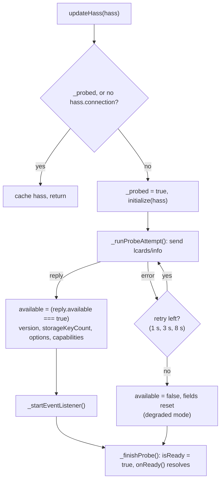

# Integration Service

> **`window.lcards.core.integrationService`**: Backend availability probe, capability flags, global storage convenience API and the push channel from the Python actions.

---

## Overview

`IntegrationService` probes the LCARdS Home Assistant integration on startup to learn whether the Python backend is installed and responding. Services and cards that call backend WebSocket commands check `integrationService.available` (or `await integrationService.onReady()`) first, so LCARdS degrades gracefully when the integration is absent.

It also wraps the global storage commands in four convenience methods (`readStorage()`, `writeStorage()`, `deleteStorage()`, `resetStorage()`), and after a successful probe subscribes to the `lcards_event` push channel that the integration's actions use to reach every browser.

---

## File

`src/core/services/IntegrationService.js` (extends `BaseService`). Created in step 23 of the [core initialization order](index.md#initialization-order); it has no `initialize()` call there and probes by itself.

---

## Responsibilities

- Send `lcards/info` on the first HASS update that has a live `connection`, and retry a failed probe
- Set `available`, `version`, `storageKeyCount`, `options` and `capabilities` from the reply
- Resolve `onReady()` once the probe chain has finished, successfully or not
- Provide the four global storage helpers with built-in availability guards
- Subscribe to `lcards/subscribe` and act on each pushed `action`, after checking device and user targeting

---

## WebSocket Commands Used

| Command | Used by | Admin only |
|---|---|---|
| `lcards/info` | Probe (`_runProbeAttempt()`), `refreshOptions()` | No |
| `lcards/storage/get` | `readStorage(key)` | Only for `_user_*` keys and for a read without a key (the full store) |
| `lcards/storage/set` | `writeStorage(updates)` | Yes |
| `lcards/storage/delete` | `deleteStorage(key)` | Yes |
| `lcards/storage/reset` | `resetStorage()` | Yes |
| `lcards/subscribe` | `_startEventListener()` | No |

The admin checks are in `custom_components/lcards/websocket_api.py` (`_require_admin()`, error code `unauthorized`). Other commands (`storage/dump`, `storage/delete_many`, the per-user and per-device commands, `fire_event`, `diagnostics`) are sent by other code directly; see [Scoped Settings](scoped-settings.md#websocket-commands) and the [Backend WebSocket API](../../development/backend-api.md).

---

## Lifecycle

`updateHass(hass)` is called by the core on every HASS distribution. It always caches the HASS (retries and storage calls use the latest), and starts the probe chain exactly once: on the first HASS that has a `connection` (`_probed` guards it). The module-load stub HASS has no connection, so the probe starts with the first real HASS.

A failed attempt is logged with its reason and retried after 1 s, 3 s and 8 s (`PROBE_RETRY_DELAYS_MS`). Only when the fourth attempt fails does the service settle into degraded mode. `onReady()` resolves once, on the first success or after the final failure, so consumers never see a transient "unavailable".



Calling `initialize(hass)` again starts a fresh probe chain (it resets the attempt counter); `onReady()` has already resolved by then and does not resolve again.

---

## Properties

| Property | Type | Description |
|----------|------|-------------|
| `available` | `boolean` | `true` once `lcards/info` answered with `available: true`. Default `false` |
| `version` | `string \| null` | Version reported by the integration (`DOMAIN_VERSION` from `const.py`) |
| `storageKeyCount` | `number \| null` | Number of keys in backend storage (`null` while storage is not initialised) |
| `options` | `Object \| null` | Options of the first config entry: `show_panel`, `sidebar_title`, `sidebar_icon`, `log_level`, `enable_previews`; `null` when there is no entry |
| `capabilities` | `Set<string>` | Capability strings from the reply; today the backend sends `['scoped_storage', 'scoped_storage_replace', 'own_user_reload']` |
| `isReady` | `boolean` (getter) | `true` once the probe chain has finished, whatever the outcome |

`window.lcards.info()` reports these as `integration` (`available`, a boolean), `backendVersion` (`version`) and `preview` (`options.enable_previews`) (`src/lcards-main.js`).

---

## `onReady()` and `refreshOptions()`

```javascript
const integration = window.lcards.core.integrationService;

await integration.onReady();   // never rejects, also when the backend is absent
if (integration.available) { /* backend calls are safe */ }
```

Use `onReady()` rather than reading `available` early or the private `_probed` / `_probeComplete` flags. The core itself waits on it to load theme overrides and the connection overlay config.

`refreshOptions()` sends `lcards/info` again and updates `options`, `capabilities` and `storageKeyCount` in place (not `available` or `version`). Call it after the integration options change (for example the preview features switch) so UI reading `options` sees the new values without a reload. It is also `window.lcards.refreshOptions()` in the console.

---

## `capabilities`

```javascript
integration.capabilities.has('scoped_storage')          // per-user / per-device storage commands exist
integration.capabilities.has('scoped_storage_replace')  // their set commands take replace: true
integration.capabilities.has('own_user_reload')         // a non-admin may fire reload_connection_config to their own sessions
```

`ScopedSettingsService` checks `scoped_storage` before using the user and device scopes, and `scoped_storage_replace` before sending `replace: true` on a write. The backend sets the list in `ws_lcards_info()`:

```python
connection.send_result(msg["id"], {
    "available": True,
    "version": DOMAIN_VERSION,
    "storage_key_count": storage_key_count,
    "options": options,
    "capabilities": ["scoped_storage", "scoped_storage_replace", "own_user_reload"],
})
```

---

## Global Storage Convenience API

All four methods return a fallback instead of throwing: `undefined` / `false` when the integration is unavailable, there is no connection, the call fails or the backend refuses it. Writes to the global store are admin-only on the backend; a refused call (`unauthorized`) is logged as "global storage needs a Home Assistant admin" and returns `false`.

Before offering a global write in UI, check `canWriteGlobalStorage(hass)` from `src/core/services/storage-permissions.js` (`hass.user.is_admin === true`), and start settings UIs on `defaultSettingsScope(hass)` (`'global'` for admins, `'user'` otherwise). `GLOBAL_WRITE_REFUSED_MSG` in the same file is the error text to show when a save is refused. Non-admins keep their own user and device scopes through [Scoped Settings](scoped-settings.md).

### `readStorage(key) → Promise<any>`

Returns the stored value for `key` (any JSON type), or `undefined` on a miss, an unavailable backend, an error or a refusal. Non-admins can read global keys; `_user_<id>` keys are refused (a user's own settings come from `lcards/storage/user/get`).

```javascript
const integration = window.lcards.core.integrationService;
const prefs = await integration.readStorage('my_service_prefs');
```

### `writeStorage(updates) → Promise<boolean>`

Shallow-merges `updates` (a plain `{ key: value }` object) into the store. Keys not in `updates` are kept; `{ key: null }` stores `null` rather than removing the key (use `deleteStorage()`). Admin only.

```javascript
const ok = await integration.writeStorage({ my_service_prefs: { theme: 'dark' } });
if (!ok) { /* show GLOBAL_WRITE_REFUSED_MSG or a save error */ }
```

### `deleteStorage(key) → Promise<boolean>`

Removes one key. Admin only.

### `resetStorage() → Promise<boolean>`

Wipes the **entire** store (all keys, including every user and device record) and saves it empty. Irreversible. Admin only. Services must drop their in-memory caches afterwards, or their next save writes stale data back.

### Usage pattern

```javascript
import { canWriteGlobalStorage, GLOBAL_WRITE_REFUSED_MSG } from '../core/services/storage-permissions.js';

const integration = window.lcards.core.integrationService;
await integration.onReady();

if (!integration.available) {
    lcardsLog.warn('[MyService] Integration unavailable: settings will not be persisted');
} else if (canWriteGlobalStorage(hass)) {
    const ok = await integration.writeStorage({ my_setting: value });
    if (!ok) this._error = GLOBAL_WRITE_REFUSED_MSG;
}
```

---

## Push Channel

After a successful probe, `_startEventListener()` subscribes with `connection.subscribeMessage(cb, { type: 'lcards/subscribe' })`. The backend's `ws_subscribe()` forwards every `lcards_event` on the Home Assistant event bus to the subscriber as the event's data dict, with no envelope. `lcards/subscribe` is not admin-gated (Home Assistant's own `subscribeEvents` is admin-only for custom event types), so non-admin dashboards receive the events too. The subscription is idempotent (`_eventUnsubscribe` guard) and ends with the WebSocket connection.

### Targeting

Events are broadcast to every subscribed browser. `_handleLcardsEvent()` first calls `_isEventTargetedAtMe(payload)`:

- No non-empty `target_device_ids` and no non-empty `target_user_ids`: broadcast, accept.
- `target_device_ids` contains this browser's `deviceIdentityManager.getDeviceId()`: accept.
- `target_user_ids` contains the signed-in user's ID (`hass.user.id`, falling back to the core's current HASS): accept.
- Otherwise: drop silently.

Both lists together mean union: matching either is enough. The Python side resolves `target_device_names` (against the stored device `display_name`, case-insensitive) and `target_user_names` (against Home Assistant user names) into these ID lists in `_async_resolve_targets()` (`custom_components/lcards/services.py`), and raises a validation error instead of broadcasting when targeting was asked for but matched nobody. The filtering itself happens in the browser.

### Handled actions

| `payload.action` | What the browser does |
|---|---|
| `reload` | `window.location.reload()` |
| `set_log_level` | `window.lcards.setGlobalLogLevel(payload.level)`; levels include `off` |
| `set_alert_mode` | `window.lcards.setAlertMode(payload.mode, { skipHelperSync: true })`: a local, targeted alert change that does not write back to `input_select.lcards_alert_mode` (that would reach every tab) |
| `clear_effect` | `window.lcards.screenEffect.clearSlot(payload.slot)`, or `.clear()` for all slots when `slot` is omitted |
| `play_sound` | `soundManager.playAsset(payload.asset_key)` when an asset is named (bypasses scheme and overrides), else `soundManager.play(payload.event_type)` |
| `trigger_effect` | For each slot in `payload.layers` (`backdrop`, `color`, `canvas`): `null` clears that slot (`sem.clearSlot()`); `{ preset, ...params }` applies it, with `sem.applySlotFor(slot, preset, params, duration)` when `payload.duration` is set (each slot keeps its own timer) or `sem.applySlot()` otherwise. A slot left out is not touched; an unknown slot is logged |
| `show_portal_card` | `portalOverlayManager.show('ha-service', { content, layers, position, width, height, duration, dismiss })` (defaults: `position: 'center'`, `width`/`height: 'auto'`, `dismiss: true`) |
| `clear_portal_card` | `portalOverlayManager.hide('ha-service')` |
| `fly_to` | `window.lcards.cards.astrometrics.flyTo(payload.card_id, { point } or { view }, { duration, warp })` |
| `set_clock` | `window.lcards.cards.astrometrics.setClock(payload.card_id, { date, rate })` |
| `borg_assimilate` | `borgAssimilationManager.assimilate(opts)`, mapping `intro_duration` → `duration`, `transition_style` → `transitionStyle`, `intro_layers` → `intro`, `persistent_layers` → `persistentLayers`, `fontSwap`, `sound` |
| `borg_deassimilate` | `borgAssimilationManager.deassimilate(opts)`, mapping `with_outro` → `withOutro`, `outro_layers` → `outroLayers`, `revert_transition_style` → `revertTransitionStyle`, `sound` |
| `reload_connection_config` | `connectionOverlayService.loadConfig()`, then a `lcards-connection-config-changed` document event for an open config panel; skipped when `payload.origin_device_id` is this device (the saving tab already applied it) |
| anything else | Logged at `debug` and ignored |

### Sources of events

- **Actions** in `services.py` fire `lcards_event` through `_fire_targeted_event(hass, action, extra, device_ids, user_ids)`, which leaves the target keys out of broadcast payloads.
- **Browsers** relay events with `lcards/fire_event` (admin only), for example the connectivity tab's `reload_connection_config` and `reload`, and `ConnectionOverlayService`. The one non-admin exception is `reload_connection_config` targeted at the caller's own user id, which `ConnectionOverlayService.saveConfig()` sends after an own-user save ([Backend API](../../development/backend-api.md#lcards-fire-event)).

→ See [Home Assistant Services](../internals/ha-services.md) for the Python action reference.
→ See [Home Assistant Integration Architecture](../ha-integration.md) for the Python side and its sequence diagrams.

---

## Degraded Mode

When `available === false` (integration not installed or not set up):

- The storage helpers return `undefined` / `false` without sending anything; no throws.
- Services keep in-memory or built-in defaults; they do not fall back to `localStorage` (the connection overlay keeps its own `localStorage` cache for offline start).
- Cards keep working: the bundle is loaded independently of the probe.
- `window.lcards.info()` reports `integration: false` and `backendVersion: null`.

---

## See Also

- [Scoped Settings Service](scoped-settings.md)
- [Device Identity Manager](device-identity.md)
- [Portal Overlay Manager](portal-overlay-manager.md)
- [Sound System](sound-system.md)
- [Storage (Python backend)](../internals/storage.md)
