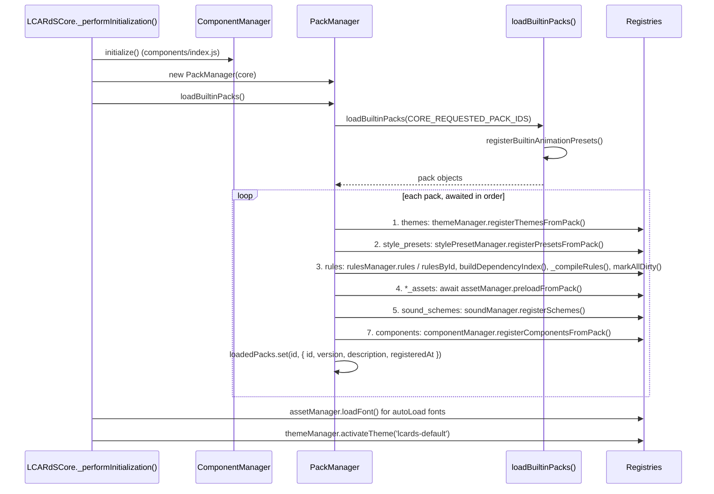

# LCARdS Pack System

> **How packs are structured, loaded and distributed to the core registries.**
> Follow this page to add a pack, a component type or a new asset kind.

---

## Overview

A **pack** is a plain JavaScript object that contributes data to LCARdS: themes, style presets, components, rules, assets and sound schemes. At startup `PackManager` (`src/core/PackManager.js`) registers each built-in pack, handing each key to the singleton that owns it.

**Rule**: cards and editors query a singleton registry (`themeManager`, `stylePresetManager`, `componentManager`, `assetManager`, `soundManager`), not the pack data files. Packs are the source of truth; registries are the query interface. Known exceptions in the code today: `CoreConfigManager._getComponentDefaults()` and the button editor import `src/core/packs/components/index.js` directly, and `ApexChartsAdapter` reads `BUILTIN_THEMES_PACK.chartAnimationPresets` directly (`src/charts/ApexChartsAdapter.js`).

All packs are built in: there is no external or user pack loader. A third-party pack is added to the bundle like a built-in one (see [How to Add a New Pack](#how-to-add-a-new-pack)).

---

## Architecture Diagram

```mermaid
flowchart TB
    subgraph BuiltinPacks["Built-in packs (src/core/packs/)"]
        P1["core<br/>(no data keys)"]:::builtinPacksStyle
        P2["lcards_buttons<br/>style_presets.button"]:::builtinPacksStyle
        P3["lcards_sliders<br/>style_presets.slider"]:::builtinPacksStyle
        P4["lcards_elbows<br/>components (type: elbow)"]:::builtinPacksStyle
        P5["builtin_themes<br/>themes, chartAnimationPresets"]:::builtinPacksStyle
        P6["lcards_sounds_default<br/>audio_assets, sound_schemes"]:::builtinPacksStyle
        P7["lcards_beeps / lcards_alerts / lcards_power<br/>audio_assets"]:::builtinPacksStyle
        P8["builtin_msd_backgrounds<br/>svg_assets"]:::builtinPacksStyle
        P9["core_fonts<br/>font_assets"]:::builtinPacksStyle
        P10["lcards_images<br/>image_assets, model_assets"]:::builtinPacksStyle
        P11["lcards_textures<br/>(no data keys)"]:::builtinPacksStyle
    end

    subgraph Loader["loadBuiltinPacks.js"]
        LBP["loadBuiltinPacks(requested)<br/>BUILTIN_REGISTRY"]
    end

    subgraph PackMgr["PackManager"]
        PM["registerPack(pack)"]
    end

    subgraph Registries["Singleton registries"]
        TM[ThemeManager]:::coreStyle
        SPM[StylePresetManager]:::coreStyle
        RE[RulesEngine]:::coreStyle
        AM[AssetManager]:::coreStyle
        SM[SoundManager]:::coreStyle
        CM[ComponentManager]:::coreStyle
    end

    BuiltinPacks --> LBP
    LBP -->|"pack objects"| PM

    PM -->|"themes"| TM
    PM -->|"style_presets"| SPM
    PM -->|"rules"| RE
    PM -->|"svg_assets, font_assets, audio_assets,<br/>image_assets, model_assets"| AM
    PM -->|"sound_schemes"| SM
    PM -->|"components"| CM

    TM & SPM & RE & AM & SM & CM --> Cards([Cards and editors])

    style BuiltinPacks fill:#2f3749,stroke:#52596e
    style Registries fill:#1e2229,stroke:#2f3749
    style Cards fill:#e7442a,stroke:#ffb399,color:#fff
    style PM fill:#1c3c55,stroke:#37a6d1,color:#fff
    style PackMgr fill:#2f3749,stroke:#52596e
    style Loader fill:#2f3749,stroke:#52596e

    classDef builtinPacksStyle fill:#2a7193,stroke:#67caf0,color:#fff
    classDef coreStyle fill:#2f3749,stroke:#52596e
```



---

## Pack Format

Every key except `id` is optional. `registerPack()` acts only on the keys below; others are ignored, and the retired keys `overlays`, `anchors`, `routing`, `palettes`, `profiles` log a warning.

```js
{
  // ── Identity ──────────────────────────────────────────────────────────────
  id:          'my_pack',          // required (snake_case); a pack without id is skipped with a warning
  version:     '1.0.0',            // built-in packs use __LCARDS_VERSION__
  name:        'My Pack',          // shown in the Pack Explorer
  description: 'What this adds',

  // ── Themes → ThemeManager.registerThemesFromPack() ───────────────────────
  themes: {
    'my-theme': { id: 'my-theme', name: 'My Theme', description: '...', tokens: { /* token tree */ } }
  },
  defaultTheme: 'my-theme',        // read only by ThemeManager.initialize(), which the core does not call

  // ── Style presets → StylePresetManager.registerPresetsFromPack() ─────────
  // Key: card type; value: { presetName: partial card config }
  style_presets: {
    button: {
      'my-lozenge': {
        extends: 'button.lozenge',
        card: { color: { background: { active: 'theme:colors.card.buttonOn' } } }
      }
    }
  },

  // ── Rules → RulesEngine (rules / rulesById, then compiled) ───────────────
  rules: [
    {
      id: 'my_rule',                                   // rules without id are skipped
      when: { entity: 'light.example', state: 'on' },
      apply: {
        overlays: {
          'tag:example': { style: { card: { color: { background: 'theme:colors.alert.red' } } } }
        }
      }
    }
  ],

  // ── Assets → AssetManager.preloadFromPack() (registered, loaded on first use) ─
  svg_assets:   { my_msd:  { url: '/local/my_pack/msd.svg', metadata: { description: '...' } } },
  font_assets:  { lcards_my_font: { url: '/local/my_pack/my-font.css', displayName: 'My Font', category: 'Custom' } },
  image_assets: { my_bg:   { url: '/local/my_pack/bg.webp', label: 'My background', category: 'backgrounds' } },
  model_assets: { my_ship: { url: '/local/my_pack/ship.glb', label: 'My ship', parts: ['saucer'] } },
  audio_assets: { my_tap:  { url: '/local/my_pack/tap.mp3', description: 'Tap beep' } },

  // ── Sound schemes → SoundManager.registerSchemes() ───────────────────────
  // Event key → audio asset key; null silences the event, an omitted key falls through
  sound_schemes: {
    my_scheme: { card_tap: 'my_tap', alert_clear: null }
  },

  // ── Components → ComponentManager.registerComponentsFromPack() ───────────
  // Each definition needs metadata.type (the getComponentsByType() group)
  components: {
    'my-widget': { svg: '<svg>...</svg>', metadata: { type: 'my_widget', name: 'My Widget', version: '1.0.0' } }
  }
}
```

- Asset entry fields per type are on the [Asset Manager](asset-manager.md#pack-registration) page. A font `url` is a CSS file with `@font-face` rules, injected as a stylesheet.
- Rules use the rules grammar (`when` / `apply`): [Rules Engine](rules-engine.md).
- The preset shape is on the [Style Preset Manager](style-preset-manager.md#preset-shape) page; component shapes on the [Component Manager](component-manager.md#component-definition-shapes) page.
- Packs carry no animation presets: the built-in ones register when `loadBuiltinPacks()` calls `registerBuiltinAnimationPresets()` (`src/core/packs/animations/presets/index.js`), not through a pack key. Each is recorded as pack `core` with a category, so the Pack Explorer lists them under the core pack (`listAnimationPresetInfo()` in `src/core/animation/presets.js`).
- `src/core/packs/example/lcards-example-pack.js` is a commented template with every key (its rule and presets are checked by `tests/core/example-pack.test.js`).

---

## Built-in Pack Inventory

`BUILTIN_REGISTRY` in `src/core/packs/loadBuiltinPacks.js`:

| Pack ID | File | Key(s) | Registry |
|---|---|---|---|
| `core` | `core-pack.js` | none (version anchor) | Pack Explorer only |
| `lcards_buttons` | `lcards-buttons-pack.js` | `style_presets.button` | StylePresetManager |
| `lcards_sliders` | `lcards-sliders-pack.js` | `style_presets.slider` | StylePresetManager |
| `lcards_elbows` | `lcards-elbows-pack.js` | `components` (type `elbow`) | ComponentManager |
| `builtin_themes` | `builtin-themes.js` | `themes`, `defaultTheme`, `chartAnimationPresets` | ThemeManager (the chart presets are read by `ApexChartsAdapter`) |
| `builtin_msd_backgrounds` | `builtin-msd.js` | `svg_assets` | AssetManager |
| `core_fonts` | `core-fonts-pack.js` | `font_assets` (built from `core_fonts.json`) | AssetManager |
| `lcards_sounds_default` | `lcards-default-sound-scheme.js` | `audio_assets`, `sound_schemes` | AssetManager, SoundManager |
| `lcards_beeps` | `lcards-beeps-pack.js` | `audio_assets` | AssetManager |
| `lcards_alerts` | `lcards-alerts-pack.js` | `audio_assets` | AssetManager |
| `lcards_power` | `lcards-power-pack.js` | `audio_assets` | AssetManager |
| `lcards_images` | `lcards-images-pack.js` | `image_assets`, `model_assets` | AssetManager |
| `lcards_textures` | `lcards-textures-pack.js` | none (metadata only; the texture presets in `textures/presets/index.js` are imported by the renderer) | Pack Explorer only |

**Which load.** The core calls `packManager.loadBuiltinPacks()` with its default, `CORE_REQUESTED_PACK_IDS` (`['core', 'lcards_buttons', 'lcards_sliders', 'builtin_themes']`). `loadBuiltinPacks(requested)` adds the always-loaded set (`builtin_themes`, `builtin_msd_backgrounds`, `core_fonts`, `lcards_sounds_default`, `lcards_beeps`, `lcards_alerts`, `lcards_elbows`, `lcards_textures`, `lcards_images`, `lcards_power`), removes duplicates, warns about ids not in `BUILTIN_REGISTRY` (`Unknown builtin pack ids ignored`) and returns the pack objects in that order. So all 13 packs load. `BUILTIN_PACK_IDS` exports every registry id.

---

## File Structure Convention

Pack wrapper files live directly under `src/core/packs/`. Subfolders hold the data the wrappers import, plus runtime code that belongs to a pack domain (backgrounds, textures).

```
src/core/packs/
  loadBuiltinPacks.js               ← manifest + loader only (BUILTIN_REGISTRY, CORE_REQUESTED_PACK_IDS)
  core_fonts.json                   ← font list for core-fonts-pack.js
  ── Pack wrappers ──────────────────────────────────────────────
  core-pack.js                      ← no data keys
  core-fonts-pack.js                ← font_assets
  lcards-buttons-pack.js            ← style_presets.button
  lcards-sliders-pack.js            ← style_presets.slider
  lcards-elbows-pack.js             ← components (type: elbow)
  builtin-themes.js                 ← themes, chartAnimationPresets
  builtin-msd.js                    ← svg_assets
  lcards-default-sound-scheme.js    ← audio_assets + sound_schemes
  lcards-beeps-pack.js              ← audio_assets
  lcards-alerts-pack.js             ← audio_assets
  lcards-power-pack.js              ← audio_assets
  lcards-images-pack.js             ← image_assets + model_assets
  lcards-textures-pack.js           ← metadata only
  ── Data and domain code ───────────────────────────────────────
  style-presets/
    buttons/index.js                ← BUTTON_PRESETS
    sliders/index.js                ← SLIDER_PRESETS
  components/
    index.js                        ← `components`: the ComponentManager bootstrap list
    elbows/index.js                 ← elbowComponents
    sliders/                        ← sliderComponents (default, picard, demo, shaped, ring)
    dpad/, dpad_voyager/            ← dpadComponents, dpadVoyagerComponents (+ .svg)
    alert/, brackets/, radar/       ← alertComponents, bracketsComponents, radarComponents
    buttons/index.js                ← BUTTON_COMPONENTS (not in components/index.js)
  themes/
    tokens/lcardsDefaultTokens.js   ← token tree of lcards-default
  animations/
    index.js                        ← re-exports registerBuiltinAnimationPresets()
    presets/                        ← effect, stagger, text and timeline presets
  backgrounds/                      ← background animation renderer, effects, presets, WebGL scenes
  textures/                         ← CanvasTextureRenderer, texture effects, presets
  shared/                           ← ImageLoader.js, ImageDrawUtils.js
  example/
    lcards-example-pack.js          ← full-feature template for pack authors
```

**Rule**: `loadBuiltinPacks.js` imports packs; it does not define them.

**Rule**: pack wrapper files live at the `packs/` root, never inside a domain subfolder.

---

## Registration Flow



- The step numbers follow the comments in `registerPack()`; step 6 is a note that animations need no registration.
- `ComponentManager` is filled from `components/index.js` before any pack registers; step 7 re-registers a pack's components with a `pack` field (see [Component Manager](component-manager.md#loading)).
- Each step runs only when the pack has the key and the core has that manager. `loadBuiltinPacks()` throws when no pack comes back.
- After the loop the core loads `autoLoad` fonts and activates `lcards-default` (see [Theme System](theme-system.md#startup)).

---

## Consumer Rules

| Consumer | Correct pattern | Anti-pattern |
|---|---|---|
| Card rendering | `window.lcards.core.componentManager.getComponent('header-left')` | `import { getElbowComponent } from '…/elbows/index.js'` |
| Card editor dropdown | `window.lcards.core.stylePresetManager.getAvailablePresets('button')` | `import { BUTTON_PRESETS } from '…/style-presets/buttons/index.js'` |
| Theme token | `window.lcards.core.themeManager.getToken('colors.ui.primary', fallback)` | Importing `lcardsDefaultTokens` |
| Image or model | `window.lcards.core.assetManager.resolveImageUrl(key)` / `resolveModelUrl(key)` | Hard-coding `/lcards/images/...` |
| Sound | `window.lcards.core.soundManager.play('card_tap')` | Hard-coding an audio URL |

Direct imports tie cards to files, skip the registries' provenance (`pack` fields, Pack Explorer) and stop another pack from replacing a definition.

---

## How to Add a New Pack

1. **Create the wrapper file at the `packs/` root**:
   ```js
   // src/core/packs/lcards-my-pack.js
   export const MY_PACK = {
     id: 'my_pack',
     name: 'My Pack',
     version: __LCARDS_VERSION__,
     description: '...',
     audio_assets: { /* ... */ }
   };
   ```

2. **Register it** in `loadBuiltinPacks.js`:
   ```js
   import { MY_PACK } from './lcards-my-pack.js';
   // In BUILTIN_REGISTRY:
   my_pack: MY_PACK,
   // Then add 'my_pack' to alwaysLoad (or to CORE_REQUESTED_PACK_IDS);
   // a pack in neither list is never loaded at startup.
   ```

3. `PackManager` distributes the keys. If the pack adds a name a config can reference (a preset, component, sound, asset), check that the config checker knows it: `scripts/lib/registries.js` reads its names from the same modules the runtime registers from, and a new kind of name needs its check in `registryIssues()` (`scripts/lib/config-validator.js`).

---

## How to Add a New Component Type

Components ship like any pack key. Two things are specific to them:

1. **`metadata.type` is required** on every definition; `ComponentManager` groups by it for `getComponentsByType()`. Add `metadata.card_type` (`'button'`, ...) when an editor should offer it: `getComponentsForCard()` in `components/index.js` filters on it.
   ```js
   // src/core/packs/components/mytype/index.js
   export const myTypeComponents = {
     'my-variant': {
       svg: `<svg viewBox="0 0 100 40">…</svg>`,
       segments: { /* per-segment defaults with theme: tokens */ },
       presets: { default: {} },
       metadata: { type: 'mytype', card_type: 'button', name: 'My Variant', version: '1.0.0' }
     }
   };
   ```

2. **Add it to the `components/index.js` spread**, which `ComponentManager.initialize()` registers before any pack loads:
   ```js
   import { myTypeComponents } from './mytype/index.js';
   export const components = {
     // ...the existing spreads
     ...myTypeComponents
   };
   ```
   A pack wrapper with `components: myTypeComponents` is optional; it adds the `pack` field the Pack Explorer shows.

Then query it through the singleton:
```js
window.lcards.core.componentManager.getComponentsByType('mytype')
window.lcards.core.componentManager.getComponent('my-variant')
```

The card that renders the type has to understand its shape (button segments, slider `render()`, elbow `pathGenerator()`); see [Component Manager](component-manager.md#component-definition-shapes).

---

## Public API

`PackManager` is a plain class (not a `BaseService`) created by the core with a reference to it.

| Method | Returns | Description |
|---|---|---|
| `loadBuiltinPacks(packIds?)` | `Promise<void>` | Load and register built-in packs (default `CORE_REQUESTED_PACK_IDS`); throws when none load |
| `registerPack(pack)` | `Promise<void>` | Distribute one pack to the registries (see [Registration Flow](#registration-flow)) |
| `getPack(id)` | `Object\|undefined` | The stored summary `{ id, version, description, registeredAt }`, not the pack object |
| `getLoadedPackIds()` | `string[]` | Ids in registration order |
| `getLoadedPacks()` | `Object[]` | Summaries plus `themeCount` and `presetCount` (`ruleCount` and `assetCount` are always `0`) |
| `getPackMetadata(id)` | `Object\|null` | Summary plus `themes` and `presets` (by type) from that pack; `rules: []`, `assets: {}` |
| `getPackStatistics()` | `Object` | `{ totalPacks, totalThemes, totalPresets, totalRules, totalAssets }` |
| `getDebugInfo()` | `Object` | `{ loadedPacks, packCount }` |

---

## Console Access

::: code-group
```javascript [Snapshot]
window.lcards.debug.singleton('packManager')
// → { loadedPacks: [ { id: 'core', version, description, registeredAt }, { id: 'lcards_buttons', ... }, ... ], packCount: 13 }
```
```javascript [Live object]
const pm = window.lcards.core.packManager

pm.getLoadedPackIds()             // ['core', 'lcards_buttons', 'lcards_sliders', 'builtin_themes', ...]
pm.getLoadedPacks()               // summaries with content counts
pm.getPack('lcards_buttons')      // { id, version, description, registeredAt }
pm.getPackMetadata('lcards_buttons')  // with presets.button
pm.getPackStatistics()            // totals for the Pack Explorer
```
:::

---

## See Also

- [Theme System](theme-system.md)
- [Style Preset Manager](style-preset-manager.md)
- [Component Manager](component-manager.md)
- [Asset Manager](asset-manager.md)
- [Rules Engine](rules-engine.md)
- [Sound System](sound-system.md)
- [Building a Pack](../../development/building-a-pack.md)
