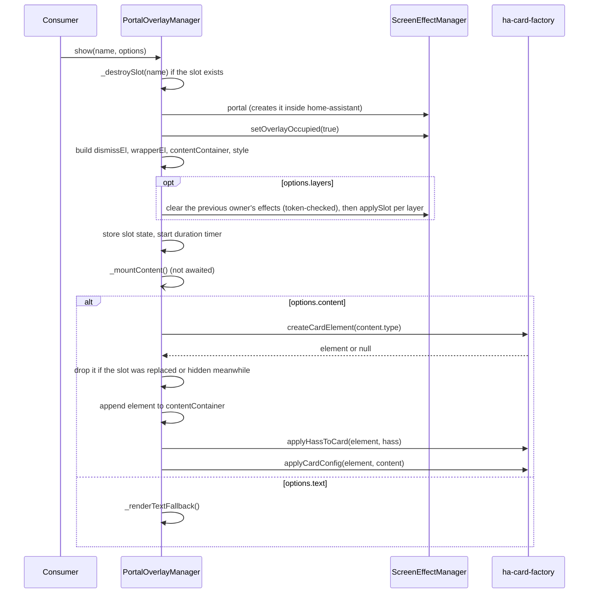

# Portal Overlay Manager

> **Singleton**: `window.lcards.core.portalOverlayManager`
> **Class**: `PortalOverlayManager` (`src/core/services/PortalOverlayManager.js`), extends `BaseService`
> **Consumers**: `lcards-alert-overlay`, `ConnectionOverlayService`, the `lcards.show_portal_card` / `lcards.clear_portal_card` actions

---

## Overview

`PortalOverlayManager` (POM) is the shared engine for everything LCARdS shows **over the whole page**: a full-screen alert overlay, the connection-lost overlay, a card pushed from an automation. It owns the DOM and the lifecycle of those overlays; the consumers only describe what to show.

What it does:

- **Named slots.** Each consumer owns one slot name. `show(name, options)` creates the slot; a second `show()` with the same name tears the old one down first (last in wins). Different names are independent and can be visible together.
- **Content.** A slot shows either a card (any Home Assistant or LCARdS card config, mounted through `src/utils/ha-card-factory.js`) or a styled plain-text message.
- **Screen effects.** A slot can carry `layers` (`{ backdrop, color, canvas }`), applied to the [Screen Effect System](screen-effects.md) slots. Only one POM slot owns the screen effect slots at a time.
- **Live HASS.** Every mounted card gets each new `hass` from core (`updateHass()`), so a card in an overlay stays live on pages without LCARdS cards too.
- **Auto-dismiss and click-to-dismiss.** `duration` hides the slot after a delay; `dismiss: true` makes a click on the backdrop hide it.

POM draws nothing of its own outside a slot: the portal element itself belongs to `ScreenEffectManager` (`sem.portal`).

---

## Location and setup

| What | Where |
|---|---|
| Class | `src/core/services/PortalOverlayManager.js` (`PortalOverlayManager`, `POSITION_MAP`) |
| Created | `LCARdSCore._performInitialization()`, `src/core/lcards-core.js:320`, after `ScopedSettingsService` and before `ConnectionOverlayService`; also assigned to `window.lcards.core.portalOverlayManager` right away (`:321`) |
| HASS | `LCARdSCore._updateHass()` calls `portalOverlayManager.updateHass(hass)` (`lcards-core.js:580-582`) |
| Card mounting | `createCardElement()`, `applyCardConfig()`, `applyHassToCard()` in `src/utils/ha-card-factory.js` |
| Portal | `ScreenEffectManager.portal` (`src/core/screen-effects/ScreenEffectManager.js`, `get portal()`) |

The built-in slot names:

| Slot name | Owner | Shown by |
|---|---|---|
| `'alert-overlay'` | `lcards-alert-overlay` card (`src/cards/lcards-alert-overlay.js`) | `_mountContentCard()` (full overlay, `:349`) and `_showBand()` (alert band, `:371`) |
| `'connection-overlay'` | `ConnectionOverlayService` (`src/core/services/ConnectionOverlayService.js`) | `_showDisconnectOverlay()`, `_doReconnected()`, `simulateReconnect()` |
| `'ha-service'` | `IntegrationService._handleLcardsEvent()` (`src/core/services/IntegrationService.js:512-528`) | the `show_portal_card` lcards_event; `clear_portal_card` calls `hide('ha-service')` |

Any other name works the same way; there is no registry of allowed names.

---

## Mounting: why the portal sits inside `<home-assistant>` {#mounting}

The portal is created lazily by `ScreenEffectManager._ensurePortal()` and appended with `mountDialogNearHomeAssistant()` (`src/utils/lcards-shared-helpers.js:64`), which puts it in the shadow root of `<home-assistant>` (falling back to `document.body` when that element is not found). Home Assistant's pickers and dialogs read their data from Lit contexts that `<home-assistant>` provides (pickers such as `ha-entity-picker` since 2026.10, per the helper's JSDoc); a card mounted under `document.body` gets none of them, and its `hass-action` / `hass-more-info` events never reach Home Assistant. Mounting inside `<home-assistant>` gives overlay cards the same environment as dashboard cards.

Two consequences in POM:

- **Styles go into the portal's root.** The per-slot `<style>` (see [DOM structure](#dom-structure)) is appended to `portal.getRootNode()` when that is a shadow root, because document styles do not reach inside it (`PortalOverlayManager.js:241-244`). Only when the portal is under `document.body` does it go into `document.head`.
- **Portal first, then occupied.** `show()` reads `sem.portal` (which creates the portal) before `sem.setOverlayOccupied(true)`. In the other order the first overlay without `layers` (the alert band) stayed hidden, because `setOverlayOccupied()` can only show a portal that exists (`:183-187`).

Any LCARdS dialog or overlay mounted imperatively must use the same helper (the rule is in `.github/instructions/editor.instructions.md`).

---

## DOM structure

`show()` builds the slot synchronously (`PortalOverlayManager.js:172-315`):

```
ScreenEffectManager portal   div[data-lcards-screen-effect-portal]
│                            position:fixed; inset:0; z-index:9100; pointer-events:none
├─ backdrop slot             div[data-lcards-se-slot="backdrop"]   (SEM)
├─ canvas slot               canvas[data-lcards-se-slot="canvas"]  (SEM)
├─ color slot                div[data-lcards-se-slot="color"]      (SEM)
│
├─ dismissEl                 (slot 'alert-overlay')  absolute, inset 0, z-index 10
├─ wrapperEl                 (slot 'alert-overlay')  absolute, inset 0, z-index 11, display:flex
│   └─ contentContainer      width/height from options, display:flex
│       └─ card element [data-lcards-pom-content-alert-overlay]  or  text <div>
│
├─ dismissEl                 (slot 'connection-overlay')
└─ wrapperEl                 (slot 'connection-overlay')
    └─ contentContainer
        └─ ...
```

- **dismissEl** is a full-screen click catcher. With `dismiss: true` it has `pointer-events: auto` and a pointer cursor, and a click runs `options.onDismiss?.()` then `hide(name)`. Without it, it lets clicks through.
- **wrapperEl** positions the content with flex alignment from `POSITION_MAP[options.position]` (unknown values fall back to `center`). It never takes clicks itself.
- **contentContainer** takes `options.width` / `options.height` (CSS strings, default `auto`) and `pointer-events: auto`, or `none` with `passThrough: true` (the alert band: clicks reach the dashboard except on the parts the band card enables).
- **portalStyleEl** (`<style data-lcards-portal-slot="<name>">`) sizes the mounted card to the container with `!important` rules, because `lcards-button` re-applies an inline `aspect-ratio` on every render. With a definite `height` the card fills the box (`aspect-ratio: unset; height: 100%`); with `height: auto` it keeps its aspect ratio (`height: auto`), so a card with only a width set takes its height from that width.

The SEM slots come first in the portal, so every POM slot draws above the screen effects. Between POM slots, all use the same z-indexes and the later `appendChild` wins: the slot shown last is on top. Replacing a slot (same name) removes it and appends it again, so it moves to the top.

### Positions

`POSITION_MAP` (exported, `PortalOverlayManager.js:57-73`):

| Value | Aliases | Anchor |
|---|---|---|
| `center` | | centre of the screen (default) |
| `top` | `top-center` | top edge, centred |
| `top-left`, `top-right` | | corners |
| `left` | `center-left`, `left-center` | left edge, centred vertically |
| `right` | `center-right`, `right-center` | right edge, centred vertically |
| `bottom` | `bottom-center` | bottom edge, centred |
| `bottom-left`, `bottom-right` | | corners |

---

## Screen effect ownership

`options.layers` uses the same shape as `lcards.trigger_effect`: `{ backdrop, color, canvas }`, each `{ preset, ...params }` or `null`.

A POM slot owns only the SEM effects it applied. Each SEM slot carries a token (`ScreenEffectManager.slotToken(slot)`), a new number every time an effect is applied there and `0` while it is empty; POM keeps the token of each effect it applied in the slot's `semTokens` and clears a SEM slot with `sem.clearSlotIfToken(slot, token)`, which does nothing once someone else has applied an effect there since.

When a slot is shown **with** `layers`:

1. If another slot owned the screen effects, the effects it applied are cleared (`_releaseSemEffects()`, token-checked) and it no longer owns any.
2. Each configured layer is applied with `sem.applySlot(slot, preset, params)` and its token recorded. A SEM slot the layers leave out (or set to `null`) is not touched, so an effect already running there keeps running.
3. `_semOwner` becomes this slot's name.

When the owning slot is torn down (`_destroySlot()`: `hide()`, a `show()` that replaces the slot, `hideAll()`), only the SEM slots it applied are cleared, and only while they still run its effect. A slot shown **without** `layers` leaves the current screen effects alone.

Things that follow from this:

- The alert overlay and the connection overlay share one set of screen effects. A connection overlay with layers replaces the alert's effects; when the connection overlay hides, the screen is left without those effects until the alert overlay shows again (for instance on the next alert change).
- An effect started by `lcards.trigger_effect` keeps running when a POM slot with layers shows or hides, unless the overlay applies a layer to the same SEM slot (applying replaces it there). An effect applied to a SEM slot after the overlay applied its own there survives the overlay's hide.
- The Borg assimilation does not use POM; it drives the SEM slots directly (see [Borg Assimilation](borg-assimilation.md)).

`sem.setOverlayOccupied(true)` is called on every `show()`, and `setOverlayOccupied(false)` only when the last slot is gone (`hide()` of the last slot, or `hideAll()`), so the portal stays visible while any slot shows, even with no effect running.

---

## Content mounting

`_mountContent(name, options, slotState)` (`:422-472`) runs after `show()` returns; callers never await it.



- **Card.** `createCardElement(content.type)` resolves `custom:` and built-in types. The element is appended **before** `setConfig`, because LCARdS cards wire their core singletons in `connectedCallback` / `firstUpdated`; then the last known `hass` is applied, then `applyCardConfig()` calls `setConfig` (with retries while the element is not upgraded yet). If the element cannot be created, the text fallback is used when `text` is set.
- **Stale guard.** After the `await`, the slot state is compared with the current one; a slot replaced or hidden during creation discards the new element (`:440-445`).
- **Text.** `_renderTextFallback()` writes a `<div>` with inline styles only (so it renders while disconnected, when theme variables may be missing): `color` (default `#93e1ff`), `font` resolved by `_resolveFontCssFamily()` through the AssetManager font registry (`asset.metadata.family`, else `<key>, sans-serif`, default `Antonio, sans-serif`), `size` in px (default 26), `weight` (default 400), `transform` (default `uppercase`), letter spacing 0.12em, padding 2rem.

### Live HASS

`updateHass(hass)` stores the object and calls `applyHassToCard()` on every mounted card. Cards only forward `hass` to core when their own entities change, and pages without LCARdS cards forward nothing, so core also polls `<home-assistant>.hass` every 500 ms (`LCARdSCore._startGlobalHassFeed()`, `lcards-core.js:608-620`) while no card is registered **or** `portalOverlayManager.hasActiveContent()` is true. An overlay card therefore stays live on any page.

---

## Lifecycle

```
show(name)  ──►  slot active  ──►  hide(name) | duration timer | backdrop click (dismiss: true)
                     │                     │
                     │                     └─► _destroySlot(name, { releaseSemOccupied: true })
                     │                            clear timer, remove card, clear SEM if owner,
                     │                            remove dismissEl / wrapperEl / style,
                     │                            setOverlayOccupied(false) if it was the last slot
                     └─► show(name) again ─► _destroySlot(name, { releaseSemOccupied: false }) then rebuild
```

- `hide(name)` is idempotent: an unknown name does nothing.
- `hideAll()` destroys every slot, then calls `setOverlayOccupied(false)` once and clears `_semOwner`.
- The backdrop click runs `onDismiss` **before** `hide()`, so the consumer can record the dismissal (the alert overlay marks itself dismissed and, with `dismiss_mode: reset` / `auto-reset`, sets the alert mode back to green; the connection overlay sets `_isDismissed` and fires `lcards-connection-overlay-dismissed`).
- `LCARdSCore.destroy()` does not call `hideAll()`; consumers hide their own slots (`ConnectionOverlayService.destroy()`, the alert overlay's `disconnectedCallback()`, when that instance owns the overlay).

---

## API

| Member | Returns | Description |
|---|---|---|
| `show(name, options?)` | `void` | Create or replace slot `name`. Logs an error and returns when `screenEffectManager` is missing. |
| `hide(name)` | `void` | Tear the slot down; no-op for an unknown name. |
| `hideAll()` | `void` | Tear down every slot. |
| `has(name)` | `boolean` | Whether the slot is active. |
| `hasActiveContent()` | `boolean` | Whether any slot currently shows a card (used by the global HASS feed). |
| `updateHass(hass)` | `void` | Store `hass` and push it to every mounted card. Called by core. |
| `_slots` | `Map<string, SlotState>` | Internal: `{ dismissEl, wrapperEl, contentContainer, contentElement, portalStyleEl, semTokens, options, durationTimer }` per slot; `semTokens` maps each SEM slot this slot applied to that effect's token. |
| `_semOwner` | `string\|null` | Internal: the slot that owns the screen effect slots. |

### show() options

| Key | Type | Default | Description |
|---|---|---|---|
| `position` | string | `'center'` | A `POSITION_MAP` key. |
| `width` | string | `'auto'` | CSS width of the content container. |
| `height` | string | `'auto'` | CSS height of the content container; `auto` keeps the card's aspect ratio. |
| `dismiss` | boolean | `false` | A backdrop click hides the slot. Read as truthy/falsy: leaving it out means no click-to-dismiss (every consumer passes it explicitly). |
| `onDismiss` | function | `null` | Called before `hide()` on a backdrop click. |
| `content` | object | `null` | Card config to mount (`{ type, ... }`). Wins over `text`. |
| `text` | object | `null` | Text fallback: `{ text, color, font, size, weight, transform }`. |
| `layers` | object | `null` | Screen effect layers `{ backdrop, color, canvas }`. See [Screen effect ownership](#screen-effect-ownership). |
| `duration` | number | `null` | Hide after this many ms. |
| `passThrough` | boolean | `false` | Clicks pass through the content box; the content enables pointer events on its own interactive parts. Use with `dismiss: false`. |

The `show_portal_card` action maps its fields one to one: `content`, `layers`, `position` (default `center`), `width`, `height` (default `auto`), `duration`, `dismiss` (default `true` there, `IntegrationService.js:516-523`). See [Home Assistant actions](../../configuration/ha-actions.md#portal-overlay-actions).

---

## Debugging

POM has no `getDebugInfo()`, so `window.lcards.debug.singleton('portalOverlayManager')` reports "has no getDebugInfo()". Use the live object:

```javascript
const pom = window.lcards.core.portalOverlayManager

pom.has('alert-overlay')                 // is the alert overlay up?
[...pom._slots.keys()]                   // active slot names, bottom to top
pom._semOwner                            // which slot owns the screen effects
pom._slots.get('ha-service')?.contentElement   // the mounted card element

// Show a card over the page for 5 s, with a blurred backdrop
pom.show('test', {
  content: { type: 'markdown', content: '## Test overlay' },
  width: '400px',
  layers: { backdrop: { preset: 'blur', amount: '8px' } },
  duration: 5000,
  dismiss: true,
})
pom.hide('test')

// The portal and its children
document.querySelector('home-assistant').shadowRoot
  .querySelector('[data-lcards-screen-effect-portal]')
```

Log lines are tagged `[PortalOverlayManager]` (debug level: `window.lcards.setGlobalLogLevel('debug')`).

---

## See also

- [Screen Effect System](screen-effects.md): the portal and the three effect slots
- [Connection Overlay System](connection-overlay.md): the `'connection-overlay'` consumer
- [Borg Assimilation](borg-assimilation.md): drives the effect slots without POM
- [Alert overlay card](../../cards/alert-overlay/index.md) (user docs)
