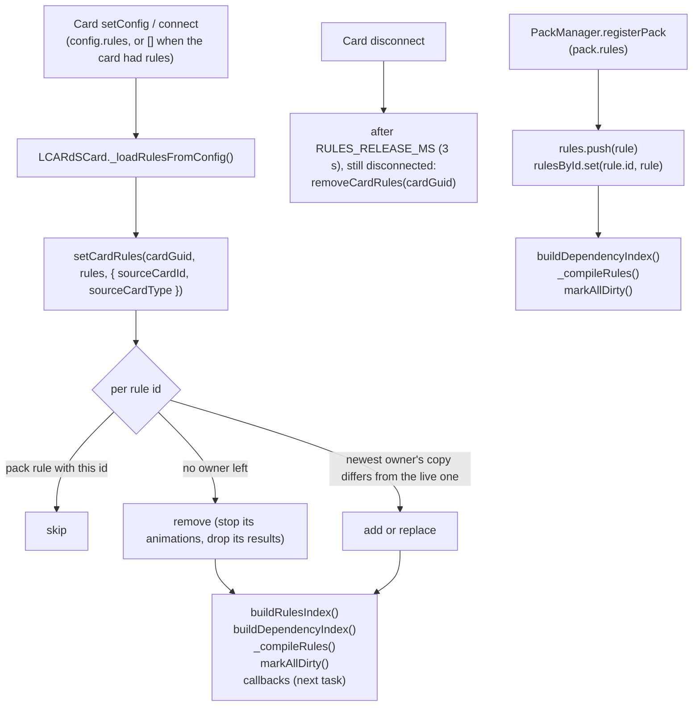
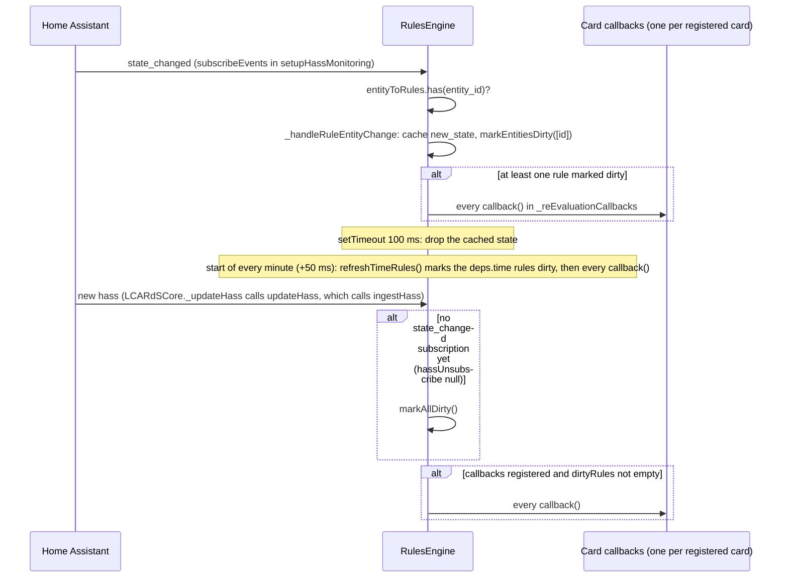
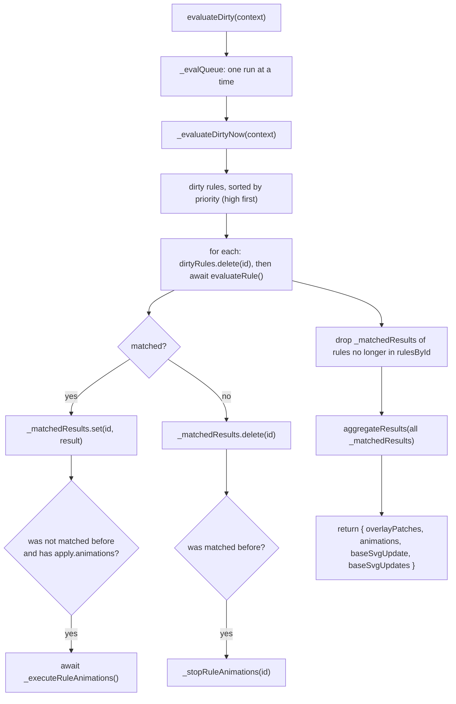

# Rules Engine

> **`window.lcards.core.rulesManager`**: one shared engine that evaluates every rule on the page and hands each card the patches, animations and base SVG updates of the rules that match.

---

## Overview

`RulesEngine` (`src/core/rules/RulesEngine.js`) extends `BaseService`. There is exactly **one** instance, created by `LCARdSCore._performInitialization()` (`src/core/lcards-core.js`, `this.rulesManager = new RulesEngine([], this.dataSourceManager)`, right after the shared DataSourceManager) and connected to the systems manager straight away (`this.rulesManager.systemsManager = this.systemsManager`), which also creates the engine's template evaluator.

Rules are page-wide. Every card that has a `rules:` block pushes its rules into the shared engine, packs push theirs the same way, and any rule can target any registered overlay (a card, or an MSD overlay) by id, tag, type or pattern. A rule written on one card can restyle another card.

The engine:

- keeps the rule list (`rules`, `rulesById`) and a compiled condition tree per rule (`compiledRules`);
- keeps a dependency index (entity id to rule ids) so a state change marks only the affected rules dirty;
- subscribes once to Home Assistant `state_changed` events and calls every registered card's re-evaluation callback when a rule entity changes;
- evaluates dirty rules in priority order, keeps the latest result of every matching rule, and returns the patches of **all** currently matching rules to every caller;
- starts rule animations when a rule starts matching and stops its looping ones when it stops matching.

---

## Key files

| File | Role |
|---|---|
| `src/core/rules/RulesEngine.js` | `RulesEngine`: rule store, dependency index, Home Assistant subscription, evaluation queue, selector resolution, aggregation, rule animations |
| `src/core/rules/compileConditions.js` | `compileRule()` turns a rule's `when` into a node tree; `evalCompiled()` walks it |
| `src/core/rules/RuleTraceBuffer.js` | `globalTraceBuffer`: ring buffer (1000 entries) of evaluation traces |
| `src/core/rules/merge-patches.js` | `mergeOverlayPatches()`: combines patches by overlay id (used by the MSD card) |
| `src/utils/comparison-utils.js` | `compareNumericBounds()`: the `above` / `at_least` / `below` / `at_most` check |
| `src/utils/linearMap.js` | `linearMap()` (used by `map_range_cond`) and `mapRangeOutput()` (map_range in animation params) |
| `src/core/animation/resolveAnimParams.js` | `resolveAnimParam()` / `resolveAnimCommandParams()`: map_range descriptors in rule animations and `shape_texture` patches |
| `src/base/LCARdSCard.js` | Card side: `_loadRulesFromConfig()`, `_registerOverlayForRules()`, `_applyRulePatches()`, `_applyRuleResults()`, `_getMergedStyleWithRules()` |
| `src/cards/lcards-msd.js` | MSD side: overlay registration, `_applyRulePatches()` override, `_applyRuleResults()` (base SVG) |
| `src/cards/schemas/common-schemas.js` | `rulesSchema`: the published rule schema (shared by every card) |

---

## Rule shape

The schema is `rulesSchema` in `src/cards/schemas/common-schemas.js`; `id`, `when` and `apply` are required.

```yaml
rules:
  - id: high_temp            # required; rules without an id are skipped when loaded
    name: High temperature   # label for the editor
    priority: 10             # default 0; higher first
    stop: false              # default false
    enabled: true            # default true; false never matches
    when:
      entity: sensor.cpu_temp
      above: 75
    apply:
      overlays:
        tag:temp_widget:
          style:
            color: var(--lcars-red)
      animations:
        - tag: temp_widget
          preset: pulse
          loop: true
      base_svg:              # MSD cards only
        filters:
          - mode: svg
            type: tint
            value:
              color: rgba(180, 0, 0, 0.35)
        transition: 500
```

`apply.profiles` is still in the schema as deprecated ("Retired: has no effect"); the engine never reads it.

---

## Loading rules into the shared engine

The constructor builds the indexes for the rules it is given (`buildRulesIndex()`, `buildDependencyIndex()`, `markAllDirty()`, `_compileRules()`), but core constructs it with no rules. Rules arrive later and are compiled in place on the same instance:



- **Card rules** (`_loadRulesFromConfig`, `src/base/LCARdSCard.js`): called from `_onConfigSet()` on every config change when the singletons are ready (with `[]` when a card that had rules has none left), otherwise flagged (`_hasRulesToLoad`) and loaded from `_onConnected()`. It calls `setCardRules(this._cardGuid, rules, meta)`: the card **instance** owns the rules. Each is stored as a **copy** carrying `_sourceCardId` (`config.id`, else the card GUID) and `_sourceCardType`, because Home Assistant freezes Lovelace card configs.
- **Shared ids**: the engine keeps, per rule id, every card instance that lists it (`_ruleOwners`, newest last). The newest owner's copy is the live rule; re-setting an unchanged copy keeps its place, so the dashboard card re-setting its saved config never takes a rule back from the editor preview. A rule is removed when its last owner lets it go. An id held by a pack (or constructor) rule is not the card's: the card copy is skipped.
- **Release on disconnect**: `_onDisconnected()` schedules `removeCardRules(cardGuid)` after `RULES_RELEASE_MS` (3000 ms, exported from `LCARdSCard.js`); `_onConnected()` and any later `_loadRulesFromConfig()` cancel it. Home Assistant disconnects and reconnects cards when it lays out a view, enters edit mode or moves a card, and those keep their rules. A card that stays disconnected (deleted, or on a view no longer shown) loses its rules and sets them again (`_hasRulesToLoad`) if it connects again. A rule on a card in a hidden view therefore does not reach cards on the shown view, as for a view never opened.
- **Pack rules** (`src/core/PackManager.js`, step 3 of pack registration): pushed as-is (no `_sourceCardId`), then indexed and compiled. Nothing removes them.
- After any add, replace or remove, `setCardRules()` rebuilds the indexes, recompiles, marks all rules dirty and runs the re-evaluation callbacks once in the next task (`_scheduleRulesChanged()`), so patches of a changed or removed rule update without a hass change.
- `_compileRules()` clears `compiledRules`, recompiles every rule and logs compilation issues as one warning (`[RulesEngine] Rule compilation issues:`).
- Cards call `setupHassMonitoring(hass)` on their first hass (`_onHassChanged()`) and again after loading rules in `_onConnected()` when hass is already there, so the dependency index is populated before the subscription is made. Only the first call that finds rule entities subscribes.

---

## Compilation

`compileRule(rule, issues)` (`compileConditions.js`) returns:

```javascript
{
  tree: { type: 'all', nodes: [ /* ... */ ] },  // see the node table below
  deps: {
    entities: Set<string>,   // entity ids the tree reads
    time: boolean            // a time_between, weekday_in or random_chance node
  }
}
```

A missing `when` compiles to `{ type: 'always' }`. `compileNode()` checks keys in a fixed order; the first match wins:

| Order | Key(s) in the condition | Node type | Notes |
|---|---|---|---|
| 1 | an array | `all` | A bare list is an AND |
| 2 | `all` | `all` | `nodes` compiled recursively |
| 3 | `any` | `any` | |
| 4 | `not` | `not` | One child (`node`) |
| 5 | `condition` | `javascript` or `jinja2` or `invalid` | Trimmed; contains `[[[` and `]]]` gives `javascript` (code is the text between the first 3 and last 3 characters), contains `{{` and `}}` gives `jinja2`, anything else gives `{ type: 'invalid', reason: 'plain-string' }` and an `error` issue |
| 6 | `jinja2` | `jinja2` | Explicit form |
| 7 | `javascript` or `js` | `javascript` | Explicit form; `js` is an alias |
| 8 | `map_range_cond` | `map_range_cond` | The object's own keys (`entity`, `input`, `output`, `clamp`, comparison keys) |
| 9 | `entity_attr`, or `entity` with `attribute` | `entity_attr` | `entity_attr: light.x` copies into `entity`; `state` becomes `equals` |
| 10 | `entity` | `entity` | `state` is normalised to `equals` |
| 11 | `time_between` | `time_between` | `"HH:MM-HH:MM"`, may wrap past midnight |
| 12 | `weekday_in` | `weekday_in` | `mon`...`sun`, case-insensitive |
| 13 | `sun_elevation` | `sun_elevation` | Bounds object |
| 14 | `random_chance` | `random_chance` | Probability `0` to `1` |
| 15 | anything else | `invalid` | `reason: 'unrecognized'` (includes `perf_metric` and `flag`, removed in 2026.11 because nothing ever supplied their values) |

`invalid` nodes evaluate to `false` (the `default` branch of `evalCompiled()`). A plain-string condition used to compile to `always`, so a mistyped condition applied the rule everywhere; the comment at that branch records the fix.

### Dependencies

`collectDeps()` adds to `deps.entities`:

- `entity`, `entity_attr`, `map_range_cond`: `c.entity`;
- `sun_elevation`: `sun.sun`;
- `jinja2`: entity ids found by `TemplateParser.extractJinja2Entities()`;
- `javascript`: every literal `states['domain.object']` (or `hass.states[...]`) in the code.

`buildDependencyIndex()` uses `extractEntityReferences(rule)`, which reads the flat form and top-level `all` / `any` lists itself and then adds the compiler's `deps.entities` (so nested trees and template conditions are covered). The result is `dependencyIndex = { entityToRules: Map<entityId, Set<ruleId>>, ruleToEntities: Map<ruleId, string[]> }`.

---

## Condition evaluation

`evalCompiled(tree, ctx)` is async (Jinja2 is a round trip). `all` and `any` evaluate their children in parallel (`Promise.all`) and then combine. The context is built per rule in `evaluateRule()`:

| `ctx` key | Value |
|---|---|
| `getEntity` | The lookup described in [Entity lookup](#entity-lookup) |
| `entity` | `getEntity(boundEntity)`: the calling card's `config.entity` |
| `hass` | `systemsManager.getHass()` with `states` proxied so states from just-received events win (`_hassWithFreshStates`) |
| `now` | `Date.now()` |
| `sun` | `{ elevation }` from `sun.sun`'s `elevation` attribute |
| `unifiedTemplateEvaluator` | The engine's `UnifiedTemplateEvaluator` |

### Comparison keys

`entity`, `entity_attr` and `map_range_cond` share `compareValue(value, c)`. It uses the **first** key present, in this order:

| Key | Test |
|---|---|
| `equals` (or `state`) | `value == equals` (loose equality) |
| `not_equals` | `value != not_equals` |
| `in` | array includes the value |
| `not_in` | array does not include the value |
| `regex` | `new RegExp(regex).test(String(value))`; an invalid pattern is `false` |
| `above`, `at_least`, `below`, `at_most` | `compareNumericBounds()`: every bound given must hold (AND), so two bounds make a range; a non-numeric value is `false` |
| none of these | truthiness of the value |

The condition editor's "between" / "between (exclusive)" operators write two of the four bounds.

### Node types

| Node | True when |
|---|---|
| `always` | always |
| `all` / `any` / `not` | every child / some child / not the child |
| `entity` | the entity exists and `compareValue(state, c)` |
| `entity_attr` | the entity exists, `attribute` is set, and `compareValue(attributes[attribute], c)` |
| `map_range_cond` | the state is a finite number, `input` and `output` are two finite numbers each, and `compareValue(linearMap(state, in0, in1, out0, out1, clamp !== false), c)` (numbers only; colour outputs are for animation params, see [map_range in rule animations](#map-range-in-rule-animations)) |
| `time_between` | local time of `ctx.now` is inside the range (inclusive) |
| `weekday_in` | today's weekday (`ctx.now`) is in the list |
| `sun_elevation` | `ctx.sun.elevation` is finite and `compareNumericBounds(elevation, cmp)` |
| `random_chance` | `Math.random() < p` on each evaluation |
| `javascript` | `new Function('entity', 'hass', 'states', code)` returns a truthy value; the code needs its own `return`; an exception is `false` |
| `jinja2` | `unifiedTemplateEvaluator.evaluateAsync(template)` gives a boolean `true`, a non-zero number, one of `true` / `1` / `yes` / `on`, a non-zero numeric string, or another non-empty string; `false` / `0` / `no` / `off` / `none` / empty are false; an error or a missing evaluator is false |
| `invalid` | never |

Notes from the code:

- `random_chance`, `time_between` and `weekday_in` set `deps.time`. Those rules are marked dirty at the start of every minute (see [When rules are re-evaluated](#when-rules-are-re-evaluated)).

### Entity lookup

When the engine has a systems manager (always, in practice), `_evaluateDirtyNow()` wraps the caller's `getEntity` in a lookup that tries, in order:

1. `_freshStateCache` (the `new_state` of a `state_changed` event, kept for 100 ms);
2. `systemsManager.getHass().states[entityId]`;
3. a DataSource reference (`resolveDataSourceValue()`, `source.transformations.key` / `source.aggregations.key`);
4. an auto-created template DataSource named `template_<entity_id with _>`;
5. the caller's own `getEntity` (cards pass `this.hass.states[id]`);
6. `dataSourceManager.getEntity()`.

Steps 3, 4 and 6 use `this.dataSourceManager`, the shared core DataSourceManager. A condition naming a data source (`entity: my_source`, or `my_source.transformations.key` when the source exists at index time) is indexed under that reference; `setupHassMonitoring()` leaves such references out of the Home Assistant subscription. The engine listens with `dataSourceManager.addEntityChangeListener()` (`_watchDataSources()`, in the constructor and `setDataSourceManager()`); when a source's entity changes, `_onDataSourceEntitiesChanged()` maps the entity to the source names (`source.cfg.entity`), calls `markEntitiesDirty(names)` (exact and `name.` prefix matches) and runs the callbacks. Only sources that read an entity notify. The user docs do not offer DataSource references in rule conditions.

---

## Evaluation flow

### When rules are re-evaluated



- `setupHassMonitoring(hass)` subscribes once for the whole engine (guarded by `hassUnsubscribe` and `_hassMonitoringSetupInProgress`). The listener checks `dependencyIndex.entityToRules` live, so rules loaded after the subscription are covered. If no rule references a Home Assistant entity, no subscription is made and `ingestHass()` keeps marking all rules dirty on every hass update.
- Once the subscription exists, `ingestHass()` no longer marks rules dirty; it only runs the callbacks when something else left rules dirty.
- Rules that read the clock (`deps.time`) get a timer of their own: `_syncTimeRefresh()` (end of `_compileRules()`) collects them in `_timeRuleIds` and arms a `setTimeout` for the next minute boundary (`TIME_REFRESH_MS`, 60000, plus 50 ms), re-armed after each tick while such rules exist and cleared by `destroy()`. `refreshTimeRules()` marks only those rules dirty and runs the callbacks, so entity rules are not evaluated again. `random_chance` therefore draws again each minute.
- Data source updates mark the rules naming the source dirty (see [Entity lookup](#entity-lookup)).
- `markAllDirty()` is also called when rules are loaded, when a card registers (`_registerOverlayForRules()` with hass present), and when an MSD card has registered its overlays.

### What a callback does

Each card registers one callback (see [Card integration](#card-integration)). It calls:

```javascript
const ruleResults = await rulesEngine.evaluateDirty({
  entity: this.config?.entity,                    // bound entity for ctx.entity
  getEntity: (entityId) => this.hass?.states?.[entityId]
});
```



- **Serialised**: `evaluateDirty()` chains each run on `_evalQueue`, because every card's callback calls it at once.
- **Every caller gets the full set**: only the first call after a change finds the rules dirty; later callers evaluate nothing but still receive the patches of every rule that matches now (`_matchedResults`). Without this, cards after the first would see no patches.
- **Dirty flag cleared before the await**: a rule marked dirty again while it is evaluated (an MSD registering overlays mid-evaluation, then `markAllDirty()`) stays dirty and is evaluated again.
- **Transitions** come from `lastEvaluation` (rule id to `{ matched, timestamp, conditions }`).
- Without a `getEntity` function and without a data source or systems manager the call returns `createEmptyResult()`.

### evaluateRule()

`evaluateRule(rule, getEntity, contextOverlays = null, boundEntity = null)`:

1. `enabled === false`: returns `createUnmatchedResult(rule)` (so its patches and animations are removed like any unmatched rule's). This is what the editor's Rules tab "Disable" writes.
2. No compiled tree: warns, unmatched.
3. Builds `ctx`, awaits `evalCompiled()`, adds a trace (`traceBuffer.addTrace`).
4. When matched and `rule.apply` exists:
   - `overlayPatches = await _resolveOverlaySelectors(rule.apply, contextOverlays)`, each patch tagged with `ruleId` and `ruleCondition` (`JSON.stringify(rule.when)`) for provenance;
   - `animations = rule.apply.animations || []`;
   - `baseSvgUpdate = rule.apply.base_svg || null`;
   - `sourceCardId = rule._sourceCardId ?? null`;
   - `stopAfter = rule.stop === true`.
5. An exception gives `{ matched: false, error }`.

---

## Targeting overlays (`apply.overlays`)

`_resolveOverlaySelectors()` reads the overlays from, in order: `contextOverlays`, `systemsManager.getAllTargetableOverlays()`, `systemsManager.getResolvedModel().overlays`. With none it returns `[]` (expected while cards are still registering).

| Selector key | Matches |
|---|---|
| `all` | every overlay |
| `type:<name>` | `overlay.type === name` |
| `tag:<name>` | `overlay.tags` includes `name` |
| `pattern:<regex>` | `new RegExp(regex).test(overlay.id)`; an invalid regex skips the selector |
| `exclude` | id or list of ids removed from every other selector |
| anything else | the overlay with that exact id |

- Several selectors matching the same overlay are merged in key order: top-level keys shallow-merged, `style` merged one level deep; later selectors win.
- Each patch is `{ id, ...patchContent }`.
- `_evaluateTemplatesInPatches()` then runs every string value in `style` and every other top-level string through the engine's `UnifiedTemplateEvaluator` (with a fresh hass), so cards receive evaluated values. A `shape_texture.config` value that is a `{ map_range: ... }` descriptor is resolved with `resolveAnimParam()`.

---

## Results and aggregation

`aggregateResults(ruleResults)` returns:

| Key | Content |
|---|---|
| `overlayPatches` | Patches grouped by overlay id, each group sorted by priority (high first) and cut by `stop` (below) |
| `animations` | Every matched rule's `apply.animations`, rules in priority order. Informational: the animations are started inside `_evaluateDirtyNow()`, not by the caller |
| `baseSvgUpdate` | The highest-priority `base_svg` of any rule (kept for compatibility) |
| `baseSvgUpdates` | `{ [sourceCardId]: base_svg }`, highest priority per source card; rules with no source card (pack rules) under `'*'` |

### Priority and `stop`

`processOverlayRules(overlayId, rules, aggregated)` walks one overlay's patches from highest priority down. After a rule with `stop: true`, lower-priority patches **for that overlay** are not added (a `stopped` trace is recorded for each). All rules are still evaluated, their animations still run, and their patches for other overlays still apply. This matches the schema description of `stop`.

Within an overlay, patches are handed to cards highest priority first. Cards merge them from the end, so the highest-priority rule is applied last and wins, while rules patching different keys combine (`LCARdSCard._applyRulePatches()`, `mergeOverlayPatches()`).

### `apply.base_svg` (MSD)

The engine only carries `base_svg` through. The MSD card applies it in `LCARdSMSDCard._applyRuleResults()` (`src/cards/lcards-msd.js`), which the base callback calls after `_applyRulePatches()`:

- it takes `baseSvgUpdates[config.id || cardGuid]`, else `baseSvgUpdates['*']`;
- if that differs from the last one applied, it calls `coordinator._applyBaseSvgUpdate(update)` (`src/msd/pipeline/MsdCardCoordinator.js`), which filters `#__msd-base-content` with a transition (default 1000 ms);
- when no rule matches any more, it restores the configured `msd.base_svg.filters` (or `[]`) with the last rule's transition;
- before the pipeline exists it returns early; the next evaluation applies it.

So a rule's `base_svg` applies to the MSD whose `rules:` block holds it; a pack rule's applies to every MSD. `tests/core/rules-engine-results.test.js` covers the per-card selection.

---

## Rule animations (`apply.animations`)

`_executeRuleAnimations(animations, ruleId)` runs when a rule goes from unmatched to matched:

1. Targets come from `_resolveAnimationTargetsWithRetry(animCmd)`, which polls `_resolveAnimationTargets()` up to 15 times, 100 ms apart, because a rule can match before an MSD's overlays have registered. Targeting reads the systems manager's overlay registry and uses the **first** key present: `overlay` (exact id), `tag`, `type`, `pattern` (regex on the id).
2. For each target: `animationManager.playAnimation(overlayId, { ...animCmd, trigger: 'on_rule' })` (`window.lcards.core.animationManager`). The raw command is passed, map_range descriptors included: `playAnimation()` resolves them itself and needs the raw `duration` descriptor to set up a live speed binding for looping animations. The engine's own `_resolveAnimCommandParams()` call there is a debug log only.
3. For `loop` entries the exact definition is remembered in `activeRuleAnimations` (rule id to `Map<overlayId, animDef[]>`).

`_stopRuleAnimations(ruleId)` runs when the rule stops matching: for each remembered definition it calls `animationManager.stopAnimations(overlayId, 'on_rule', def)`, so another rule's loop on the same overlay keeps running. One-shot animations are not tracked.

### Animation scopes (`animationScope`)

The overlay id a rule targets is not always the id of the card's AnimationManager scope (sliders, charts and MSDs name their scopes differently). `_registerOverlayForRules()` therefore registers `animationScope: this._getAnimationSetup().overlayId` in the overlay metadata, and `AnimationManager._resolveScopeFromOverlay(overlayId)` resolves a target in this order:

1. a scope whose id is the overlay id;
2. the registered `animationScope`, if that scope exists;
3. `${type}-${sourceCardId}` from the overlay metadata.

### map_range in rule animations

`duration`, `delay` and every `params` value of a rule animation may be a `{ map_range: { entity, attribute?, input, output, clamp? } }` descriptor (`resolveAnimParam()`, `src/core/animation/resolveAnimParams.js`):

- the entity value comes from `resolveEntityValue()` (state, an attribute, or the virtual `brightness_pct`);
- `mapRangeOutput(value, inMin, inMax, output, clamp)` (`src/utils/linearMap.js`) maps two numbers linearly, or blends two colours with `interpolateColor(from, to, t)` (`src/core/themes/resolve-color.js`): both ends go through `resolveColor(..., { concrete: true })`, so `var()`, `theme:` tokens, named colours, `rgb()` / `hsl()` and any hex length work, and the mix is premultiplied RGBA; colour outputs always hold at the ends;
- `clamp` defaults to `true`.

```yaml
apply:
  animations:
    - tag: grid_power
      preset: pulse
      loop: true
      params:
        color:
          map_range:
            entity: sensor.grid_power
            input: [0, 5000]
            output:
              - theme:colors.ui.primary
              - var(--lcars-red)
```

---

## Card integration

### `_registerOverlayForRules(overlayId, type, tags = [])`

`src/base/LCARdSCard.js`. Cards call it from `_handleFirstUpdate()` (button and elbow, chart, slider, data grid, select menu, astrometrics, MSD). Positional arguments:

```javascript
_handleFirstUpdate() {
  super._handleFirstUpdate();
  const overlayId = this.config.id || this._cardGuid;
  this._registerOverlayForRules(overlayId, 'button', this.config.tags || []);
}
```

It:

1. remembers the arguments in `_rulesRegistration` (a reconnect calls it again from `_onConnected()`, because a disconnect unregisters the card and the first update never runs again);
2. returns if the singletons are missing or the card is already registered (`_overlayRegistered`);
3. calls `systemsManager.registerOverlay(overlayId, { id, type, tags, sourceCardId: this._cardGuid, animationScope })`;
4. registers one callback with `rulesEngine.setReEvaluationCallback(callback)` and keeps it in `_rulesCallback`;
5. with hass present, calls `markAllDirty()` and runs the callback once.

The callback calls `evaluateDirty()`, then `_applyRulePatches(ruleResults.overlayPatches)`, then `_applyRuleResults(ruleResults)` (a no-op except on the MSD card).

`_unregisterOverlayFromRules()` (from `_onDisconnected()`) removes the callback by reference, unregisters the overlay, and clears `_lastRulePatches`.

The JSDoc example above `_registerOverlayForRules()` and the class-level example at the top of `LCARdSCard.js` still show an object argument (`{ id, type }`) and `_onRulePatchesChanged(patches)`; the code takes positional arguments and the hook takes none.

### `_applyRulePatches(overlayPatches)`

Base card behaviour:

- keeps only patches whose `id` is the card's `_overlayId`;
- none left: if patches were applied before, clears them, restores `this.config` from the `_baseConfig` snapshot, calls `_onRulePatchesChanged()` and `requestUpdate()`;
- otherwise deep-merges its patches from the end (highest priority wins), compares with `_lastRulePatches` by JSON, and on a change: snapshots `_baseConfig` before the first patch, records each patched field in the provenance tracker (`rulesEngine.trackRulePatch()`), sets `this.config = deepMerge(copy of _baseConfig, mergedPatch)`, calls `_onRulePatchesChanged()` and `requestUpdate()`.

A patch can therefore change any config key, not only `style`. `_getMergedStyleWithRules(style)` deep-merges `_lastRulePatches` onto an object for cards that resolve styles separately.

### `_onRulePatchesChanged()`

A no-op hook in the base class with **no arguments**; override it to clear caches or re-resolve styles:

```javascript
_onRulePatchesChanged() {
  this._resolveButtonStyle();  // reads this.config, which now carries the patches
}
```

### MSD cards

`LCARdSMSDCard._registerOverlaysWithRulesEngine()` (`src/cards/lcards-msd.js`), after the pipeline has processed the config:

- clears `this.hass` while it registers (so `_registerOverlayForRules()` does not evaluate once per overlay);
- calls `_registerOverlayForRules(this._cardGuid, 'msd-card')` for the card itself, so `type:msd-card` selectors match it;
- registers every overlay with `systemsManager.registerOverlay(overlay.id, { id, type, tags: ['msd-overlay', overlay.type, ...overlay.tags], sourceCardId })`, skipping `control` overlays whose card is an LCARdS card (those register themselves);
- restores hass, calls `markAllDirty()` and, with hass, runs its callback.

The MSD overrides `_applyRulePatches()` to keep patches for **all** its overlays (`mergeOverlayPatches()` into `{ overlayId: patch }`). Style-only patches are written to the DOM (`_applyStylePatchesToDOM()`), others re-render; `_onMsdRendered()` re-applies style-only patches after each render.

---

## Public API

| Member | Description |
|---|---|
| `rules`, `rulesById` | The rule list and the id map |
| `compiledRules` | `Map<ruleId, { tree, deps }>` |
| `dependencyIndex` | `{ entityToRules, ruleToEntities }` |
| `dirtyRules` | `Set<ruleId>` |
| `buildRulesIndex()`, `buildDependencyIndex()`, `_compileRules()` | Rebuild after adding rules (what packs call) |
| `setCardRules(ownerId, rules, meta?)`, `removeCardRules(ownerId)` | A card instance's rules: add, replace, remove; returns `{ added, replaced, removed }` |
| `refreshTimeRules()` | Mark the time-dependent rules dirty and run the callbacks (the minute timer calls it) |
| `markAllDirty()`, `markEntitiesDirty(ids)` | Mark rules for evaluation; the latter returns the count newly marked |
| `evaluateDirty(context)` | `Promise` of the aggregated results (see above) |
| `evaluateRule(rule, getEntity, overlays?, boundEntity?)` | Evaluate one rule (used by tests) |
| `setupHassMonitoring(hass)` | Subscribe to `state_changed` once |
| `ingestHass(hass)` / `updateHass(hass)` | Hass update from core (`updateHass` calls `ingestHass`) |
| `setReEvaluationCallback(fn)`, `removeReEvaluationCallback(fnOrIndex)` | Card callbacks |
| `setDataSourceManager(dsm)` | Swaps the DataSource manager (core passes it to the constructor instead): listens to it, rebuilds the index, marks all dirty |
| `getAllRules()` | `rules` (used by the editor's rules dashboard) |
| `getRuleDependencies(ruleId)`, `getEntityDependents(entityId)` | Index lookups |
| `getTrace()` | Counts, `lastEvaluations`, `evalCounts`, dependency and trace-buffer stats |
| `getRuleTrace(ruleId, limit = 20)` | One rule's history |
| `getRecentMatches(windowMs = 60000)` | Matches in the window |
| `exportTrace(options)`, `clearTrace()` | Trace buffer export and reset |
| `trackRulePatch(fieldPath, original, patched, ruleId, condition, cardTracker)` | Forwards to the card's `ProvenanceTracker` |
| `getDebugInfo()` | Snapshot for `debug.singleton('rulesManager')` |
| `destroy()` | Unsubscribes (Home Assistant and data sources), stops the timers and drops the callbacks |

The `stopProcessing` map is created by the constructor and never read.

---

## Console access

::: code-group
```javascript [Snapshot]
window.lcards.debug.singleton('rulesManager')
// { type: 'RulesEngine', rulesCount, rulesById, dirtyRules, evalCounts,
//   hasDataSourceManager, dependencyIndex: { entityToRules, ruleToEntities, ... },
//   recentMatches, trace }
```
```javascript [Live object]
const rm = window.lcards.core.rulesManager;

rm.getAllRules();                        // every rule, with _sourceCardId on card rules
rm.compiledRules.get('high_temp');       // { tree, deps }
rm.getRuleDependencies('high_temp');     // entity ids
rm.getEntityDependents('sensor.cpu_temp');
rm.lastEvaluation.get('high_temp');      // { matched, timestamp, conditions }
rm.getRuleTrace('high_temp', 20);
rm.getRecentMatches(30000);
rm.markAllDirty();                       // then change any rule entity to re-run callbacks
```
:::

---

## See also

- [Rules (user guide)](../../core/rules/index.md) and [Conditions](../../core/rules/conditions.md)
- [Systems Manager](systems-manager.md): the overlay registry
- [Animation Manager](animation-manager.md)
- [Template System](template-system.md): Jinja2 and JavaScript conditions, templates in patches
- [Debug API](../../development/debug-api.md)
