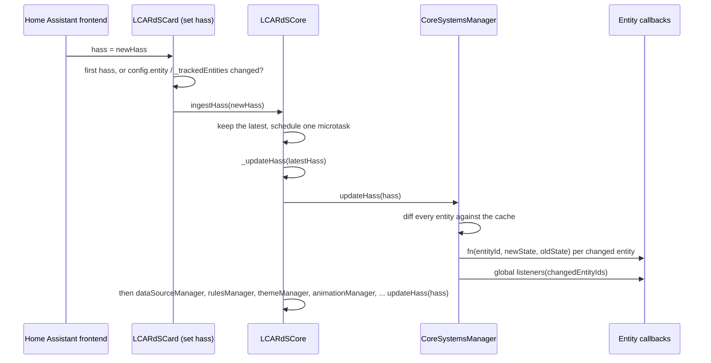

# Systems Manager

> **`window.lcards.core.systemsManager`**: shared entity state cache, per-entity change callbacks, card registry and the overlay registry the rules engine targets.

---

## Overview

`CoreSystemsManager` (`src/core/systems-manager/index.js`) is a plain class (it does not extend `BaseService`) created first in `LCARdSCore._performInitialization()`. It keeps the last state of every entity, diffs each HASS update the core hands it, and calls the callbacks registered for the entities that changed. It also holds the overlay registry: every card that takes part in rules registers an overlay (id, type, tags, owning card, animation scope) so `RulesEngine` can resolve selectors such as `tag:status` across cards.

It does not open any Home Assistant subscription of its own. Updates come from HASS objects that cards forward to the core.

---

## Responsibilities

- Keep a `Map<entityId, state>` cache (`_entityStates`), seeded from `hass.states` in `initialize(hass)` and updated by `updateHass()`.
- Keep a list of `{ cardId, fn }` callbacks per entity (`_entitySubscriptions`); the same function is added once per entity.
- On every update, compare each entity with the cached state and call that entity's callbacks, then the global change listeners, synchronously.
- Track registered cards (`registerCard()`) so their subscriptions can be removed together (`unregisterCard()`).
- Hold the overlay registry used by `RulesEngine` and the editors' tag picker.

---

## HASS Update Flow



- **Forwarding is gated per card** (`LCARdSCard` hass setter, `src/base/LCARdSCard.js`). A card calls `core.ingestHass()` on its first HASS, or when its `config.entity` or one of its `_trackedEntities` changed (template entities, `map_range` entities and `triggers_update`). A synthetic HASS (a parent card's rewritten copy, for example the select menu's options) is never forwarded. The diff covers all entities, so one forwarded update also delivers changes to entities no card forwarded for.
- **One propagation per microtask.** `ingestHass()` keeps only the latest HASS and runs `_updateHass()` once in a microtask, however many cards called it in that tick (`src/core/lcards-core.js`).
- **Without cards.** While no card is registered, or a portal overlay shows content, the core polls `document.querySelector('home-assistant').hass` (`_startGlobalHassFeed()`) and ingests it when it is a new object.
- `_updateHass()` calls `systemsManager.updateHass()` first, then `dataSourceManager`, `rulesManager`, `themeManager`, `animationManager`, `validationService`, `soundManager`, `integrationService`, `deviceIdentityManager`, `scopedSettingsService`, `portalOverlayManager`, `connectionOverlayService`, `assetManager` and `helperManager`, each when present.

**What counts as a change** (`updateHass()`): an entity is changed when it has no cached state, or when `state`, `last_changed` or `last_updated` differ. `last_updated` is the one that catches attribute-only updates (a light's `brightness` while it stays `on`); `last_changed` moves only with `state`, so that check adds nothing but is harmless. An entity that disappears from `hass.states` (deleted or renamed in Home Assistant) leaves the cache and counts as changed: its callbacks get `newState` `null`, and `getEntityState()` returns `null` from then on.

**Callback arguments**: `fn(entityId, newState, oldState)`, where `oldState` is the previously cached state (`null` the first time) and `newState` is `null` for an entity that was removed. Old states are released right after the callbacks run. A callback that throws is logged and the others still run.

---

## Entity Subscription API

Cards use the inherited wrapper, which passes the card id and unsubscribes automatically on disconnect (`LCARdSCard.subscribeToEntity()`):

```javascript
// Inside an LCARdSCard subclass
this.subscribeToEntity(this.config.entity, (entityId, newState, oldState) => {
  this._state = newState;
  this.requestUpdate();
});
```

Outside cards, call the manager and keep the unsubscribe function:

```javascript
import { lcardsLog } from '../utils/lcards-logging.js';

const sm = window.lcards?.core?.systemsManager;

const unsubscribe = sm?.subscribeToEntity('sensor.temperature', (entityId, newState, oldState) => {
  lcardsLog.debug('[MyService] Temperature changed', { entityId, from: oldState?.state, to: newState?.state });
});

// Cached state, no subscription
const state = sm?.getEntityState('sensor.temperature');

// Later:
unsubscribe?.();
```

- `subscribeToEntity(entityId, cb, cardId?)` throws for a missing id or a non-function callback. With a `cardId` of a registered card, the entity is also recorded on that card, so `unregisterCard(cardId)` removes the card's callbacks.
- `getEntityState(id)` reads the cache, then `hass.states` (and caches it); `null` when unknown.

---

## Card Registry

`LCARdSCore.registerCard(cardId, card, config)` calls `systemsManager.registerCard()`, and `LCARdSCore.unregisterCard()` calls `systemsManager.unregisterCard()`. The context `registerCard()` returns has `getEntityState`, `subscribeToEntity`, `unsubscribeFromEntity` and `getAllEntityStates`; note that its `subscribeToEntity` does not pass the card id (the core's own card context does).

---

## Overlay Registry

Cards register for rules through `LCARdSCard._registerOverlayForRules(overlayId, type, tags)` (`src/base/LCARdSCard.js`), which calls:

```javascript
this._singletons.systemsManager.registerOverlay(this._overlayId, {
  id: this._overlayId,
  type,                     // 'button', 'slider', ...
  tags: this._overlayTags,
  sourceCardId: this._cardGuid,
  // The card's own AnimationManager scope, so rule animations reach it
  // whatever the card names its scope
  animationScope: this._getAnimationSetup().overlayId
});
```

`registerOverlay(overlayId, metadata)` stores `{ id: overlayId, type (default 'unknown'), tags (default []), sourceCardId (default 'unknown'), animationScope (default null), element (default null), registeredAt }`; the stored `id` is always the first argument. Registering an id again replaces it. The card unregisters on disconnect (`unregisterOverlay(this._overlayId)`) and registers again on reconnect from the remembered arguments (`_rulesRegistration`).

`RulesEngine` reads `getAllTargetableOverlays()` / `getOverlayRegistry()` to resolve selectors (`src/core/rules/RulesEngine.js`); `AnimationManager` reads the registry and uses `animationScope` to run a rule animation in the card's own scope (`src/core/animation/AnimationManager.js`). The rule editor lists `getAllTargetableOverlays()`, the form field's tag picker `getAllTags()`. See [Rules Engine](rules-engine.md).

---

## Public API

| Method | Returns | Description |
|---|---|---|
| `initialize(hass)` | `void` | Store HASS and seed the cache; a second call only runs `updateHass()` |
| `getHass()` | `Object\|null` | The last HASS object |
| `updateHass(hass)` | `void` | Diff, update the cache, notify (see [HASS Update Flow](#hass-update-flow)); warns and ignores `null` |
| `getEntityState(entityId)` | `Object\|null` | Cached state, falling back to `hass.states` |
| `getAllEntityStates()` | `Map<string, Object>` | The cache merged with the current `hass.states` |
| `subscribeToEntity(entityId, cb, cardId?)` | `() => void` | Add `cb(entityId, newState, oldState)`; returns the unsubscribe function |
| `unsubscribeFromEntity(entityId, cb)` | `void` | Remove one callback |
| `addEntityChangeListener(fn)` / `removeEntityChangeListener(fn)` | `void` | `fn(changedEntityIds)` after every update with changes |
| `registerCard(cardId, card, config?)` | `Object` | Card context (see [Card Registry](#card-registry)); warns and replaces a duplicate id |
| `unregisterCard(cardId)` | `void` | Remove the card and its tracked entity callbacks |
| `registerOverlay(overlayId, metadata)` | `void` | `metadata`: `{ type?, tags?, sourceCardId?, animationScope?, element? }` |
| `unregisterOverlay(overlayId)` | `void` | Remove one overlay |
| `getOverlay(overlayId)` | `Object\|null` | One overlay's stored metadata |
| `getAllTargetableOverlays()` | `Object[]` | Every overlay's metadata |
| `getOverlayRegistry()` | `Map<string, Object>` | The raw `overlayId → metadata` map |
| `getOverlaysBySource(cardId)` | `Object[]` | Overlays owned by one card |
| `getOverlaysByTag(tag)` | `Object[]` | Overlays with a tag |
| `getAllTags()` | `string[]` | Every tag in use, sorted |
| `getDebugInfo()` | `Object` | See the snapshot below |
| `destroy()` | `void` | Clear everything |

---

## Console Access

::: code-group
```javascript [Snapshot]
window.lcards.debug.singleton('systemsManager')
// → {
//   initialized: true,
//   destroyed: false,
//   registeredCards: ['card-abc123', 'card-def456'],
//   totalCards: 2,
//   registeredOverlays: ['my_button', 'lcards-slider-def456'],
//   totalOverlays: 2,
//   entityStateCount: 142,
//   entitySubscriptionCount: 12,
//   globalChangeListeners: 0,
//   hasHass: true
// }
```
```javascript [Live object]
const sm = window.lcards.core.systemsManager

sm.getEntityState('sensor.temperature')   // cached entity state object
sm.getAllTargetableOverlays()             // overlay metadata objects (array)
sm.getOverlaysByTag('status')             // overlays with one tag
sm.getAllTags()                           // every tag in use
sm._entitySubscriptions                   // Map<entityId, [{ cardId, fn }]>
```
:::

---

## See Also

- [Card Foundation](../cards/lcards-card-foundation.md)
- [Rules Engine](rules-engine.md)
- [Animation Manager](animation-manager.md)
