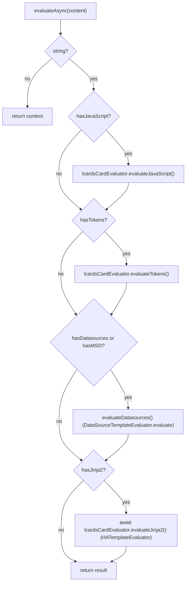

# Template System

> Unified template evaluation for all LCARdS cards and text fields. There is no singleton: evaluators are created per use.

---

## Overview

All dynamic text in LCARdS goes through `UnifiedTemplateEvaluator` (`src/core/templates/UnifiedTemplateEvaluator.js`). It runs up to four phases in a fixed order over one string: JavaScript, tokens, data sources, Jinja2. Cards do not keep an evaluator: `LCARdSCard.processTemplate()` builds a fresh one with the current context on every call, and the rules engine keeps one of its own for Jinja2 conditions and templates in rule patches.

---

## Key classes

| Class / module | File | Role |
|---|---|---|
| `UnifiedTemplateEvaluator` | `src/core/templates/UnifiedTemplateEvaluator.js` | Orchestrator: runs the four phases in order (`evaluateAsync()`), or the first three (`evaluateSync()`) |
| `LCARdSCardTemplateEvaluator` | `src/core/templates/LCARdSCardTemplateEvaluator.js` | JavaScript `[[[...]]]` and token `{...}` templates; owns an `HATemplateEvaluator` (created in its constructor) for the Jinja2 phase |
| `HATemplateEvaluator` | `src/core/templates/HATemplateEvaluator.js` | Sends Jinja2 to Home Assistant (`render_template` subscription, 5 s timeout) |
| `DataSourceTemplateEvaluator` | `src/core/templates/DataSourceTemplateEvaluator.js` | `{datasource:...}` / `{ds:...}` and the legacy `{name.path}` form |
| `TemplateEvaluator` | `src/core/templates/TemplateEvaluator.js` | Base class of the three evaluators above: `context`, `updateContext()`, stats, `_safeEvaluate()`, `_validateContent()` |
| `TemplateDetector` | `src/core/templates/TemplateDetector.js` | Fast checks (`detectTemplateTypes()`, `hasTemplates()`) so phases that have nothing to do are skipped |
| `TemplateParser` | `src/core/templates/TemplateParser.js` | Token parsing, JavaScript extraction, `extractJinja2Entities()`, `parseMSDReference()` |
| `templateRefs()` | `src/core/templates/template-refs.js` | What a template refers to (entities, data sources, theme tokens, variables); used for template provenance in `processTemplate()` and by the editor's Templates tab and sandbox |

---

## Template types and syntax

### 1: JavaScript `[[[...]]]`

```yaml alternatives
text: "[[[return entity.state.toUpperCase()]]]"
text: "[[[return Math.round(entity.attributes.brightness / 2.55) + '%']]]"
```

The code runs in `new Function(...)` with these names (`LCARdSCardTemplateEvaluator._safeEvalCode()`):

| Name | Value |
|---|---|
| names in `context.extra` | Card-supplied extras (for example the astrometrics card's `sky` and `point`); listed first, so the standard names below win |
| `entity` | `context.entity` (the card's entity object) |
| `config` | `context.config` |
| `hass` | `context.hass` |
| `states` | `context.hass.states` (or `{}`) |
| `user` | `context.hass.user` (or `{}`) |
| `variables` | `context.variables` (or `{}`) |
| `theme` | `context.theme` (or `{}`) |
| `Math`, `String`, `Number`, `Boolean`, `parseFloat`, `parseInt`, `Array`, `Object`, `Date` | The globals |

The code needs its own `return`. JavaScript templates always see raw values; `displayFormat` does not apply to them.

### 2: LCARdS tokens `{...}`

```yaml alternatives
text: "{entity.state}"
text: "{entity.attributes.friendly_name}"
text: "{states.sensor.outside_temp.state}"
text: "{variables.label}"
text: "{theme:colors.ui.primary}"
text: "{config.name}"
```

`_evaluateTokens()` matches `{...}` but not `{{`, `{%`, `{#`, `{datasource:` or `{ds:`, and keeps a match its `deferToken` test accepts (a legacy data source reference, below). `_resolveToken()`:

- `theme:<path>`: `window.lcards.core.themeManager.getToken(path)`, else a dot walk of `context.theme`, else `''`;
- `states.<domain>.<object_id>.state` and `states.<domain>.<object_id>.attributes.<key>`: rebuilds the entity id from the two segments after `states` (because `hass.states` is a flat map keyed by `domain.object_id`) and formats the value per `displayFormat`;
- anything else: a dot walk of the context; `entity.state` and `entity.attributes.<key>` are then formatted per `displayFormat`.

`context.displayFormat` (default `'friendly'`) controls those entity values:

| `displayFormat` | Output |
|---|---|
| `friendly` | Home Assistant's display string (`haFormatState` / `haFormatAttrValue`) |
| `raw` | The raw state or attribute |
| `parts` | The formatted parts joined (`joinParts`) |
| `unit` | Only the unit (`extractUnit`) |

### 3: Data sources `{ds:...}`

```yaml alternatives
text: "{ds:sensor_name}"                    # base value: locale-formatted number + unit
text: "{ds:sensor_name.celsius}"            # processor output: raw value, no unit
text: "{ds:sensor_name.celsius:.1f}"        # format spec: number only
text: "{ds:sensor_name.celsius:.1f} °C"     # manual unit suffix
text: "{datasource:temp.rolling_avg}"       # explicit long prefix
```

`DataSourceTemplateEvaluator._resolveDatasourceReference()` parses `name[.path][:format]` (`TemplateParser.parseMSDReference()`); `name.processor` is read as `name.processing.processor`. With a format spec the output is the number only. Without one, the base value is formatted with `haFormatNumber()` and gets the entity's unit; a processor output is returned as is. `transformations.*` paths still work with a deprecation warning.

**Legacy form.** The evaluator also resolves `{name.path}` without a prefix (`_evaluateLegacyDatasources()`), the old MSD syntax. Phase 2 leaves it alone: `UnifiedTemplateEvaluator` gives the card evaluator a `deferToken` test (`_isLegacyDataSourceRef()`), and `_evaluateTokens()` keeps a `{...}` the test accepts as written. A token is deferred when its first segment (before `.` or `:`) is not a context key (`entity`, `config`, `variables`, `hass`, ... win on a clash), it is not `theme:`, and `DataSourceTemplateEvaluator.canResolve()` resolves it now. So `"{config.name} {temp:.1f}"` gives `"N 21.5"`, and `"{temp}"` alone resolves too (phase 2 used to empty both). An unknown `{name}` is still a token and still resolves to `''`. Prefer `{ds:...}`.

### 4: Jinja2 `{{...}}` / `` / `{# #}`

```yaml alternatives
text: "{{ states('sensor.temp') }} °C"
text: "OnOff"
```

`HATemplateEvaluator._renderTemplate()` subscribes to `render_template` once and unsubscribes on the first result. It sends these variables:

```javascript
variables: {
  ...context.extra,             // card-supplied extras as top-level names
  config: context.config,
  user: context.hass.user.name,
  variables: context.variables
}
```

If `hass.connection` is not there yet it waits 100 ms once, then fails. No result in 5 seconds rejects with a timeout.

---

## Evaluation order



Detection runs again on the current result before each phase, so a JavaScript template may emit a token or Jinja2 that a later phase then evaluates. `evaluateSync()` runs the first three phases only (no Home Assistant round trip), for values needed without an `await`, such as the slider's marker `value` / `min` / `max` on every hass update (`lcards-slider.js`).

### Failure behaviour

| Phase | On failure or no value |
|---|---|
| JavaScript | An exception keeps the original `[[[...]]]` text; `null` / `undefined` give `''` |
| Tokens | Unresolved, `null`, `undefined` or an exception give `''` |
| Data sources | An unknown source or missing value keeps the original text; with no `dataSourceManager` the content is returned unchanged (with a warning) |
| Jinja2 | A server error or timeout returns the string as it was before the phase |
| Whole `evaluateAsync()` | Any exception returns the original input |

---

## How cards evaluate templates

`LCARdSCard.processTemplate(template, options)` (`src/base/LCARdSCard.js`) builds the context and a new evaluator:

```javascript
const context = {
  ...(extra ?? {}),                  // options.extra names at the top level too
  ...(extra ? { extra } : {}),
  entity: options.entity !== undefined ? options.entity : this._entity,
  config: this.config,
  hass: this.hass,
  states: this.hass?.states,
  variables: this.config?.variables || {},
  theme: this._singletons?.themeManager?.getActiveTheme?.(),
  displayFormat: options.displayFormat ?? 'friendly'
};

const evaluator = new UnifiedTemplateEvaluator({
  hass: this.hass,
  context,
  dataSourceManager: window.lcards?.core?.dataSourceManager
});
const result = await evaluator.evaluateAsync(template);
```

After evaluation it records template provenance: `templateRefs(template, { entityId })` gives the entities, data sources, variables and theme tokens, which go to `this._provenanceTracker.trackTemplate(field, template, result, deps, processor)`. If a `{ds:` / `{datasource:` template arrives before the DataSource manager exists, the card schedules a retry.

Other evaluators:

- `RulesEngine._initializeTemplateEvaluator()` creates one `UnifiedTemplateEvaluator` with `context: { config: {}, variables: {} }`, and sets `hass` on it before each patch evaluation (see [Rules Engine](rules-engine.md)).
- `lcards-button.js` and `BackgroundAnimationRenderer.js` use `LCARdSCardTemplateEvaluator` directly for synchronous JavaScript and tokens.
- The editor's template evaluation tab and sandbox (`src/editor/components/templates/`) create `UnifiedTemplateEvaluator`s for previews.

A standalone use, for code outside a card (inside a card, call `this.processTemplate()`):

```javascript
import { UnifiedTemplateEvaluator } from '../core/templates/UnifiedTemplateEvaluator.js';
import { lcardsLog } from '../utils/lcards-logging.js';

const evaluator = new UnifiedTemplateEvaluator({
  hass,
  context: {
    entity: hass.states['sensor.outside_temp'],
    config,
    hass,
    states: hass.states,
    variables: config.variables || {},
    theme: window.lcards?.core?.themeManager?.getActiveTheme?.(),
    displayFormat: 'friendly'
  },
  dataSourceManager: window.lcards?.core?.dataSourceManager
});

const label = await evaluator.evaluateAsync('{entity.state} · {{ now().hour }}');
lcardsLog.debug('[MyFeature] label', { label });
```

---

## UnifiedTemplateEvaluator API

| Method | Description |
|---|---|
| `constructor({ hass?, context?, dataSourceManager? })` | Copies `hass` into `context.hass` if missing; creates the card evaluator (with `context`) and the DataSource evaluator |
| `evaluateAsync(content)` | All four phases; non-strings are returned as is |
| `evaluateSync(content)` | JavaScript, tokens, data sources |
| `evaluateDatasources(content)` | Phase 3 only |
| `updateContext(newContext)` | Merges into the card evaluator's context (`TemplateEvaluator.updateContext()`), which this, the card evaluator and the Jinja2 evaluator then share |
| `updateDataSourceManager(dsm)` | Replaces the DataSource manager |
| `updateHass(newHass)` | Sets `hass` and `context.hass` (tokens and Jinja2 alike) |
| `extractDependencies(content)` | Entity ids read by Jinja2 templates (`TemplateParser.extractJinja2Entities()`) |

The card evaluator's `HATemplateEvaluator` shares its context object, so a hass set either way reaches Jinja2. The rules engine still sets `evaluator.hass` and `evaluator.context.hass` directly. For every reference in a config use `templateRefs()`.

---

## See also

- [Templates user guide](../../core/templates/)
- [DataSource System](datasource-system.md)
- [Rules Engine](rules-engine.md): Jinja2 and JavaScript conditions
- `.github/instructions/templates.instructions.md`: the rules for code that evaluates templates
