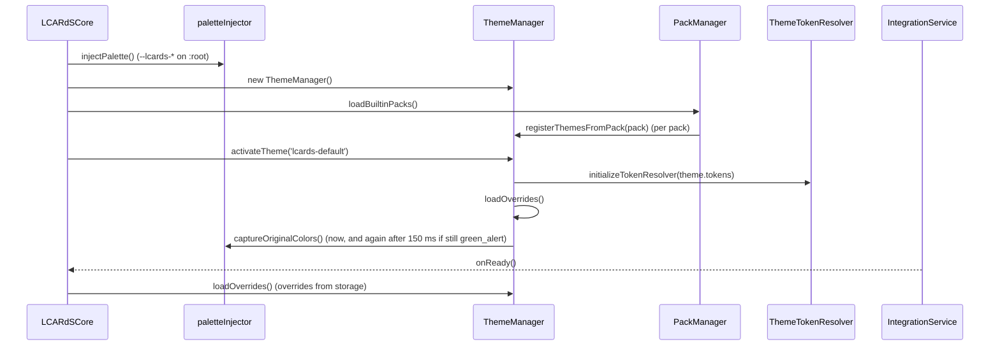
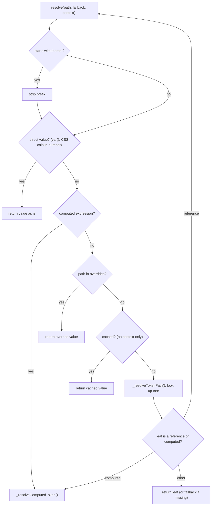
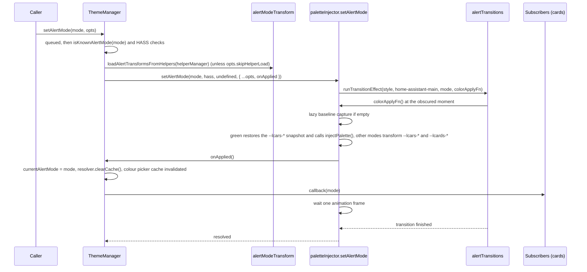

# Theme System

> **`window.lcards.core.themeManager`**: token-based theming, scoped token overrides and alert-mode palette transforms.

---

## Overview

`ThemeManager` (`src/core/themes/ThemeManager.js`) extends `BaseService`. It holds the registry of themes that packs register, owns the active theme's `ThemeTokenResolver`, applies scoped token overrides, and runs alert-mode changes. Alert modes rewrite CSS custom properties on `:root`, so any card colour that stays a `var()` follows without a re-render; cards that resolved colours to concrete values repaint from an alert-mode subscription.

Colour syntax and colour resolution are not part of this page: they live in `src/core/themes/color-syntax.js` (the one grammar) and `src/core/themes/resolve-color.js` (`resolveColor()`). See [Colour Resolution](../../development/colour-resolution.md).

---

## Key Modules

| Module | File | Role |
|---|---|---|
| `ThemeManager` | `src/core/themes/ThemeManager.js` | Theme registry, activation, token access, scoped overrides, alert mode queue and subscribers |
| `ThemeTokenResolver` | `src/core/themes/ThemeTokenResolver.js` | Resolves token paths (`colors.ui.primary`) through overrides, the token tree, references and computed functions; caches results |
| `paletteInjector` | `src/core/themes/paletteInjector.js` | Writes the `--lcards-*` fallback palette (`GREEN_ALERT_PALETTE`) at boot; captures the `--lcars-*` baseline; its `setAlertMode()` writes the transformed variables for a mode |
| `alertModeTransform` | `src/core/themes/alertModeTransform.js` | The HSL transform per alert mode (`DEFAULT_ALERT_MODE_TRANSFORMS`), runtime overrides, `isKnownAlertMode()`, and `loadAlertTransformsFromHelpers()` (Alert Lab helper values) |
| `alertTransitions` | `src/core/themes/alertTransitions.js` | Visual transition effects (`TRANSITION_STYLE_OPTIONS`: `off`, `blur_fade`, `fade_only`, `flash`, `color_bleed`, `flicker`, `static`, `wipe`) that hide the palette swap; `runTransitionEffect()` calls the colour write at the most obscured moment |
| `color-syntax.js`, `resolve-color.js`, `ColorUtils.js` | `src/core/themes/` | Colour grammar, `resolveColor()`, colour maths used by computed tokens: see [Colour Resolution](../../development/colour-resolution.md) |
| `themeGeneratorCore.js` | `src/core/themes/themeGeneratorCore.js` | Pure OKLCH/tone math shared by the Theme Generator UI and the `scripts/generate-lcards-*` scripts |
| `borgFontAssimilation.js` | `src/core/themes/borgFontAssimilation.js` | Overrides `--lcars-font` for the Borg effect (used by `BorgAssimilationManager`) |

---

## Startup

Theme work during `LCARdSCore._performInitialization()` (`src/core/lcards-core.js`):



- `ThemeManager.initialize(packs, requestedThemeId, rootElement)` exists (it loads themes from a pack list and activates one) but the core does not call it: packs register themes one at a time through `registerThemesFromPack()` (called from `PackManager`), then the core activates `lcards-default` itself.
- The first `loadOverrides()` inside `activateTheme()` runs before the integration is ready and usually finds nothing; the second, after `integrationService.onReady()`, loads the stored overrides and fires `lcards:theme-overrides-changed` only if they differ from what is applied.
- The second baseline capture is skipped when a non-green alert mode is already active, so transformed colours are never stored as the baseline (`activateTheme()` comment in ThemeManager.js).

---

## Built-in Themes

One theme ships, in the `builtin_themes` pack (`src/core/packs/builtin-themes.js`, `BUILTIN_THEMES_PACK`):

| ID | Name | Tokens |
|---|---|---|
| `lcards-default` | `LCARdS Default` | `lcardsDefaultTokens` (`src/core/packs/themes/tokens/lcardsDefaultTokens.js`); also the pack's `defaultTheme` |

The same pack carries `chartAnimationPresets` (ApexCharts animation profiles), which are not themes. `tm.listThemes()` is the authoritative list at runtime.

---

## Theme Tokens

**Token tree.** A theme is `{ id, name, description, tokens }`. The default token tree (`lcardsDefaultTokens`) has five top-level namespaces:

| Namespace | Contents (examples) |
|---|---|
| `typography` | `fontFamily.primary`, `fontSize.{sm,base,lg,xl,2xl,3xl}` (numbers), `fontWeight`, `textTransform` |
| `effects` | `opacity.{base,inactive,unavailable,disabled,overlay}` |
| `borders` | `width.{none,thin,base,thick}`, `radius.{none,sm,base,lg,xl,full}` (numbers) |
| `colors` | `text.*`, `ui.{primary,secondary,tertiary,quaternary}`, `card.*` (`button`, `buttonOn`, `buttonOff`, ...), `status.*`, `chart.*`, `alert.*`, `grid.*` |
| `components` | Per-component defaults: `button`, `elbow`, `slider`, `chart`, `line`, `alert`, `dpad`, `backgroundAnimation` |

There is no `palette` and no `spacing` namespace. `spacing.*` and `animations.*` are phantom namespaces: the resolver still treats them as token categories (`_isTokenReference()` and `componentPath()` in ThemeTokenResolver.js), but no theme defines them, so every lookup returns its fallback.

**Leaf values** are one of:

- a CSS value, usually a variable with a fallback chain: `'var(--lcars-ui-primary, var(--lcards-gray-medium))'` (HA-LCARS variable first, injected `--lcards-*` palette second);
- a number (`typography.fontSize.base: 14`);
- a reference to another token by bare path: `'colors.ui.primary'`;
- a computed expression: `'alpha(colors.card.buttonOff, 0.35)'`, `'darken(colors.card.button, 0.35)'`. The functions are `alpha`, `darken`, `lighten`, `saturate`, `desaturate`, `mix` and `base` (`COMPUTED_COLOR_FUNCTIONS` in color-syntax.js);
- an object with `small` / `medium` / `large` (or `base`) keys: a responsive token, picked by the width of `context.viewBox` (under 400: `small`, under 800: `medium`, else `large`; `_resolveResponsiveToken()`).

Inside the token tree, references are bare paths. In configuration, a value that refers to a token must use the `theme:` prefix.

**Resolution order** (`ThemeTokenResolver.resolve(path, fallback, context)`):



- A missing path returns the `fallback` argument. A circular reference logs a warning and returns the fallback (`resolutionStack`).
- Results are cached per `path:fallback` only when no `context` is passed. Computed results are cached only when the expression has no `var(` and no `base(`, and no `element` or `materialize` context (`_resolveComputedToken()`), because CSS variables change with alert modes and section themes.
- Computed functions keep CSS variables live by default (they emit `color-mix(... var(...) ...)`); `context.materialize` (set by `resolveColor(..., { concrete: true })`) reads the current concrete value. `saturate` and `desaturate` always read the concrete value: they have no `color-mix()` form.
- `base(x)` returns the pre-alert (green_alert) baseline of a token or variable: the captured `--lcars-*` snapshot or `GREEN_ALERT_PALETTE` for `--lcards-*`.

**Component scoping.** `resolver.forComponent(name)` and `ThemeManager.getComponentResolver(name)` return a resolver bound to one component. `componentPath(name, path)` keeps paths that start with a shared namespace (`colors.`, `typography.`, `borders.`, `effects.`, `spacing.`, `animations.`) or with `components.<name>.`, and prefixes anything else with `components.<name>.`.

---

## Token Usage

**In card configuration**, the `theme:` prefix is required and the token path is the whole value:

```yaml
type: custom:lcards-button
style:
  card:
    color:
      background:
        active: theme:colors.card.buttonOn
        inactive: theme:colors.card.buttonOff
```

- `CoreConfigManager._resolveThemeTokens()` walks the merged config after the layer merge and replaces each string that starts with `theme:` with its value, through `resolver.forComponent(cardType)` (`src/core/config-manager/index.js`). So in a button config `theme:colors.ui.primary` is a shared token, while a path outside the shared namespaces resolves under `components.button.`. Each replacement is recorded for provenance.
- Strings inside lists are not replaced at that stage (cards resolve them later, often with an element context); they are only recorded.
- Colour fields resolve through `resolveColor()` or the card helpers `_resolveColorValue()` / `_resolveEntityStateColor()`: see [Colour Resolution](../../development/colour-resolution.md).
- The theme layer of the merge reads `components.<cardType>.base` (`_getThemeDefaults()` via `getDefault(cardType, 'base')`). The default theme defines no `base` entry for any component, so with the built-in theme that layer is empty.

**In JavaScript**, go through the singleton, never a module-level import of the resolver (the module instance has no token tree before a theme is activated):

```javascript
import { lcardsLog } from '../utils/lcards-logging.js';

const tm = window.lcards?.core?.themeManager;

// Resolve a token path; the theme: prefix is optional here
const primary = tm?.getToken('theme:colors.ui.primary', 'var(--lcards-gray-medium)');

// Component default: components.slider.ring.track.color
const track = tm?.getDefault('slider', 'ring.track.color');

lcardsLog.debug('[MyFeature] Theme colours', { primary, track });
```

Inside an `LCARdSCard`, use `this.getThemeToken(path, fallback, usedByField)` (`src/base/LCARdSCard.js`), which calls `themeManager.getToken()` and records the use in the card's provenance tracker.

`getActiveTheme()` returns `{ id, name, description, packId, tokens, ...tokens }`: the token tree both under `.tokens` and spread on the top level (so `theme.colors.ui.primary` is the raw leaf, unresolved). Read values through `getToken()` instead, so overrides, references and computed functions apply. There is no `getCurrentTheme()`.

---

## Alert Mode Integration

This section is the developer reference for alert modes; the user page is [Alert Mode](../../core/alert-mode.md), and other pages link here rather than repeat it.

**Who calls it.** `ThemeManager.setAlertMode(mode, opts)` does the palette work. It is called by:

- `window.lcards.setAlertMode(mode, opts)` (`src/lcards-main.js`): validates the mode with `isKnownAlertMode()`, reads the transition style from the `alert_transition_style` helper (or `off` with `opts.skipTransition`), calls `themeManager.setAlertMode(mode, { transitionStyle })`, then writes the mode back to `input_select.lcards_alert_mode` when that helper exists (unless `opts.skipHelperSync`); without the helper, or with the sync skipped, it plays the alert sound and fires `lcards-alert-mode-local` itself.
- `LCARdSHelperManager._setupAlertModeAutoSwitch()` (`src/core/helpers/lcards-helper-manager.js`): subscribes to the `alert_mode` helper (`input_select.lcards_alert_mode`) and calls `window.lcards.setAlertMode(newMode)` on a change, unless the theme manager already shows that mode ([Alert-Mode Auto-Switch](helper-manager.md#alert-mode-auto-switch)). On startup, if `input_boolean.lcards_alert_mode_auto_switch` is on, it applies the helper's mode without a transition (timed retries at 100, 750 and 2500 ms, then on every HASS update until it settles).
- `BorgAssimilationManager` calls `tm.setAlertMode('borg_alert', ...)` directly; `borg_alert` is not an option of the helper.

**Serialized.** Each call chains onto `_alertModeQueue`, so back-to-back calls finish in the order issued even though the work is async. A call that throws does not break the queue; its own returned promise still rejects.

**One call** (`_applyAlertMode()`):



- `_applyAlertMode()` returns early, with a warning, for an unknown mode, and returns early, with an error, when `window.lcards.core._currentHass` is not set yet.
- `opts.skipHelperLoad` is set by the Alert Lab editor, which has already put live values in place and does not want them replaced by the saved helpers.
- Non-green modes always transform from the captured green baseline, never from the current colours, so switching between modes does not drift (`transformAndApplyAlertMode()`). Green restores the snapshot; it does not call `frontend/reload_themes`.
- Subscribers are called as soon as the variables are written, while the transition still hides the swap, not after the transition ends.

**Transforms.** Mode keys always carry the `_alert` suffix: `green_alert`, `red_alert`, `blue_alert`, `yellow_alert`, `gray_alert`, `black_alert`, `borg_alert` (the keys of `DEFAULT_ALERT_MODE_TRANSFORMS`, which `isKnownAlertMode()` checks). Each is an HSL spec, not a palette map:

```javascript
// DEFAULT_ALERT_MODE_TRANSFORMS.red_alert (src/core/themes/alertModeTransform.js)
{
  hueShift: 0,
  hueStrength: 0.8,
  saturationMultiplier: 1.4,
  lightnessMultiplier: 0.9,
  hueAnchor: { centerHue: 0, range: 60, strength: 0.9 }
}
```

`black_alert` adds `contrastEnhancement` (`threshold`, `darkMultiplier`, `lightMultiplier`). The values used are the helper value where the helper exists, else the built-in default: `loadAlertTransformsFromHelpers()` reads `input_number.lcards_alert_lab_<mode>_*` for red, yellow, blue, gray and black, skips a mode whose `..._hue` helper is missing, and skips each parameter whose value is not a number. Runtime changes go through `setAlertModeTransformParameter()` / `resetAlertModeTransform()`.

**Repainting cards.** Colours that stay `var()` in CSS follow the variable change by themselves. Colours a card resolved to concrete values (SVG attributes, Canvas2D, WebGL, anime.js, ApexCharts) need a repaint. Every `LCARdSCard` subscribes in `_subscribeThemeChanges()` (`themeManager.subscribeToAlertMode()`, re-made on reconnect; the same method listens for `lcards:theme-overrides-changed`) and calls `_onAlertModeChanged(mode)`:

| Card | `_onAlertModeChanged` |
|---|---|
| Default (`LCARdSCard`: select menu and others) | `_reprocessForThemeChange()` (config re-process), background animation colours refreshed |
| Button, elbow (`LCARdSElbow` extends `LCARdSButton`) | Re-render, background animation colours refreshed |
| Slider | Memoised track/gauge cleared, then as button |
| Chart | Chart options rebuilt |
| Data grid | Effects restarted (cascade colours), grid data kept |
| MSD | Line and shape colours re-resolved in place; background animation refreshed |
| Astrometrics | `_scene.recolor()` (WebGL colours re-resolved, camera kept); background animation refreshed |

Outside cards:

```javascript
const tm = window.lcards?.core?.themeManager;
const unsubscribe = tm?.subscribeToAlertMode((mode) => {
  this._alertMode = mode;
  this.requestUpdate();
});
// In disconnectedCallback():
unsubscribe?.();
```

User-facing behaviour (helpers, sounds, overlay) is in [Alert Mode](../../core/alert-mode.md).

---

## Scoped Theme Overrides

`ThemeManager` stores per-scope token overrides through `ScopedSettingsService` under the key `theme_overrides` (`STORAGE_KEY_THEME_OVERRIDES` in `src/core/services/ScopedSettingsConstants.js`). Each scope holds a flat map of token path to value.

```javascript
const tm = window.lcards?.core?.themeManager;

// Merge global, then user, then device (device wins) and apply (called at startup)
await tm.loadOverrides();

// Set one override in a scope: 'global' (admins only), 'user' or 'device'
const saved = await tm.setOverride('colors.ui.primary', 'var(--lcards-blue-medium)', 'device');

// Remove it again (clears the scope's key when it was the last override)
const cleared = await tm.clearOverride('colors.ui.primary', 'device');
```

- `loadOverrides()` calls `sss.readAllScopes('theme_overrides')`, merges, and only when the merged set differs from the one applied calls `resolver.setOverrides(merged, scopes)` (which clears the caches) and `_notifyOverridesChanged()`. That notifies `subscribeToOverridesChanged()` callbacks, invalidates the colour picker cache and dispatches a `lcards:theme-overrides-changed` window event, debounced 50 ms, on which cards re-process their config.
- The resolver checks overrides by exact path before the token tree, and again for every referenced path, so overriding `colors.card.buttonOff` also changes tokens that refer to it.
- `setOverride()` / `clearOverride()` return `false` when no `ScopedSettingsService` exists or the write fails or is refused (a non-admin writing `global`: `canWriteGlobalStorage()` in `src/core/services/storage-permissions.js`). Without the integration's `scoped_storage` capability, reads see only the global tier and writes to user/device are downgraded to global (`ScopedSettingsService.write()`).
- Overrides belong to the resolver, which `activateTheme()` replaces, so `activateTheme()` loads them again for the new theme.
- `getThemeDefault(path, fallback)` resolves with the overrides switched off, for the "theme default" column of the overrides editor (`lcards-theme-token-browser-tab.js`). It calls `resolver.resolveDefault()`, which resolves against fresh, throwaway caches and puts the live ones back afterwards, so a default lookup never changes what `getToken()` returns.

---

## Public API

| Method | Returns | Description |
|---|---|---|
| `initialize(packs, requestedThemeId?, rootElement?)` | `Promise<void>` | Load themes from a pack list and activate one (not used by the core, see [Startup](#startup)) |
| `registerThemesFromPack(pack)` | `void` | Register every entry of `pack.themes`, tagged with `packId`; called by `PackManager` |
| `activateTheme(themeId, rootElement?)` | `Promise<void>` | New resolver from the theme's tokens, reload overrides, capture the alert baseline; throws if the theme or its tokens are missing |
| `getActiveTheme()` | `Object\|null` | `{ id, name, description, packId, tokens, ...tokens }` |
| `listThemes()` / `getThemeIds()` | `string[]` | Registered theme IDs (`getThemeIds()` is an alias) |
| `getTheme(themeId)` | `Object\|null` | `{ id, name, description, packId, hasCssFile }` |
| `getThemeMetadata(id)` | `Object\|null` | `{ id, name, description, version, pack, type: 'theme', tokenCount, hasCssFile }` |
| `getThemesWithMetadata()` | `Object[]` | `getThemeMetadata()` for every theme |
| `getThemesByPack(packId)` | `Object[]` | Theme metadata filtered by pack |
| `getToken(path, fallback?, context?)` | `*` | `resolver.resolve()`; returns the fallback (with a warning) before a theme is active |
| `getDefault(componentType, property, fallback?, context?)` | `*` | Resolves `components.<componentType>.<property>` |
| `getComponentResolver(componentType)` | `Function` | `(property, fallback?, context?) => value` under `components.<componentType>.`; throws before a theme is active |
| `getResolver()` | `ThemeTokenResolver` | The active resolver; throws before a theme is active. The `resolver` property holds the same instance (or `null`) |
| `getThemeDefault(path, fallback?)` | `*` | Value without overrides (private caches; the live caches are untouched) |
| `clearCache()` | `void` | Clear the resolver caches |
| `trackTokenResolution(path, ref, value, chain?, cardTracker?, usedByFields?)` | `void` | Record a token resolution in a card's `ProvenanceTracker` |
| `getAlertMode()` | `string` | Current mode, `'green_alert'` initially |
| `setAlertMode(mode, opts?)` | `Promise<void>` | Queue an alert-mode change; `opts.transitionStyle`, `opts.skipHelperLoad` |
| `subscribeToAlertMode(cb)` | `Function` | `cb(mode)` after each applied change; returns the unsubscribe function |
| `loadOverrides()` | `Promise<void>` | Merge and apply scoped overrides |
| `setOverride(path, value, scope)` / `clearOverride(path, scope)` | `Promise<boolean>` | Write or remove one override; `false` when not saved |
| `subscribeToOverridesChanged(cb)` | `Function` | `cb()` after overrides change; returns the unsubscribe function |
| `getDebugInfo()` | `Object` | See the console snapshot below |
| `destroy()` | `void` | Clear themes, resolver and subscribers |

---

## Console Access

::: code-group
```javascript [Snapshot]
window.lcards.debug.singleton('themeManager')
// → {
//   initialized: true,
//   activeTheme: { id: 'lcards-default', name: 'LCARdS Default', description: 'Default LCARdS theme with HA-LCARS integration', packId: 'builtin_themes', tokens: {...}, /* ...tokens spread */ },
//   availableThemes: [
//     { id: 'lcards-default', name: 'LCARdS Default', description: '...', packId: 'builtin_themes', hasCssFile: false }
//   ],
//   resolverCacheSize: 87,
//   themeCount: 1
// }
```
```javascript [Live object]
const tm = window.lcards.core.themeManager

tm.getActiveTheme()                          // active theme ({ id, name, tokens, ...tokens })
tm.listThemes()                              // ['lcards-default']
tm.getToken('colors.ui.primary', '#fff')     // resolve a token path with a fallback
tm.getDefault('slider', 'ring.track.color')  // components.slider.ring.track.color
tm.resolver.explain('colors.ui.primary')     // step-by-step resolution (override, lookup, reference, css-var, ...)
tm.getAlertMode()                            // e.g. 'green_alert'
await window.lcards.setAlertMode('red_alert') // full path: theme, helper sync, sound
```
:::

---

## See Also

- [Colour Resolution](../../development/colour-resolution.md)
- [Alert Mode](../../core/alert-mode.md)
- [Pack System](pack-system.md)
- [Style Preset Manager](style-preset-manager.md)
