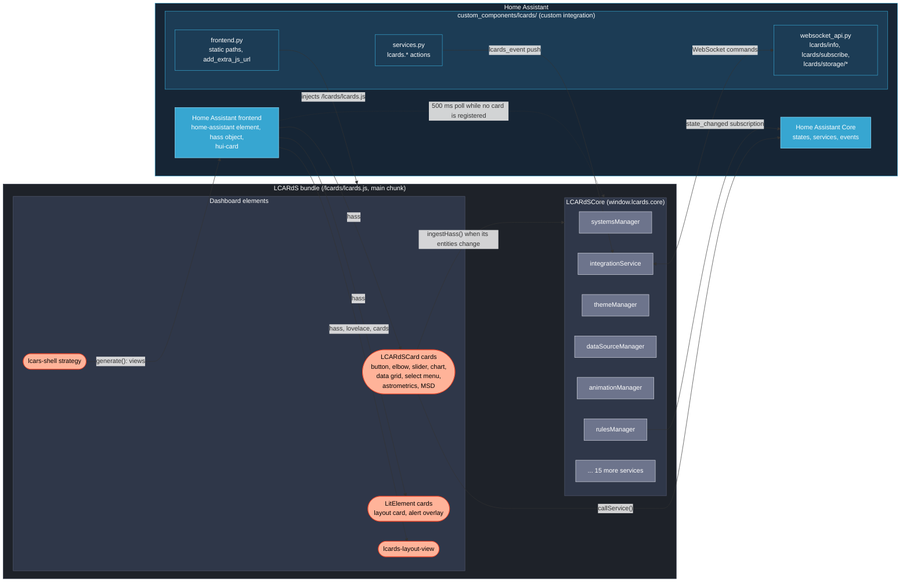
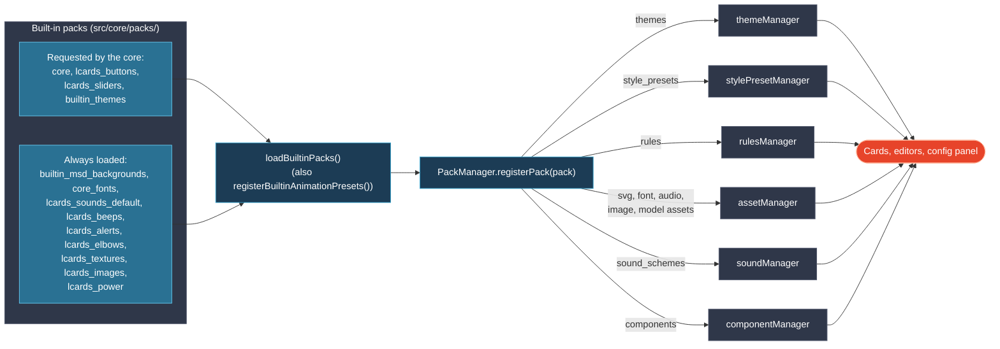

# Systems Architecture

> **How the pieces fit at runtime**: the Python integration, the one JavaScript bundle it loads into every Home Assistant page, the core singletons on `window.lcards.core`, and the cards, view and strategy on a dashboard.

---

## Runtime overview

- **Loading.** `frontend.py` serves the integration folder at `/lcards` and registers `/lcards/lcards.js` with `add_extra_js_url()`, so the bundle loads on every Home Assistant page without a Lovelace resource. `lcards.js` is a small loader stub that imports the hashed main chunk (`chunks/lcards-main-*.js`); editors, studios, the config panel, the grid edit overlay, ApexCharts and three.js are lazy chunks. See [Home Assistant Integration: Bundle and Loading](ha-integration.md#bundle-and-loading).
- **Core start.** `src/lcards-main.js` calls `lcardsCore.initialize(stubHass)` when the main chunk runs and defines the card elements only after it resolves; the view element and the strategy element are defined at module top level (Home Assistant's strategy resolver waits only a short time). The 30 initialization steps are listed in [Core Subsystems: Initialization Order](subsystems/index.md#initialization-order).
- **HASS.** Home Assistant sets `hass` on each card. An `LCARdSCard` forwards it to `window.lcards.core.ingestHass()` only on its first HASS or when one of its own entities changed; the core then pushes it to its services once per microtask. While no card is registered (or a portal overlay shows content) the core polls `document.querySelector('home-assistant').hass` every 500 ms instead. See [HASS distribution](subsystems/index.md#hass-distribution) and [Card Foundation: HASS flow](cards/lcards-card-foundation.md#hass-flow).
- **Rules** subscribe to Home Assistant `state_changed` events themselves (one subscription for the page), so rule entities update even when no card forwarded the change ([Rules Engine](subsystems/rules-engine.md)).
- **Backend channel.** `integrationService` probes `lcards/info` on the first HASS with a connection, then subscribes to the `lcards_event` push channel through `lcards/subscribe` (Home Assistant's own `subscribe_events` is admin-only for custom event types). The `lcards.*` actions (alert mode, reload, screen effects, sound, Borg, astrometrics) reach the browsers this way. See [Integration Service](subsystems/integration-service.md) and [Home Assistant Services: Implementation Notes](internals/ha-services.md).
- **Actions.** Each card has its own `LCARdSActionHandler` (there is no core action handler); service calls go through `LCARdSCard.callService()` ([Action Handler](subsystems/action-handler.md)).

---

## What runs where

| Element | Class (file under `src/`) | Base | Architecture page |
|---|---|---|---|
| `lcards-button`, `lcards-elbow`, `lcards-slider` | `LCARdSButton`, `LCARdSElbow`, `LCARdSSlider` (`cards/`) | `LCARdSCard` (elbow and slider extend the button) | [Card Foundation](cards/lcards-card-foundation.md) |
| `lcards-chart` | `LCARdSChart` (`cards/lcards-chart.js`, `charts/`) | `LCARdSCard` | [Charts](charts.md) |
| `lcards-data-grid` | `LCARdSDataGrid` (`cards/lcards-data-grid.js`, `data-grid/`) | `LCARdSCard` | [Card Foundation](cards/lcards-card-foundation.md) |
| `lcards-select-menu` | `LCARdSSelectMenu` (`cards/lcards-select-menu.js`) | `LCARdSCard` | [Card Foundation](cards/lcards-card-foundation.md) |
| `lcards-astrometrics-card` | `LCARdSAstrometricsCard` (`cards/lcards-astrometrics-card.js`, `core/astrometrics/`) | `LCARdSCard` | [Astrometrics](astrometrics.md) |
| `lcards-msd-card` | `LCARdSMSDCard` (`cards/lcards-msd.js`, `msd/`) | `LCARdSCard` | [MSD Pipeline](msd/) |
| `lcards-layout-card` | `LCARdSLayoutCard` (`cards/lcards-layout-card.js`) | `LitElement` | [Layout View and Layout Card](layout-view.md) |
| `lcards-alert-overlay` | `LCARdSAlertOverlay` (`cards/lcards-alert-overlay.js`) | `LitElement` | [Screen Effects](subsystems/screen-effects.md), [Portal Overlay Manager](subsystems/portal-overlay-manager.md) |
| `lcards-layout-view` (view type `custom:lcards-layout-view`) | `LCARdSLayoutView` (`views/lcards-layout-view.js`) | `LitElement` | [Layout View and Layout Card](layout-view.md) |
| `ll-strategy-dashboard-lcars-shell` (strategy `custom:lcars-shell`) | `LCARdSShellDashboardStrategy` (`strategies/lcards-shell-strategy.js`) | `HTMLElement` | [Shell Strategy](shell-strategy.md) |

All elements are registered in `src/lcards-main.js`, each behind a `customElements.get()` guard. The card picker entries are one guarded push of `LCARdSCardClasses` into `window.customCards`; the strategy is listed in `window.customStrategies` for Home Assistant's New Dashboard picker.

---

## Core services

`window.lcards.core` is the `LCARdSCore` instance (`src/core/lcards-core.js`). It creates these services once and exposes each as a property. Each one is documented in [Core Subsystems](subsystems/), which also has the full initialization table.

| Area | Services (`window.lcards.core.*`) |
|---|---|
| Entities and overlays | [`systemsManager`](subsystems/systems-manager.md) (entity cache, subscriptions, card and overlay registries) |
| Data | [`dataSourceManager`](subsystems/datasource-system.md) (named buffers with processors) |
| Rules | [`rulesManager`](subsystems/rules-engine.md) (one engine for every rule on the page) |
| Theming | [`themeManager`](subsystems/theme-system.md) (tokens, alert modes), [`stylePresetManager`](subsystems/style-preset-manager.md), [`componentManager`](subsystems/component-manager.md) |
| Animation | [`animationManager`](subsystems/animation-manager.md), [`performanceMonitor`](subsystems/index.md#performance-monitor) (FPS watch for canvas backgrounds) |
| Config | [`validationService`](subsystems/validation-service.md), [`configManager`](subsystems/config-manager.md) (merge pipeline with provenance) |
| Assets and packs | [`assetManager`](subsystems/asset-manager.md), [`packManager`](subsystems/pack-system.md) |
| Helpers and sound | [`helperManager`](subsystems/helper-manager.md) (LCARdS `input_*` helpers, alert-mode auto-switch), [`soundManager`](subsystems/sound-system.md) |
| Screen | [`screenEffectManager`](subsystems/screen-effects.md), [`borgAssimilationManager`](subsystems/borg-assimilation.md), [`portalOverlayManager`](subsystems/portal-overlay-manager.md), [`connectionOverlayService`](subsystems/connection-overlay.md) |
| Backend | [`integrationService`](subsystems/integration-service.md), [`deviceIdentityManager`](subsystems/device-identity.md), [`scopedSettingsService`](subsystems/scoped-settings.md) |

The template evaluator is not a singleton: `UnifiedTemplateEvaluator` is created per use ([Template System](subsystems/template-system.md)). There is no `actionHandler` and no `animationRegistry` on the core: action handlers are per card, and the animation presets are a module registry (`src/core/animation/presets.js`).

---

## Packs

Packs are plain JavaScript objects bundled with LCARdS that fill the registries at startup. There is no external or user pack loader.

- `PackManager.loadBuiltinPacks()` (`src/core/PackManager.js`) is called once, from `LCARdSCore._performInitialization()`, with `CORE_REQUESTED_PACK_IDS`; `loadBuiltinPacks()` (`src/core/packs/loadBuiltinPacks.js`) adds the always-loaded packs, so 14 packs are registered.
- Animation presets do not come from packs: `registerBuiltinAnimationPresets()` fills the preset registry in `src/core/animation/presets.js`.
- The `rules` key is supported, but no built-in pack ships rules today.

What each pack holds and how to add one: [Pack System](subsystems/pack-system.md).

---

## Further reading

- [Architecture overview](./) (every page in this section)
- [Home Assistant Integration](ha-integration.md)
- [Card Foundation](cards/lcards-card-foundation.md)
- [Core Subsystems](subsystems/)
- [Template System](subsystems/template-system.md)
- [Background Animation System](internals/background-animation-system.md)
- [Shape Texture System](internals/shape-texture-system.md)
