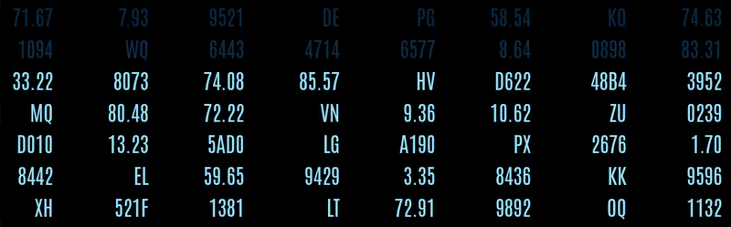

# Data Grid Card

`custom:lcards-data-grid`



**A grid of cells in the LCARS style: columns of generated numbers that fill a panel with texture, or a table of your own text, entity states and templates.**

- **Decorative:** columns of generated digits, decimals, letters or hex codes, often with the classic LCARS colour cascade rolling down the rows. No entities needed.
- **Data:** a table you write row by row, where each cell is text, a live entity state, a template or a data source value.

::: tip Try it
- In the card editor, **Open Configuration Studio** gives you a live preview, a spreadsheet of your cells, and row, column and cell styling.
- The [Playground](./playground) lets you edit data grid YAML here in the docs and see the result.
:::

The grids on these pages are live previews drawn with the card's own code. Entities show sample values.

| Page | Covers |
|------|--------|
| [Data and Cells](./data) | Decorative values, rows, what a cell can be, data sources, header rows, conditional colours, tap actions |
| [Styling and Animation](./styling) | Style layers and keys, header style, grid layout, the cascade, highlighting changes, filters |
| [Playground](./playground) | Edit YAML and see the grid live |
| [Upgrading](./upgrading) | Older data grid configs and what they become |

---

## Quick start

**Two grids to start from: the decorative grid the card picker adds, and a small status table.**

- The first is six rows of mixed values with the colour cascade, as the card picker adds it.
- In the status table the first row is a header, the middle column shows each entity's state and the last column is a template.

```yaml live
type: custom:lcards-data-grid
data_mode: decorative
format: mixed
grid:
  grid-template-rows: repeat(6, auto)
  grid-template-columns: repeat(6, minmax(60px, 1fr))
  gap: 0px
style:
  padding: 0px
  font_size: 22px
animations:
  - trigger: on_load
    preset: cascade-color
```

```yaml live
type: custom:lcards-data-grid
data_mode: data
rows:
  - values: [System, Value, Status]
    header: true
  - [Inside, sensor.living_room_temperature, "{{ 'WARM' if states('sensor.living_room_temperature') | float > 22 else 'OK' }}"]
  - [Outside, sensor.outdoor_temperature, "{{ 'WARM' if states('sensor.outdoor_temperature') | float > 22 else 'OK' }}"]
  - [Humidity, sensor.living_room_humidity, "{{ states('sensor.living_room_humidity') | int }}%"]
grid:
  grid-template-columns: 140px 1fr 90px
  gap: 4px
style:
  font_size: 18px
columns:
  - style:
      align: left
      color: var(--lcars-orange)
```

## Which mode should I use?

**`data_mode` picks the mode: `decorative` for generated values, `data` for your own rows.** When it is left out, a card with `rows` is a data grid and anything else is decorative.

| | Decorative | Data |
|---|---|---|
| **Shows** | Generated values: digits, decimals, letters or hex | Your rows: text, entity states, templates, data source values |
| **Set up with** | `format`, the grid size in `grid` | `rows` |
| **Changes when** | Every `refresh_interval` ms (optional) | An entity, template or data source changes |
| **Good for** | Filling space with LCARS texture, backgrounds behind other cards | Status panels, sensor tables, system readouts |

## Card options

**The data grid's own top-level keys.** Each has its section on a topic page; this table links to it.

- The grid also takes the keys every LCARdS card takes (`height`, `width`, `grid_options`, `overflow`, `z_index`, `id`, `tags` ...): see [Common card properties](../common).
- In a sections view the grid asks for the full width and 4 rows unless `grid_options` says otherwise, and never fewer than 4 columns and 2 rows.

```yaml live
type: custom:lcards-data-grid
data_mode: decorative
format: hex
refresh_interval: 2000 # new values every 2 seconds
refresh_cells: 0.2 # a fifth of the cells each time
grid:
  grid-template-rows: repeat(4, auto)
  grid-template-columns: repeat(8, 1fr)
  gap: 0px
style:
  font_size: 20px
  color: var(--lcars-orange)
highlight_changes: true
```

::: details More about the card options
- **Masonry views:** the card reports its height from a pixel `height`, or else from the number of rows: each row 1.5 times the grid's `font_size` (`24px` by default) plus the row gap (`8px` by default), in units of 50 px.
- **Rules:** the [rules engine](../../core/rules/) finds the grid by `id` and `tags`. A rule's `style` patch applies to the grid-wide `style`.
- **Older keys:** a config with keys from earlier versions still works; see [Upgrading](./upgrading).
:::

| Key | Type | Default | Description |
|-----|------|---------|-------------|
| `data_mode` | string | `data` with `rows`, else `decorative` | `decorative` or `data`: see [Which mode should I use?](#which-mode-should-i-use) |
| `format` | string | `mixed` | Decorative mode: the kind of value generated. See [Decorative mode](./data#decorative-mode) |
| `refresh_interval` | number | `0` | Decorative mode: new values every this many ms. `0` keeps them fixed |
| `refresh_cells` | number | `1` | Decorative mode: the share of cells that change on each refresh, `0` to `1` |
| `rows` | list | - | Data mode: the rows of cells. See [rows](./data#rows) |
| `cell_tap_action` | action | - | What tapping an entity cell does: see [Tap actions](./data#tap-actions) |
| `data_sources` | object | - | Named data sources for `{datasource:...}` cells: see [Data sources](./data#data-sources) |
| `triggers_update` | list | - | Extra entity ids whose changes re-run the templates, for JavaScript templates: see [Manual tracking](../../core/templates/#manual-tracking-with-triggers-update) |
| `grid` | object | equal columns, `8px` gap | CSS Grid layout: see [Grid layout](./styling#grid-layout) |
| `style` | object | theme defaults | Style for every cell: see [Style keys](./styling#style-keys) |
| `header_style` | object | header defaults | Style for header rows: see [Header rows](./styling#header-rows) |
| `columns` | list | - | Per column, by position: `style`, and `format` in decorative mode. See [Style layers](./styling#style-layers) |
| `animations` | list | - | Card animations, including the `cascade-color` preset: see [The cascade](./styling#the-cascade) |
| `highlight_changes` | boolean / object | off | Animate cells whose value just changed: see [Highlighting changes](./styling#highlighting-changes) |
| `filters` | list | - | CSS filters on the whole grid: see [Filters](./styling#filters) |
