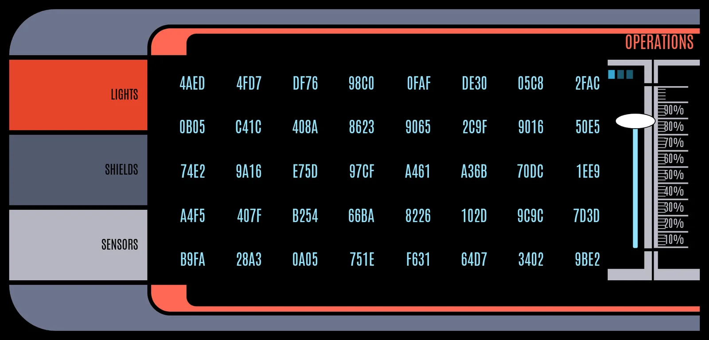
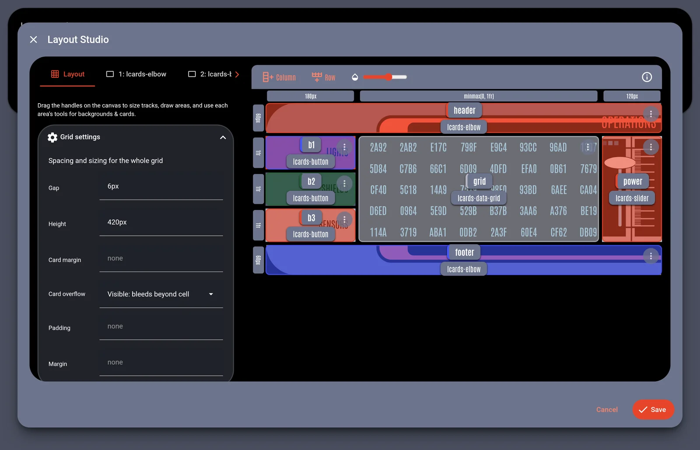

# Layout Card

`custom:lcards-layout-card`



A grid of cards inside one card. Use it to build a sub-grid in one area of a [Layout View](../layout-view/), or a whole LCARS panel on any dashboard. It uses the same `layout`, `view_layout` and `areas` options as the Layout View.

- **CSS Grid with named areas:** place each card by area name.
- **Layout Studio:** a full-screen visual editor to size tracks, draw areas and place cards.
- **Nestable:** put layout cards inside layout cards for deeper sub-grids.
- **Visibility:** child cards keep Home Assistant's own Visibility conditions, and `conditional` cards work too (see [Showing cards only sometimes](#showing-cards-only-sometimes)).

## Quick start

A standalone panel needs a height, so its `fr` rows have something to divide:

```yaml
type: custom:lcards-layout-card
layout:
  height: 320px
  grid-gap: 6px
  grid-template-columns: 180px minmax(0, 1fr)
  grid-template-rows: 1fr 1fr 1fr
  grid-template-areas: |
    "b1 main"
    "b2 main"
    "b3 main"
cards:
  - type: custom:lcards-button
    preset: lozenge
    view_layout: { grid-area: b1 }
  - type: custom:lcards-button
    preset: lozenge
    view_layout: { grid-area: b2 }
  - type: custom:lcards-button
    preset: lozenge
    view_layout: { grid-area: b3 }
  - type: custom:lcards-data-grid
    data_mode: decorative
    view_layout: { grid-area: main }
```

## Inside a layout view

Most often the layout card fills one area of a [Layout View](../layout-view/) to hold several cards. There it defaults to `height: 100%` and fills the area:

```yaml
# A layout view whose "controls" area holds a 2×2 sub-grid of buttons
type: custom:lcards-layout-view
layout:
  grid-template-areas: |
    "header"
    "controls"
cards:
  - type: custom:lcards-elbow
    view_layout: { grid-area: header }
  - type: custom:lcards-layout-card        # sub-grid in the "controls" area
    view_layout: { grid-area: controls }
    layout:
      grid-template-columns: "1fr 1fr"
      grid-template-rows: "1fr 1fr"
      grid-gap: "6px"
    cards:
      - type: custom:lcards-button
      - type: custom:lcards-button
      - type: custom:lcards-button
      - type: custom:lcards-button
```

## Showing cards only sometimes

**A child card's Visibility conditions and Home Assistant's `conditional` card work inside a layout card as they do on a view: each child is wrapped in Home Assistant's own card wrapper, which decides whether it shows.**

- A hidden card's row or column collapses and the `fr` rows and columns take the space, as in a [Layout View](../layout-view/#collapsing-rows-and-columns): a row (column) collapses when every card that sits in it alone is hidden, and a card without a condition keeps its row and column open.
- In an `auto` row a card takes its own natural height, which can be taller than a layout card with a fixed `height`, so it spills out of the card. Use `minmax(0, max-content)` to size the row to the card but never past the layout card, or `1fr` to share the height.

The example is plain YAML: Home Assistant decides visibility, and the docs have no dashboard to do it.

```yaml
# A row of two buttons; the second shows only while the helper is on, and its
# column collapses while it is hidden. minmax(0, max-content) keeps the row
# inside the 120 px card.
type: custom:lcards-layout-card
layout:
  height: 120px
  grid-template-columns: 1fr 1fr
  grid-template-rows: minmax(0, max-content)
  grid-template-areas: |
    "main extra"
cards:
  - type: custom:lcards-button
    preset: lozenge
    view_layout:
      grid-area: main
  - type: conditional
    conditions:
      - condition: state
        entity: input_boolean.show_extra
        state: "on"
    card:
      type: custom:lcards-button
      preset: lozenge
    view_layout:
      grid-area: extra
```

## Options

The layout card takes the same options as the Layout View:

- [Layout properties](../layout-view/#layout-properties): `grid-template-*`, `grid-gap`, `height`, `padding`, `card_margin`, `mediaquery` and more.
- [Placing cards](../layout-view/#placing-cards-view-layout): each child card's `view_layout` (`grid-area`, alignment, margin, overflow).
- [Per-area settings](../layout-view/#per-area-settings): backgrounds and borders for an area itself.

| Option | Default | Notes |
|--------|---------|-------|
| `layout.height` | `100%` | Fills the area it's placed in. Set a fixed height (e.g. `320px`, `40vh`) when it stands alone, e.g. in a masonry view. |
| `cards` | - | The child cards. Each places itself with `view_layout`. |

## Editing

The layout card is edited in its card editor. **Open Layout Studio** launches a full-screen workspace:



- a large **canvas** with a grid overlay: size tracks, draw, rename and delete areas, and style area backgrounds and borders;
- a **Layout** tab for global settings (gap, height, card margin, padding);
- a **tab per card** with an inline card editor and placement controls (area, align, margin, overflow), plus **Add card** and **Remove**.

> **Card picker:** the first time you use **Add card** in a session, Home Assistant may not have loaded its card picker yet. If you see a "Card picker not ready" message, click **Add card** once on any dashboard view (you can cancel it) to load it, then come back. This is a Home Assistant limitation shared by other cards' editors.

On a [Layout View](../layout-view/) the same grid is edited right on the dashboard; that page shows it in motion.

## Coming from custom:layout-card

The LCARdS Layout Card replaces [`custom:layout-card`](https://github.com/thomasloven/lovelace-layout-card) for LCARdS dashboards. Inside `custom:layout-card`, LCARdS cards shrink to their minimum height and `card_margin` is ignored; the layout card has neither problem.

To move a card over, change its `type` to `custom:lcards-layout-card` and remove `layout_type`. The `layout` keys and each card's `view_layout` stay the same.

## Notes

- **One card per area:** nest another layout card (or a stack card) to group several.
- **`grid-gap` is grid-wide:** CSS grid has no per-cell gap.
