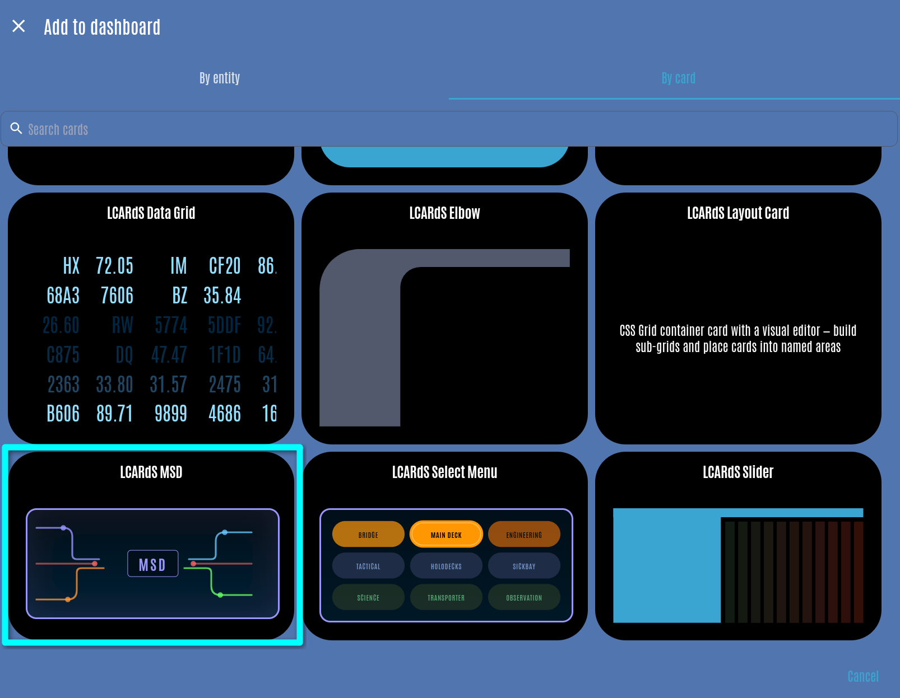
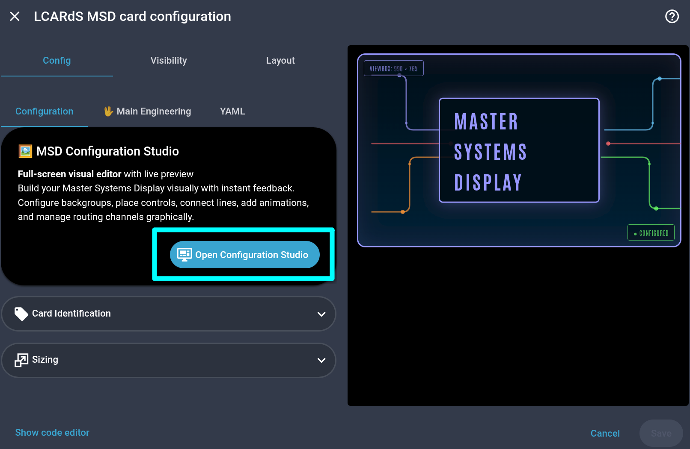
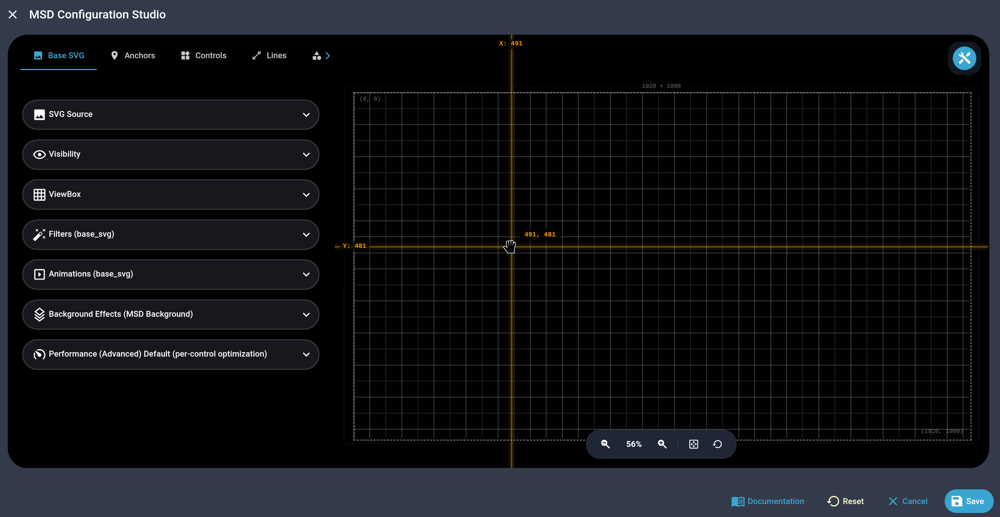
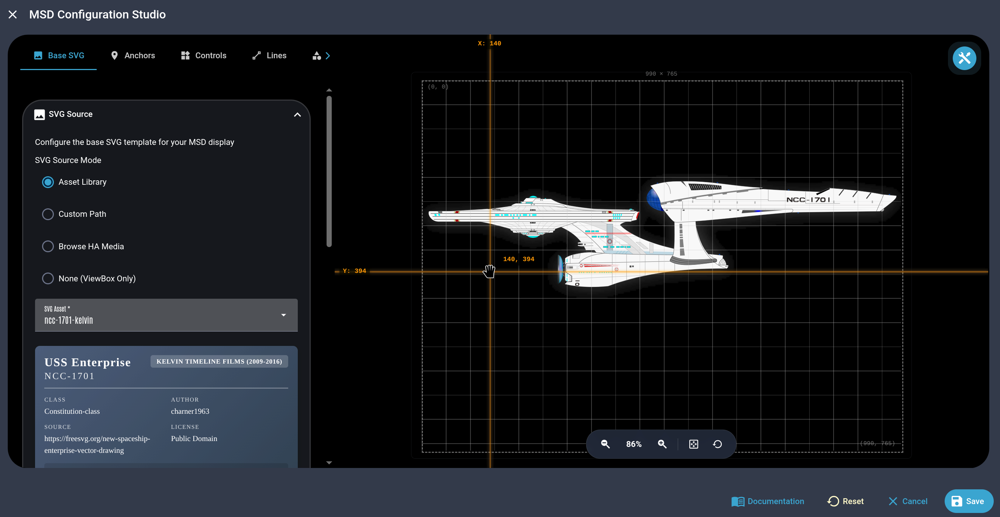
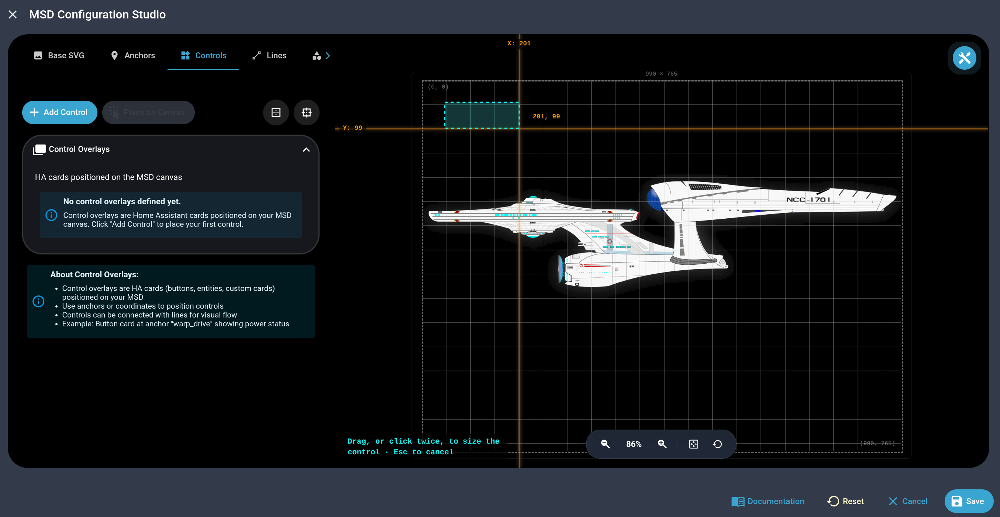
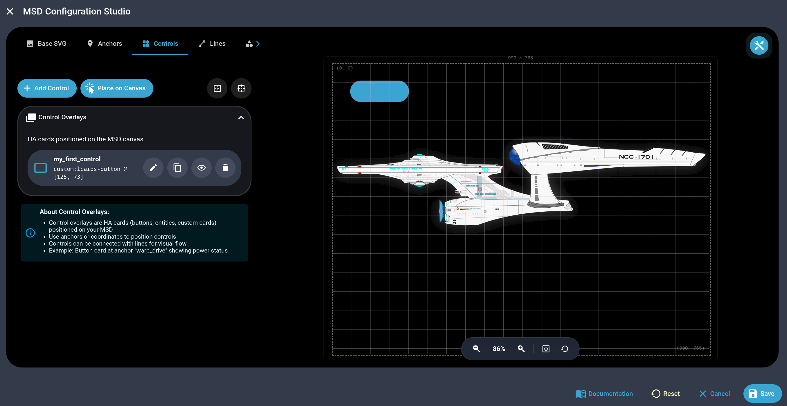
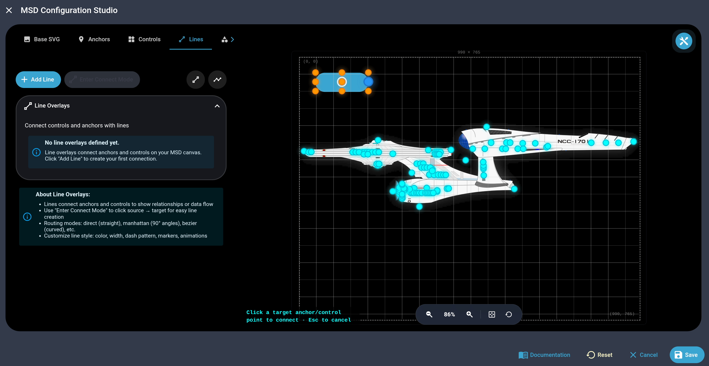
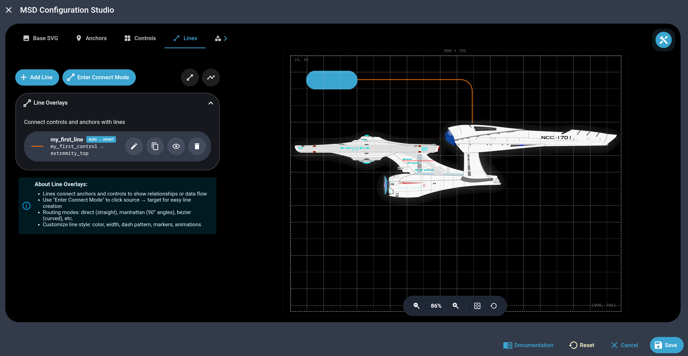
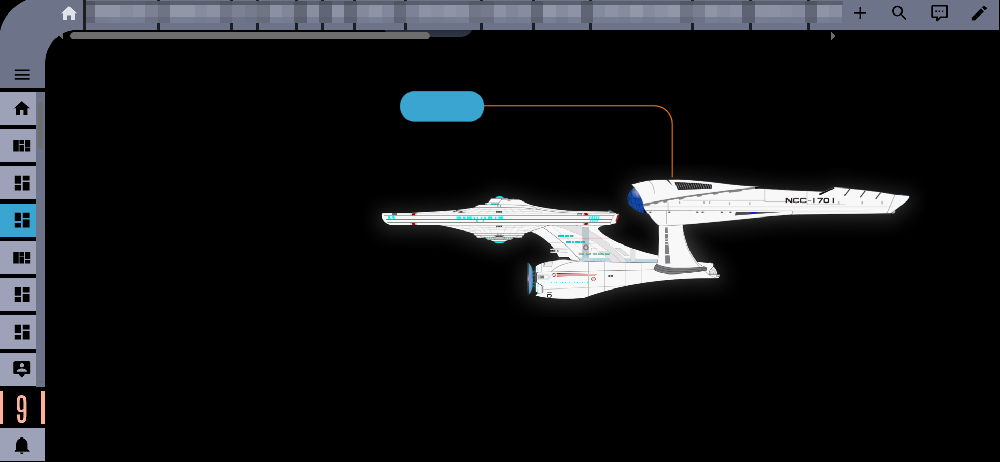

# Getting Started

**Build a first Master Systems Display in the MSD Studio, the card's full-screen editor, without writing any YAML.** The MSD is more a small canvas editor than a single card, so this page shows which buttons and panels to use, in order.

- The other pages cover every option and the YAML underneath: [Background and Anchors](./background), [Control Overlay](./control-overlay), [Line Overlay](./line-overlay), [Shape Overlay](./shape-overlay) and [Line Routing](./routing).
- [Putting it together](#putting-it-together) at the end is a complete display to copy.

## What you're building

**An MSD is four layers on top of each other, all arranged in the MSD Studio.**

| Layer | What it is |
|-------|------------|
| **Base SVG** | The drawing underneath: a starship blueprint, a deck plan, a floor plan, or nothing at all (an empty view box) |
| **Controls** | Any Home Assistant or LCARdS card (a button, a slider, a sensor), placed on the drawing |
| **Lines** | Connections between controls and points on the drawing, routed automatically like circuit traces |
| **Shapes** | Rooms, zones and conduits drawn on top |

## Step 1: Add the card

**In a dashboard in edit mode, click Add Card and search for LCARdS MSD.**



**On the card editor's Configuration tab, click Open Configuration Studio.**



**The MSD Studio opens full screen: the canvas on one side, the settings on the other, and tabs across the top.** The tabs are Base SVG, Anchors, Controls, Lines, Shapes, Routing and YAML; a first display needs only the first four.



## Step 2: Choose a background

**On the Base SVG tab, pick where the drawing comes from.** For a first display, pick a ship from the Asset library.

- **Asset library:** the ship blueprints built into LCARdS, the easiest start.
- **Browse Home Assistant media:** an SVG you uploaded to the Home Assistant media library.
- **Custom path:** a `/local/...` path to your own SVG.
- **None (ViewBox Only):** a blank canvas with no drawing.

::: tip Free anchors
Built-in ships, and most SVGs, come with anchor points worked out from the drawing's own outline (`hull_center`, `extremity_top` and others), so your first lines can attach to the ship before you place a single anchor yourself: see [Automatic anchors](./background#automatic-anchors).
:::



## Step 3: Place your first control

**On the Controls tab, click Place on Canvas and draw a box for the control on the canvas.** When you let go, the Add Control form opens. You can also click **Add Control** and type the position and size into the form.



**In the form, give the control an ID, pick its card on the Card tab, and save.**

- The card is any Home Assistant or LCARdS card (a button, a slider, a sensor tile), set up exactly as anywhere else on a dashboard.
- The control then appears on the canvas, on top of the background.



## Step 4: Connect the control to the ship with a line

**On the Lines tab, draw a line from your control to a point on the ship.** There are two ways.

- **Add Line** opens a form where you pick the start (**Anchor**) and the end (**Attach To**) from every control and anchor on the canvas, and which side of each the line leaves and arrives at.
- The **Connect Line** tool in the toolbar above the canvas: click a connection point of your control (an orange dot), then another control's connection point or an anchor (a blue dot).



**The Add Line form opens: give the line an ID or keep the one it suggests, leave the rest as it is, and click Save.** The line finds the best route by itself and appears on the canvas.



## Step 5: Save

**Click Save in the Studio's footer, then save the card and the dashboard as usual.** That is a complete display: a background, a live control, and a line from the control to the ship.

- Shapes and Routing are optional. Shapes add rooms, zones and conduits when you want the drawing to feel like a real schematic; Routing holds card-wide settings worth changing only once you notice something you want different ([Line Routing](./routing) explains how lines find their way).



## Where to go next

| Page | Covers |
|------|--------|
| [Background and Anchors](./background) | Blueprints, the view box, your own anchors and the ones found in the drawing |
| [Control Overlay](./control-overlay) | Every way to place and size a control |
| [Line Overlay](./line-overlay) | Sides, gaps, colours that follow an entity, markers |
| [Line Routing](./routing) | How lines find their way, bundle together and avoid crossing, and how to guide them |
| [Shape Overlay](./shape-overlay) | Rooms, zones and freeform shapes |
| [Animations and Rules](./animations) | Animations and rules on the display |
| [MSD Card](./) | Every card option, once you write the YAML yourself |

## Putting it together

**A complete display to copy: a dimmed blueprint, three controls joined to its markers, a room drawn as a shape, and a rule that turns the warp core line red.** Tap the controls, or change the entities under the card.

- The blueprint's filters fade it so the controls stand out ([Base SVG Filters](./base-svg-filters)); `br`, `wc` and `sb` are markers in the blueprint itself ([Automatic anchors](./background#automatic-anchors)).
- The rule recolours the line and blinks it while the toggle helper is on ([Rules](./animations#rules)).

```yaml live controls
type: custom:lcards-msd-card
grid_options:
  columns: full
  rows: 6
msd:
  # the blueprint, dimmed, and the part of it to show
  base_svg:
    source: builtin:ncc-1701-a-blue
    filters:
      - mode: css
        type: opacity
        value: 0.5
      - mode: css
        type: brightness
        value: 0.8
  view_box: [180, 270, 1600, 720]
  overlays:
    # three controls, each joined to a marker on the ship
    - id: bridge-ctl
      type: control
      attachment: top-left
      position: [190, 278]
      size: [340, 96]
      card:
        type: custom:lcards-button
        preset: lozenge
        entity: input_boolean.lcards_test_lights
        text:
          name:
            content: BRIDGE
            show: true
            font_size: 30
    - id: core-ctl
      type: control
      attachment: top-left
      position: [190, 886]
      size: [340, 96]
      card:
        type: custom:lcards-button
        preset: lozenge
        entity: input_boolean.lcards_test_toggle
        text:
          name:
            content: WARP CORE
            show: true
            font_size: 30
    - id: shuttle-ctl
      type: control
      attachment: top-left
      position: [1430, 886]
      size: [340, 96]
      card:
        type: custom:lcards-button
        preset: filled
        entity: input_boolean.lcards_test_doors
        text:
          name:
            content: SHUTTLE BAY
            show: true
            font_size: 30
    - id: bridge-line
      type: line
      anchor: bridge-ctl
      attach_to: br
      route: auto
      corner_style: round
      style:
        color: var(--lcards-gray-medium-light)
        width: 3
    - id: core-line
      type: line
      anchor: core-ctl
      attach_to: wc
      route: auto
      corner_style: round
      style:
        color: var(--lcards-gray-medium-light)
        width: 3
    - id: shuttle-line
      type: line
      anchor: shuttle-ctl
      attach_to: sb
      route: auto
      corner_style: round
      style:
        color: var(--lcards-gray-medium-light)
        width: 3
    # a room drawn over the top right corner
    - id: ops-room
      type: shape
      kind: rect
      position: [1430, 290]
      size: [340, 160]
      corner_style: round
      corner_radius: 20
      style:
        color: var(--lcars-orange)
        width: 3
        fill: alpha(var(--lcars-orange), 0.12)
rules:
  - id: msd-warp-core-alert
    when:
      entity: input_boolean.lcards_test_toggle
      state: "on"
    apply:
      overlays:
        core-line:
          style:
            color: var(--lcars-alert-red)
      animations:
        - overlay: core-line
          preset: blink
          loop: true
```
