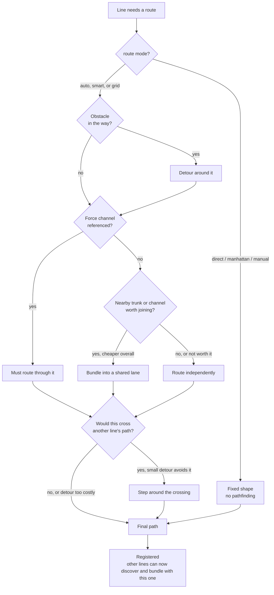
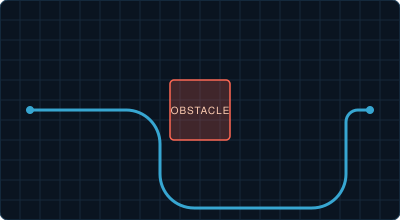
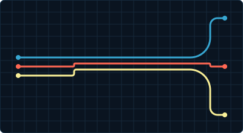
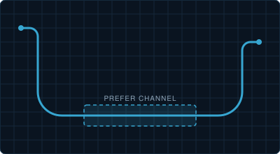
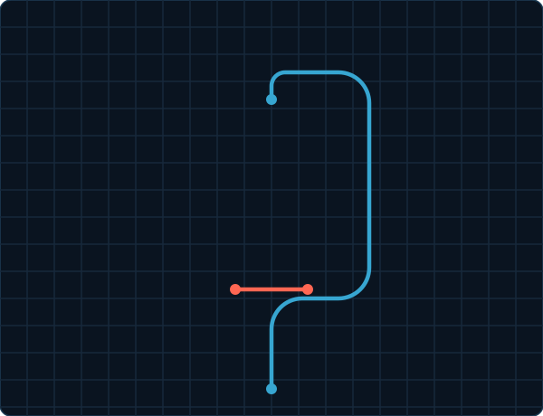

# Line Routing

**MSD lines route themselves like cables in a raceway: they find their way round obstacles, bundle with lines going the same way, and avoid cutting across each other when a small detour is cheap.** This page explains how the router decides a path, then lists every routing setting.

- The settings on each line (`route`, `route_hint`, sides, `waypoints`) are on [Line Overlay](./line-overlay#routing-modes). This page covers the router and the card-wide `routing` and `channels` settings.
- The order you list lines in never changes the result: the router routes every line until the arrangement settles, before anything is drawn.

## How a Line Finds Its Path

**For every line, every time the card draws, the router works through the same steps.**



- Bundling and crossing avoidance are cost comparisons, never hard rules: a line joins a bundle or takes a detour only when that is cheaper than the alternative.
- `direct`, `manhattan` and `manual` lines keep their shape, but they are still registered: other lines avoid crossing them and can bundle beside them. That makes a `direct` line a good fixed backbone or wall.

## Obstacles

**An obstacle is a control or shape that routed lines go round instead of through.** Set `obstacle: true` on it; no setting is needed on the lines.

- Lines routed `auto` (the default), `smart` or `grid` avoid obstacles. `clearance` keeps them a set distance from the box: card-wide in [`routing`](#routing), or on one line.
- A `rect` or `circle` shape can be an obstacle as well as a control; see [Control Overlay](./control-overlay#obstacle).



```yaml live
type: custom:lcards-msd-card
msd:
  view_box: [0, 0, 600, 240]
  routing:
    clearance: 10
  overlays:
    - id: reactor
      type: control
      position: [300, 120]
      size: [120, 100]
      obstacle: true
      card:
        type: custom:lcards-button
        preset: panel-dark
        interactive: false
        text:
          label:
            content: REACTOR
    - id: sensors
      type: control
      position: [70, 120]
      size: [100, 34]
      card:
        type: custom:lcards-button
        preset: lozenge
        interactive: false
        text:
          name:
            content: SENSORS
            show: true
    - id: core
      type: control
      position: [530, 120]
      size: [100, 34]
      card:
        type: custom:lcards-button
        preset: lozenge
        interactive: false
        text:
          name:
            content: CORE
            show: true
    - id: coolant_line
      type: line
      anchor: sensors
      attach_to: core
      style:
        color: var(--lcars-blue)
        width: 4
```

| Key | Type | Default | Description |
|---|---|---|---|
| `obstacle` | boolean | `false` | On a control or a `rect`/`circle` shape: routed lines go round its box |
| `clearance` | number | `routing.clearance` (`0`) | On a line: space kept round obstacles, viewBox units |

## Bundling

**Lines that run close and side by side merge into one corridor, on evenly spaced lanes, and branch apart where their ends differ.** It happens on its own: no channel, no setting, just lines going the same way.

- The first line's path becomes the trunk's centre line and stays put. Lines that join take lanes either side of it, `trunk_line_spacing` apart.
- A line joins only when that is cheaper than going its own way. Which side of the centre a line rides follows where it comes from, never its id, and stays the same along a chain of trunks.
- Only `auto`, `smart` and `grid` lines join a bundle; `direct`, `manhattan` and `manual` lines can still have others bundle beside them.



```yaml live
type: custom:lcards-msd-card
msd:
  view_box: [0, 0, 600, 300]
  routing:
    trunk_line_spacing: 12
    clearance: 8
  overlays:
    # two bulkheads with a gap between them
    - id: bulkhead_top
      type: control
      position: [300, 55]
      size: [100, 110]
      obstacle: true
      card:
        type: custom:lcards-button
        preset: panel-dark
        interactive: false
        text:
          label:
            content: DECK 4
    - id: bulkhead_bottom
      type: control
      position: [300, 245]
      size: [100, 110]
      obstacle: true
      card:
        type: custom:lcards-button
        preset: panel-dark
        interactive: false
        text:
          label:
            content: DECK 6
    - id: a
      type: control
      position: [70, 40]
      size: [100, 34]
      card:
        type: custom:lcards-button
        preset: lozenge
        interactive: false
        text:
          name:
            content: A
            show: true
    - id: b
      type: control
      position: [70, 150]
      size: [100, 34]
      card:
        type: custom:lcards-button
        preset: lozenge
        interactive: false
        text:
          name:
            content: B
            show: true
    - id: c
      type: control
      position: [70, 260]
      size: [100, 34]
      card:
        type: custom:lcards-button
        preset: lozenge
        interactive: false
        text:
          name:
            content: C
            show: true
    - id: d
      type: control
      position: [530, 40]
      size: [100, 34]
      card:
        type: custom:lcards-button
        preset: lozenge
        interactive: false
        text:
          name:
            content: D
            show: true
    - id: e
      type: control
      position: [530, 150]
      size: [100, 34]
      card:
        type: custom:lcards-button
        preset: lozenge
        interactive: false
        text:
          name:
            content: E
            show: true
    - id: f
      type: control
      position: [530, 260]
      size: [100, 34]
      card:
        type: custom:lcards-button
        preset: lozenge
        interactive: false
        text:
          name:
            content: F
            show: true
    - id: a_d
      type: line
      anchor: a
      attach_to: d
      style:
        color: var(--lcars-blue)
        width: 3
    - id: b_e
      type: line
      anchor: b
      attach_to: e
      style:
        color: var(--lcars-blue)
        width: 3
    - id: c_f
      type: line
      anchor: c
      attach_to: f
      style:
        color: var(--lcars-blue)
        width: 3
```

| Key | Type | Default | Description |
|---|---|---|---|
| `routing.trunk_bundling_enabled` | boolean | `true` | Lines bundle on their own. `false` turns it off for the card |
| `routing.trunk_line_spacing` | number | `8` | Gap between lanes, viewBox units. It also limits how round the small bends are where lines step onto their lanes; see [Corner Size](#corner-size-target-vs-forced) |
| `routing.trunk_proximity` | number | `32` | How close a line must run to a trunk to join it, viewBox units |
| `routing.trunk_bundle_weight` | number | `0.5` | How strongly joining is rewarded: higher pulls lines in from further away |
| [Advanced bundling settings](#advanced-routing-settings) | | | `trunk_min_length`, `trunk_min_overlap`, `trunk_max_join_candidates`, `trunk_bundle_discount_cap`, `trunk_discovery_max_passes` |

## channels

**A channel is a corridor you draw: lines are rewarded for running through it, kept out of it, or made to use it.** Where bundling only happens between lines already close together, a channel can pull a line off the path it would take.

- `channels` sits directly under `msd:`, not under `msd.routing:`.
- A line opts in with `route_channels: [main_bus]`. A `force` channel must be used, in the order the line lists them; `prefer` is taken when it is cheaper overall; `avoid` costs extra to enter.
- A channel is also a ready-made trunk: lines bundle through it on lanes, as in [Bundling](#bundling). Any `auto`, `smart` or `grid` line passing near it may join, even one that doesn't list it; `discoverable: false` keeps it to the lines that do.



```yaml live
type: custom:lcards-msd-card
msd:
  view_box: [0, 0, 600, 300]
  channels:
    main_bus:
      bounds: [200, 130, 200, 40]
      mode: force
      direction: horizontal
      line_spacing: 16
  overlays:
    # the channel drawn as a shape, so you can see it
    - id: bus
      type: shape
      kind: rect
      position: [200, 130]
      size: [200, 40]
      style:
        color: var(--lcars-orange)
        width: 1
        fill: var(--lcars-orange)
        fill_opacity: 0.2
    - id: a
      type: control
      position: [70, 50]
      size: [100, 34]
      card:
        type: custom:lcards-button
        preset: lozenge
        interactive: false
        text:
          name:
            content: A
            show: true
    - id: b
      type: control
      position: [70, 250]
      size: [100, 34]
      card:
        type: custom:lcards-button
        preset: lozenge
        interactive: false
        text:
          name:
            content: B
            show: true
    - id: c
      type: control
      position: [530, 50]
      size: [100, 34]
      card:
        type: custom:lcards-button
        preset: lozenge
        interactive: false
        text:
          name:
            content: C
            show: true
    - id: d
      type: control
      position: [530, 250]
      size: [100, 34]
      card:
        type: custom:lcards-button
        preset: lozenge
        interactive: false
        text:
          name:
            content: D
            show: true
    - id: a_c
      type: line
      anchor: a
      attach_to: c
      route_channels: [main_bus]
      style:
        color: var(--lcars-blue)
        width: 3
    - id: b_d
      type: line
      anchor: b
      attach_to: d
      route_channels: [main_bus]
      style:
        color: var(--lcars-blue)
        width: 3
```

::: details More about channels
- **Lanes:** lines through one channel get their own lanes, centred: one line rides the middle, two ride `line_spacing / 2` either side, three ride `-line_spacing`, `0` and `+line_spacing`, and so on. Lanes stay inside `bounds`, so make the channel at least `line_spacing` times the number of lines across.
- **Invisible:** a channel guides lines but draws nothing. Draw a shape on the same box (as above) if you want to see it; the Studio's Channels toggle shows them while you edit.
- **Older name:** `type` (`bundling`, `avoiding`, `waypoint`) is the old name for `mode` (`prefer`, `avoid`, `force`).
:::

| Key | Type | Default | Description |
|---|---|---|---|
| `channels.<id>.bounds` | `[x, y, width, height]` | required | The channel's box, viewBox units |
| `channels.<id>.mode` | string | `prefer` | `prefer`, `avoid` or `force` |
| `channels.<id>.direction` | string | `auto` | `horizontal`, `vertical`, or `auto`: wide boxes run horizontal, tall ones vertical |
| `channels.<id>.weight` | number | `0.5` | How strongly it pulls (`prefer`) or pushes (`avoid`), `0` to `1` |
| `channels.<id>.line_spacing` | number | `8` | Gap between lanes inside it, viewBox units, `0` to `100` |
| `channels.<id>.discoverable` | boolean | `true` | `false`: only lines that list it in `route_channels` use it |
| `route_channels` | list | - | On a line: the channel ids it routes through, in order |

## Crossing Avoidance

**A line is steered away from cutting across another line, unless the detour would be long.** It is a deterrent, not a wall: when stepping round is cheap the router steps round; otherwise the line crosses cleanly.

- Running side by side is never penalised: lines in a bundle don't push each other apart, and a line crossing the inner lanes of a bundle to reach its own outer lane does so freely, as in a real raceway.
- Raise `crossing_avoid_bias` to accept longer detours rather than cross.



```yaml live
type: custom:lcards-msd-card
msd:
  view_box: [0, 0, 600, 260]
  routing:
    crossing_avoid_bias: 8
  overlays:
    - id: port
      type: control
      position: [70, 130]
      size: [100, 34]
      card:
        type: custom:lcards-button
        preset: lozenge
        interactive: false
        text:
          name:
            content: PORT
            show: true
    - id: aft
      type: control
      position: [330, 130]
      size: [100, 34]
      card:
        type: custom:lcards-button
        preset: lozenge
        interactive: false
        text:
          name:
            content: AFT
            show: true
    - id: helm
      type: control
      position: [200, 30]
      size: [100, 34]
      card:
        type: custom:lcards-button
        preset: lozenge
        interactive: false
        text:
          name:
            content: HELM
            show: true
    - id: sickbay
      type: control
      position: [530, 230]
      size: [100, 34]
      card:
        type: custom:lcards-button
        preset: lozenge
        interactive: false
        text:
          name:
            content: SICKBAY
            show: true
    # a fixed power bus: the blue line goes round its end rather than across it
    - id: power_bus
      type: line
      anchor: port
      attach_to: aft
      route: direct
      style:
        color: var(--lcars-orange)
        width: 4
    - id: helm_line
      type: line
      anchor: helm
      attach_to: sickbay
      style:
        color: var(--lcars-blue)
        width: 3
```

| Key | Type | Default | Description |
|---|---|---|---|
| `routing.crossing_avoid_enabled` | boolean | `true` | Lines avoid crossing each other. `false` turns it off for the card |
| `routing.crossing_avoid_bias` | number | `4` | The cost of a crossing: higher accepts longer detours to avoid one |
| `routing.crossing_min_length` | number | `12` | The shortest straight run other lines still avoid crossing, viewBox units |

## Routing Modes

**Each line's `route` picks whether the router finds its path or draws a fixed shape.** Leave it out for `auto`.

- `auto` always means full pathfinding, with or without obstacles or channels on the card. `routing.default_mode` changes what `auto` means for the whole card; a line's own `route` still wins.
- For a line that should not bundle or avoid crossings, choose `manhattan` (fixed shape) or `grid` (pathfinding without the refinement pass) on purpose.

```yaml live
type: custom:lcards-msd-card
msd:
  view_box: [0, 0, 600, 380]
  overlays:
    - id: direct_from
      type: control
      position: [70, 40]
      size: [100, 34]
      card:
        type: custom:lcards-button
        preset: lozenge
        interactive: false
        text:
          name:
            content: DIRECT
            show: true
    - id: direct_to
      type: control
      position: [530, 80]
      size: [100, 34]
      card:
        type: custom:lcards-button
        preset: lozenge
        interactive: false
        text:
          name:
            content: END
            show: true
    - id: direct_line
      type: line
      anchor: direct_from
      attach_to: direct_to
      route: direct
      style:
        color: var(--lcars-blue)
        width: 3
    - id: manhattan_from
      type: control
      position: [70, 130]
      size: [100, 34]
      card:
        type: custom:lcards-button
        preset: lozenge
        interactive: false
        text:
          name:
            content: MANHATTAN
            show: true
    - id: manhattan_to
      type: control
      position: [530, 170]
      size: [100, 34]
      card:
        type: custom:lcards-button
        preset: lozenge
        interactive: false
        text:
          name:
            content: END
            show: true
    - id: manhattan_line
      type: line
      anchor: manhattan_from
      attach_to: manhattan_to
      route: manhattan
      style:
        color: var(--lcars-blue)
        width: 3
    - id: auto_from
      type: control
      position: [70, 220]
      size: [100, 34]
      card:
        type: custom:lcards-button
        preset: lozenge
        interactive: false
        text:
          name:
            content: AUTO
            show: true
    - id: auto_to
      type: control
      position: [530, 260]
      size: [100, 34]
      card:
        type: custom:lcards-button
        preset: lozenge
        interactive: false
        text:
          name:
            content: END
            show: true
    - id: auto_line
      type: line
      anchor: auto_from
      attach_to: auto_to
      route: auto
      style:
        color: var(--lcars-blue)
        width: 3
    - id: manual_from
      type: control
      position: [70, 310]
      size: [100, 34]
      card:
        type: custom:lcards-button
        preset: lozenge
        interactive: false
        text:
          name:
            content: MANUAL
            show: true
    - id: manual_to
      type: control
      position: [530, 350]
      size: [100, 34]
      card:
        type: custom:lcards-button
        preset: lozenge
        interactive: false
        text:
          name:
            content: END
            show: true
    - id: manual_line
      type: line
      anchor: manual_from
      attach_to: manual_to
      route: manual
      waypoints:
        - [250, 310]
        - [350, 330]
      style:
        color: var(--lcars-blue)
        width: 3
```

| Mode | What it does |
|---|---|
| `auto` | The default: full pathfinding with obstacle avoidance, bundling and crossing avoidance. Resolves to `smart`, or to `routing.default_mode` |
| `direct` | A straight line. Never pathfinds or detours |
| `manhattan` | One bend (more only to leave and arrive on the sides set). No pathfinding, no bundling, no crossing avoidance |
| `smart` | Pathfinding plus a refinement pass that nudges bends for clearance and corner room |
| `grid` | Like `smart` (pathfinding, bundling, crossing avoidance) without the refinement pass |
| `manual` | Straight runs through `waypoints`; see [Manual Routing](./manual-routing) |

| Key | Type | Default | Description |
|---|---|---|---|
| `route` | string | `auto` | On a line: the mode, from the table above |
| `routing.default_mode` | string | `auto` | What `auto` means on this card: `auto` or `smart` (the same), `grid` or `manhattan`. A line's own `route` wins |

## Corner Size: Target vs. Forced

**A rounded corner needs room: a straight run either side of the bend.** `corner_radius_mode`, on each line, says where that room comes from.

- `auto` (the default): `corner_radius` is a target. The router picks the path it prefers for crossings and bundling, and each corner gets the full radius where the path leaves room, a smaller one where it doesn't.
- `forced`: `corner_radius` is a requirement. The line keeps a straight run of twice the radius at each end before routing, so the full radius always fits, but the router can't steer that stretch round crossings. It can cause detours or crossings near tight geometry; use it only where one line's corners must be exact.
- Lines with a large `corner_radius` and sides set that cross where they needn't are the `forced` trade-off in action: `auto` is the fix.

```yaml live
type: custom:lcards-msd-card
msd:
  view_box: [0, 0, 600, 300]
  overlays:
    - id: auto_from
      type: control
      position: [60, 50]
      size: [100, 34]
      card:
        type: custom:lcards-button
        preset: lozenge
        interactive: false
        text:
          name:
            content: AUTO
            show: true
    - id: auto_to
      type: control
      position: [240, 250]
      size: [100, 34]
      card:
        type: custom:lcards-button
        preset: lozenge
        interactive: false
        text:
          name:
            content: END
            show: true
    - id: forced_from
      type: control
      position: [360, 50]
      size: [100, 34]
      card:
        type: custom:lcards-button
        preset: lozenge
        interactive: false
        text:
          name:
            content: FORCED
            show: true
    - id: forced_to
      type: control
      position: [540, 250]
      size: [100, 34]
      card:
        type: custom:lcards-button
        preset: lozenge
        interactive: false
        text:
          name:
            content: END
            show: true
    # auto: the corners shrink to fit
    - id: target_line
      type: line
      anchor: auto_from
      attach_to: auto_to
      anchor_side: right
      attach_side: left
      corner_radius: 60
      style:
        color: var(--lcars-blue)
        width: 4
    # forced: the full radius, with the room it needs
    - id: forced_line
      type: line
      anchor: forced_from
      attach_to: forced_to
      anchor_side: right
      attach_side: left
      corner_radius: 60
      corner_radius_mode: forced
      style:
        color: var(--lcars-orange)
        width: 4
```

::: details More about corner size
- **Stroke width counts:** a corner's radius is limited by how close the nearest edge of a neighbouring line is, not its centre line, so a thick line gets a smaller radius next to others than a thin one. To get the wider corner back, increase the lane spacing (`trunk_line_spacing` or a channel's `line_spacing`) rather than thinning the line.
- **The straight run at each end:** every routed line keeps a short straight run at each end before it turns. Unset, it is one grid cell (`grid_resolution` times `min_stub_length_factor`, and never less than one cell in `auto` mode), or twice `corner_radius` in `forced` mode. A line's `stub_length` overrides it; going below about one grid cell can make very short lines misbehave, so check what the router chose first with the [debugger](#debugging).
- **Bundled lines turn sooner:** where lines step onto their lanes before a channel or trunk, that small S-bend is limited by the lane spacing, not by `corner_radius`, so the router keeps only as much lead-in as it can use (never more than twice `corner_radius`). A large `corner_radius` for the big bends elsewhere doesn't push every lane change further out.
- **Lane changes keep the full radius:** when bundle members start far apart and converge on tight lanes, each one's lane change is drawn as a real S-curve of two arcs with the full `corner_radius`; a member with less distance to cover sweeps less of the same curve. Members start bending at about the same point, unless one would cut through a neighbour's approach, in which case it starts only as far out as it must.
- **Recovering squeezed corners:** `corner_room_weight` (on by default, `4`) lets the refinement pass of `smart` and `auto` lines move a bend a little to give a squeezed corner its full radius, when the extra distance is small. Unlike `forced`, it is a real cost comparison and never forces a long detour. Set `0` card-wide or on one line to turn it off.
:::

| Key | Type | Default | Description |
|---|---|---|---|
| `corner_radius_mode` | string | `auto` | On a line: `auto` (the radius is a target) or `forced` (room for it is reserved) |
| `stub_length` | number | the router's | On a line: the straight run at each end, viewBox units |
| `corner_room_weight` | number | `4` | On a line or in `routing`: how hard the refinement pass works to give a squeezed corner its full radius. `0` turns it off |
| `routing.min_stub_length_factor` | number | `1` | Multiplier on `grid_resolution` for the shortest straight run at each end |

## routing

**`msd.routing` holds the card-wide routing settings; a line's own setting wins where both exist.** Most cards need none of them.

- The settings people change most are in [Bundling](#bundling), [Crossing Avoidance](#crossing-avoidance) and [Corner Size](#corner-size-target-vs-forced). The table below has the rest, and [Advanced Routing Settings](#advanced-routing-settings) the deep internals.
- In MSD Studio the same settings are on the Routing tab: Common Routing Options, Trace Bundling & Crossings, and Advanced Routing Configuration.

```yaml live
type: custom:lcards-msd-card
msd:
  view_box: [0, 0, 600, 240]
  routing:
    turn_penalty: 6
    clearance: 12
  overlays:
    - id: cargo
      type: control
      position: [300, 120]
      size: [120, 100]
      obstacle: true
      card:
        type: custom:lcards-button
        preset: panel-dark
        interactive: false
        text:
          label:
            content: CARGO
    - id: bridge
      type: control
      position: [70, 40]
      size: [100, 34]
      card:
        type: custom:lcards-button
        preset: lozenge
        interactive: false
        text:
          name:
            content: BRIDGE
            show: true
    - id: engineering
      type: control
      position: [530, 200]
      size: [100, 34]
      card:
        type: custom:lcards-button
        preset: lozenge
        interactive: false
        text:
          name:
            content: ENGINEERING
            show: true
    - id: route_line
      type: line
      anchor: bridge
      attach_to: engineering
      style:
        color: var(--lcars-blue)
        width: 4
```

| Key | Type | Default | Description |
|---|---|---|---|
| `routing.default_mode` | string | `auto` | What `auto` means on this card; see [Routing Modes](#routing-modes) |
| `routing.clearance` | number | `0` | Space kept round obstacles, viewBox units |
| `routing.grid_resolution` | number | scaled to the card | The pathfinding grid's cell size, viewBox units. Unset, it is the shorter side of `view_box` divided by 12, kept between `16` and `64`. Values below 5 become `32` |
| `routing.turn_penalty` | number | `2` | The cost of each change of direction: higher gives straighter paths |
| `routing.corner_room_weight` | number | `4` | See [Corner Size](#corner-size-target-vs-forced) |
| `routing.min_stub_length_factor` | number | `1` | See [Corner Size](#corner-size-target-vs-forced) |
| [Bundling](#bundling), [crossing](#crossing-avoidance) settings | | | `trunk_*` and `crossing_*` |

### Advanced Routing Settings

**Deep internals of the router, rarely needed.** They are under Advanced Routing Configuration on the Studio's Routing tab.

```yaml live
type: custom:lcards-msd-card
msd:
  view_box: [0, 0, 600, 240]
  routing:
    smoothing_mode: chaikin
    smoothing_iterations: 3
    clearance: 12
  overlays:
    - id: cargo
      type: control
      position: [300, 120]
      size: [120, 100]
      obstacle: true
      card:
        type: custom:lcards-button
        preset: panel-dark
        interactive: false
        text:
          label:
            content: CARGO
    - id: bridge
      type: control
      position: [70, 40]
      size: [100, 34]
      card:
        type: custom:lcards-button
        preset: lozenge
        interactive: false
        text:
          name:
            content: BRIDGE
            show: true
    - id: engineering
      type: control
      position: [530, 200]
      size: [100, 34]
      card:
        type: custom:lcards-button
        preset: lozenge
        interactive: false
        text:
          name:
            content: ENGINEERING
            show: true
    - id: smooth_line
      type: line
      anchor: bridge
      attach_to: engineering
      style:
        color: var(--lcars-blue)
        width: 4
```

| Key | Type | Default | Description |
|---|---|---|---|
| `routing.route_hint_penalty` | number | `6` | The cost of a first or last step that goes against `route_hint` |
| `routing.smoothing_mode` | string | `none` | `chaikin` softens every line into curves (a line's own setting wins) |
| `routing.smoothing_iterations` | number | `0` | Smoothing passes, `1` to `5`; `chaikin` does nothing without at least `1` |
| `routing.smoothing_max_points` | number | `160` | Most points a smoothed path keeps |
| `routing.smart_proximity` | number | `0` | How close to an obstacle a bend must be for the refinement pass to move it, viewBox units. `0` turns this off (`corner_room_weight` still runs) |
| `routing.smart_detour_span` | number | `48` | Refinement pass: how far a bend may move, viewBox units |
| `routing.smart_max_extra_bends` | number | `3` | Refinement pass: most bends it may add |
| `routing.smart_min_improvement` | number | `4` | Refinement pass: how much better a change must be to keep it |
| `routing.smart_max_detours_per_elbow` | number | `4` | Refinement pass: tries per bend |
| `routing.channel_force_penalty` | number | `800` | The cost of a route that misses a `force` channel |
| `routing.channel_avoid_multiplier` | number | `1` | Multiplier on every `avoid` channel's cost |
| `routing.channel_prefer_bias` | number | `0.9` | Per-cell discount inside a `prefer` channel, scaled by its `weight` |
| `routing.channel_avoid_bias` | number | `3` | Per-cell cost inside an `avoid` channel, scaled by its `weight` |
| `routing.trunk_min_length` | number | `60` | Shortest straight run that becomes a trunk others can join, viewBox units |
| `routing.trunk_min_overlap` | number | `60` | Shortest shared stretch that makes joining worthwhile, viewBox units |
| `routing.trunk_max_join_candidates` | number | `2` | Most trunks one line considers chaining through |
| `routing.trunk_bundle_discount_cap` | number | `150` | The most distance credited when a line rides a trunk another line made, viewBox units, so a long ride can't pay for extra bends elsewhere. Never applies to your own channels |
| `routing.trunk_discovery_max_passes` | number | `4` | Most routing passes before drawing (a safety limit for the order-independence) |
| `routing.cost_defaults.bend` | number | `10` | Route cost of each bend |
| `routing.cost_defaults.proximity` | number | `4` | Route cost of running close to an obstacle |

## Debugging

**The browser console and MSD Studio both show what the router decided.**

- In MSD Studio's canvas toolbar, **Routing Grid** (amber) draws the router's own pathfinding grid, which differs from the drag-snap grid, and **Discovered Trunks** (cyan) draws every bundle in effect with its member count. Both are off by default.
- For the internals (how bundling, lanes and the pre-render passes work) see [Routing Engine Architecture](../../architecture/msd/routing).

```js
// the line's routed points, straight from the route cache (read-only);
// .meta.debug shows what the router resolved for it:
// { stubLength, gridResolution, cornerRadiusMode, cornerRadius }
window.lcards.debug.msd.routing.inspect('line_id')

// router state: cache size, obstacle count, trunk and crossing registry counts
window.lcards.debug.msd.routing.stats()

// every trunk on this card: id, direction, creator, member lines and bounds,
// the data the Studio's Discovered Trunks overlay draws
window.lcards.debug.msd.routing.trunks('card_id')
```

## Known Limitations

**Two rough edges are known and left as they are on purpose: each fix that was tried made other, correct layouts worse.**

- **Joining a trunk is all or nothing.** A line within `trunk_proximity` of a trunk can join it; one just outside can't. Right at that distance, a move of one unit can switch bundling on or off. Widening the distance to soften this changed bundling in layouts that were already right, so it was undone. If a line snaps in and out of a bundle, change `trunk_proximity` itself.
- **A line through several trunks that alternate horizontal and vertical** can now and then pick an order that isn't the shortest, which shows as a small backtrack where two trunks meet. It needs several such trunks in a row, which ordinary diagrams rarely have; so far it has only shown up in stress tests with many lines.
