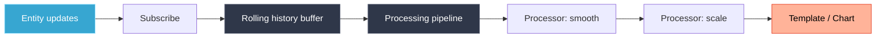

# Data Sources

Data Sources give cards access to entity history, real-time updates, and processed values, beyond the plain current state that HA cards normally see.

---

## What They Do

A data source subscribes to an entity, optionally preloads history, and runs values through a processing pipeline. Results are available in templates as `{ds:name}` or as chart series.



---

## Basic Usage

Define `data_sources` on any card. Each key is a name you choose:

```yaml
data_sources:
  temp:
    entity: sensor.temperature
    history:
      hours: 6
```

Use in a text template:

```yaml
text:
  value:
    content: "{ds:temp}"         # HA-native: locale-formatted + unit → "4,7 °C"
    # content: "{ds:temp:.1f} °C"  # explicit precision + unit suffix
```

Use as a chart series:

```yaml
type: custom:lcards-chart
data_sources:
  temp:
    entity: sensor.temperature
sources:
  - datasource: temp
chart_type: area
```

---

## Configuration Options

```yaml
data_sources:
  my_source:
    entity: sensor.power_usage      # Required - entity to track
    attribute: current              # Optional - track attribute instead of state
    window_seconds: 120             # Rolling buffer window size in seconds (default: 60)
    min_emit_ms: 500                # Min ms between updates emitted downstream (default: 100)
    history:
      hours: 24                     # Preload history (1–168 hours)
    processing:
      # Named processors - each stores results in its own buffer
      kilowatts:
        type: scale
        input_range: [0, 1000]
        output_range: [0, 1]
      smoothed:
        type: smooth
        input_source: kilowatts     # Chain from previous processor
        method: exponential
        alpha: 0.3
      rounded:
        type: round
        input_source: smoothed
        precision: 2
```

### Top-Level Fields

| Field | Type | Description |
|-------|------|-------------|
| `entity` | string | Entity ID to subscribe to |
| `attribute` | string | Attribute to track instead of state |
| `enum_mapping` | object | Numbers for non-numeric states, e.g. `{ heat: 2, cool: 1, off: 0 }` (`on`/`off` already map to 1/0) |
| `window_seconds` | number / string | Sets the buffer size: about 10 points per second of window, at most 1,000 points (default: 60, so 600 points). Also takes a duration such as `"5m"` |
| `min_emit_ms` | number | Min ms between downstream updates (throttle, default: 100) |
| `coalesce_ms` | number | Window in ms for merging rapid changes into one update (default: 40% of `min_emit_ms`, at least 20) |
| `max_delay_ms` | number | Longest ms an update may be held back while merging (default: 3 x `coalesce_ms`) |
| `emit_on_same_value` | boolean | Send updates even when the value didn't change (default: `true`) |
| `history.enabled` | boolean | Preload history when the dashboard loads (default: `true`) |
| `history.hours` | number | Hours of history to preload (1–168, default 6): every recorded change, or Home Assistant's hourly statistics when none are recorded |
| `history.days` | number | Days of history to preload (1–7), instead of `hours` |
| `processing` | object | Named processing pipeline steps |

Older configs may use camelCase (`windowSeconds`, `minEmitMs`, `coalesceMs`, `maxDelayMs`, `emitOnSameValue`). Those still work; the editor marks them as old names. If both spellings are set, the snake_case one wins.

---

## Processors

Each processor transforms data and stores results under its name. Processors can be chained with `input_source`.

| Processor | Purpose | Key params |
|-----------|---------|------------|
| `convert_unit` | Convert between unit types | `from`, `to` (e.g. `c`/`f`) |
| `scale` | Map from one range to another | `input_range`, `output_range`, `curve` |
| `smooth` | Smooth noisy values | `method` (`exponential`, `moving_average`, `gaussian`), `alpha`, `window` |
| `round` | Round to decimal places | `precision`, `method` |
| `expression` | Custom JS expression | `expression` (uses `value`, `sources`, `Math`), `sources` |
| `clamp` | Clamp to min/max | `min`, `max` |
| `rate` | Rate of change per unit time | `unit` (`per_second`, `per_minute`, `per_hour`), `smoothing` |
| `trend` | Increasing, decreasing or stable | `samples`, `threshold` |
| `delta` | Difference from previous value | `absolute` |
| `duration` | Time spent meeting a condition | `condition`, `reset_on` |
| `statistics` | Min/max/mean and more over a window | `window`, `stats` |
| `threshold` | Two outputs either side of a threshold | `threshold`, `above`, `below`, `hysteresis` |

The [Processor Reference](./processor-reference) covers every option, with a live lab for each processor.

```yaml
processing:
  # Convert Celsius to Fahrenheit
  fahrenheit:
    type: convert_unit
    from: c
    to: f

  # Smooth the converted value
  smooth_f:
    type: smooth
    input_source: fahrenheit
    method: exponential
    alpha: 0.2
```

### In the card editor

A card editor's **Data Sources** tab (under Main Engineering) creates and edits data sources without YAML. In the data source dialog, the **Processing** tab shows:

- **A preview**: the processors run over the entity's own recent history (the span set under Timing & History, the way the data source preloads it), charted against the raw values. It updates as you edit; the selected processor's line is drawn heavier.
- **The pipeline**: each processor under its input, numbered in the order they run. Errors such as a missing input or a loop show above it.
- **The selected processor's settings**, edited in place: its name (renaming updates the processors that use it), its input (the raw value or another processor), and the type's options. **Edit as YAML** switches to its YAML.

The preview runs the same processor code as the dashboard. Live-only behaviour, such as a duration ticking between state changes, isn't shown.

---

## Accessing Values in Templates

```yaml alternatives
# No format spec - HA-native: locale-formatted number + unit from entity metadata
"{ds:temp}"                          # → "4,73 °C"  (locale + unit)

# With format spec - you own the output: number only, no auto-unit
"{ds:temp:.1f}"                      # → "4,7"  (1 decimal, no unit)
"{ds:temp:.0f}"                      # → "5"    (integer, no unit)
"{ds:temp:.1f} °C"                   # → "4,7 °C"  (explicit unit suffix)

# From a specific processor buffer
"{datasource:temp.fahrenheit:.0f} °F"  # → "87 °F"
```

> **Rule:** no format spec → HA displays it (locale + unit). With a spec → you control the output.

---

## Data Sources in Charts

A chart series can plot a data source's values, or one of its processor buffers:

```yaml
sources:
  - datasource: temp       # raw values
  - datasource: temp
    buffer: smoothed       # values from the 'smoothed' processor
```

Data sources live in your browser: they are created when the dashboard loads, preload some history, then follow live changes. They keep a limited number of recent points (see `window_seconds`), so for plain entity history or long spans, plot the entity directly instead. The [Chart card](../../cards/chart/#where-the-data-comes-from) compares the options.
