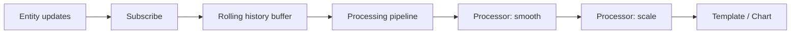

# Data Sources

**A data source follows one entity in your browser, keeps its recent values, and runs them through processors that smooth, convert or otherwise work on them.** Cards show the results in [templates](../templates/#data-source-templates) as `{ds:name}` and plot them as [chart series](#data-sources-in-charts).

- Declare data sources under `data_sources` on any LCARdS card. Each key is a name you choose, and the name is how templates and charts find it.
- Names are shared by the whole dashboard: the first card to create a name sets it up, and a later card using the same name gets that data source, settings and all. Give each data source its own name.
- Data sources are created when the dashboard loads, preload some history, then follow live changes. They keep a limited number of recent points (see [`window_seconds`](#top-level-fields)), so for long spans of plain history, plot the entity on a [chart](../../cards/chart/series#where-the-data-comes-from) instead.

::: tip Try it
A card editor's **Main Engineering > Data Sources** tab creates and edits data sources without YAML, with a preview of each processor ([In the card editor](#in-the-card-editor)). The [Processor Reference](./processor-reference) has a live lab for every processor.
:::

## How a Data Source Works

**Each change of the entity goes into a rolling buffer of recent values, then through the processing pipeline, and each processor keeps its own result.** Templates and charts read the raw value or any processor's result.



## Basic Usage

**Name a data source under `data_sources`, give it an `entity`, and read it in a template with `{ds:name}`.** Without a format the value shows as Home Assistant shows numbers, with the entity's unit; with one, such as `:.1f`, you write your own unit.

```yaml live
type: custom:lcards-button
preset: lozenge
data_sources:
  room_temp:
    entity: sensor.demo_temperature
    history:
      hours: 6
text:
  default:
    color: var(--lcars-black)
  native:
    content: "{ds:room_temp}" # Home Assistant's number format, with the unit
    position: top-left
  precise:
    content: "{ds:room_temp:.1f} °C" # your precision, your unit
    position: bottom-left
grid_options:
  rows: 2
```

## Configuration Options

**A data source needs only an `entity`; the other keys set how much it keeps, how often it updates cards, and how much history it preloads.** The defaults suit most cards.

- History is preloaded when the card loads: every recorded change over `history.hours`, or Home Assistant's hourly statistics when the recorder has none (for the entity state, not an attribute).
- The buffer holds a number of points, not a span of time: a sensor that reports once a minute keeps ten hours of values in the default 600 points, and a preload longer than that keeps only its newest points.
- A change after a quiet spell reaches cards at once. Rapid changes are merged before cards hear of them: at most one update every `min_emit_ms`, sent `coalesce_ms` after the last change of a burst, and never held back longer than `max_delay_ms`. The merged update carries the newest value; the buffer and the processors still see every change.

### Top-Level Fields

**Every key a data source takes, besides its processors.** Processors are under [Processors](#processors).

```yaml live
type: custom:lcards-button
preset: lozenge
data_sources:
  house_power:
    entity: sensor.demo_power # required: the entity to follow
    window_seconds: 120 # keep about 1,200 points
    min_emit_ms: 500 # update cards at most twice a second
    history:
      hours: 24
    processing:
      # each processor keeps its result under its own name
      kilowatts:
        type: scale
        input_range: [0, 1000]
        output_range: [0, 1]
      smoothed:
        type: smooth
        input_source: kilowatts # works on the kilowatts result
        method: exponential
        alpha: 0.3
text:
  default:
    color: var(--lcars-black)
  power:
    content: "{ds:house_power.smoothed:.2f} kW"
    position: top-left
grid_options:
  rows: 2
```

::: details More about the fields
- **Older names:** older configs may use camelCase (`windowSeconds`, `minEmitMs`, `coalesceMs`, `maxDelayMs`, `emitOnSameValue`) and `history.preload` for `history.enabled`. They still work, and the editor marks them as old names. If both spellings are set, the snake_case one wins.
- **States that are not numbers:** the states `on`, `true`, `active` and `open` count as 1, and `off`, `false`, `inactive` and `closed` as 0. Other words need `enum_mapping`; without it they are skipped, as are `unavailable` and `unknown`.
- **Home Assistant's code editor:** it reads unquoted `on`, `off`, `yes` and `no` as true or false, so quote them as `enum_mapping` keys: `"off": 0`.
:::

| Key | Type | Default | Description |
|-----|------|---------|-------------|
| `entity` | string | required | The entity to follow |
| `attribute` | string | the state | An attribute to follow instead of the state. `state` means the state |
| `enum_mapping` | object | - | Numbers for states that are not numbers, such as `heat: 2` and `cool: 1` |
| `window_seconds` | number / string | `60` | How many points the buffer keeps: about 10 per second of window, at least 60 and at most 1,000 (`60` keeps 600). Also takes a duration such as `"5m"` |
| `min_emit_ms` | number | `100` | The least time between updates sent to cards, ms (at least 10) |
| `coalesce_ms` | number | 40% of `min_emit_ms`, at least `20` | How long to wait after the last of several rapid changes before sending the merged update, ms (at least 20) |
| `max_delay_ms` | number | 3 x `coalesce_ms` | The longest an update may be held back while gathering, ms (at least `min_emit_ms`) |
| `emit_on_same_value` | boolean | `true` | Send an update even when the value didn't change |
| `history.enabled` | boolean | `true` | Preload history when the card loads |
| `history.hours` | number | `6` | Hours of history to preload, 1 to 168 |
| `history.days` | number | - | Days of history to preload, 1 to 7, instead of `hours`. `hours` wins when both are set |
| `processing` | object | - | Named processors: see [Processors](#processors) |

## Processors

**A processor works on the data source's values and keeps its result under its own name; `input_source` chains it after another processor.** Without `input_source` a processor reads the raw value.

- Read a processor's result in a template with `{ds:name.processor}`, and plot it with a chart series' `buffer`.
- A processor's result has no unit: give it a format and your own unit, such as `{ds:temp.fahrenheit:.0f} °F`.
- The [Processor Reference](./processor-reference) covers every option, with a live lab for each processor.

```yaml live
type: custom:lcards-button
preset: lozenge
data_sources:
  room_temp_f:
    entity: sensor.demo_temperature
    processing:
      # Celsius to Fahrenheit
      fahrenheit:
        type: convert_unit
        from: c
        to: f
      # then smooth the converted value
      smooth_f:
        type: smooth
        input_source: fahrenheit
        method: exponential
        alpha: 0.2
text:
  default:
    color: var(--lcars-black)
  raw:
    content: "{ds:room_temp_f:.1f} °C"
    position: top-left
  converted:
    content: "{ds:room_temp_f.smooth_f:.1f} °F"
    position: bottom-left
grid_options:
  rows: 2
```

| Processor | Purpose | Main settings |
|-----------|---------|---------------|
| `convert_unit` | Convert between units | `from`, `to` (such as `c` and `f`) |
| `scale` | Map from one range to another | `input_range`, `output_range`, `curve` |
| `smooth` | Smooth noisy values | `method` (`exponential`, `moving_average`, `gaussian`), `alpha`, `window` |
| `round` | Round to decimal places | `precision`, `method` |
| `expression` | A JavaScript expression of your own | `expression` (uses `value`, `sources`, `Math`), `sources` |
| `clamp` | Keep within a minimum and maximum | `min`, `max` |
| `rate` | Rate of change per unit of time | `unit` (`per_second`, `per_minute`, `per_hour`), `smoothing` |
| `trend` | Increasing, decreasing or stable | `samples`, `threshold` |
| `delta` | Difference from the previous value | `absolute` |
| `duration` | Time spent meeting a condition | `condition`, `reset_on` |
| `statistics` | Min, max, mean and more over a window | `window`, `stats` |
| `threshold` | Two outputs either side of a threshold | `threshold`, `above`, `below`, `hysteresis` |

| Key | Type | Default | Description |
|-----|------|---------|-------------|
| `type` | string | required | The processor, from the list above |
| `input_source` | string | the raw value | The name of another processor in this data source whose result this one works on |
| `enabled` | boolean | `true` | `false` passes values through unchanged |

### In the card editor

**A card editor's Data Sources tab (under Main Engineering) creates and edits data sources without YAML.** In the data source dialog, the **Processing** tab shows:

- **A preview**: the processors run over the entity's own recent history (the span set under Timing & History, the way the data source preloads it), charted against the raw values. It updates as you edit; the selected processor's line is drawn heavier.
- **The pipeline**: each processor under its input, numbered in the order they run. Errors such as a missing input or a loop show above it.
- **The selected processor's settings**, edited in place: its name (renaming updates the processors that use it), its input (the raw value or another processor), and the type's options. **Edit as YAML** switches to its YAML.

The preview runs the same processor code as the dashboard. Live-only behaviour, such as a duration ticking between state changes, isn't shown.

## Accessing Values in Templates

**`{ds:name}` (or `{datasource:name}`) shows a data source's value in any text that takes [templates](../templates/#where-templates-work).** The rule: no format, and Home Assistant formats it with the unit; with a format, you control the output. The [Templates](../templates/#data-source-templates) page lists every format.

```yaml alternatives
# No format: Home Assistant's number format, with the entity's unit
"{ds:temp}"                            # → "21.4 °C"

# With a format: the number only, no unit
"{ds:temp:.1f}"                        # → "21.4"
"{ds:temp:.0f}"                        # → "21"
"{ds:temp:.1f} °C"                     # → "21.4 °C" (your own unit)

# A processor's result: a dot and its name, with either prefix
"{ds:temp.fahrenheit:.0f} °F"          # → "71 °F"
"{datasource:temp.fahrenheit:.0f} °F"  # the same
```

::: details More about values in templates
- **Data sources from other cards:** a card updates when the data sources in its own `data_sources` change. To show one another card defines, declare it in this card's `data_sources` too, with the same name.
- **One statistic:** a `statistics` processor holds several values; pick one with another dot. For a processor named `stats`: `{ds:temp.stats.max:.1f}`.
:::

## Data Sources in Charts

**A chart series can plot a data source's values, or one of its processors' results with `buffer`.** See the [Chart card](../../cards/chart/series#data-sources) for the series keys.

```yaml live
type: custom:lcards-chart
chart_type: line
data_sources:
  chart_temp:
    entity: sensor.demo_temperature
    processing:
      smoothed:
        type: smooth
        method: exponential
        alpha: 0.3
sources:
  - datasource: chart_temp
    name: Raw
  - datasource: chart_temp
    buffer: smoothed
    name: Smoothed
```
