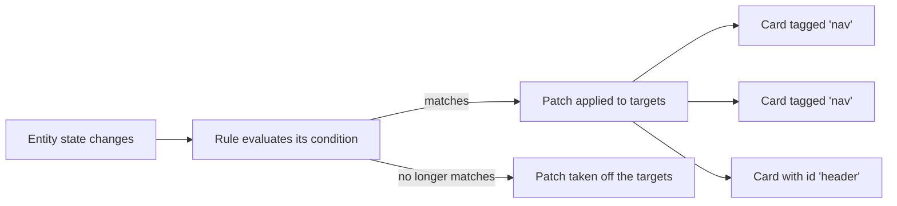

# Rules Engine

**A rule changes cards while a condition holds: when an entity, the time or a template says so, it patches the cards it targets, and takes the patch off again when the condition stops holding.** One rule can restyle a single card, every card with a tag, or the lines on an MSD.

- A rule has three parts: `when` (the condition), `apply` (what changes) and an `id`. It can sit in any card's `rules` list and still change other cards on the page.
- A patch is a piece of card config (`style`, `text` ...) merged over the card's own while the rule matches. Rules can also start animations and tint an MSD's blueprint.



::: tip Try it
- Every card editor has a **Rules** tab: it lists the rules on the page, adds and edits them with a condition builder, and turns them on and off.
- The Rules view of the [Live Demo](/getting-started/live-demo) shows rules recolouring and blinking cards as you drag sliders.
:::

| Page | Covers |
|------|--------|
| [Conditions](./conditions) | `when`: entity states and attributes, numbers, time, sun, chance, `all`/`any`/`not`, JavaScript and Jinja2 |
| [Targets and Changes](./changes) | `apply`: naming cards with `id` and `tags`, selectors, patches, animations, MSD blueprint filters |
| [Priority and Debugging](./priority) | Which rule wins, `stop`, `enabled`, and seeing which rules apply now |
| [Examples](./examples) | Whole rule sets to copy: a temperature alert, day and night, a multi-condition alert |

---

## Quick start

**A rule on one card can restyle a group of others: here the toggle turns the three panels red.** The panels carry the tag `docs-rules-deck`, and the rule's `tag:docs-rules-deck` selector finds them.

- Tap TOGGLE (or use the control under the card) to switch `input_boolean.lcards_test_toggle`; the rule matches while it is `"on"`.
- The rule lives on the toggle button, but it would work from any card on the page: rules are not tied to the card that holds them.

```yaml live controls
type: custom:lcards-layout-card
layout:
  height: 150px
  grid-gap: 6px
  grid-template-columns: 1fr 1fr 1fr
  grid-template-rows: 1fr 1fr
cards:
  - type: custom:lcards-button
    preset: lozenge
    entity: input_boolean.lcards_test_toggle
    tap_action:
      action: toggle
    text:
      name:
        content: TOGGLE
        show: true
    view_layout:
      grid-column: 1 / 4
    rules:
      - id: docs-rules-quick-start
        when:
          entity: input_boolean.lcards_test_toggle
          state: "on"
        apply:
          overlays:
            tag:docs-rules-deck:
              style:
                card:
                  color:
                    background: var(--lcars-alert-red)
  # three panels in one group
  - type: custom:lcards-button
    preset: filled
    tags:
      - docs-rules-deck
    text:
      name:
        content: REACTOR
        show: true
  - type: custom:lcards-button
    preset: filled
    tags:
      - docs-rules-deck
    text:
      name:
        content: INJECTORS
        show: true
  - type: custom:lcards-button
    preset: filled
    tags:
      - docs-rules-deck
    text:
      name:
        content: CONDUITS
        show: true
```

## Where rules live

**Rules go in the `rules` list of any LCARdS card, or in a content pack.** All of them run in one engine for the whole page, keyed by rule `id`.

- Give every rule an `id` no other card on the page uses: a second rule with an `id` already loaded is skipped.
- A rule with no `id` is skipped too, with a warning in the browser console.

::: tip Refresh after changing an existing rule
A **new** rule takes effect as soon as you save the card. Changes to an **existing** rule (same `id`), or removing one, take effect after a page refresh.
:::

## Rule structure

**Every rule needs `id`, `when` and `apply`; the other keys are optional.** This rule recolours its own card while the power level is above 80.

- Drag the power control under the card above or below 80 to see the rule match and let go.
- `priority`, `stop` and `enabled` decide what happens when several rules patch the same card: see [Priority and Debugging](./priority).

```yaml live controls
type: custom:lcards-button
id: docs-rules-structure-btn
preset: lozenge
text:
  name:
    content: POWER
    show: true
rules:
  - id: docs-rules-structure
    name: Power high
    priority: 10
    when:
      entity: input_number.lcards_test_power
      above: 80
    apply:
      overlays:
        docs-rules-structure-btn:
          style:
            card:
              color:
                background: var(--lcars-alert-red)
```

| Key | Type | Default | Description |
|-----|------|---------|-------------|
| `id` | string | required | The rule's name, unique on the page. Shown in the Rules tab and in traces |
| `name` | string | - | A readable label for the editor |
| `when` | object / list | required | The condition: see [Conditions](./conditions). A list means all of its items |
| `apply` | object | required | What changes while the rule matches: see [Targets and Changes](./changes) |
| `priority` | number | `0` | Higher runs first and wins where two rules patch the same key: see [priority](./priority#priority) |
| `stop` | boolean | `false` | While this rule matches, lower-priority rules' patches on the same cards are dropped: see [stop](./priority#stop) |
| `enabled` | boolean | `true` | `false` turns the rule off without deleting it: see [enabled](./priority#enabled) |
