# Zones

Every button, elbow and slider divides itself into named rectangles, **zones**, that text fields go into. `position`, `padding`, `x_percent` and `font_size_percent` all work within the zone, not the whole card. The other field keys are on the [Text Fields](./text-fields#per-field-options) page.

## Zones per card

**The zones each card makes for itself, from its shape.** The outlines in the pictures come from [`debug_zones`](#debug-zones).

| Card | Zones |
|------|-------|
| **Button** (preset, no icon area) | `body` and `full`, both the whole card <br/> 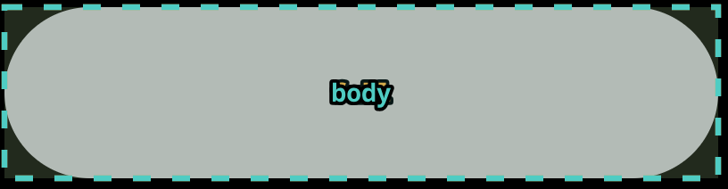 |
| **Button** (preset, with an icon area) | `body`: the card without the icon strip · `full`: the whole card · `icon`: the icon strip <br/> 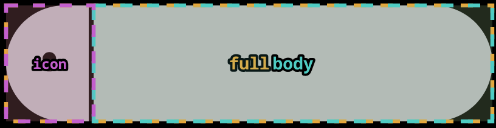 |
| **Button** (component) | The zones the [component](/cards/button/components) declares, and `full` <br/><br/> 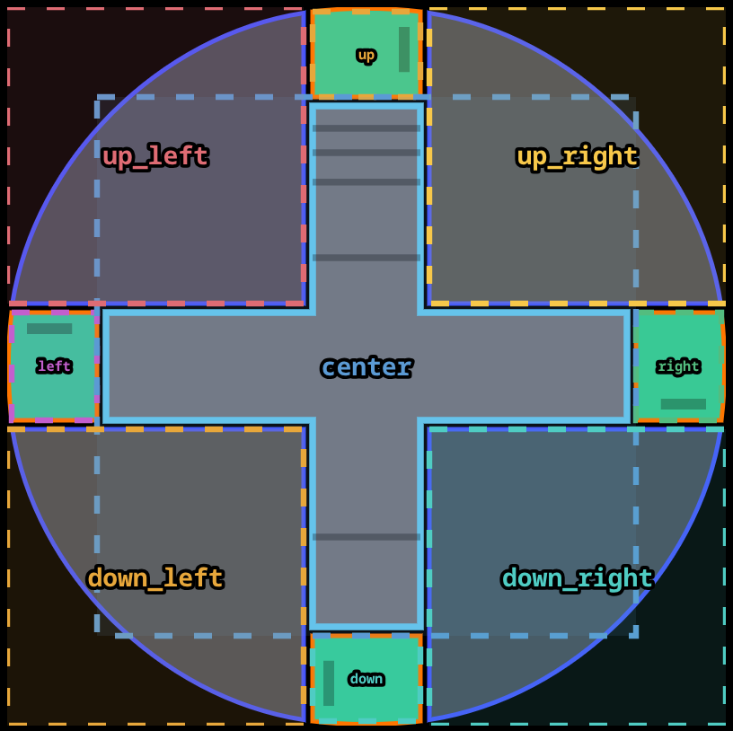 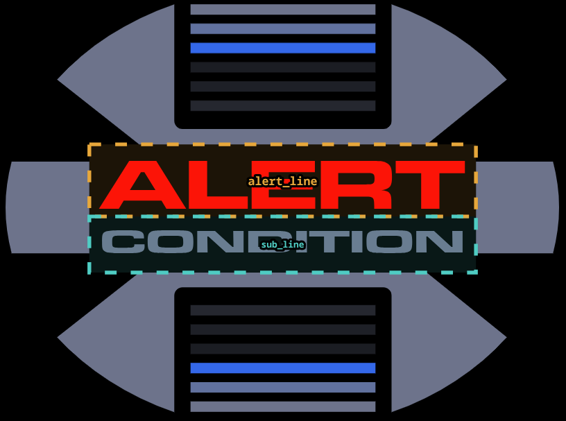 |
| **Slider** (pills and gauges) | `track` (inside the borders) and one zone per border that is on: `left`, `right`, `top`, `bottom` <br/> 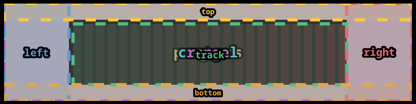 |
| **Slider** (ring) | `center` (inside the ring), and `label`, `value` and `sublabel` stacked within it; `track` is the ring's box |
| **Slider** (shaped) | `track` (the shape), with `top` and `bottom` text bands (`left` and `right` when horizontal) |
| **Elbow** (simple, L-corner left) | `vertical_bar` · `left_bar` (the same as `vertical_bar`) · `horizontal_bar` · `body` · `full` <br/> 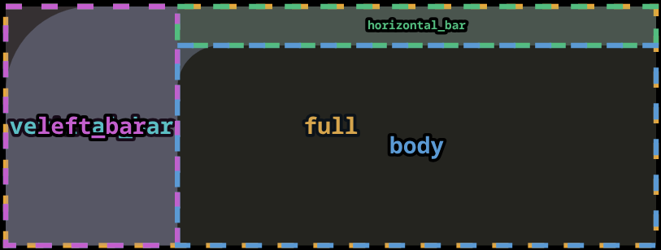 |
| **Elbow** (simple, L-corner right) | `vertical_bar` · `right_bar` (the same as `vertical_bar`) · `horizontal_bar` · `body` · `full` <br/> 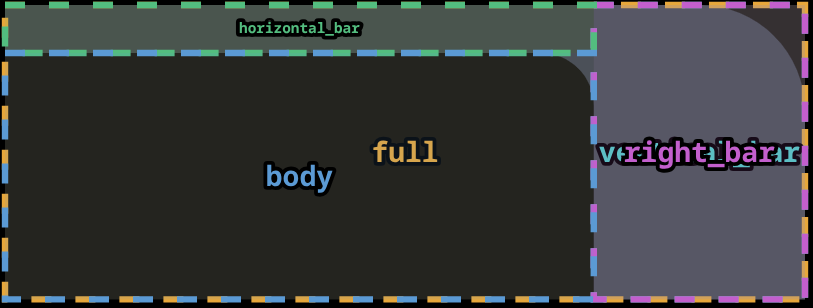 |
| **Elbow** (simple, open) | `horizontal_bar` · `body` · `full`: no vertical bar <br/> 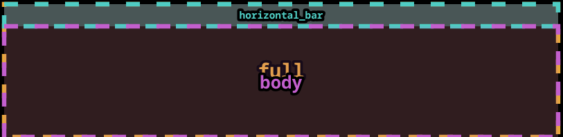 |
| **Elbow** (simple, contained) | `left_bar` · `right_bar` · `horizontal_bar` · `body` · `full` <br/> 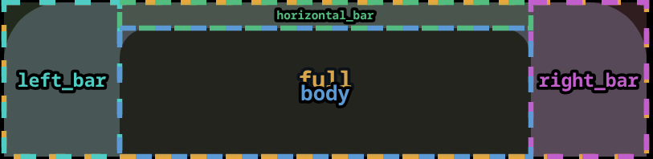 |
| **Elbow** (segmented) | `outer_vertical_bar` · `inner_vertical_bar` · `outer_horizontal_bar` · `inner_horizontal_bar` · `body` · `full` <br/> 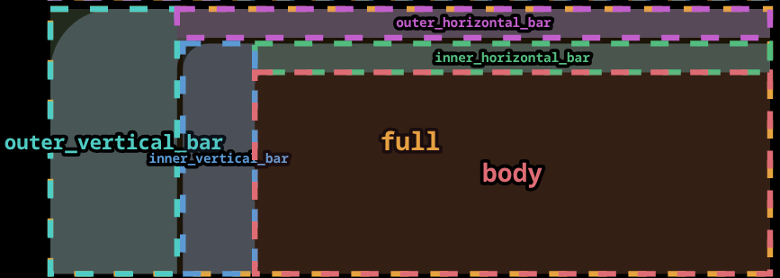 |
| **Elbow** (bar types) | `body` and `full`, both the whole bar |
| **Elbow** (frame) | `top` · `bottom` · `left` · `right` (the sides it draws) · `body` · `full` <br/> 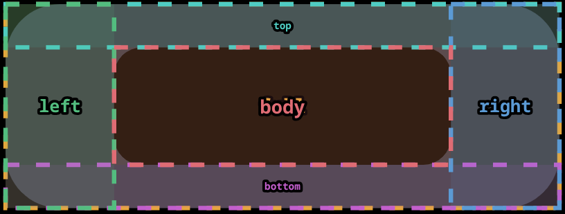 |

## zone

**Puts a field in a named zone.** Without it, a field goes in the card's main zone.

- The main zone is `body` on a button and an elbow, and the first zone of a button's component. On a slider it is the first border that is on (`left`, then `right`, `top`, `bottom`), else `track`.
- A zone the card doesn't have sends the field to the main zone instead (on a slider, to `track`).

```yaml live
type: custom:lcards-elbow
elbow:
  type: header-left
  segment:
    bar_width: 120
    bar_height: 24
    color: var(--lcars-orange)
text:
  title:
    content: BRIGHTNESS
    zone: horizontal_bar # on the top bar
    position: center-right
    font_size_percent: 60 # 60 % of the bar's height
    color: var(--lcars-black)
  note:
    content: MAIN ENGINEERING
    position: top-right # body, the open area
    color: var(--lcards-moonlight)
```

| Key | Type | Default | Description |
|-----|------|---------|-------------|
| `text.<name>.zone` | string | the main zone | A zone from the table above, or one of [your own](#zones) |

## zones

**Your own zones, or new bounds for one the card already has.** Give each a name, then send fields to it with `zone`.

- Each side takes pixels or a percentage of the card: `x` or `x_percent`, `y` or `y_percent`, `width` or `width_percent`, `height` or `height_percent`. You can mix them, such as a fixed width with a full height.
- A zone needs all four: one with a side missing is skipped.
- A zone named like one the card makes (such as `body`) replaces it.
- The card editor's **Zones** tab adds and edits zones.

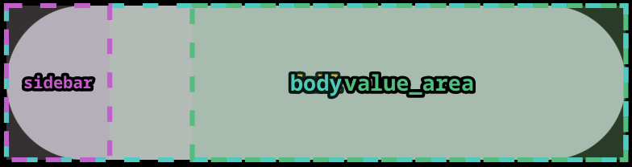

```yaml live
type: custom:lcards-button
preset: lozenge
zones:
  sidebar:
    x: 0
    "y": 0 # quoted: Home Assistant's editor reads a bare y as true
    width: 80
    height_percent: 100 # fixed 80 px wide, full card height
  value_area:
    x_percent: 30
    y_percent: 0
    width_percent: 70
    height_percent: 100
text:
  tag:
    content: "07"
    zone: sidebar
    position: center
    color: var(--lcars-black)
  reading:
    content: SHIELDS 84%
    zone: value_area
    position: center
    color: var(--lcars-black)
grid_options:
  rows: 2
```

::: details More about your own zones
- **Pixels and percentages together:** when a side has both, pixels win.
- **Resizing:** percentages are worked out from the card's size each time it draws, so the zone follows the card.
- **Components:** on a button with a `component`, text goes only in the component's own zones. Your zones are outlined by `debug_zones` but take no text.
:::

| Key | Type | Default | Description |
|-----|------|---------|-------------|
| `zones` | object | - | Your zones, keyed by name |
| `zones.<name>.x` | number | - | Left edge, px from the card's left |
| `zones.<name>.y` | number | - | Top edge, px from the card's top. Quote the key, `"y":`, in Home Assistant's code editor |
| `zones.<name>.width` | number | - | Width, px |
| `zones.<name>.height` | number | - | Height, px |
| `zones.<name>.x_percent` | number | - | Left edge, percent of the card's width |
| `zones.<name>.y_percent` | number | - | Top edge, percent of the card's height |
| `zones.<name>.width_percent` | number | - | Width, percent of the card's width |
| `zones.<name>.height_percent` | number | - | Height, percent of the card's height |

## debug_zones

**Outlines every zone on the card, with its name.** Turn it on while you lay out text, and off before you finish the dashboard.

- The toggle is also in the card editor, under **Zones**, **Developer Tools**.

```yaml live
type: custom:lcards-button
entity: light.kitchen
preset: lozenge
debug_zones: true
zones:
  sidebar:
    x: 0
    "y": 0
    width: 60
    height_percent: 100
```

| Key | Type | Default | Description |
|-----|------|---------|-------------|
| `debug_zones` | boolean | `false` | Draw a dashed, coloured outline and the name of each zone over the card |
