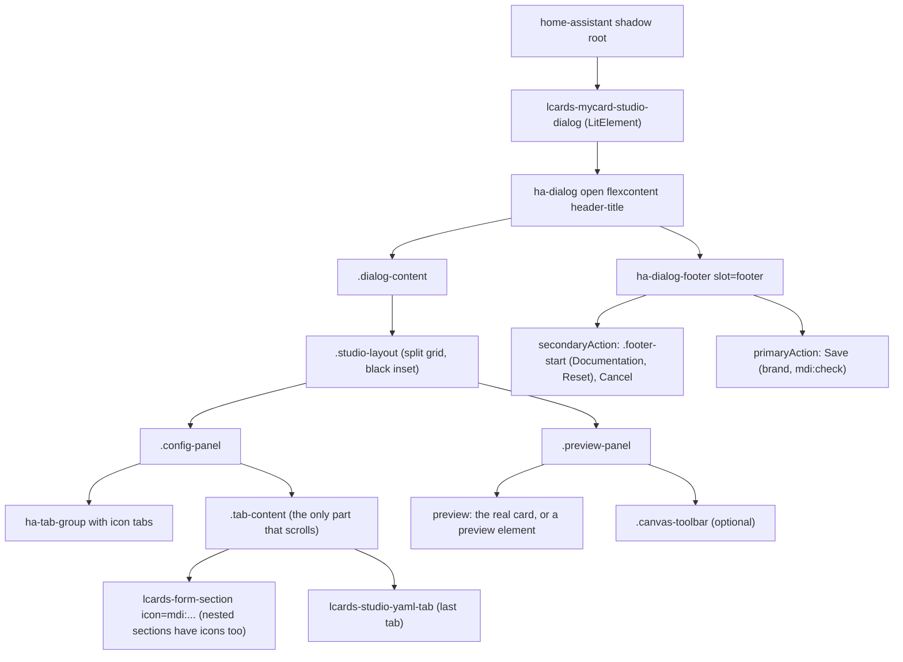
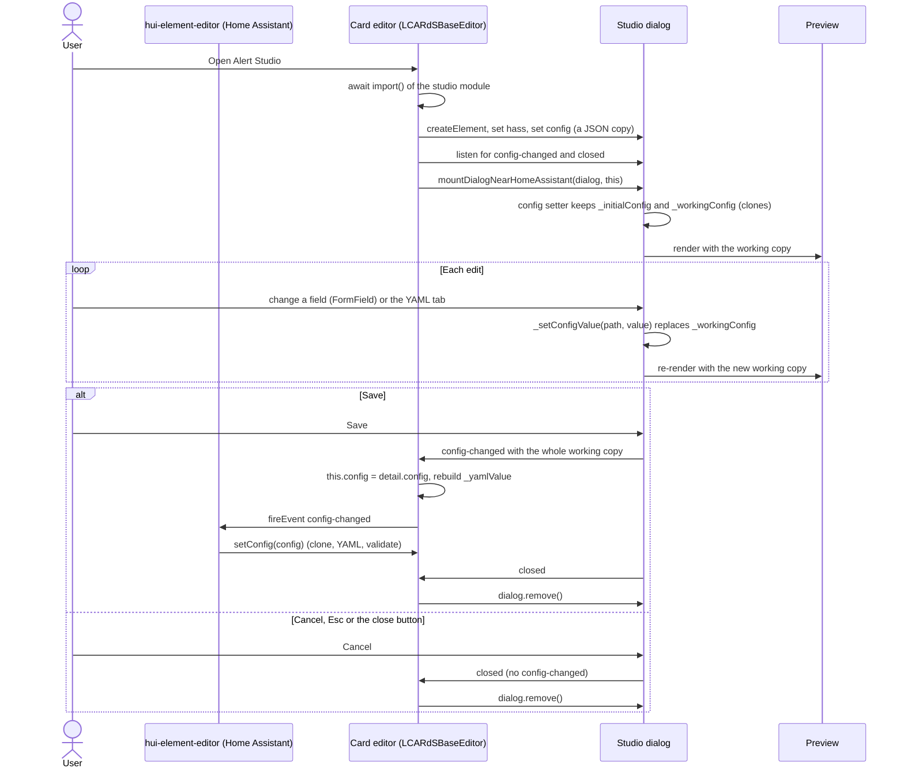

# Building a Studio Editor

A **studio** is a full-size Home Assistant dialog with a config panel on the left and a live preview on the right. LCARdS uses one for every card whose config is too big for a form: MSD, chart, data grid, layout, alert overlay, astrometrics, and the data source editor. All of them share one shell, so they look and behave alike.

This page shows how to build one, how to launch it from a card editor and how to test it. The short [Basic Card Editor](#basic-card-editor) section at the end covers the plain tabbed editor every card has, which is also where a studio is launched from.

The full rule set for editor code is `.github/instructions/editor.instructions.md` (Field Rendering, Approved Shared Components, "Dialogs, surfaces and messages", CSS and Theming). This page follows it and cites the files every sample comes from; when the two disagree, the code wins and the instructions file needs fixing.

## When to Build a Studio

**Build a studio when the user needs to see the card while editing it, or when the config has more structure than a tab of fields can show.** Otherwise a plain card editor is enough.

- **Studio:** nested lists (chart series, MSD overlays, astrometrics objects), placement on a canvas (MSD anchors, layout areas), something that never shows on the dashboard by itself (the alert overlay only appears during an alert, so its studio shows each condition on a mock screen), or a preview with tools (pick a point, replay an animation).
- **Plain editor:** a card with a handful of options, where Home Assistant's own preview beside the card editor already shows the change (button, elbow, slider, select menu).
- **Both:** a card with a studio still has a card editor. For the layout card, alert overlay and astrometrics card it is mostly a launcher (a summary and an "Open ... Studio" button, plus the YAML and Main Engineering tabs); the chart, data grid and MSD editors keep a few settings beside the button.

### The Existing Studios

| Studio | Element | File | Opened from | Split (config / preview) |
|---|---|---|---|---|
| MSD | `lcards-msd-studio-dialog` | `src/editor/dialogs/lcards-msd-studio-dialog.js` (+ `msd-studio/`) | `lcards-msd-editor.js` `_openMsdStudio()` | 33.3% / 66.6% |
| Chart | `lcards-chart-studio-dialog` | `lcards-chart-studio-dialog.js` | `lcards-chart-editor.js` `_openChartStudio()` | 40% / 60% |
| Data Grid | `lcards-data-grid-studio-dialog-v4` | `lcards-data-grid-studio-dialog.js` | `lcards-data-grid-editor.js` `_openConfigurationStudio()` | 50% / 50% (shared default) |
| Layout | `lcards-layout-studio-dialog` | `lcards-layout-studio-dialog.js` | `lcards-layout-card-editor.js` `_openStudio()` | 1fr / 2fr |
| Alert | `lcards-alert-overlay-studio-dialog` | `lcards-alert-overlay-studio-dialog.js` (+ `alert-studio/`) | `lcards-alert-overlay-editor.js` `_openAlertStudio()` | 40% / 60% |
| Astrometrics | `lcards-astrometrics-studio-dialog` | `lcards-astrometrics-studio-dialog.js` (+ `astro-studio/`) | `lcards-astrometrics-editor.js` `_openStudio()` | 33.3% / 66.6% |
| Data source | `lcards-datasource-studio-dialog` | `lcards-datasource-studio-dialog.js` | Main Engineering > Data Sources (`lcards-datasource-editor-tab.js`), the chart studio's "Manage data sources" | 50% / 50% |

Studio files live in `src/editor/dialogs/`, editors in `src/editor/cards/`. The **Alert Studio is the smallest complete one** (about 300 lines plus its forms mixin in `alert-studio/alert-studio-forms.js`), and the example below follows it. The data source studio is the odd one out: it is a sub-studio rendered inside other editors' templates, with an `open` property and `save` / `cancel` events instead of the launcher pattern.

## Anatomy of a Studio

**A studio is a `LitElement` that renders an `ha-dialog` with the shared shell classes, keeps its own working copy of the config, and sends the whole config back once, on Save.**



- **Shell:** `ha-dialog` with `open`, `flexcontent` and `header-title`. Without `flexcontent` the dialog body doesn't stretch its content, so the inset shrinks to fit a short tab. There is no LCARdS dialog wrapper and no `DialogMixin` (that is internal to Home Assistant's own source).
- **Styles:** `studioDialogStyles` (`src/editor/dialogs/studio-dialog-styles.js`) fixes the dialog at 90vh and 95vw, keeps `.dialog-content` in the flex chain so only `.tab-content` scrolls, draws `.studio-layout` as the black inset (`var(--primary-background-color)`), and styles the tab group, the floating `.canvas-toolbar`, `.zoom-controls` and `.placeholder-content`. It also sets `font-family: var(--ha-font-family-body)` on `.dialog-content`, so LCARdS text follows the theme font like Home Assistant's controls do. Add `editorStyles` (`src/editor/base/editor-styles.js`, which includes the info guide styles) and `messageStyles` (`src/editor/base/surface-styles.js`, for `.hint` and `.banner`).
- **Split:** `.studio-layout` is 50/50 and stacks into two rows below 1024px. A studio changes only `grid-template-columns`, and when it does it must set `grid-template-rows: minmax(0, 1fr)` in the same rule, or the shared narrow-screen rule leaves an empty second row (`tests/editor/studio-layout-css.test.js`). Don't set heights on `.dialog-content`, `.tab-content` or the panels.
- **Sections:** group fields in `lcards-form-section` (`src/editor/components/shared/lcards-form-section.js`), the outlined section card built on `ha-expansion-panel`. Every section has an `icon`, nested sections included (`nested` gives the tighter spacing). Don't add tinted containers, accent borders or your own card styles around them: the section is the container.
- **Help:** one way for each kind (`editor.instructions.md`, "Messages and explainers"): `renderInfoGuide()` for explanations, the section's `description` for one line about a section, the field's `helper` for one line about a field, `lcards-message` for something to notice now (at most 200 characters for an info message).
- **Preview:** the real card element (chart, data grid, astrometrics, layout) or a dedicated preview element (`lcards-alert-preview`, the MSD canvas), fed from the working copy.
- **Footer:** `<ha-dialog-footer slot="footer">` with Cancel (`slot="secondaryAction"`, `appearance="plain"`) then Save (`slot="primaryAction"`, `variant="brand"`, an `mdi:check` icon). Documentation and Reset go first, in a `<div class="footer-start" slot="secondaryAction">`, which `studioDialogStyles` pushes to the left. `tests/editor/dialog-footer-guards.test.js` fails on a hand-built `div slot="footer"` and on a Cancel that isn't plain.
- **YAML:** the last tab is `lcards-studio-yaml-tab` (`src/editor/components/yaml/lcards-studio-yaml-tab.js`) with the icon `mdi:code-braces`.

### Open, Edit, Save

This is the flow of the Alert Studio and its launcher (`src/editor/cards/lcards-alert-overlay-editor.js:148-167`, `src/editor/dialogs/lcards-alert-overlay-studio-dialog.js`); the chart, data grid, layout, MSD and astrometrics studios follow the same steps.



- **The studio never commits while it is open.** Edits change only `_workingConfig`; the card editor and Home Assistant see nothing until Save. `tests/browser/alert-studio.spec.js` checks this: an edit shows in the preview, the editor has received no `config-changed`, Save hands over the whole config, and Cancel hands over nothing.
- **Save replaces the config.** The studio sends the whole config, so keys the user deleted must disappear. That is why the launcher assigns `this.config` instead of calling `_updateConfig()`, which deep-merges and would keep them (see [Working Copy vs Committed Config](#working-copy-vs-committed-config)).
- **Home Assistant calls `setConfig()` back.** `hui-element-editor` (in the Home Assistant frontend) answers a `config-changed` by calling the editor's `setConfig()` with the new config, which clones it, rebuilds the YAML tab and runs validation (`LCARdSBaseEditor.js:102-133`).

## Dialogs and Portals

**Mount every dialog, studio or portal near `<home-assistant>` with `mountDialogNearHomeAssistant()`, never on `document.body`.**

```javascript
// src/utils/lcards-shared-helpers.js:64
export function mountDialogNearHomeAssistant(dialogEl, startEl) {
  const haRoot = (startEl && findHomeAssistantRoot(startEl)) ?? document.querySelector('home-assistant');
  const mountRoot = haRoot?.shadowRoot ?? document.body;
  mountRoot.appendChild(dialogEl);
}
```

- **Why:** since Home Assistant 2026.7, its pickers (`ha-entity-picker` and the rest) and `ha-dialog` read states, registries and settings from Lit contexts that `<home-assistant>` provides. A dialog under `document.body` is a sibling of `<home-assistant>`, not a descendant, so the contexts never resolve and pickers come up empty, with no error. Mounting in its shadow root mirrors Home Assistant's own dialog manager.
- **`startEl`:** pass `this`. `findHomeAssistantRoot()` walks up through slots and shadow roots from there. In the browser test harness there is no `<home-assistant>`, so the helper falls back to `document.body`, which is why `tests/browser/alert-studio.spec.js` finds the studio with `document.querySelector`.
- **Dialogs inside a studio** (a card picker, a confirm) are mounted the same way, with the studio as `startEl` (`alert-studio/alert-studio-forms.js:1164`).
- **Imperative dialogs** (built with `document.createElement('ha-dialog')`) get their footer from `createDialogFooter({ secondary, primary })` in the same file (`lcards-shared-helpers.js:78`).
- **No native dialogs.** Never `confirm()`, `alert()` or `prompt()` (`tests/editor/editor-guards.test.js`). Use `showConfirmDeleteDialog`, `showInfoDialog` and `showPromptDialog` from `src/views/layout-edit-dialogs.js`. The chart studio's "Discard unsaved changes?" is `showConfirmDeleteDialog({ title, message, confirmText: 'Discard' })` (`lcards-chart-studio-dialog.js:698`).
- **Closing:** `ha-dialog` fires `closed` when it closes for any reason (Esc, its close button, `open = false`), and some components inside a dialog fire their own `closed`, which bubbles. Stop the event so it doesn't close the card editor around the studio, and act only when `e.target === e.currentTarget` (`_onDialogClosed()`, `lcards-astrometrics-studio-dialog.js:2072`). `tests/editor/studio-dialog-guards.test.js` fails on an `@closed` handler that acts without the check.

## Build a Studio, Step by Step

The example builds `lcards-mycard-studio-dialog` for a card `lcards-mycard` (card type `mycard`). It is the Alert Studio reduced to two tabs, with a real-card preview in the style of the astrometrics and data grid studios. The names `mycard`, `getMyCardSchema` and `DOCS.mycard` are placeholders; every LCARdS import and method is real.

### 1. The Element, the Working Copy and the Edit Methods

**The studio is the "editor" that `FormField.renderField()` writes to, so it implements the four members FormField calls: `hass`, `_getSchemaForPath()`, `_getConfigValue()` and `_setConfigValue()` (`lcards-form-field.js:80,97,302`).**

```javascript
// src/editor/dialogs/lcards-mycard-studio-dialog.js
// Based on src/editor/dialogs/lcards-alert-overlay-studio-dialog.js:15-157
import { LitElement, html, css } from 'lit';
import { createRef, ref } from 'lit/directives/ref.js';
import { editorStyles } from '../base/editor-styles.js';
import { messageStyles } from '../base/surface-styles.js';
import { studioDialogStyles } from './studio-dialog-styles.js';
import { LCARdSBaseEditor } from '../base/LCARdSBaseEditor.js';
import { LCARdSFormFieldHelper as FormField } from '../components/shared/lcards-form-field.js';
import { renderInfoGuide } from '../components/shared/info-guide.js';
import { lcardsLog } from '../../utils/lcards-logging.js';
import { docsUrl, DOCS } from '../../utils/docs-url.js';
import { getMyCardSchema } from '../../cards/schemas/lcards-mycard-schema.js';
import '../components/shared/lcards-form-section.js';
import '../components/shared/lcards-message.js';
import '../components/yaml/lcards-studio-yaml-tab.js';

const TABS = [
    { id: 'config', label: 'Config', icon: 'mdi:cog-outline' },
    { id: 'yaml',   label: 'YAML',   icon: 'mdi:code-braces' },
];

/** A config without its undefined values (deleted keys stay deleted). @param {any} c */
const clean = (c) => JSON.parse(JSON.stringify(c ?? {}));

const PREVIEW_DELAY = 150;

export class LCARdSMyCardStudioDialog extends LitElement {

    static get properties() {
        return {
            hass:           { attribute: false },
            _workingConfig: { state: true },
            _activeTab:     { state: true },
        };
    }

    set config(value) {
        this._handled       = false;
        this._initialConfig = clean(value);
        this._workingConfig = clean(value);
    }
    get config() { return this._workingConfig; }

    constructor() {
        super();
        /** @type {any} */
        this.hass = undefined;
        /** @type {any} */
        this._initialConfig = {};
        /** @type {any} */
        this._workingConfig = {};
        this._handled = false;
        this._activeTab = 'config';
        this.cardType = 'mycard';
        this._previewRef = createRef();
        /** @type {any} */
        this._previewCard = null;
        /** @type {ReturnType<typeof setTimeout> | undefined} */
        this._previewTimer = undefined;
    }

    // ── The edit methods FormField uses, on the working copy ──

    _getSchema() {
        return getMyCardSchema();
    }

    /** @param {string} path */
    _getSchemaForPath(path) {
        // The card editors' path lookup (patternProperties, additionalProperties, oneOf)
        return LCARdSBaseEditor.prototype._getSchemaForPath.call(this, path);
    }

    /** @param {string} path */
    _getConfigValue(path) {
        /** @type {any} */
        let value = this._workingConfig;
        for (const key of path.split('.')) {
            if (value === undefined || value === null) return undefined;
            value = value[key];
        }
        return value;
    }

    /**
     * Set one key; empty values remove it (and empty parents).
     * @param {string} path
     * @param {any} value
     */
    _setConfigValue(path, value) {
        if (value === undefined || value === null || value === '') {
            this._removeConfigPath(path);
            return;
        }
        const next = clean(this._workingConfig);
        const keys = path.split('.');
        let node = next;
        for (const key of keys.slice(0, -1)) {
            if (!node[key] || typeof node[key] !== 'object') node[key] = {};
            node = node[key];
        }
        node[keys[keys.length - 1]] = value;
        this._workingConfig = next;
    }

    /** @param {string} path */
    _removeConfigPath(path) {
        const next = clean(this._workingConfig);
        const keys = path.split('.');
        /** @type {any[]} */
        const chain = [next];
        for (const key of keys.slice(0, -1)) {
            const child = chain[chain.length - 1]?.[key];
            if (!child || typeof child !== 'object') return;
            chain.push(child);
        }
        delete chain[chain.length - 1][keys[keys.length - 1]];
        // prune parents left empty
        for (let i = chain.length - 1; i > 0; i--) {
            if (Object.keys(chain[i]).length) break;
            delete chain[i - 1][keys[i - 1]];
        }
        this._workingConfig = next;
    }
}
```

- **The config setter takes a copy twice:** `_initialConfig` is the baseline (for an unsaved-changes check or a Reset), `_workingConfig` is what the tabs and preview show. The launcher already passes a JSON copy; cloning again keeps the studio safe from any caller.
- **Every edit assigns a new object** to `_workingConfig`. It is a reactive `state` property, so the assignment re-renders the tabs and the preview; mutating it in place would not.
- **Empty values remove the key.** A cleared field leaves no `color: ''` behind, and empty parent objects are pruned, so the saved YAML stays clean.
- **`_getSchemaForPath` is borrowed from `LCARdSBaseEditor`.** It resolves dotted paths through `properties`, `patternProperties`, `additionalProperties`, array `items` and `oneOf`, and calls `this._getSchema()`, which the studio supplies. Import the schema module directly rather than reading it from `window.lcards.core.configManager`.
- **`cardType`** is what FormField and the YAML tab use for docs links and schema lookups that go by card type.

### 2. Render the Shell

**`render()` is the shared shell: the dialog, the split, the tabs, the preview host and the footer. Only the tab bodies and the preview are yours.**

```javascript
    // Based on lcards-alert-overlay-studio-dialog.js:159-229
    /** @param {Event} e */
    _onTab(e) {
        const value = /** @type {any} */ (e.target).activeTab?.getAttribute('value');
        if (value) this._activeTab = value;
    }

    /** Only the dialog's own `closed` cancels; closes bubbling from inside must not. @param {Event} e */
    _onDialogClosed(e) {
        e.stopPropagation();
        if (e.target === e.currentTarget) this._handleCancel();
    }

    render() {
        return html`
            <ha-dialog open flexcontent header-title="My Card Studio" @closed=${this._onDialogClosed}>
                <div class="dialog-content">
                    <div class="studio-layout">
                        <div class="config-panel">
                            <ha-tab-group @wa-tab-show=${this._onTab}>
                                ${TABS.map((t) => html`
                                    <ha-tab-group-tab value=${t.id} ?active=${this._activeTab === t.id}>
                                        <ha-icon icon=${t.icon}></ha-icon>
                                        ${t.label}
                                    </ha-tab-group-tab>`)}
                            </ha-tab-group>
                            <div class="tab-content">${this._renderActiveTab()}</div>
                        </div>
                        <div class="preview-panel">
                            <div class="preview-host" ${ref(this._previewRef)}></div>
                        </div>
                    </div>
                </div>
                <ha-dialog-footer slot="footer">
                    <div class="footer-start" slot="secondaryAction">
                        <ha-button appearance="plain" @click=${() => window.open(docsUrl(DOCS.mycard), '_blank', 'noopener')}>
                            <ha-icon icon="mdi:book-open-variant" slot="start"></ha-icon>
                            Documentation
                        </ha-button>
                    </div>
                    <ha-button slot="secondaryAction" appearance="plain" @click=${this._handleCancel}>Cancel</ha-button>
                    <ha-button slot="primaryAction" variant="brand" @click=${this._handleSave}>
                        <ha-icon icon="mdi:check" slot="start"></ha-icon>
                        Save
                    </ha-button>
                </ha-dialog-footer>
            </ha-dialog>
        `;
    }

    _renderActiveTab() {
        switch (this._activeTab) {
            case 'yaml': return html`
                <lcards-studio-yaml-tab
                    .hass=${this.hass}
                    .config=${this._workingConfig}
                    .schema=${getMyCardSchema()}
                    cardType="mycard"
                    @yaml-config-changed=${(/** @type {CustomEvent} */ e) => { this._workingConfig = clean(e.detail.config); }}>
                </lcards-studio-yaml-tab>`;
            default: return this._renderConfigTab();
        }
    }
```

- **Tabs:** `ha-tab-group` fires `wa-tab-show`; read the tab with `activeTab?.getAttribute('value')`, not a `.value` property. Each tab has an `mdi:` icon and a label; YAML is last.
- **Render only the active tab.** The tab body is rebuilt on switch, so a tab that is not shown costs nothing. The inset keeps one height on every tab because `.tab-content` scrolls inside a fixed dialog (`tests/ha/ha.spec.js`, "the inset keeps one height on every tab").
- **The title** is a name ("My Card Studio"); the card editor's button says "Open My Card Studio".
- **The YAML tab** fires `yaml-config-changed` with the parsed config only for YAML that parses to an object. It leaves the text and cursor alone when the studio echoes back the config it just sent, so typing is never interrupted (`lcards-studio-yaml-tab.js:60-71`).
- **A floating toolbar** over the preview uses the shared `.canvas-toolbar`, `.canvas-toolbar-group`, `.canvas-toolbar-group-label` and `.canvas-toolbar-button` classes (`studio-dialog-styles.js`); see the Alert Studio's `_renderToolbar()` (`lcards-alert-overlay-studio-dialog.js:231-266`) for the collapsed and expanded states.

### 3. The Config Tab

**Fields come from the card schema through `FormField.renderField()`, grouped in outlined `lcards-form-section`s with icons, with explanations in an info guide.**

```javascript
    // Pattern: alert-studio/alert-studio-forms.js:87-140
    _renderConfigTab() {
        return html`
            ${renderInfoGuide({
                header: 'How My Card works',
                icon: 'mdi:information-outline',
                body: html`
                    <p>The card shows one entity's state as a bar. The preview updates as you edit; Save keeps the changes.</p>
                `,
            })}

            <lcards-form-section
                header="Entity"
                description="The entity the card shows"
                icon="mdi:home-automation"
                ?expanded=${true}
                outlined>
                ${FormField.renderField(this, 'entity')}
                ${FormField.renderField(this, 'height', { label: 'Height' })}

                <lcards-form-section
                    header="Colours"
                    icon="mdi:palette-outline"
                    outlined
                    nested>
                    ${FormField.renderField(this, 'style.color')}
                    ${FormField.renderField(this, 'style.background')}
                </lcards-form-section>
            </lcards-form-section>
        `;
    }
```

- **No raw controls.** No `<input>`, `<select>`, `<textarea>`, bare `ha-selector` beside a label div, or `ha-textfield` (it renders at 0px). `FormField.renderField(editor, path, options)` picks the `ha-selector` from the schema (see [Validation and Schema Hints](#validation-and-schema-hints)); `options` takes `label`, `helper`, `selectorOverride`, `value`, `disabled` and `required` (`lcards-form-field.js:57-70`).
- **Reuse the shared controls** before writing new ones (`src/editor/components/shared/`): `lcards-color-picker` and `lcards-color-list` for colours (FormField renders the colour picker for a schema with `x-ui-hints.widget: 'lcards-color-picker'`), `lcards-form-section` and `lcards-collapsible-section`, `renderInfoGuide()`, `renderFilterChips()` for a single-choice row of pills, `lcards-message`, `lcards-asset-source-picker`, and `lcards-zone-list-editor` (in `src/editor/components/`). The Alert Studio edits a content card with that card's own editor instead of rebuilding its fields.
- **No added decoration.** No accent-coloured panels, tinted boxes, gradient headers, emoji or badges: the section card, its icon and Home Assistant's controls are the look. Colours come from theme variables (`var(--primary-color)`, `var(--divider-color)`, `var(--secondary-text-color)`), never hex values or a new palette.
- **Spacing, radius and motion** use Home Assistant's variables: `var(--ha-space-N)`, `var(--ha-border-radius-*)`, `var(--ha-border-width-*)`, `var(--ha-box-shadow-s/m/l)` (never a hand-written shadow), `var(--ha-animation-duration-*)` and `var(--ha-font-size-*)`. See the [Home Assistant CSS Variable Reference](ha-css-vars.md).
- **Home Assistant elements:** `ha-input` and `ha-textarea` (with `hint`, not `helper-text`) for text that isn't a schema field, `ha-button` with `variant="brand"`, `"danger"` or `"warning"` and `appearance="plain"` for cancel-like actions, `ha-spinner size="small"` while loading (`ha-circular-progress` no longer exists), `ha-switch` with its label inside, `ha-icon-button` with `.label`. The full list of approved and dead elements is in the approved elements section of `editor.instructions.md`, and `npm run validate:ha-compat` fails the build on the dead ones.
- **Text:** sentence case for new labels, "Home Assistant" in full, no em dashes. Delete is permanent, Remove is reversible.

### 4. The Live Preview

**The preview shows the working copy and nothing else: mount the real card once, then hand it each new config.**

```javascript
    // Based on lcards-astrometrics-studio-dialog.js:264-271,478-514
    firstUpdated() {
        const host = /** @type {HTMLElement | undefined} */ (this._previewRef.value);
        if (!host) return;
        const card = /** @type {any} */ (document.createElement('lcards-mycard'));
        try {
            card.setConfig(this._previewConfig());
        } catch (error) {
            lcardsLog.warn('[MyCardStudio] Preview config rejected', error);
        }
        card.hass = this.hass;
        host.replaceChildren(card);
        this._previewCard = card;
    }

    /** @param {Map<string, unknown>} changed */
    updated(changed) {
        if (changed.has('hass') && this._previewCard) this._previewCard.hass = this.hass;
        if (changed.has('_workingConfig') && this._previewCard) {
            clearTimeout(this._previewTimer);
            this._previewTimer = setTimeout(() => this._updatePreview(), PREVIEW_DELAY);
        }
    }

    _updatePreview() {
        try {
            this._previewCard?.setConfig(this._previewConfig());
        } catch (error) {
            lcardsLog.warn('[MyCardStudio] Preview config rejected', error);
        }
    }

    /** The config the preview shows: the working copy, filling the panel. */
    _previewConfig() {
        return { ...clean(this._workingConfig), type: 'custom:lcards-mycard', height: '100%' };
    }

    disconnectedCallback() {
        super.disconnectedCallback();
        clearTimeout(this._previewTimer);
        this._previewCard = null;
    }
```

- **Config before connect.** Call `setConfig()` and set `hass` before appending the card, so its first update has both (`lcards-chart-studio-dialog.js:556-560`).
- **Hand the preview a copy**, and only preview-only changes on top of it (`height: '100%'`, a chosen alert condition, a look picked in the toolbar). Preview-only values never go into `_workingConfig`, so they are never saved.
- **Debounce rebuilds.** The astrometrics studio waits 150ms, the chart studio 300ms and rebuilds the whole card (`_schedulePreviewUpdate()`, `lcards-chart-studio-dialog.js:528-566`), which suits a card whose `setConfig()` can't change everything in place.
- **Catch a rejected config.** `setConfig()` throws on a config the card can't take; log it and keep the last good preview, or show an empty or error state next to the mount (the chart studio's `.preview-state`), never inside it.
- **Keep `hass` live.** Forward `hass` to the preview card in `updated()`, and have the launcher forward it to the open studio (step 5).
- **A preview never acts.** It must not call services, change helpers or raise anything on the real screen: the Alert Studio's `lcards-alert-preview` builds the alert inside a mock screen and never touches `input_select.lcards_alert_mode`, and the astrometrics card in studio mode turns taps into selections (`attachStudio()`).
- **Tear it down on close.** Clear timers, observers and listeners in `disconnectedCallback()`; the launcher removes the dialog on `closed`, which disconnects the preview card and runs its own cleanup.

### 5. Save, Cancel and Register

```javascript
    // lcards-alert-overlay-studio-dialog.js:268-285, 287-316
    _handleSave() {
        if (this._handled) return;
        this._handled = true;
        this.dispatchEvent(new CustomEvent('config-changed', { detail: { config: clean(this._workingConfig) } }));
        this._handleClose();
    }

    _handleCancel() {
        if (this._handled) return;
        this._handled = true;
        this._handleClose();
    }

    _handleClose() {
        this.dispatchEvent(new CustomEvent('closed'));
    }

    static get styles() {
        return [
            editorStyles,
            studioDialogStyles,
            messageStyles,
            css`
                :host { display: block; }
                .studio-layout { grid-template-columns: 40% 60%; grid-template-rows: minmax(0, 1fr); }
                ha-tab-group { flex-shrink: 0; }
                lcards-form-section { display: block; }
                .preview-host { flex: 1; min-height: 0; display: flex; padding: var(--ha-space-4); }
            `,
        ];
    }
}

if (!customElements.get('lcards-mycard-studio-dialog')) {
    customElements.define('lcards-mycard-studio-dialog', LCARdSMyCardStudioDialog);
}
```

- **`_handled` makes Save and Cancel run once.** Save closes the studio, and the dialog's own `closed` can follow; without the flag a Save could also count as a Cancel.
- **Save sends a clean copy** of the whole config. A studio can tidy it first: the data grid studio runs `compactDataGridConfig()`, the chart studio drops an empty `data_sources` object.
- **Cancel sends no config.** If the studio tracks changes, it can ask first: the chart studio compares `_initialConfig` with `_workingConfig` and confirms with `showConfirmDeleteDialog` before discarding.
- **The events need not bubble.** The launcher listens on the studio element itself. The alert, chart and layout studios add `bubbles: true, composed: true`; the astrometrics and data grid studios don't. Both work.
- **The studio registers itself** in its own file with the guard, like an editor. Only cards are registered centrally in `src/lcards-main.js`.

## Launching the Studio from the Card Editor

**The card editor creates the studio on demand, passes it a copy of its config, replaces its config on Save and removes the studio on close.**

```javascript
// src/editor/cards/lcards-mycard-editor.js
// Based on src/editor/cards/lcards-alert-overlay-editor.js:25-38,107-167
import { html } from 'lit';
import { fireEvent } from 'custom-card-helpers';
import { LCARdSBaseEditor } from '../base/LCARdSBaseEditor.js';
import { configToYaml } from '../utils/yaml-utils.js';
import { mountDialogNearHomeAssistant } from '../../utils/lcards-shared-helpers.js';

export class LCARdSMyCardEditor extends LCARdSBaseEditor {

    constructor() {
        super();
        this.cardType = 'mycard';
        /** @type {any} Open studio dialog, kept in sync with hass */
        this._studio = null;
    }

    /** @param {Map<string, unknown>} changedProps */
    updated(changedProps) {
        super.updated(changedProps);
        if (changedProps.has('hass') && this._studio) this._studio.hass = this.hass;
    }

    _getTabDefinitions() {
        return [
            { label: 'Configuration', content: () => this._renderLauncher() },
            ...this._getUtilityTabs(),
        ];
    }

    _renderLauncher() {
        return html`
            <div class="info-card">
                <div class="info-card-content">
                    <h3>My Card Studio</h3>
                    <p>Every setting, with a live preview of the card.</p>
                </div>
                <div class="info-card-actions">
                    <ha-button @click=${this._openStudio}>
                        <ha-icon icon="mdi:tune-variant" slot="start"></ha-icon>
                        Open My Card Studio
                    </ha-button>
                </div>
            </div>
        `;
    }

    /** Open the studio on a copy of the config; Save replaces it (deleted keys must go). */
    async _openStudio() {
        await import('../dialogs/lcards-mycard-studio-dialog.js');
        const dialog = /** @type {any} */ (document.createElement('lcards-mycard-studio-dialog'));
        dialog.hass = this.hass;
        dialog.config = JSON.parse(JSON.stringify(this.config || {}));
        this._studio = dialog;
        dialog.addEventListener('config-changed', (/** @type {CustomEvent} */ e) => {
            this.config = e.detail.config;
            this._isUpdatingYaml = true;
            this._yamlValue = configToYaml(this.config);
            requestAnimationFrame(() => { this._isUpdatingYaml = false; });
            fireEvent(this, 'config-changed', { config: this.config });
            this.requestUpdate();
        });
        dialog.addEventListener('closed', () => {
            dialog.remove();
            if (this._studio === dialog) this._studio = null;
        });
        mountDialogNearHomeAssistant(dialog, this);
    }
}

if (!customElements.get('lcards-mycard-editor')) customElements.define('lcards-mycard-editor', LCARdSMyCardEditor);
```

- **Load the studio with `import()`** when the button is pressed (the Alert Studio does), or with a static `import '../dialogs/lcards-mycard-studio-dialog.js'` at the top of the editor (chart, data grid, layout, MSD and astrometrics do). Both keep it out of the main chunk, because the editor itself is a lazy chunk; a dynamic import also keeps a large studio out of the editor chunk until it is needed. Never import a studio from a card file or `src/lcards-main.js` (see [Lazy Loading](#lazy-loading)).
- **The launcher card** uses the `.info-card` classes from `editorStyles`; a few counts in the card (the Alert Studio shows the display, dismiss mode and custom card count) tell the user what is configured without opening the studio.
- **`_isUpdatingYaml`** stops the YAML tab's own change handler from echoing the rebuilt text back as an edit.
- **Forward `hass`** to the open studio in `updated()`, as every studio launcher does (`tests/editor/studio-dialog-guards.test.js`), so its pickers and preview follow state changes. A preview that rebuilds its card on a config change sets only `hass` on the card it has on a state tick (`lcards-msd-live-preview.js`, the Layout Studio's `updated()`), or every state change would rebuild it.
- **Remove the studio on `closed`.** A studio is created per opening; nothing is reused.

## Working Copy vs Committed Config

**Inside a studio, every edit changes only `_workingConfig`. The card editor's config changes once, on Save, by replacement.**

| | Studio (`_workingConfig`) | Card editor (`this.config`) |
|---|---|---|
| Written by | `_setConfigValue()`, `_removeConfigPath()`, the YAML tab, the studio's own forms | `_updateConfig()` for its own fields; the studio launcher on Save |
| Merge rule | Replace: each edit assigns a new object | `_updateConfig()` deep-merges (`deepMerge`, `LCARdSBaseEditor.js:249-292`); the launcher replaces |
| Reaches Home Assistant | Never directly | `config-changed` (debounced 50ms in `_updateConfig()`, immediate from the launcher) |
| Validation | The studio's own (see below) | `_validateConfig()` on `setConfig()` and `_updateConfig()`, shown above the tabs |

- **Why the launcher replaces.** `_updateConfig({ ... })` deep-merges a partial update into the current config, which is right for a field edit and wrong for a studio result: a key the user removed in the studio would survive the merge. So the launcher assigns `this.config` and fires `config-changed` itself, doing the same YAML sync `_updateConfig()` does. This is the one place a card editor sets `this.config` directly; field edits always go through `_updateConfig()`.
- **Why the studio is mounted outside the editor.** `LCARdSBaseEditor.render()` listens for `config-changed` from its children and merges them with `_updateConfig()` (`_handleChildConfigChange`, `LCARdSBaseEditor.js:141-150`). A studio mounted inside the editor would have its whole config merged, not replaced, before the launcher saw it. Mounting near `<home-assistant>` avoids that as well as fixing the contexts.
- **A studio's own `_updateConfig` is not the base one.** Studios are not `LCARdSBaseEditor`s, and the name means different things in each: the Alert Studio's replaces top-level keys (`_updateConfig(updates)`, for its forms mixin), the chart studio's sets one path (`_updateConfig(path, value)`). Only FormField's four members have a fixed contract.
- **Nested hosts.** When a studio embeds a component written for a card editor (the chart studio's data source tab), give it a host object that reads and writes the working copy and swallows its events, so nothing commits before Save (`_dataSourceHost`, `lcards-chart-studio-dialog.js:108-132`).

## Validation and Schema Hints

**The card schema drives a studio twice: FormField picks each control from it, and the YAML tab completes and lints against it.**

```javascript
// In the card schema (src/cards/schemas/*.js): the control is a property of the schema
height: {
    type: 'number',
    description: 'Height of the bar in pixels.',
    'x-ui-hints': {
        label: 'Height',
        helper: 'Bar height in pixels',
        selector: { number: { min: 8, max: 200, mode: 'slider', unit_of_measurement: 'px' } }
    }
}
```

- **Selector order:** `options.selectorOverride`, then `x-ui-hints.selector`, then one generated from the schema (`type`, `enum`, `format: 'entity' | 'icon' | 'color' | 'action'`) (`lcards-form-field.js:100-103`, `_getSelectorConfig()` and `_autoGenerateSelector()` below it). A field label and helper come from `x-ui-hints` unless the call overrides them.
- **A path with no schema** renders "No schema found for path" as a warning, so a typo or a missing schema entry shows at once. `tests/browser/alert-overlay-editor.spec.js` checks that every Alert Studio field resolves.
- **Unset fields show the schema `default`.** Pass `options.value` to show a value the config implies instead.
- **Every schema property needs a `description`** (`scripts/check-schema-descriptions.js` runs in `npm run build`). New keys follow the `lcards-card-option` project skill: schema, runtime, editor, docs and tests together, reusing the words other cards already use.
- **The YAML tab** (`lcards-studio-yaml-tab` over `lcards-yaml-editor`) gives schema completion, inline lint and the "Options here" panel from the same schema.
- **Blocking checks** belong in the studio when a config can't be saved at all. The data source studio collects them in `_errors()` (name required and unique, entity required), shows them as `lcards-message type="error"` above the tab content, and disables Save until they pass, showing errors only after the first input (`lcards-datasource-studio-dialog.js:183-225,566-590`). Schema warnings that don't block saving are left to the card editor, which validates the saved config in `setConfig()`.

## Testing a Studio

**Every studio change gets a test in the layer that can see it** (COOKBOOK.md, "Tests"). Run one node file with `node --no-maglev --import ./tests/setup/browser-shims.js --import ./tests/setup/vite-imports.js --test <file>`; the browser and Home Assistant layers need `npm run build` first.

| Layer | What to test | Examples |
|---|---|---|
| Node (`npm test`) | Pure helpers the studio uses (config transforms, history, field lists), and the source guards | `tests/editor/astro-studio-*.test.js`, `tests/editor/studio-layout-css.test.js`, `tests/editor/dialog-footer-guards.test.js`, `tests/editor/editor-guards.test.js`, `tests/editor/editor-element-imports.test.js` |
| A: browser (`npm run test:browser`) | Open the studio from its editor against the fake `hass`; an edit shows in the preview; Save hands the whole config to the editor, Cancel nothing; the preview never calls a service | `tests/browser/alert-studio.spec.js`, `tests/browser/astro-studio.spec.js`, `tests/browser/chart-studio-series.spec.js`, `tests/browser/alert-overlay-editor.spec.js` |
| C: real Home Assistant (`npm run test:ha`) | Layout and Home Assistant elements: the inset keeps one height on every tab, `flexcontent`, the footer order and button appearance, pickers working inside the dialog | `tests/ha/ha.spec.js` (the `STUDIOS` list, "alert studio: ...", "data source studio: ...", "Layout studio: ...") |

- **Open it the way the editor does.** The browser specs call the card's `getConfigElement()` (which loads the editor chunk), `setConfig()` on the editor, then the editor's open method, and read the studio's `renderRoot` and `_workingConfig` (`tests/browser/alert-studio.spec.js:11-25`).
- **The harness has no Home Assistant elements.** `ha-dialog`, `ha-selector` and friends are undefined there, so Layer A drives fields through `_setConfigValue()` or their `value-changed` events, and checks state rather than layout. Layout, sizing and Home Assistant controls are checked in Layer C.
- **Add the studio to `STUDIOS` in `tests/ha/ha.spec.js`** (name, card tag, config, open method, dialog tag). The loop checks the one-height inset, `flexcontent` and the footer for every listed studio.
- **The node guards scan all of `src/`:** footers and Cancel appearance, no native dialogs, no `<textarea>` or raw `<select>`, short `lcards-message` text, no emoji, a `.studio-layout` that sets columns also sets rows, and every `<lcards-*>` element the studio renders is imported by a module it imports.
- **Look at it in real Home Assistant.** Tests check behaviour, not looks. Build, hard-refresh the dev Home Assistant (Ctrl+Shift+R), open the studio on a real dashboard, under the default theme and HA-LCARS, at full width and below 1024px, and look at every tab before calling it done. Add a view for the card to the `lcards-demo` board (`demo/views/`, `npm run demo:push`) so the change can be reviewed.

## Studio Checklist

1. `src/editor/dialogs/lcards-<card>-studio-dialog.js`: a `LitElement` with `config` setter and getter, `_initialConfig` and `_workingConfig`, and FormField's members (`hass`, `_getSchemaForPath`, `_getConfigValue`, `_setConfigValue`).
2. Styles `` [editorStyles, studioDialogStyles, messageStyles, css`...`] ``; if you change the split, set `grid-template-rows: minmax(0, 1fr)` in the same rule; no heights on the shell.
3. `ha-dialog open flexcontent header-title=...`; `.dialog-content` > `.studio-layout` > `.config-panel` (`ha-tab-group` with icon tabs, `.tab-content`) and `.preview-panel`.
4. Fields through `FormField.renderField()` with selectors in the schema's `x-ui-hints`; outlined `lcards-form-section`s with icons, nested ones too; help through `renderInfoGuide()`, `description`, `helper` and `lcards-message`; shared controls reused; no tinted containers, accent colours or emoji.
5. YAML as the last tab: `lcards-studio-yaml-tab` with the card schema and `mdi:code-braces`.
6. Preview from a copy of the working config, debounced, with `hass` forwarded; preview-only values stay out of the saved config; nothing acts on the real system.
7. Footer: `ha-dialog-footer` with `.footer-start` (Documentation), Cancel (plain), Save (brand, `mdi:check`); `_handled` guard; `closed` stopped and checked against `e.currentTarget`.
8. Save sends the whole config in `config-changed`; Cancel sends only `closed`.
9. Guarded `customElements.define()` in the studio file.
10. Card editor: an "Open ... Studio" button, the studio imported only from the editor, mounted with `mountDialogNearHomeAssistant(dialog, this)`, config replaced on Save, `hass` forwarded, studio removed on `closed`.
11. Tests: a Layer A spec for open, edit, Save and Cancel; the studio in `STUDIOS` in `tests/ha/ha.spec.js`; node tests for helpers. Then `npm run build` and a look in real Home Assistant.

## Basic Card Editor

**Every card has a card editor: a class extending `LCARdSBaseEditor` that Home Assistant shows in its card editor dialog.** It supplies the tabs; the base class supplies tab rendering, config state, YAML sync, validation and the Main Engineering and YAML tabs.

```javascript
// src/editor/cards/lcards-mycard-editor.js
// Patterns: src/editor/cards/lcards-elbow-editor.js:219-231,456-522 and editor.instructions.md
import { html } from 'lit';
import { LCARdSBaseEditor } from '../base/LCARdSBaseEditor.js';
import { LCARdSFormFieldHelper as FormField } from '../components/shared/lcards-form-field.js';
import '../components/shared/lcards-form-section.js';

export class LCARdSMyCardEditor extends LCARdSBaseEditor {

    constructor() {
        super();
        // The schema name the card registers (configManager.registerCardSchema('mycard', ...))
        this.cardType = 'mycard';
    }

    _getTabDefinitions() {
        return [
            { label: 'Config', content: () => this._renderFromConfig(this._getConfigTabConfig()) },
            { label: 'Style',  content: () => this._renderStyleTab() },
            ...this._getUtilityTabs(),
        ];
    }

    _getConfigTabConfig() {
        return this._buildConfigTab({
            infoMessage: 'Configure your My Card.',
            modeSections: [
                {
                    type: 'section',
                    header: 'Display',
                    description: 'Size and label',
                    icon: 'mdi:resize',
                    expanded: true,
                    children: [
                        { type: 'field', path: 'height' },
                        { type: 'field', path: 'name', label: 'Name', helper: 'Shown on the card' },
                    ],
                },
            ],
        });
    }

    _renderStyleTab() {
        return html`
            <lcards-form-section header="Colours" icon="mdi:palette-outline" ?expanded=${true} outlined>
                ${FormField.renderField(this, 'style.color')}
                ${FormField.renderField(this, 'style.background')}
            </lcards-form-section>
        `;
    }
}

// Cards are registered centrally in src/lcards-main.js; editors register themselves, guarded.
if (!customElements.get('lcards-mycard-editor')) {
    customElements.define('lcards-mycard-editor', LCARdSMyCardEditor);
}
```

- **`cardType`** must equal the name the card's static `registerSchema()` passes to `configManager.registerCardSchema()` (called from `src/lcards-main.js:380-389` after core init). `_getSchema()` looks it up there, and a missing schema shows a "Schema Not Registered" error above the tabs. `_updateConfig()` and `setConfig()` also restore a missing `type` as `custom:lcards-${cardType}`.
- **Read config from `this.config`.** It is the editor's reactive property (`LCARdSBaseEditor.js:27-31`); `setConfig()` stores a deep clone there.
- **Tabs:** `_getTabDefinitions()` returns `{ label, content, docs? }` entries. The base renders them in an `ha-tab-group`, each body in a plain `div.tab-panel`, and adds a "Docs" link at the top of each tab from `docs` or from `editorTabDocs(cardType, label)` (`src/editor/utils/yaml-docs-links.js`). Spread `...this._getUtilityTabs()` last for "🖖 Main Engineering" (data sources, rules, templates, theme, provenance) and YAML.
- **`_buildConfigTab({ ... })`** returns a declarative list for `_renderFromConfig()`: an `lcards-message` with `infoMessage`, your `modeSections`, then a "Card Identification" section with `entity`, `id` and `tags`. Don't add another entity field in your sections; change that section with `basicFields` (the elbow editor passes only `id` and `tags`, because its entity has its own section), or turn it off with `showBasicSection: false` (the button editor). Other options: `basicSectionHeader`, `basicSectionDescription`, `basicSectionIcon`, `basicSectionExpanded` (`LCARdSBaseEditor.js:1150-1240`).
- **Declarative entries** (`_renderFromConfig()`, `LCARdSBaseEditor.js:761-886`): `section` (`header`, `description`, `icon`, `expanded`, `outlined`, `headerLevel`, `children`), `grid` (two columns), `field` (`path`, `label`, `helper`, rendered by `FormField.renderField()`) and `custom` (`render`, called with the editor as `this`). Any entry can take a `condition`.
- **Fields are schema-driven.** Prefer `field` entries and `FormField.renderField()` calls; declare the control in the schema's `x-ui-hints` (see [Validation and Schema Hints](#validation-and-schema-hints)). For options known only at run time, pass `selectorOverride` rather than rendering a bare `ha-selector` in a `custom` entry.
- **Commit with `_updateConfig(partial)`.** It deep-merges the partial update, restores `type`, validates, re-syncs the YAML tab and fires `config-changed` to Home Assistant after a 50ms debounce (`LCARdSBaseEditor.js:249-292`). Nested updates need no spreading: `this._updateConfig({ style: { background: ev.detail.value } })` keeps the rest of `style`. The second argument is the source, `'visual'` (the default) or `'yaml'`; only `'visual'` re-syncs the YAML tab, so leave it out. Never assign `this.config = ...` or fire `config-changed` yourself (the studio launcher above is the one exception, and it does the YAML sync itself).
- **Styles:** `LCARdSBaseEditor.styles` already includes `editorStyles` and `messageStyles`. An editor that adds styles returns `` [...super.styles, css`...`] ``.

### Lazy Loading

**The card loads its editor only when Home Assistant asks for it.**

```javascript
// src/cards/lcards-mycard.js (pattern: src/cards/lcards-chart.js:747-752)
static async getConfigElement() {
    // Editors load on demand (HA awaits getConfigElement), keeping them out of
    // the bundle every dashboard loads.
    await import('../editor/cards/lcards-mycard-editor.js');
    return document.createElement('lcards-mycard-editor');
}
```

- **Home Assistant awaits `getConfigElement()`** when it opens the visual editor. The dynamic `import()` loads the editor module, which registers its element, at that moment; Vite emits it as a lazy chunk (`chunks/lcards-<card>-editor-<hash>.js`).
- **Never import an editor or a studio statically from a card or `src/lcards-main.js`.** That pulls it into the main chunk every dashboard loads. Studios are imported only from their editor (statically or with `import()`), so they ride in, or after, the editor chunk.
- **`tests/browser/bundle.spec.js` guards it:** every card's `getConfigElement()` defines its editor, rendering cards loads no editor chunk, an editor chunk reuses the same core, and the main chunk stays under its size ceiling.
- **`getStubConfig()`** on the card gives Home Assistant's card picker a starting config; the card side (schema registration, `registerSchema()`, registration in `src/lcards-main.js`) is in [Building a Custom Card](custom-card.md).

## Related

- [Building a Custom Card](custom-card.md)
- [Building a Pack](building-a-pack.md)
- [Home Assistant CSS Variable Reference](ha-css-vars.md)
- [Colour Resolution](colour-resolution.md)
- [Type Checking](typescript.md)
