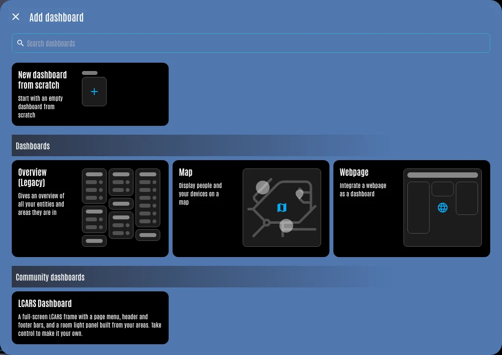
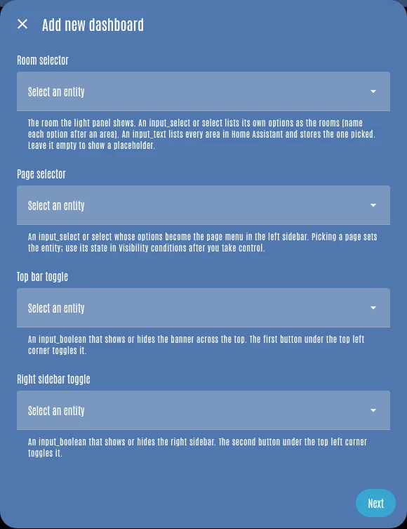
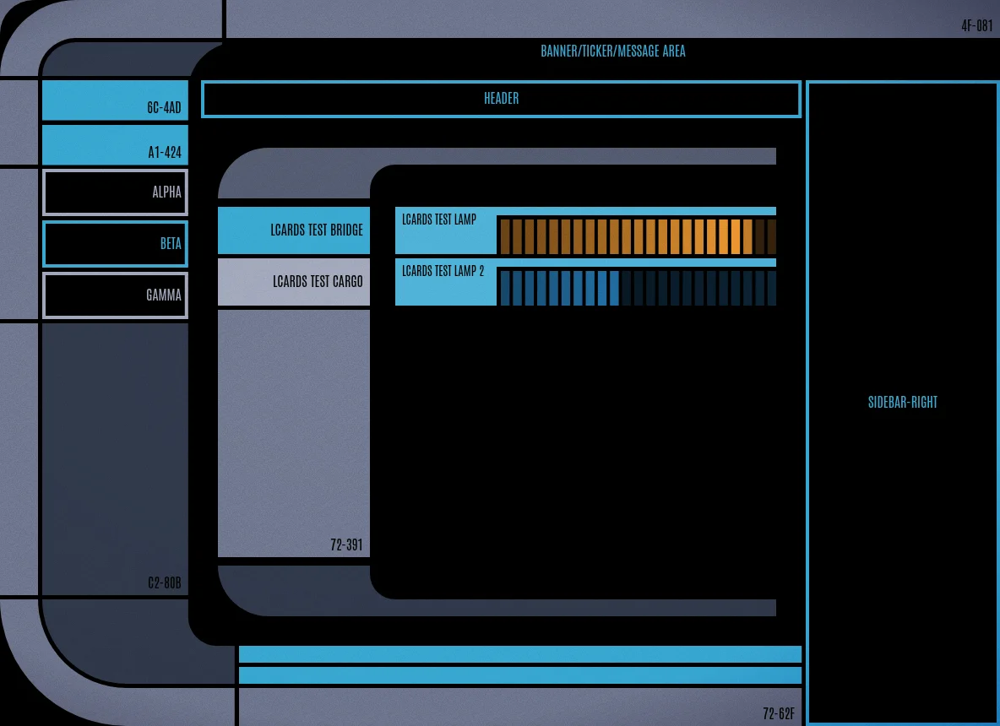

# Dashboard Strategies

**A dashboard strategy builds a whole dashboard for you from a few settings.** You pick it in Home Assistant's Add dashboard dialog, choose a few helpers, and LCARdS draws the screen. The dashboard stores only the settings, so it stays current as your home changes.

- A strategy dashboard rebuilds itself when you add, rename or move areas, devices or entities. While it does, you can change its settings but not its cards.
- To change the cards, **take control**: Home Assistant saves what the strategy made as an ordinary dashboard, and you edit it like any other. The strategy no longer runs after that.
- LCARdS has one dashboard strategy so far, the [LCARS Dashboard](#lcars-dashboard). More are on the way.

| Strategy | In the Add dashboard dialog | What it builds |
|---|---|---|
| [`custom:lcars-shell`](#lcars-dashboard) | LCARS Dashboard | A full-screen LCARS frame with a page menu and a room light panel |

## Create a strategy dashboard

**Strategy dashboards are created from Settings → Dashboards, like any other dashboard.** LCARdS must be installed and Home Assistant reloaded once, so the browser has loaded LCARdS.

1. Open **Settings → Dashboards** and select **Add dashboard**.
2. Under **Community dashboards**, pick **LCARS Dashboard**.
3. Pick the helpers for each setting (see [Helpers to create](#helpers-to-create)) and select **Next**. Every setting can stay empty: the room panel and the page menu then show a hint, and you can pick helpers later.
4. Give the dashboard a title and an icon, and select **Create**.



::: details More about creating one
- **Not in the list:** the Community dashboards heading appears only when the browser has loaded LCARdS. Reload the page (Ctrl+Shift+R) after installing or updating, and check that the LCARdS integration is set up under **Settings → Devices & services**.
- **YAML dashboards:** a dashboard kept in a YAML file can use a strategy too: put the settings under `strategy:` at the top of the file, as in the [example below](#settings).
:::

## Change the settings

**Open the dashboard, select the pencil, and the Edit dashboard dialog shows the strategy's settings.** Change a helper and the screen rebuilds when you save.



- The dialog's three-dot menu has **Edit in YAML**, which shows the settings as YAML, and **Take control** (see [Take control](#take-control)).
- Only administrators see the pencil.

## When it rebuilds

**Home Assistant rebuilds a strategy dashboard when your areas, devices, entities or floors change, and when you change its settings.** You don't need to reload the page.

- Adding a light to an area, renaming an area or creating a new one shows up on the screen within a moment.
- Changing a state (turning a light on, picking a room) doesn't rebuild anything. The cards follow states themselves, so the screen stays fast.
- A helper you rename or delete has to be picked again in the settings.

## Take control

**Take control turns the strategy's output into an ordinary dashboard you can edit.** Use it when you want to fill the frame with your own cards, move parts or change colours.

- Select the pencil, then **Take control** in the Edit dashboard dialog's three-dot menu. Home Assistant asks you to confirm, then saves every card the strategy made.
- After that the dashboard no longer rebuilds: new areas and lights don't appear by themselves. Create a new strategy dashboard if you want both.
- The LCARS Dashboard is one [layout view](../cards/layout-view/), so after taking control you edit it with the layout view's own editor.

## LCARS Dashboard

**`custom:lcars-shell` draws a full-screen LCARS frame: corner sweeps, header and footer bars, a page menu on the left and a room light panel in the middle.** It is a starting point: the header, the top bar and the right sidebar hold placeholder labels for you to replace after you [take control](#take-control).



- **Room light panel:** a list of rooms and, next to it, a slider for each light in the picked room. Tap a slider to toggle the light, hold it for its more-info dialog. A room without lights says so.
- **Page menu:** the options of your page selector as buttons in the left sidebar. Picking one only sets the helper; nothing on the screen changes. After you take control, give your cards a Visibility condition on that helper to show them on one page.
- **Top bar and right sidebar:** the two buttons under the top left corner toggle them, through two `input_boolean` helpers. Without the helpers the buttons are still drawn but do nothing; the top bar is left out and the right sidebar always shows.
- An [alert overlay](../cards/alert-overlay/) sits over the top left corner and shows during an alert.

### Helpers to create

**The shell reads up to four helpers; create them in Settings → Devices & services → Helpers → Create helper.** Each one is optional.

| Setting | Helper | What to put in it |
|---|---|---|
| Room selector | Dropdown (`input_select`) or Text (`input_text`) | A Dropdown: one option per room, spelled exactly like the area's name (or its area id). A Text: nothing, the shell lists your areas and stores the one picked |
| Page selector | Dropdown (`input_select`) | One option per page, for example `Main`, `Engineering`, `Sensors` |
| Top bar toggle | Toggle (`input_boolean`) | Nothing; on shows the top bar |
| Right sidebar toggle | Toggle (`input_boolean`) | Nothing; on shows the right sidebar |

### Room selector modes

**The room selector decides where the room list comes from.** Pick a Text helper to list every area with no upkeep; pick a Dropdown to show only some rooms, in your own order. Both show the same light lists.

- **A Dropdown (`input_select` or `select`):** its options are the rooms, in your order. Spell each option exactly like an area's name in Settings → Areas, labels & zones, capitals included (or use the area id). An option that matches no area shows "No lights in this room". New areas need a new option.
- **A Text helper (`input_text`):** the room list is every area in Home Assistant, sorted by name, with its icon. Picking a room stores its area id in the helper. New areas appear on their own.
- A light belongs to a room through its own area, or else its device's area. Hidden lights and lights with an entity category (configuration lights such as status LEDs) are left out.

### Settings

**These are the keys of the dashboard's `strategy:` block; the settings dialog writes them for you.** The example is the whole dashboard config; **Edit in YAML** shows the lines under `strategy:`. It is a whole dashboard, so it can't render inside this page.

```yaml
strategy:
  type: custom:lcars-shell
  room_selector_entity: input_select.lcars_room
  page_selector_entity: input_select.lcars_page
  top_bar_entity: input_boolean.lcars_top_bar
  right_sidebar_entity: input_boolean.lcars_right_sidebar
```

::: details More about the LCARS Dashboard
- **One view:** the dashboard has a single view at `/<dashboard>/lcars`, a [layout view](../cards/layout-view/) sized to the screen. It is built from LCARdS cards only, so it needs no other custom cards.
- **Narrow screens:** below 1010 px wide the gap before the right sidebar narrows to 1 px.
- **Colours:** every colour comes from your theme's LCARS variables, so [alert modes](../core/themes/) recolour the frame.
- **"Configuration error" in the room panel:** before 2026.11 the room lists used the auto-entities card from HACS, and without it each room showed this error. Since 2026.11 LCARdS reads the lights from your areas itself: update LCARdS and hard refresh the page (Ctrl+Shift+R).
:::

| Key | Type | Default | Description |
|---|---|---|---|
| `type` | string | required | `custom:lcars-shell` |
| `room_selector_entity` | string | - | An `input_select`, `select` or `input_text` that picks the room. Empty shows a hint in the room panel |
| `page_selector_entity` | string | - | An `input_select` or `select` whose options become the page menu. Empty shows a hint in the sidebar |
| `top_bar_entity` | string | - | An `input_boolean` that shows or hides the top bar. Empty leaves the top bar out |
| `right_sidebar_entity` | string | - | An `input_boolean` that shows or hides the right sidebar. Empty keeps the sidebar shown |
