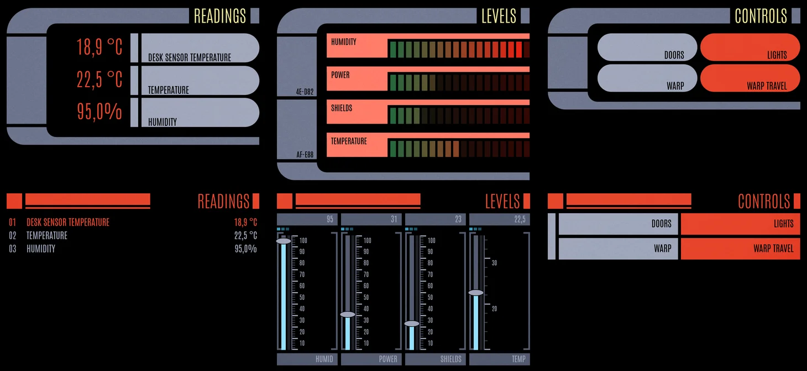

# Section Strategies

**An automatic section fills itself with cards for the area (or devices, labels, entities) you pick, and stays up to date.** LCARdS adds three to Home Assistant's sections dashboards, each an LCARS building block: readings, gauges and controls, drawn in the classic (TNG) or the Picard look.

- They work in any sections view, beside your own sections and Home Assistant's built-in automatic sections.
- When you add a light to an area, rename a sensor or move a device, the section rebuilds itself. You change its settings, not its cards.
- Every section has a title and uses your theme's LCARS colours. A frame in the section's look is one switch away.
- For more than these settings, take control of the section and edit its cards.



| Section | In the chooser | Classic look | Picard look |
|---|---|---|---|
| [`custom:lcars-readings`](#lcars-readings) | LCARS readings | A number column: big values beside their names | A numbered readings table |
| [`custom:lcars-gauges`](#lcars-gauges) | LCARS gauges | Pill bars with the name in the end cap | Upright column gauges |
| [`custom:lcars-controls`](#lcars-controls) | LCARS controls | Rounded pills | Filled buttons beside a thin bar |

## Add a section

**Sections are added in the dashboard's edit mode, from Create section.** The dashboard's view must be a sections view, Home Assistant's default for new dashboards.

1. Open the dashboard, select the pencil, and select the **Create section** tile at the end of the view.
2. Pick **Automatic section**, then one of the LCARS sections under **Community sections**. Each tile shows a preview built from the area with the most matching entities.
3. On the **Strategy** tab, pick an area (or devices, floors, labels or entities), and if you like a title, the look, a frame, how many items sit side by side and the spacing. Save.

::: details More about adding sections
- **Not in the chooser:** the Community sections heading appears only when the browser has loaded LCARdS. Hard refresh the page (Ctrl+Shift+R) after installing or updating.
- **Change it later:** select the section's pencil in edit mode; the Strategy tab holds its settings, and the three-dot menu shows them as YAML.
- **Width and visibility:** the section's other tabs (appearance, visibility) work as for any section.
- **Take control:** to change more than the settings, take control of the section in its menu; it becomes ordinary LCARdS cards that no longer update themselves.
:::

## Section keys

**Every LCARS section takes the same keys: the two of Home Assistant's own Entities section (`title`, `target`) and nine for its look and sizes.** The settings form writes them for you; this is what its YAML looks like inside a sections view.

- `target` can name several things at once; the section shows the matching entities of all of them.
- Hidden entities and configuration or diagnostic entities are left out, unless you name them under `entity_id`.
- Names are shortened for the small LCARS labels: the area's name and any words every name in the section starts with are dropped ("Bridge Temperature" in the Bridge reads TEMPERATURE).
- The frame follows the look: the classic bracket, open on the right, is built in pieces like the DS9 brackets (a sweep that runs on as the title bar, a bar down the left and a closing sweep, with small breaks between them); the Picard sweep runs along the top, down the left and along the bottom, open on the right, under the Picard title (a thin bar with the title at its end).
- The classic bracket's side breaks into blocks as the section grows taller (about one per 90 px), as on the TNG panels; `codes: true` puts a random code number on each.
- Sizes have four keys: `item_height` for each row of items, `gap` between items, `padding` between the items and the frame (or the section's edges), and `header_gap` between the title and the first row. Leave them out for what suits the look; give sections side by side the same `item_height` to line their rows up.

```yaml
type: sections
sections:
  - strategy:
      type: custom:lcars-readings
      title: BRIDGE
      target:
        area_id: bridge
  - strategy:
      type: custom:lcars-controls
      look: picard
      frame: true
      columns: 3
      item_height: 40
      gap: 8
      header_gap: 12
      target:
        floor_id: deck_1
        entity_id:
          - switch.coffee_maker
```

| Key | Type | Default | Description |
|---|---|---|---|
| `type` | string | required | The section: `custom:lcars-readings`, `custom:lcars-gauges` or `custom:lcars-controls` |
| `title` | string | the area's name | The title's text. Without it: the target's area name when the target is one area, else READINGS, LEVELS or CONTROLS |
| `look` | string | `classic` | `classic` (TNG-era pills and bars) or `picard` (column gauges, filled buttons, a readings table) |
| `frame` | boolean | `false` | A frame round the items in the look's style: a bracket in pieces with the title in its top bar (classic) or a sweep open on the right (Picard) |
| `codes` | boolean | `false` | Classic frame only: a random code number at the bottom right of each block of the bracket's side |
| `columns` | number | per section | Items side by side, 1 to 6. The Picard readings table is always one column |
| `max_items` | number | per section | At most this many items: 12 readings, 8 gauges or 24 controls unless set |
| `item_height` | number | per section | Height of each row of items, px (in a readings table, of each line). Rows are then exactly this tall, so sections side by side line up. Kept above a floor per kind (120 for Picard column gauges) |
| `gap` | number | `6` | Space between the items, px (0 to 64) |
| `padding` | number | per look | Space between the items and the frame or the section's edges, px: `18` in a classic bracket, `16` in a Picard sweep, the gap beside the Picard controls' side bar, else `0` |
| `header_gap` | number | per look | Space between the title (or the bracket's top bar) and the first row, px: `18` in a classic bracket, else `8` |
| `target.area_id` | string or list | - | Areas: entities in the area, directly or through their device |
| `target.floor_id` | string or list | - | Floors: every area on them |
| `target.device_id` | string or list | - | Devices: their entities |
| `target.label_id` | string or list | - | Labels on entities, devices or areas |
| `target.entity_id` | string or list | - | Entities, always shown in the section whatever their domain, even when hidden; an area, device, floor or label brings in only what suits the section |

## lcars-readings

**Each sensor's name and its value: a number column, as on the TNG operations panels, or a readings table.** Use it for an area's temperature, humidity, power and the like.

- Sensors with a device class or a unit are listed; temperature, humidity, light level, CO2, pressure, power, energy and battery come first, in that order, then the rest by name.
- Number column: each value as a big number, a small block, then the name in a pill (classic) or a filled button (Picard); tap the name for its more-info dialog. It is the classic look's default.
- Table: names and values in rows; the Picard table numbers its rows and lights the first in the accent colour. It is the Picard look's default.

```yaml
type: sections
sections:
  - strategy:
      type: custom:lcars-readings
      mode: table
      target:
        area_id: living_room
```

| Key | Type | Default | Description |
|---|---|---|---|
| [Section keys](#section-keys) | | | `type`, `title`, `target`, `look`, `frame`, `codes`, `columns`, `max_items`, `item_height`, `gap`, `padding`, `header_gap` |
| `mode` | string | `numbers` classic, `table` Picard | `numbers` (the number column) or `table` |
| `columns` | number | `1` | Number-column rows side by side; a table is always one |

## lcars-gauges

**Gauges for levels: classic pill bars, or a bank of upright Picard column gauges with the value in the top cap and a short name in the bottom one.** Use it for humidity, battery, a temperature, a number helper or the lights of a room.

- From an area, device or label: sensors in % and temperature, humidity or battery sensors, number helpers and number entities, dimmable lights (brightness), fans (speed), covers (position) and media players (volume). Drag a gauge to set what it can set: a light's gauge follows your finger while you drag.
- An entity you pick yourself is always a gauge, whatever its domain; so a dimmable light can be a toggle in a controls section and a gauge here.
- A Picard cap shows one word, shortened (TEMP, HUMID, BATT); a classic bar shows the whole short name in its left cap.

```yaml
type: sections
sections:
  - strategy:
      type: custom:lcars-gauges
      title: LEVELS
      frame: true
      codes: true
      target:
        label_id: climate
```

| Key | Type | Default | Description |
|---|---|---|---|
| [Section keys](#section-keys) | | | `type`, `title`, `target`, `look`, `frame`, `codes`, `columns`, `max_items`, `item_height`, `gap`, `padding`, `header_gap` |
| `columns` | number | `1` classic, `4` Picard | Gauges side by side |

## lcars-controls

**Toggles for the lights, switches, fans and toggle helpers of the target: classic rounded pills, or Picard filled buttons beside a thin bar.** Tap one to toggle it, hold it for its more-info dialog.

- A pill or button shows its entity's state by colour.

```yaml
type: sections
sections:
  - strategy:
      type: custom:lcars-controls
      look: picard
      target:
        area_id: kitchen
```

| Key | Type | Default | Description |
|---|---|---|---|
| [Section keys](#section-keys) | | | `type`, `title`, `target`, `look`, `frame`, `codes`, `columns`, `max_items`, `item_height`, `gap`, `padding`, `header_gap` |
| `columns` | number | `2` | Pills or buttons side by side |
