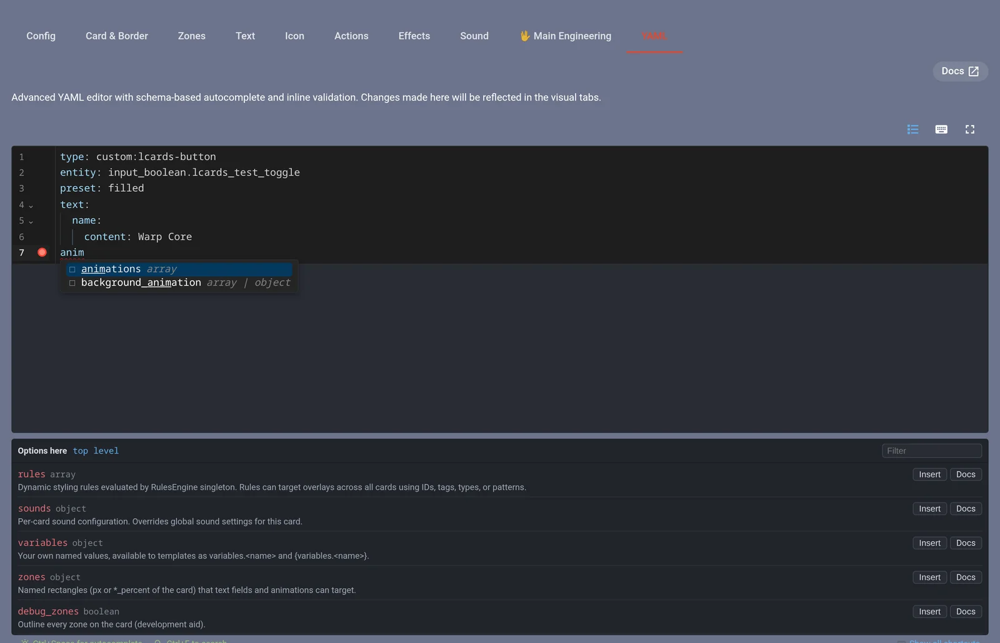
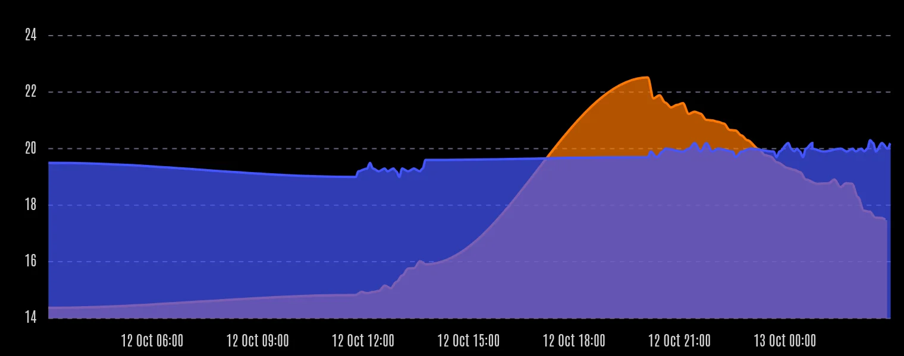
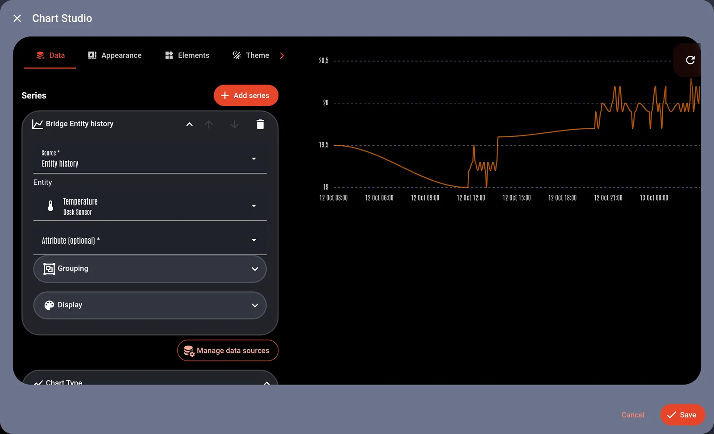
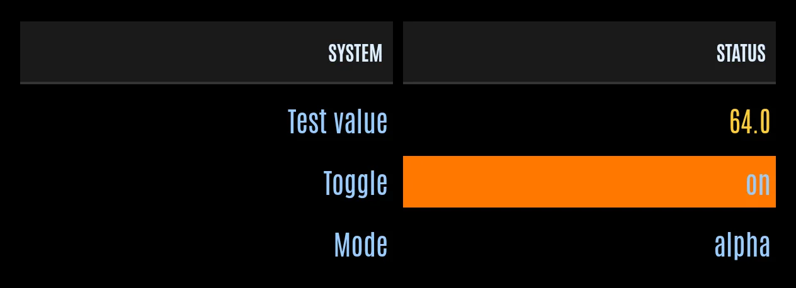
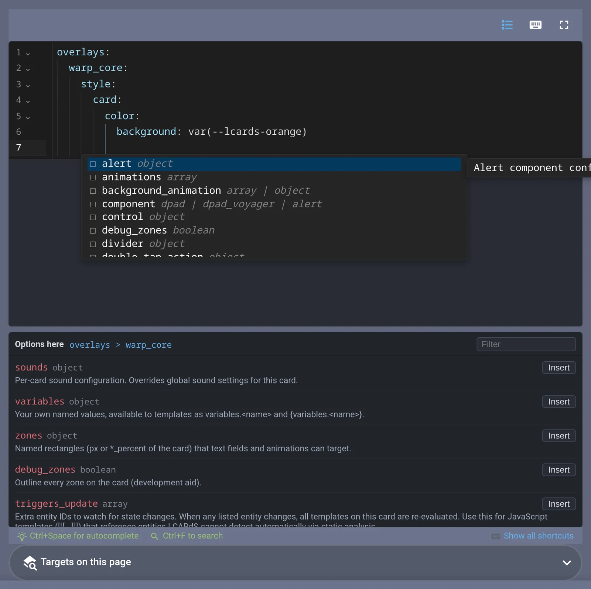
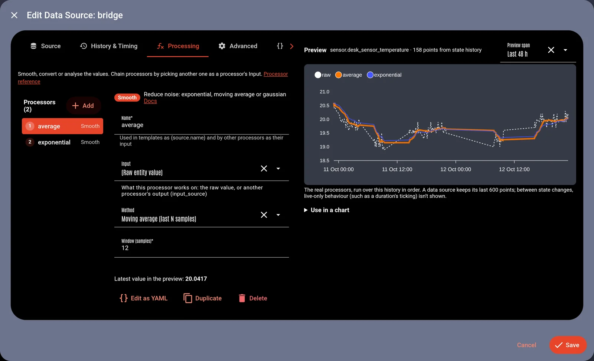
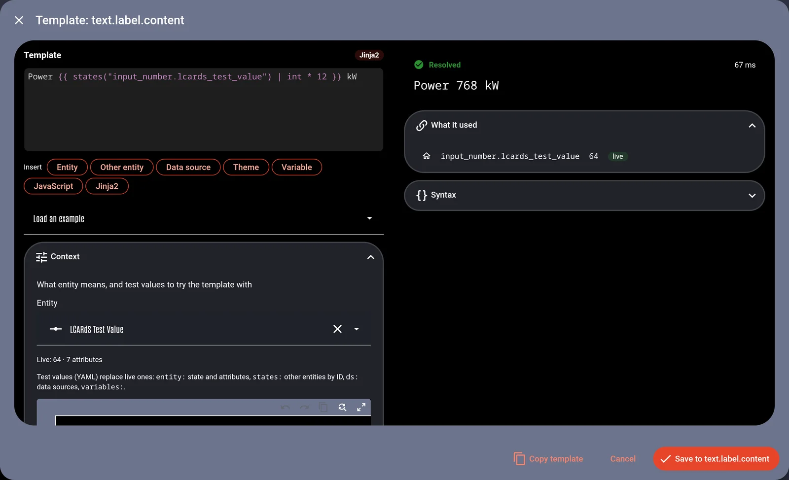
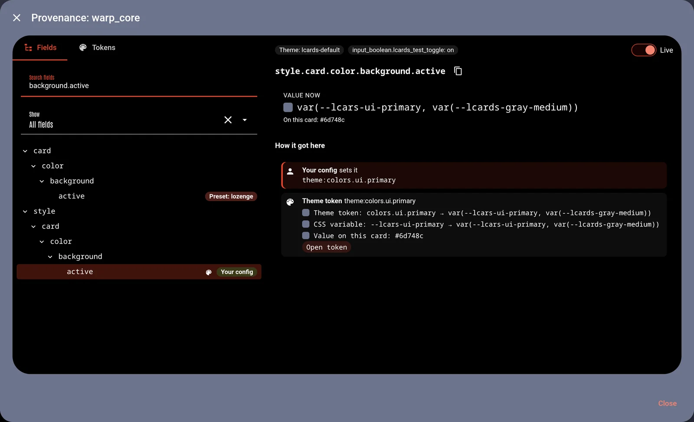
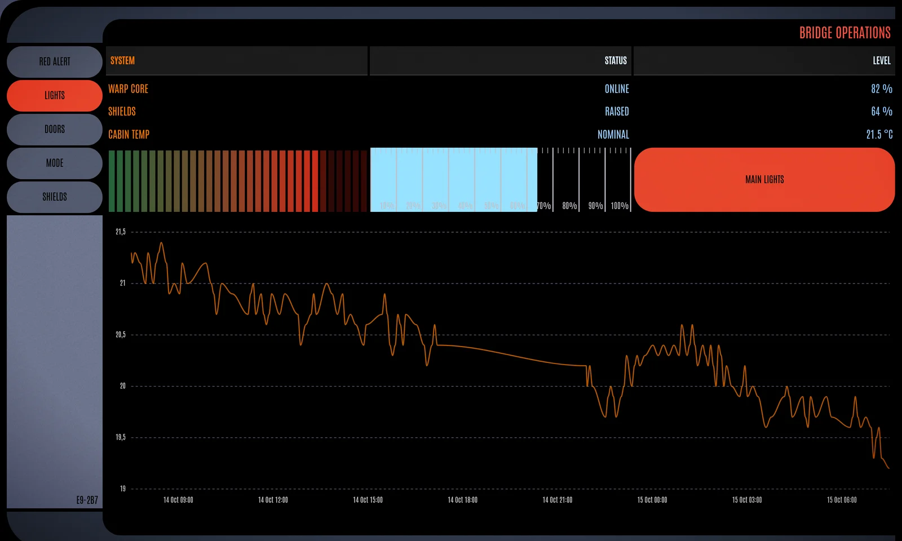
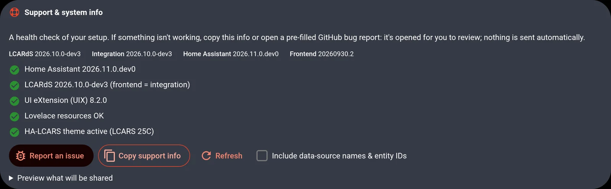

# LCARdS 2026.10.0

<video class="release-shot" src="/releases/2026.10.0/showcase-social.webm" title="An empty LCARS view builds itself stage by stage: elbows slide in, sidebar buttons follow, a ship display draws its shield arcs and lines, then a chart, a room table and Picard gauges appear; lights switch on and a red alert plays" autoplay loop muted playsinline></video>

A big release focused on making LCARdS more approachable and easier to start with, and an overall increase in usability and reliability.

New to LCARdS?  The overhauled docs walk you from install to your first screen.  Examples throughout the docs now mount *real live cards* to demonstrate the config.  You can even use the card playgrounds to try out different options before using them in your dashboard.

Already running it? Your dashboards will load much faster - lazy loading components when needed.  Colours and alert modes behave the same in every card, charts and data grids are completely overhauled (see below), the studios share one polished look, if when something does go wrong, a health check tells you what and how to fix it.

Speaking of dashboards, there is a small gallery of dashboards that demo LCARdS functionality and includes the config to copy.  The new *LCARdS skill* enables an AI assistant to fully underdstand LCARdS - it can write accurate working configs, and even review existing configs and fix it for you.

Want it to look the part? A new LCARS design guide, with new presets, components and elbow shapes, shows what makes a screen read as LCARS. The new Astrometrics card draws 3D star maps, galaxies and the sky with the sun and moon. Backgrounds can now run on your graphics card: perspective grid floors, grids wrapped round cylinders, domes and spheres, a holographic planet, a warp starfield, and smoother noise effects. And there are new animation presets, a ring gauge for sliders and a full-width alert band.

## Before you update

- **Home Assistant 2026.10 or newer is required.** Home Assistant Marketplace (formerly HACS) will not offer the upgrade on Home Assistant versions below 2026.10.
- **Charts and Data Grids use a new config format.** Your existing cards *will keep working*: they are converted on the fly at runtime until you update the config.  To update, just open each one in the card editor and press Save to store the new form. See the [chart](/cards/chart/upgrading) and [data grid](/cards/data-grid/upgrading) upgrade pages.
- **Stacked background animations draw in the documented order.** The first entry in `background_animation` is now the bottom layer, as the [docs](/core/effects/background-animations#effect-stacking) always said; before, the stack was drawn upside down. If you stack effects and tuned them to the old order, reverse the list.
- **Rule priority on cards is fixed.** The higher `priority` wins, as the [rules docs](/core/rules/#priority) always said. If you set priorities on a card's rules, check that the right one still applies.
- **`to_state` animations play on the change only.** An `on_entity_change` animation with `to_state` used to play again every time its card redrew while the state matched; it now plays when the state changes to it, and `from_state` animations never play on load. If you relied on the replay, use a rule or `while` instead.
- **`panel-light` and `panel-dark` follow their entity.** They show the theme's accent colour when their entity is on and the dark structure colour when off, and now use theme colours, so they also show without HA-LCARS. Check panels that set an entity.
- **Background animations look a little different.** `grid`, `contour-field`, `plasma` and `fluid` are now drawn with WebGL where the browser supports it (see [WebGL backgrounds](#webgl-backgrounds)); set `renderer: canvas` on an effect to keep the old drawing. Backgrounds also follow their card's size now (some were drawn squashed after the card changed width), grid major lines stay evenly spaced (two could meet side by side), and a `contour-field` with a fixed `seed` lays its field out differently once.
- **The Borg assimilation intro is new.** It now plays on WebGL with an assimilation front, Borg circuitry and a Borg cube (see [Borg assimilation, rebuilt](#borg-assimilation-rebuilt)). To keep the original tendril animation, add `renderer: canvas` to the `lcards.borg_assimilate` action or pick **Classic** in the Config Panel; all of its settings still work.
- **Deprecated animation keys:** the old custom animation form (`type: custom` with `animejs:`) still runs; the config checker points you to `preset: custom` with `params`. `settle_at` on `text-scramble` is no longer used and can go. A top-level `timelines:` block (never documented, never ran) is gone; use a [`sequence`](/core/animations/preset-reference#sequence) animation.

## New features

Try them live first: the [Live Demo](/getting-started/live-demo) runs this release's new cards and effects in the browser.

### Documentation:TNG

The docs site is rebuilt from the ground up for beginners and for exploring:

- **Start here:** one path from [installing LCARdS](/getting-started/installation) to [building your first dashboard](/getting-started/building-dashboards), with a [Getting help](/getting-started/getting-help) checklist when something goes wrong.
- **How LCARdS works:** an interactive diagram on [What is LCARdS](/getting-started/what-is-lcards) designed to help explore and understand how the parts of LCARdS work together with Home Assistant. Click any part to see what it works with, or play a scenario (alert mode, rules, data sources and more) to see a step by step walkthrough.
- **Live cards everywhere:** over a hundred examples render the real cards, and card pages show galleries of every preset and style.
- **Playgrounds:** edit a button, elbow, slider, select menu, chart or data grid with completion and a live preview, then copy the YAML. Animation presets, filters, background effects and data source processors can be tried right on their reference pages.
- **A [dashboard gallery](/getting-started/dashboard-gallery):** seven complete dashboards to copy, each recorded in action.
- **[Check Your Config](/getting-started/config-checker):** paste a card or a whole dashboard and get plain-language problems, line by line, with links to the right page.
- **Docs for your version:** the stable release, the development docs and every past release, with a switcher by the title. Each editor tab links straight to its page.

### Help from AI, and help built in

LCARdS now comes ready for AI assistants, so Claude, ChatGPT and others can write cards and even whole dashboards that actually work:

- **The LCARdS skill for Claude:** a plugin for Claude Code (install it with two `/plugin` commands and it keeps itself up to date) and a download for claude.ai and the Claude apps; see [Getting AI Help](/getting-started/ai-assistance). It teaches Claude every option, built-in preset and colour for your version, asks for your real entity ids instead of inventing them, and checks its YAML before handing it over. It follows the **Open Agent Skills** standard.
- **Fix existing YAML:** paste a config into Claude with the skill and ask it to check and fix it.
- **Your home's context:** with the community [ha-mcp](https://github.com/homeassistant-ai/ha-mcp) server, Claude can look up your areas and entities itself.
- **Other assistants:** for assistants that cannot use the skill, a validated schema for every card is provided for you to attach to the chat, and an `llms.txt`/`llms-full.txt` for tools that look for one.
- **The same checker everywhere:** in the skill, [in your browser](/getting-started/config-checker) and on the command line; it finds unknown keys and misspelt names and suggests the right one. It also warns about misspelt HA-LCARS and LCARdS colour variables.
- **Knows your theme and styling tools:** the skill knows every HA-LCARS colour variable and theme, and how UIX fits with LCARdS. In Claude Code the plugin checks every LCARdS YAML file Claude writes and adds `/lcards:check` and `/lcards:dashboard` commands.

See [Getting AI help](/getting-started/ai-assistance).

::: details Prefer to write YAML yourself? The LCARdS YAML tab in every card editor now knows the card's schema

- **Completion** for keys at the cursor (nested ones and list items included), their values and your entity ids.
- **Hover help** on any key: what it does, its type, default and allowed values.
- **Options here:** a panel listing everything that can go at the cursor, with Insert and a link to its docs.
- **Mistakes underlined as you type:** YAML errors, unknown keys and wrong values, plus a one-click fix for colours like `#ff9900` that YAML would otherwise read as a comment.

The same help works in the docs playgrounds and the studios' YAML tabs.

:::

### Charts, rebuilt

Charts has been rebuilt to be more intutitive.  History, long-term statistics and LCARdS data sources in one `sources:` list, with time spans and grouping like apexcharts-card, several y axes, no point cap and upgraded to ApexCharts 7 library.

See [Series and time](/cards/chart/series) or try the [chart playground](/cards/chart/playground); coming from apexcharts-card, see the [upgrade page](/cards/chart/upgrading#coming-from-apexcharts-card).

::: details More on charts
- `graph_span`, span start, end and offset, and `group_by` (average, min, max, sum, median, delta and more, plus min/max bands, box plots and candlesticks).
- Per-series units, precision, colours, line style and chart type.
- Pie, donut, gauge, radar and treemap charts plot each series' latest value.
- Chart Studio: a Time and axes section, a YAML tab with completion, and data source management.

:::

### Data grid, rebuilt

Conditional cell colours, header rows, tap actions on cells, column formats and `highlight_changes`, which flashes cells when their value changes. See [Data](/cards/data-grid/data), [Styling](/cards/data-grid/styling) or the [data grid playground](/cards/data-grid/playground).

### Main Engineering and the Studios

Every studio and Main Engineering panel now shares one style: tabs, a live preview, short help and the same buttons. New inside: updated rules editor you edit in context, a live processor preview for data sources, revamped template sandbox, an updated provenance inspector that shows where any value comes from, and the theme tokens each card uses. See [Main Engineering](/cards/main-engineering).

::: details Pictures and details
- **Rules, edited in context:** a rule's Apply section is YAML that knows your dashboard. Completion offers every card id on the page, and the patch for a card completes against that card's own options (style, text, icons, animations and the rest), with hover help and the Options here panel. "Start with this card" fills in the card you are editing, a table lists the ids, types and tags you can target, and new rules show in the list straight away. See [Rules](/core/rules/).

- **Data sources:** processors edited inline in the order they run, previewed against the raw values. Once you are happy, "Use in a chart" gives you a fully working `lcards-chart` config.

- **Templates:** each templated field shows its live result; the sandbox has completion for entities, attributes, data sources and theme tokens, test values and "Save to field".

- **Provenance:** pick a field to see your config, presets, theme tokens, templates and rules that shaped it, live.

- **Theme:** the tokens a card uses, with their values.
:::

### Entrance animations: `on_show`

A new animation trigger that plays each time a card appears: when its view opens, when you come back to it, and when a visibility condition shows it. Stagger a few with delays and a view builds itself up; MSD lines and shapes can draw themselves in. See [Entrance animations](/core/animations#entrance-animations-with-on-show).

<video class="release-shot" src="/releases/2026.10.0/showcase.webm" title="An empty LCARS view builds itself stage by stage: elbows slide in, sidebar buttons follow, a ship display draws its shield arcs and lines, then a chart, a room table and Picard gauges appear; lights switch on and a red alert plays" autoplay loop muted playsinline></video>

### Animated backgrounds

Background animations can now be animated themselves. Point an animation at `target: background` and a trigger, rule or alert can change the starfield's speed, a grid's colour or a level's fill, eased like any other animation; for example a starfield that ramps to warp on red alert. Entity-bound background values (`map_range` and templates) now glide to their new value instead of jumping, over a `transition` you choose, and every moving effect takes a `speed` multiplier. See [Animating the background](/core/effects/background-animations#animating-the-background).

### WebGL backgrounds

Background effects can now be drawn by your graphics card, sharing one WebGL context across the whole dashboard and falling back to the classic drawing on devices without WebGL:

<video class="release-shot" src="/releases/2026.10.0/webgl-grid-floor.webm" title="A flat orange grid with white major lines tips back into a perspective floor running to the horizon, a scan line sweeping toward the viewer, then tips flat again" autoplay loop muted playsinline></video>

- **Grid floors:** `grid` (and the diagonal and hexagonal grids) gains `view: floor`, a perspective floor running to a calm horizon, with a camera you can tilt, turn and zoom, and animate: a flat grid can tip into a floor on red alert. Line widths now work in every view, with a scan line sweeping in.
- **Grid surfaces:** the same grids can wrap a cylinder, a dome or a sphere for astrometrics displays (`surface`), seen from outside or from inside: a tunnel down a cylinder, a planetarium inside a dome. They spin with the grid's scroll, keep their line spacing and widths, and dim their far side.
- **Gravity wells:** `surface: well` draws a funnel of any shape: the classic gravity-well trumpet by default, a cone, a bowl or a wormhole (two trumpets throat to throat), or your own profile from a list of diameters. Wells can morph from one profile to another and carry ripples running down into the throat, all animatable.
- **Polar charts:** `pattern: polar` draws rings and spokes round any point on the card, flat or as a tilted galaxy-map floor, with rings that can pulse outward and spokes that turn. It works without WebGL too.
- **Look from anywhere:** a new `camera_roll` turns the view round its line of sight (the grids and `warp-starfield`, which can now bank at warp), and `surface_rotate_x`, `_y` and `_z` turn a surface itself, so a funnel can lean, tip or tumble while the camera circles it.
- **`holo-sphere`:** a rotating wireframe planet with a scan band, placed and sized anywhere on the card.
- **`warp-starfield`:** stars flying at you in 3D that stretch into streaks as the speed rises, ready for a warp-speed animation; turn, tilt and bank the view as the ship manoeuvres; `spectrum: true` splits the streaks into colour, as in some TNG warp shots: a Doppler shift of each star's own colour (violet toward the tail, or reversed).
- **Smoother noise effects:** `contour-field`, `plasma` and `fluid` draw the same picture without the pause they used to cause when a card first drew, resized or changed alert colours, and their noise settings can now be animated. `nebula` gains `volumetric: true` for clouds shaded with drifting wisps.
- **Alert colours change in place:** effects keep their motion through an alert instead of restarting.

<video class="release-shot" src="/releases/2026.10.0/grid-wells.webm" title="An orange polar grid funnels into a gravity well, ripples running down the trumpet into the narrow throat" autoplay loop muted playsinline></video>

Set `renderer: canvas` on an effect to keep the classic drawing. See [WebGL presets](/core/effects/background-animations#webgl-presets) [grid views and camera](/core/effects/background-animations/preset-reference#grid-views-and-camera), [grid surfaces](/core/effects/background-animations/preset-reference#grid-surfaces), [grid wells](/core/effects/background-animations/preset-reference#grid-wells) and the [polar pattern](/core/effects/background-animations/preset-reference#polar-pattern).

### Design LCARS screens

A new guide, [Designing LCARS Screens](/getting-started/lcars-design), explains what makes a screen read as LCARS, for the Picard and the classic TNG looks: colour by theme role, structure, screen layouts and over twenty patterns rendered live. The dashboard gallery gains screens built from it, and the LCARdS skill uses it when it designs a dashboard for you. New building blocks to go with it:

- Presets `toggle-tab` (state as a line along the top) and `panel-flagged` (a dark code panel with an accent flag). See [Presets](/core/presets).
- Button components `brackets` (a round display between two arcs) and `radar` (rings, cross hairs and a sweep). See [Brackets and Radar](/cards/button/#component-mode-brackets-and-radar).
- Elbow types `bar-slant-right`, `bar-slant-left` and `bar-parallelogram`: bars with cut ends that stretch to any width. See [Elbow types](/cards/elbow/#elbow-types).

### New animation presets

- **`text-decode`:** text that resolves out of scrambling characters, like an LCARS readout.
- **`boot-sequence`:** a card powers up part by part (draw, flicker or sweep, decode).
- **`tap-ripple`:** a wave across a grid starting where you tap.
- **`sensor-sweep`:** a radar wedge sweeping round with a ping ring.
- **`morph`:** one shape morphing into another.

Stagger presets now take the full set of stagger options and do what their docs say, and random presets (`flicker`, `glitch`, `chaos`) take a `seed` and play a new pattern on each loop. With your device's Reduce motion setting on, `essential_motion: true` keeps a meaningful animation such as an alert flash playing ([Reduced motion](/core/animations#reduced-motion)). See the [animation preset reference](/core/animations/preset-reference).

### Slider: ring gauge

`component: ring` (and the `ring` and `picard-ring` presets) turns a slider into a circular gauge you drag around, with scale ticks, value markers, coloured band ranges and text in the centre. See [Ring Gauge](/cards/slider-card/#ring-gauge).

### Alert band

`display: band` shows an alert as a row of dashes in the alert colour across the screen with the alert symbol in the middle, in the Picard style. The dashboard stays usable underneath; tap the symbol to dismiss. See [Alert Band](/cards/alert-overlay/#alert-band).

### Borg assimilation, rebuilt

Resistance is still futile, but now it is drawn by your graphics card. Injection sites grow glowing tendrils with light pulsing along them, an assimilation front crawls out across the screen and leaves Borg circuitry behind it, a Borg cube emerges at the centre, and bursts of signal corruption tear the picture. The cube is solid: machinery at several scales, a rail lattice a little off each face, green glows pulsing deep inside and a soft halo (`cube_style: classic` gives a lighter wireframe cube). `cube`, `corruption` and `overrun` tune it; `renderer: canvas` keeps the classic intro, and devices without WebGL get it automatically.

Assimilation and deassimilation now have sound events of their own, **Borg assimilation** and **Borg deassimilation**. LCARdS ships no Borg audio: give them your own file in the sound overrides, in a sound scheme, or for one call with the new `sound` field (`sound: /local/sounds/borg.mp3`). See [Borg Assimilation](/core/borg).

### Astrometrics card

A new card for 3D scenes in the style of the astrometrics lab and stellar cartography: a lettered sector map with territories, a galaxy disc with Federation and Borg space, a planet with an away team on its surface, or the sky over your home with the sun and moon where they are right now.

- **Explore it:** drag to orbit, scroll or pinch to zoom toward the pointer, double-tap empty space to fly in toward that spot, tap a labelled point to fly to it, and fly between named views with a tap. Panning follows the screen, so a side view pans up and down, and the scene can never be panned out of sight. Optional on-card buttons pan, zoom and reset (hold to keep moving), and the arrow, plus, minus and Home keys work when the card has focus. See [Controls](/cards/astrometrics/#controls).
- **Fly from anywhere:** any LCARdS card's `fly-to` action can fly an astrometrics card's camera to a view or a point, and the new `lcards.fly_to` action does it from an automation (doorbell rings, the wall panel shows the front door). See [Fly-to from other cards and automations](/cards/astrometrics/data#fly-to-from-other-cards-and-automations).
- **Astrometrics Studio:** a full-screen editor with the live scene. Tap a point or object on the scene to edit it (rings and paths by their line); every object type has a form made from its options. Drag points on the scene, or place new ones with a tap on a globe, a dome, a sector map or the ground. The Camera tab captures the preview's camera as a named view, flies between views and sets the one the card starts on. The Starters tab copies a whole scene (the galaxy, a sector map, the sky dome, a solar system, a Federation map, a starbase approach, Deep Space 9, the Utopia Planitia yards, a Borg encounter) or a part (a planet with moons, an asteroid belt, a nebula field, a set of territories, a starbase) into your card, ready to change. The Points tab lists every point with its placement, label, marker and colour; **Pick on preview** places a point with one tap, on the ground, a globe, the sky dome or a sector map cell. See [Astrometrics Studio](/cards/astrometrics/studio) and [Starters](/cards/astrometrics/starters), where each starter is a live card with its YAML.
- **Build it from parts:** grids (flat, disc, dome, sphere, cylinder, gravity well), see-through territory volumes, planets, orbits, routes, beams, glows and your own images, with LCARS labels and markers on named points.
- **Cards in the scene:** pin any Lovelace card to a point (a tile, an entities card, an LCARdS button), always shown or opened with a tap on the point. It follows the point as you turn the view and hides behind planets and models. The Studio's Points tab picks and edits it with Home Assistant's own card editor. See [Cards on points](/cards/astrometrics/points#cards-on-points).
- **3D models as holograms:** load a glTF model (`type: model`) and it is drawn as a hologram with a glowing rim, scanlines, feature edges and a scan sweep, or with its own materials. Points stand on its named parts and follow its animations, and labels on its far side hide behind it. A Constitution-class starship ships with LCARdS (`builtin:constitution`), made in code as fan art. See [model](/cards/astrometrics/objects#model).
- **Grids that move like jelly:** any grid (and any planet) can wobble, bend, twist or ripple with smooth noise, alone or together: a wobbling specimen tube, a tornado whose funnel circles, a whirlpool, rolling terrain under a sector map. Labels, points and filled cells ride the surface. A grid can also be a gravity well or a wormhole. See [Deformed grids](/cards/astrometrics/objects#deformed-grids) and [Wells and wormholes](/cards/astrometrics/objects#wells-and-wormholes).
- **Sun and moon:** placed from the time and your Home Assistant location, with today's tracks across the sky and the moon's phase.
- **Effects in 3D:** nebula clouds that sit in the scene and shift as you turn the camera, scan bands sweeping grids, planets and territories, pulses running along routes, planets with animated plasma, ocean or banded gas-giant surfaces, and warp streaks (with an optional spectrum) when the camera flies between views. Still unless you set a speed, and still under reduced motion. See [Effects](/cards/astrometrics/effects).
- **Light on your device:** the scene draws only while something moves, every card on the page shares one graphics context, and alert modes recolour it.
- **Labels are LCARdS text:** the text-field keys of the other cards (fonts, sizes, weights, letter spacing, background boxes, colours by state), several fields round one point, your own label styles; a label that would overlap another or run off the card moves to the other side of its point. See [Points: labels](/cards/astrometrics/points#labels).
- **Live data:** a point can have its own entity for its label templates, state colours and actions, and take its position from an entity (a phone on a globe, the sun from `sun.sun`). Templates can read the sky (`{sky.moon.illumination}`). Rules recolour, relabel, hide or move points and objects without redrawing the whole scene. See [Live data](/cards/astrometrics/data).
- **Planets:** globes can wear the built-in maps of the Earth, the Moon, Mercury, Venus, Mars, Jupiter and Pluto (NASA and USGS, public domain), or your own. Nine planet types paint the rest (`fill_effect: { preset: gas_giant }`: gas, ringed, ice and storm giants, a cloud deck, lava, ice, rock and an Earth-like world), in theme colours, with your own settings on top. A ring takes a picture across its width, and `builtin:saturn_rings` gives Saturn its rings. The solar system starter now has all eight planets. An asteroid belt (`type: belt`) is a band of rough rocks, thousands in one draw, lit from its star; the inner ones go round faster and each tumbles. See [Built-in planet maps](/cards/astrometrics/objects#built-in-planet-maps), [Planet types](/cards/astrometrics/effects#planet-types) and [belt](/cards/astrometrics/objects#belt).
- **Starbases:** three more built-in models, made in code after the designs on screen: Deep Space 9 (`builtin:deep_space_nine`), Earth Spacedock (`builtin:earth_spacedock`) and a Utopia Planitia drydock (`builtin:utopia_planitia_drydock`), each with named parts for points (Ops, the Promenade, the pylons, the space doors, the berth). New starters: a Deep Space 9 scene by the wormhole, the Utopia Planitia yards over Mars and a Starbase part; the starbase approach now flies into Spacedock. See [Built-in models](/cards/astrometrics/objects#built-in-models).
- **Trails:** `type: trail` draws where a moving point has been (a planet on its orbit, a ship riding a ring, a point placed from an entity), fading to its tail (`fade_tail`), `length` seconds long, built while the card is open. See [trail](/cards/astrometrics/objects#trail).
- **The Borg cube in the scene:** `type: cube` is the Borg screen effect's cube as a 3D object, with carved machinery, the rail lattice, green light from inside and pulsing glow spots; it turns, hides labels behind it and lets other objects pass into its recesses (`detail: false` for slow hardware, `style: plain` for a plain box). New starter: Borg encounter. See [cube](/cards/astrometrics/objects#cube).
- **Detail as you zoom in:** any object can show only within a range of camera distances (`max_distance`, `min_distance`, `fade`, as on points), so a planet appears as you close in on its system, a sector map gives way to the star system inside it, and a marker far away gives way to the model close up. See [Distance](/cards/astrometrics/objects#distance).
- `labels.overlap` (or `overlap` on a style or a point) keeps labels from ever being hidden by others.
- Actions on points and objects work as on any card (more-info, toggle, perform an action), and any background animation can sit behind the scene.

See [Astrometrics](/cards/astrometrics/).

### Dashboard gallery

From a bridge to a ship's engineering display: copy the YAML, swap in your entities. See the [Dashboard Gallery](/getting-started/dashboard-gallery).

### Support and system info

The config panel's Welcome tab has a new health check section that will quickly check and alert you to possible problems.  It validates versions, card-mod or UIX, leftover resources, the HA-LCARS theme, `custom:layout-card`), each with a fix, and **Report an issue** opens GitHub's bug form filled in with your system info. See [Getting help](/getting-started/getting-help).

### Slider: drag value badge

A badge follows your finger with the value a drag will set, like Home Assistant's own sliders. See [Drag value badge](/cards/slider-card/#drag-value-badge).

<video class="release-shot" src="/releases/2026.10.0/slider-drag-badge.webm" title="A slider showing its value badge while dragged" autoplay loop muted playsinline></video>

## Improvements & Fixes

::: details ...a lot of them
**Improvements**
- **Colours, one set of rules:** every colour field accepts the same formats (hex, names, `rgb()`, `hsl()`, `oklch()`, `color-mix()`, variables, theme tokens and nestable colour functions)  See [Colours](/core/colours#colour-value-formats).
- **Faster dashboards:** by dynanically loading chunks, only when needed, LCARdS main modules is now about 420 KB instead of 9 MB; editors and the config panel load when you open them.
- `base()` colour modifier works in animation and effect settings.
- **Text fields:** `letter_spacing` on every card's text (px, or a CSS value such as `0.1em`). See [Text fields](/core/text-fields).
- **Reduced motion:** with the device's Reduce motion setting on, animations jump to where they would end, loops don't run and canvas effects show a still frame. See [Reduced motion](/core/animations#reduced-motion).
- Animation engine updated to anime.js 4.5: colour animations blend more evenly, so the colours in the middle of a fade look slightly different.
- Entity pickers and other Home Assistant controls inside LCARdS dialogs work again (Home Assistant 2026.10+)
- Cards in alert, connection or portal overlays stay live on pages without LCARdS cards.
- Layout view rows collapse for every kind of visibility condition, without recalculating on each state change.
- Data sources load full-resolution history first and wait for Home Assistant on a cold start.
- Editors: more concise messages, standardised against Home Assistant's native dialogs. Config panel: one look, grouped Storage keys, fix live Pack Explorer previews.
- Fewer false validation warnings: `calc()`/`clamp()` sizes, `0` spacing, numeric grid positions, MSD with only a `view_box`, overlay tags and animations, animations without a `trigger`, `on_double_tap`/`on_datasource_change`, frame elbow and symbiont options.
- HA-LCARS ships the LCARdS theme profiles; the new [Theme Lab guide](/configuration/ha-lcars-theme-lab) builds your own. New [Layout Card](/cards/layout-card/) page and documented [frame elbows](/cards/elbow/#frame-type).
- **Layout view editing** looks and works like Home Assistant's edit mode: controls sit outside the cells, one docked inspector, areas resized by their edges, a picker for stacked cards, and no more "Dashboard updated in another session" when adding a card.
- **Animations survive a redraw:** a card that redraws (a toggling button) keeps its running animations instead of cutting them off.
- **Dialogs** use Home Assistant's footer layout and focus; "Home Assistant" is written in full in the editors and docs.
- The YAML editor's **Options here** panel opens in every editor by default.
- The background animation editor has fields for the new effects and settings, and a Renderer choice for WebGL effects.
- The config checker flags an unknown `custom:lcards-*` card type with a suggestion. Elbow symbiont: a `uix:` block on the embedded card applies, with imprint applied after it.

**Fixes**
- **Button:** colour animations on the background and border now play ([#401](https://github.com/snootched/lcards/issues/401)). `on_entity_change` animations ignored `to_state`/`from_state` when the button's own entity changed (and on load), and ran twice when they named the entity.
- **Background animations:** backgrounds drew squashed after their card changed width; two grid major lines could meet side by side; a background could freeze after the graphics driver reset. Entity bindings did nothing on the `grid`, `starfield` (with or without zoom), `nebula` and `contour-field` presets, and the bound key fell back to its default; they now follow the entity. Bound values also apply as soon as the card loads, not on the next state change.
- **Animations:** a hover leave or a `while` stop during an animation's start now stops it; two MSD cards on a view no longer stop each other's animations; animating a rotated or scaled part of an SVG no longer makes it jump. The `cubicBezier`, `steps`, `irregular`, custom `linear` and custom easings ran as plain linear, as did these easings picked in the editor without changing their numbers; `steps(4)`-style easings written in YAML were ignored. Stopping a looping colour animation (hover ends, a rule stops matching) now puts the original colour back instead of leaving it mid-fade. Text animations (`text-reveal`, `text-scramble`, `text-typewriter`, `text-glitch`) on a button without a `target` turned the whole button black; they now animate its text.
- **Charts:** Chart Studio adds and deletes series on the first click; charts follow their card's size; radar, half-circle gauge and horizontal bar charts draw properly. Several series no longer jump as the later ones load; garbled month names, invisible custom tooltips, ignored gradients, font sizes and annotation colours, long y-axis decimals, hairline statistics columns, and charts stopping after a view change.
- **Data grid:** card size errors, double-escaped cells, animations leaking after removal; template and data source cells refresh; the studio edits columns correctly.
- **Slider:** card animations only ran with a tap or hold action (never on gauge or pills); % units for lights, covers, fans, humidifiers and valves; units for non-numeric entities; templated labels showed code until the entity changed.
- **Elbow:** a single `segment.color` value was ignored; the editor's text zones were wrong for frame, open and contained elbows.
- **Alert overlay:** with no size set the symbol didn't show; it now fills 60% of the screen's width by default.
- **Rules:** a plain-text `condition:` (no `[[[ ]]]` or `{{ }}`) matched every state and now never matches, with a warning ([conditions](/core/rules/conditions)); rules stopped after Home Assistant moved a card; `entity_attr` never matched; JavaScript conditions read the previous state or didn't react; `condition: |` blocks broke; `apply.profiles` (never worked) now warns.
- **Templates:** percent formats in data source templates (`{ds:x:.1f%}`) failed; inline `{theme:...}` tokens rendered empty; mixing `{token}` and `{{ jinja }}` lost the Jinja2 part.
- **Data sources:** `input_source` ignored by statistics and smoothing; expressions before their sources; empty `attribute: state` series; no history for new sources; `{ds:temp.smoothed}` text never filled in; the snake_case timing keys the editor writes (`window_seconds`, `min_emit_ms` and so on) were ignored.
- **Colours:** false "Format validation failed" warnings; `mix()` flagged invalid; nested functions and tokens inside functions; `theme:darken(...)` never evaluated; transparency lost by `darken()`, `lighten()`, `saturate()`; `base()` following the alert for some theme colours.
- **Select menu:** other cards on the same entity showed `on`/`off` instead of the option.
- **Layout:** the Layout Studio's grid tools missing on a fresh page; the layout view's edit hint covering placed cards.
- **Docs examples that never worked:** per-card sounds written as `lcards_default:nav_forward` (use `lcards_default_nav`), alert symbol presets `red`/`yellow` (use `condition_red`/`condition_yellow`), and `var(--lcards-alert-red)` colours (use `var(--lcars-alert-red)`).
- **Editors:** completion and hover popups in dialogs (the rule editor, the studios) opened away from the cursor or squeezed the code; the maximised YAML editor and its search panel; studios on windows narrower than 1024 px; MSD Studio's Reset discarded the config without waiting for the confirmation.
- **Presets and themes:** a select menu with the `toggle-tab` preset showed plain tiles until tapped; alert colours and fonts were invisible without HA-LCARS (on the docs site, for example); elbow symbiont imprint now applies and turns off live.
- **Layout card:** areas in a grid with `repeat()` tracks collapsed.
- **Also:** shape texture colour templates and `match-light`; chart series names with a dot flagged as missing entities; icon buttons without icons; LCARS shell elbows logging warnings.
:::
