# LCARdS 2026.11.0

<video class="release-shot" src="/img/lcards-banner.mp4" poster="/img/lcards-banner.webp" title="A blue LCARS frame around a live astrometrics scene: a wormhole bursts open in a nebula, spins and snaps shut" autoplay loop muted playsinline></video>

2026.11 brings one of the biggest LCARdS releases yet. In addition to new features and fixes - it brings many updates focused on making LCARdS more approachable, easier to start with, and nicer to work with.

 

**Documentation:TNG**

A vastly rebuilt docs site that focuses on:
  - **Progressive disclosure:** standardized pages per card/function that takes you from introduction and quick start - progressively to more features on each sub-page.
  - **Examples brought to life:** most YAML configuration samples now render with real live cards embedded throughout.  Some even have on-page controls to change entity states helping visualize the example.
  - **Playgrounds:** cards now have a dedicated page that allows you to explore and play with options, explore schemas, and more.  Each one can start with a sample config.
  - **Live Demo:** a living page that updates with each release.  It has collections of example dashboard views that show off new features, functions, and configuration options - all interactively and how they would show in Home Assistant.  Filter by release, and browse by types.  Every view has its YAML provided for you to bring into your own Home Assistant if you like (and how to create the example helpers these views utilize if desired)
  - **Dashboard Gallery:** a gallery of some generated dashboard configs using our new LCARdS AI Skill (more below)
  - **Config Checker:** a page where you can paste in any dashboard YAML and have it instantly analyzed for configuration issues against the LCARdS schema.  It will show you what is incorrect and why - and can even fix it for you.

---

**AI Assistance**

An LCARdS skill for Claude (or other LLMs) that has full knowledge of LCARdS and HA-LCARS.  It can help write accurate and working dashboards.  It can even analyze and fix configs.

---

**Chart and Data Grid, rebuilt**

Both cards and their editors have had a big overhaul.  They are much easier to use and configure - and several issues were fixed along the way.

---

**WebGL backgrounds**

A bit of an under-the-hood change that lays the foundation for more eye candy.  On supported devices, WebGL can use your GPU to render graphics freeing up the CPU.  Along with this, there are new animation concepts, and updated looks of existing animations.

---

**Faster Dashboards**

LCARdS now uses chunk loading to reduce the loaded sized.  It only loads editors, charts and 3D libraries, and other components only when you need them.

---

**Astrometrics Card**

Last but definitely not least - build your own Astrometrics display featuring a full 3D environment.  Galaxies, nebulae, starships and more.  Complete with the LCARdS features you know, like state-based colours driven by entities.  Even drive the 3D scene with data from your Home Assistant!

## Before you update

- **Home Assistant 2026.11 or newer is required.** Home Assistant Marketplace (formerly HACS) won't offer the update below it.
- **Charts and data grids have a new config format.** Your existing cards *keep working as is* (converted on the fly); You can update to the new schema by opening the card in the editor, and press Save. See the [chart](/cards/chart/upgrading) and [data grid](/cards/data-grid/upgrading) upgrade pages.
- **Stacked background animations draw in the documented order:** the first entry is the bottom layer. Reverse a stack you tuned to the old order.
- **Rule `priority`:** the higher priority now wins, as documented.
- **`to_state` animations** play on the change only, not on every redraw.
- **MSD lines without a side meet the nearest side,** not the overlay's centre, so routes can move. Set `center` to keep the old ones.

::: details Smaller changes that may affect a dashboard (mostly fixes)
- **The Borg intro is new** (WebGL, see below). Add `renderer: canvas` to `lcards.borg_assimilate` or pick **Classic** in the Config Panel to keep the original. Deassimilation now returns to the alert mode you were in, and a Borg-mode disconnect waits out the disconnect tolerance first.
- **Background animations look a little different:** `grid`, `contour-field`, `plasma` and `fluid` draw with WebGL where supported (`renderer: canvas` keeps the old drawing); backgrounds follow their card's size; a `contour-field` with a fixed `seed` lays out differently once.
- **`panel-light` and `panel-dark`** follow their entity (accent when on, dark when off) and use theme colours.
- **`style.text.default`** now wins over a preset's per-field settings.
- **Shimmer texture speed** is no longer squared (default 6): a shimmer with its own `speed` runs slower.
- **Rules:** `map_range_cond` clamps by default (`clamp: false` for the old behaviour); `enabled: false` on a rule is honoured.
- **`lcards.trigger_effect`** keeps the slots you leave out, each with its own duration.
- **Data source throttling** (`min_emit_ms`, `coalesce_ms`, `max_delay_ms`) now runs, so cards may update less often. Card-only data sources are released 30 s after their last card leaves.
- **`alert_button`** applies every button key, as documented; keys you set before now show.
- **Sliders:** three-quarter rings centre on their own arc; upright sliders ask a sections view for 4 rows by 3 columns (Picard 7 by 6); labels use the LCARS theme font; `control.attribute` really sets what it names.
- **Cards in a layout card or layout view cell** with a set height fill it.
- **Charts** follow Home Assistant's time zone, first weekday and 12/24-hour clock, not the browser's.
- **Alert colours:** blue and black alerts change slightly without the Alert Mode Lab helpers (the defaults now match).
- `action: none` no longer plays a tap sound. Alert actions fail when the alert mode helper is missing. MSD controls without `attachment` block routes where they are drawn, and an MSD with no `grid_options` takes the full width of a sections view.
- **Deprecated:** `preset` on an elbow, `type: custom` animations with `animejs:` (use `preset: custom`), `update_interval` on data sources (use `min_emit_ms`); data sources in MSD `triggers_update` are ignored.
- `settle_at` on `text-scramble` is no longer used; chart `style.theme.palette` (use `style.colors.series`), button `control` and `icon_style.type` do nothing.
- **Global LCARdS settings are admin-only.** Everyone keeps their own user and device settings. See [Users and devices](/configuration/users-devices).
- **Removed keys** that never worked: the `perf_metric` and `flag` rule conditions, MSD `animation_presets`, the `button_tap` sound and top-level `timelines:`. The [config checker](/getting-started/config-checker) flags them, and deprecated ones too.
:::

## New features

Try them first in the [Live Demo](/getting-started/live-demo): every feature in the browser, by topic.

### Astrometrics card

3D scenes straight from the astrometrics lab: fly through a galaxy, the Badlands or a wormhole, follow starships on their orbits, or watch the sun and moon over your home. It all reacts to your entities, and the Astrometrics Studio builds a scene with you from ready-made starters.

<video class="release-shot" src="/releases/2026.11.0/astro-tribute.webm" poster="/releases/2026.11.0/astro-tribute.webp" title="The Star Trek galaxy turning, its four quadrants and the empires marked: it switches from realistic stars to an LCARS diagram with orbit rings, then to both; four taps on the camera pad send it to warp, and the stars settle into a portrait of Captain Picard with a dedication before warping back to the galaxy" autoplay loop muted playsinline></video>

Somewhere in every Astrometrics card, a tribute to Sir Patrick Stewart is waiting to be found.

See [Astrometrics](/cards/astrometrics/) and the [Starters](/cards/astrometrics/starters), each a live card with its YAML.

::: details More on the Astrometrics card

- **Explore it:** drag to orbit, pinch or scroll to zoom, pan with two fingers, double-tap to fly in, tap a point to fly to it. Camera buttons (the LCARdS D-pad), fly forward and back, a time slider, keyboard keys, and the camera follows a moving ship. See [Camera and views](/cards/astrometrics/camera).
- **Astrometrics Studio:** a full-screen editor on the live scene. Tap to edit, drag points, place new ones with a tap, capture camera views, measure, isolate, undo and redo. The starter gallery copies a whole scene or a part into your card. See [The Studio](/cards/astrometrics/start#the-studio).
- **Build it from parts:** grids (flat, disc, dome, sphere, cylinder, gravity well, wobbling and twisting), territories, planets with real maps (Earth, Moon, Mars, Jupiter and more) or nine planet types, rings, orbits, routes, beams, trails, glows and your own images, with LCARS labels on named points.
- **Space phenomena:** nebulae you can fly into (the Badlands with its plasma storms and lightning, the Nexus ribbon), galaxies, asteroid belts, comets, wormholes and the Crystalline Entity. See [Space objects](/cards/astrometrics/objects/space) and [Effects](/cards/astrometrics/effects).
- **Ships and starbases:** holographic 3D models with points on their parts. Built in: the refit Constitution class, the Galaxy class, Deep Space 9, Earth Spacedock, a Utopia Planitia drydock and the Borg cube; or [your own models](/cards/astrometrics/models) from a `.glb` file.
- **Two looks:** a clean LCARS diagram or a realistic render, or a mix. See [Looks](/cards/astrometrics/scene#looks-diagram-and-realistic).
- **True scale:** a solar system in km and a galaxy in light years in one card, diving from the galaxy down to a station. See [Scale](/cards/astrometrics/scale).
- **The real sky:** sun and moon from your Home Assistant location, and Solar System planets where they really are, on a scene clock you can run fast.
- **Live data:** points take their position, label and colour from entities; any number or colour on an object can follow an entity or template; rules recolour, relabel or move things; a guided camera tour follows an entity. See [Live data](/cards/astrometrics/data).
- **Cards in the scene:** pin any Lovelace card to a point; it follows the point and hides behind planets. See [Cards on points](/cards/astrometrics/points#cards-on-points).
- **Fly from anywhere:** any LCARdS card's `fly-to` action, or `lcards.fly_to` from an automation (doorbell rings, the panel flies to the front door). See [Fly-to](/cards/astrometrics/data#fly-to-from-other-cards-and-automations).
- **Light on your device:** it draws only while something moves, every card shares one graphics context, and alert modes recolour it in place.

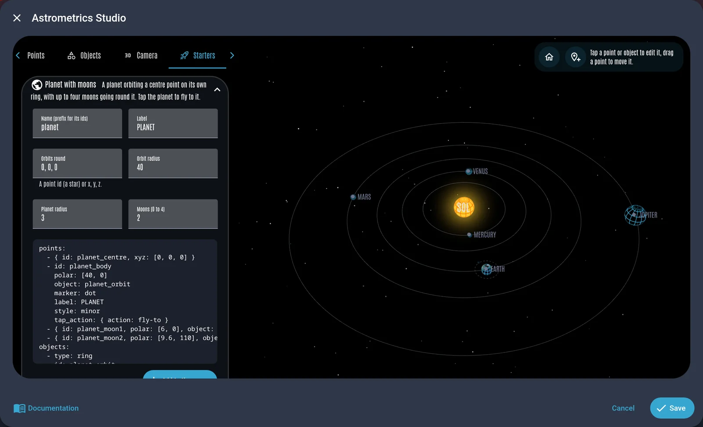
:::

### Documentation:TNG

Start with the [Live Demo](/getting-started/live-demo), then see what the LCARdS skill built in the [Dashboard Gallery](/getting-started/dashboard-gallery): a set of functional dashboards, each recorded in action, with the YAML to copy.

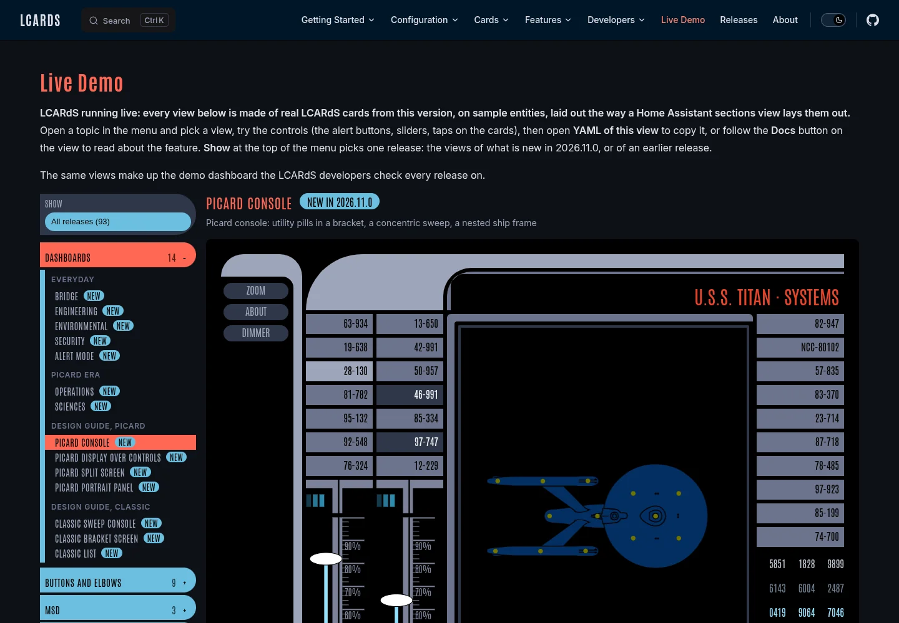

::: details More on the docs
- **Start here:** one path from [installing LCARdS](/getting-started/installation) to [your first dashboard](/getting-started/building-dashboards), and a [Getting help](/getting-started/getting-help) checklist.
- **How LCARdS works:** an interactive diagram on [What is LCARdS](/getting-started/what-is-lcards): click a part, or play a scenario (alert mode, rules, data sources) step by step.
- **Designing LCARS Screens:** a new [guide](/getting-started/lcars-design) to what makes a screen read as LCARS, Picard and classic TNG, with [LCARS Patterns](/getting-started/lcars-patterns) rendered live. The LCARdS skill follows it when it designs a dashboard for you.
- **Galleries and playgrounds:** card pages show every preset and style as live cards. Playgrounds cover the button, elbow, slider, select menu, chart and data grid; animation presets, filters, backgrounds and data source processors can be tried on their reference pages.
- **Docs for your version:** the stable release, the development docs and every past release, with a switcher by the title. Each editor tab links straight to its page, and old links land on the moved section.
- New pages for the [Layout Card](/cards/layout-card/) and the bundled libraries (About).
:::

### Help from AI, and help built in

The **LCARdS skill** teaches Claude every option, preset and colour for your version, so it writes cards and whole dashboards that actually work, and fixes the YAML you already have. When something is off, a health check on the config panel's Welcome tab tells you how to fix it. See [Getting AI help](/getting-started/ai-assistance) and [Getting help](/getting-started/getting-help).

::: details More on AI help, the YAML editor and support
- **The skill:** a Claude Code plugin (two `/plugin` commands, keeps itself up to date) and a download for claude.ai and the Claude apps, following the Open Agent Skills standard. It asks for your real entity ids instead of inventing them, and knows HA-LCARS and UIX.
- **Your home's context:** with the community [ha-mcp](https://github.com/homeassistant-ai/ha-mcp) server, Claude looks up your areas and entities itself.
- **Other assistants:** a validated schema for every card to attach to the chat, and `llms.txt` / `llms-full.txt`.
- **[Check Your Config](/getting-started/config-checker):** the same checker in the skill, in your browser and on the command line, with plain-language problems line by line and a suggestion for every misspelt name. It flags unknown `custom:lcards-*` types and removed or deprecated keys too.
- **The YAML tab knows the card:** completion for keys, values and entity ids, hover help on any key, an **Options here** panel, and mistakes underlined as you type. The same help works in the docs playgrounds and the studios.

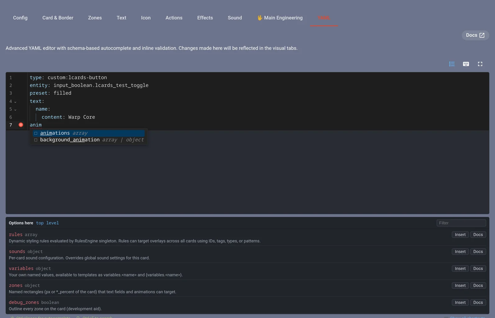

- **Support and system info:** the health check spots common problems (versions, card-mod or UIX, leftover resources, the HA-LCARS theme), and **Report an issue** opens GitHub's bug form with your system info filled in.

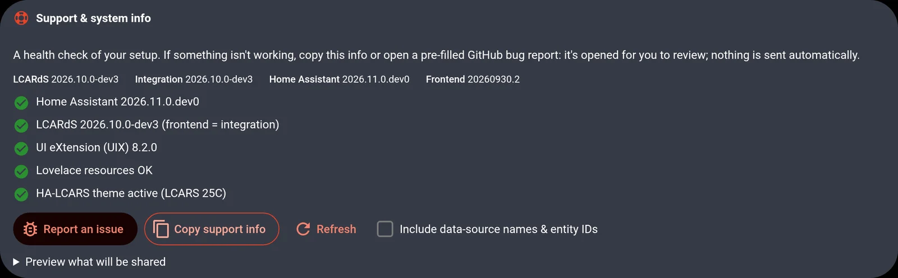
:::

### Charts and data grids, rebuilt

Charts take history, statistics and data sources in one `sources:` list, with time spans and grouping like apexcharts-card, on ApexCharts 7. Data grids gain cell colours by state, header rows, cell taps and cells that flash on change.

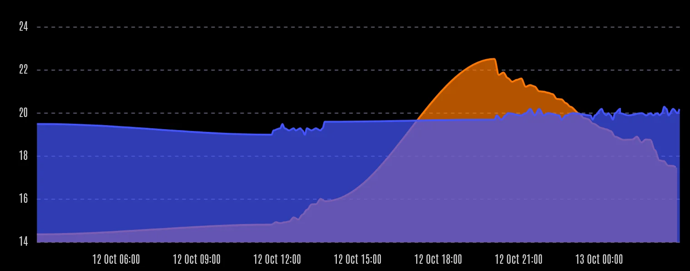

See [Series and time](/cards/chart/series) and the [data grid](/cards/data-grid/data). Coming from apexcharts-card? See [the upgrade page](/cards/chart/upgrading#coming-from-apexcharts-card).

::: details More on charts and data grids
- `graph_span`, span start, end and offset, and `group_by` (average, min, max, sum, median, delta and more, plus min/max bands, box plots and candlesticks).
- Per-series units, precision, colours, line style and chart type; pie, donut, gauge, radar and treemap charts plot each series' latest value.
- Data grid: see [Data](/cards/data-grid/data), [Styling](/cards/data-grid/styling) and the [data grid playground](/cards/data-grid/playground).
- Both studios are rebuilt too; see [Studios](#studios-live-previews-while-you-edit) below.

<video class="release-shot" src="/releases/2026.11.0/data-grid.webm" title="Two data grids: a ship status table whose values change colour by state and flash as they change, the main lights cell turning orange when on, beside a grid of digits with the LCARS colour cascade rolling through it" autoplay loop muted playsinline></video>
:::

### Animations and effects

Effects now draw on your graphics card with WebGL: grid floors running to the horizon, tunnels, gravity wells, a holographic planet and a warp starfield. Your existing `grid`, `contour-field`, `plasma`, `fluid` and `nebula` effects get the upgrade too. Resistance is still futile, but the **Borg assimilation** is rebuilt on it. A new `on_show` trigger lets a view build itself up like the clip at the top, with five new animation presets.

<video class="release-shot" src="/releases/2026.11.0/effects.webm" poster="/releases/2026.11.0/effects.webp" title="Five WebGL effects in an LCARS frame: a flat grid tips into a floor running to the horizon, a tunnel, a gravity well with ripples, a starfield going to warp with spectrum streaks, and a wireframe planet over a grid floor" autoplay loop muted playsinline></video>

See [Background animations](/core/effects/background-animations#webgl-presets), [Borg Assimilation](/core/borg) and [Entrance animations](/core/animations/triggers#entrance-animations-with-on-show).

::: details More on backgrounds
- **Grid floors:** `view: floor` on `grid` (and the diagonal and hexagonal grids), with a camera you can tilt, turn, zoom and animate: a flat grid can tip into a floor on red alert. See [grid views and camera](/core/effects/background-animations/preset-reference#grid-views-and-camera).
- **Grid surfaces:** `surface` wraps a cylinder, dome or sphere, seen from outside or inside: a tunnel, a planetarium. See [grid surfaces](/core/effects/background-animations/preset-reference#grid-surfaces).
- **Gravity wells:** `surface: well` draws a trumpet, cone, bowl, wormhole or your own profile, with ripples running into the throat. See [grid wells](/core/effects/background-animations/preset-reference#grid-wells).
- **Polar charts:** `pattern: polar` draws rings and spokes, flat or as a tilted galaxy-map floor. See [polar pattern](/core/effects/background-animations/preset-reference#polar-pattern).
- **Look from anywhere:** `camera_roll` and `surface_rotate_x`, `_y`, `_z` turn the view and the surface.
- **`holo-sphere`:** a rotating wireframe planet with a scan band.
- **`warp-starfield`:** stars flying at you that stretch into streaks; `spectrum: true` splits them into colour like a Doppler shift.
- **Existing effects upgraded:** `grid`, `contour-field`, `plasma` and `fluid` draw with WebGL (`renderer: canvas` keeps the old drawing, and devices without WebGL get it automatically); the noise effects no longer pause on first draw and their noise settings animate; `nebula` gains `volumetric: true`.
- **Alert colours change in place:** effects keep their motion through an alert.
- **Animated backgrounds:** `target: background` lets a trigger, rule or alert change a background's speed, colour or fill, eased: a starfield that ramps to warp on red alert. Entity-bound background values glide to their new value. See [Animating the background](/core/effects/background-animations/binding-and-animation#animating-the-background).

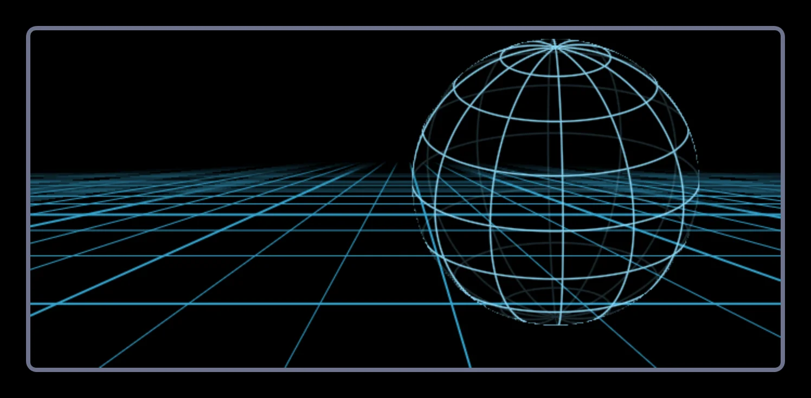

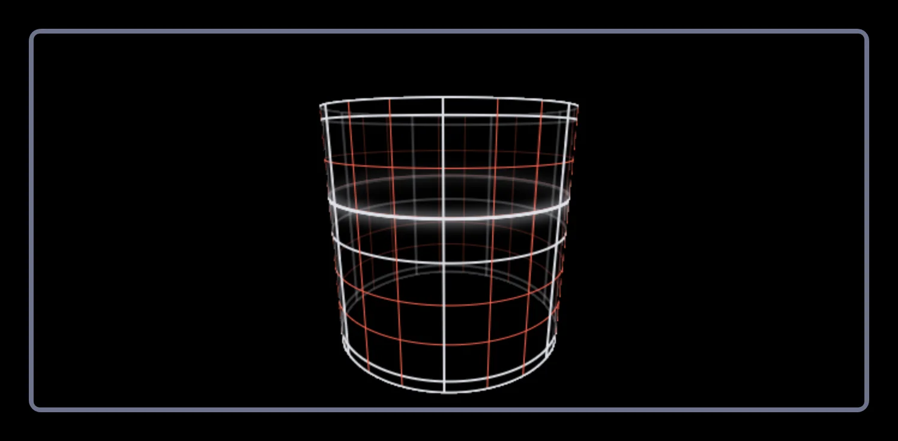

<video class="release-shot" src="/releases/2026.11.0/grid-wells.webm" title="An orange polar grid funnels into a gravity well, ripples running down the trumpet into the narrow throat" autoplay loop muted playsinline></video>
:::

::: details More on the Borg
<video class="release-shot" src="/releases/2026.11.0/borg.webm" title="A Bridge dashboard is assimilated: the palette turns Borg green, glowing tendrils spread across the screen, a Borg cube emerges, then the dashboard stays in Borg colours and lettering" autoplay loop muted playsinline></video>

- Glowing tendrils, an assimilation front leaving Borg circuitry behind, and a Borg cube emerging amid signal corruption.
- The cube is solid machinery with a rail lattice and green glows deep inside (`cube: classic` for a lighter wireframe). `cube`, `corruption`, `overrun` and `palette_hue` tune it; `renderer: canvas` keeps the classic intro.
- Assimilation and deassimilation have their own sound events. LCARdS ships no Borg audio: give them your own file in the sound overrides, a sound scheme, or the new `sound` field on the action.
:::

::: details More on animations
- **`on_show`:** plays each time a card appears: when its view opens, when you come back, when a visibility condition shows it. Stagger a few and a view builds itself up.

<video class="release-shot" src="/releases/2026.11.0/showcase.webm" title="An empty LCARS view builds itself stage by stage: elbows slide in, sidebar buttons follow, a ship display draws its shield arcs and lines, then a chart, a room table and Picard gauges appear; lights switch on and a red alert plays" autoplay loop muted playsinline></video>

- **New presets:** **`text-decode`:** text resolving out of scrambling characters; **`boot-sequence`:** a card powering up part by part; **`tap-ripple`:** a wave from where you tap; **`sensor-sweep`:** a radar wedge with a ping ring; **`morph`:** one shape into another. See the [animation preset reference](/core/animations/preset-reference).
- Fuller stagger options, and random presets (`flicker`, `glitch`, `chaos`) take a `seed` and play a new pattern each loop.
:::

### New building blocks

New pieces for building LCARS screens:

- **Ring gauge:** `component: ring` (and the `ring` and `picard-ring` presets) turns a slider into a circular gauge you drag around, with ticks, markers, coloured ranges and text in the centre. See [Ring gauge](/cards/slider-card/components#ring-gauge).
- **Drag value badge:** a badge follows your finger with the value a slider drag will set. See [Drag value badge](/cards/slider-card/control#drag-value-badge).
- **Alert band:** `display: band` shows an alert as a Picard-style row of dashes across the screen with the symbol in the middle; the dashboard stays usable underneath. See [Alert Band](/cards/alert-overlay/band).
- **Presets** `toggle-tab` and `panel-flagged`. See [Presets](/core/presets).
- **Button components** `brackets` and `radar`. See [Brackets and Radar](/cards/button/components#brackets-and-radar).
- **Elbow types** `bar-slant-right`, `bar-slant-left` and `bar-parallelogram`. See [Elbow types](/cards/elbow/#elbow-types).

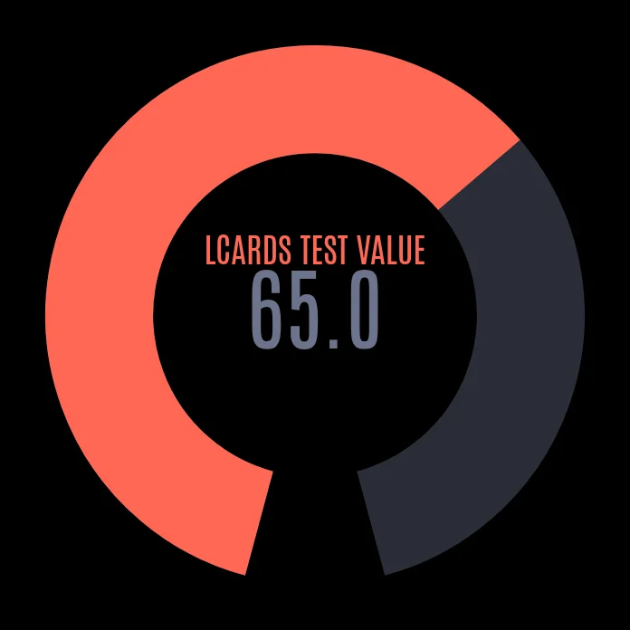

::: details Drag value badge in action
<video class="release-shot" src="/releases/2026.11.0/slider-drag-badge.webm" title="A slider showing its value badge while dragged" autoplay loop muted playsinline></video>
:::

### Studios: live previews while you edit

The card studios are refreshed, and there is a new **Alert Studio** that shows every alert condition on a mock screen without raising an alert. In Main Engineering, you see rules, templates and data sources working before you save, and the provenance inspector shows where any value comes from. See [Main Engineering](/cards/main-engineering).

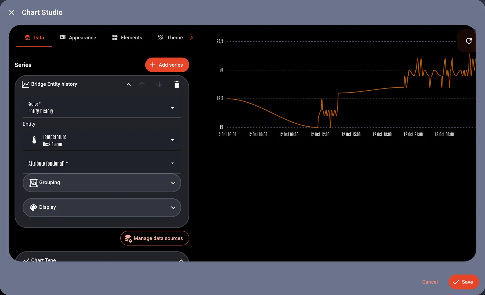

::: details More on the card studios
- **Alert Studio:** every alert overlay setting in one place, with a mock screen that shows each condition (symbol, band, size, effects). Per condition: the alert symbol, a customised symbol, or your own card. `alert_button` can now be set once for every condition. See [Alert Studio](/cards/alert-overlay/#alert-studio).
- **Chart Studio:** sources and series for the new chart format, a Time and axes section and data source management.
- **Data Grid Studio:** rebuilt for the new data grid format.
- **Astrometrics Studio:** new with the card; see [above](#astrometrics-card).
- **Every studio** shares one look and has a YAML tab with completion, hover help and the **Options here** panel.
:::

::: details More on Main Engineering
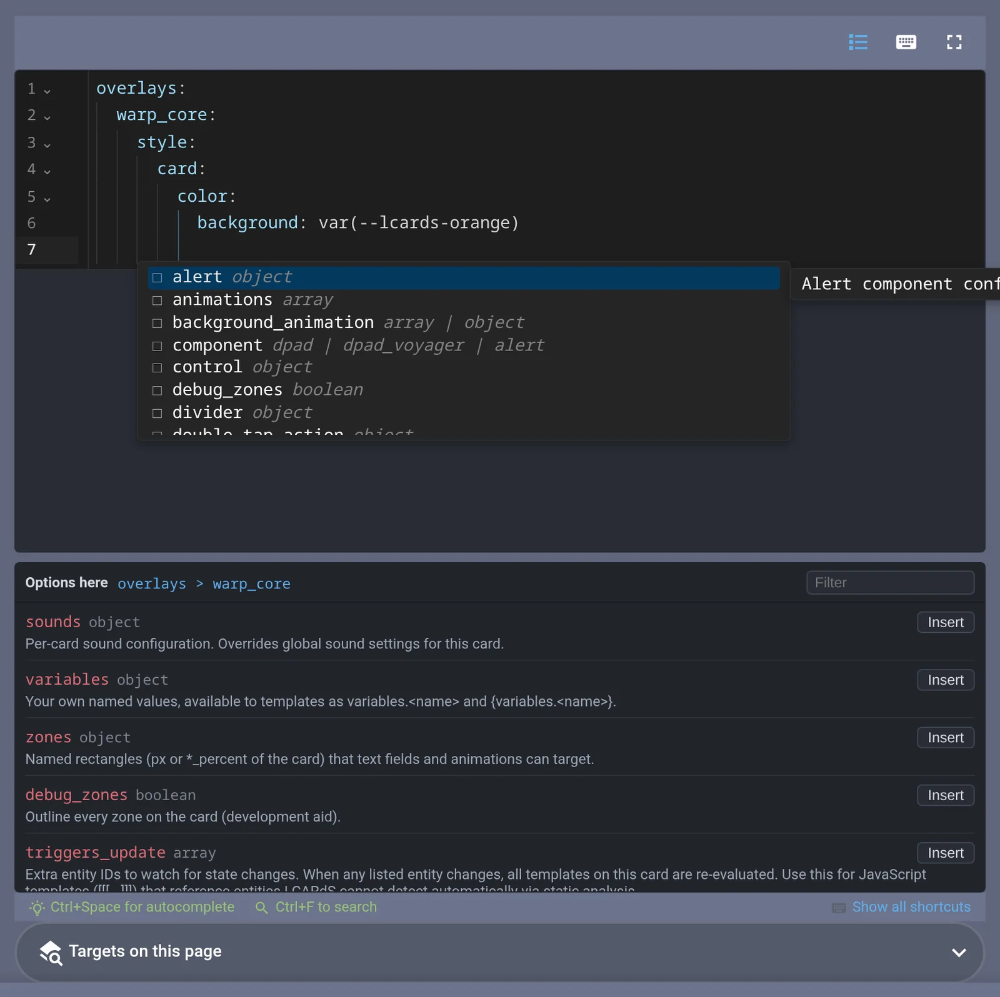

- **Rules, edited in context:** completion offers every card id on the page, and a card's patch completes against that card's own options. "Start with this card" fills in the card you are editing. See [Rules](/core/rules/).
- **Data sources:** processors edited inline in the order they run, previewed against the raw values; "Use in a chart" gives you a working chart config.

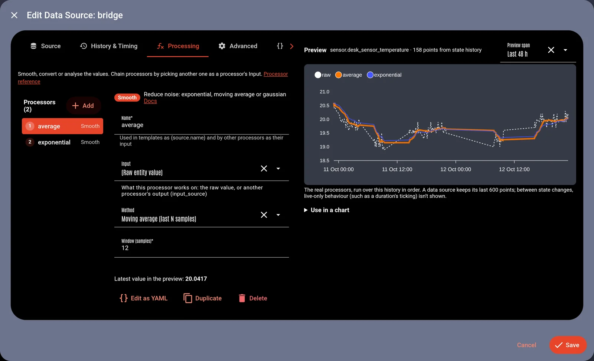

- **Templates:** each templated field shows its live result; the sandbox completes entities, attributes, data sources and theme tokens, with test values and "Save to field".

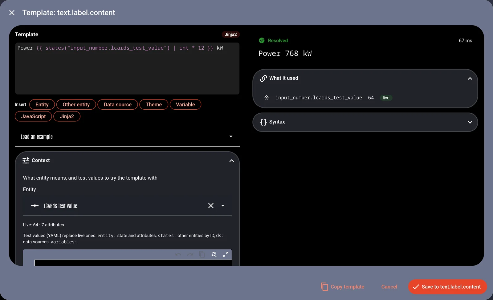

- **Provenance:** pick a field to see the config, presets, theme tokens, templates and rules that shaped it, live.

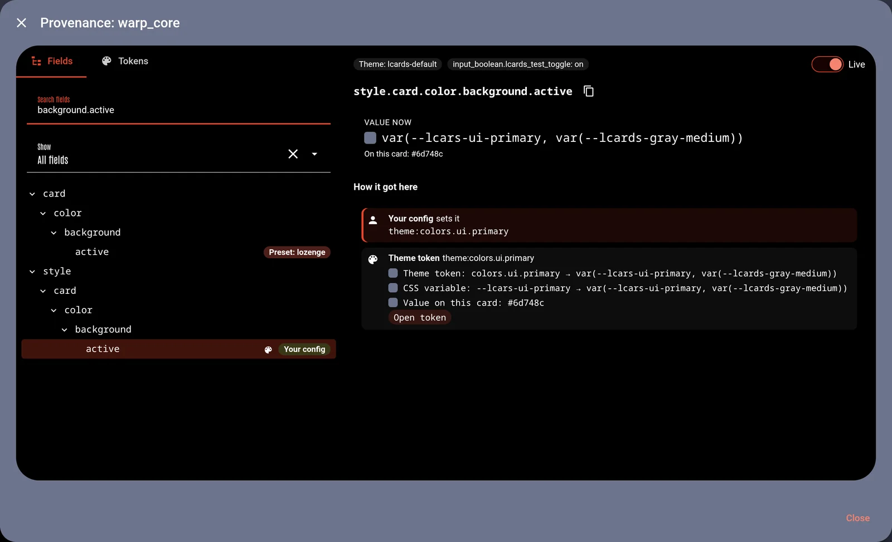

- **Theme:** the tokens a card uses, with their values.
:::

## Improvements & Fixes

::: details Improvements
- **Faster dashboards:** the main file is a fraction of its old size; editors, the config panel, charts and 3D load when you open them.
- **Colours, one set of rules:** every colour field takes the same formats (hex, names, `rgb()`, `hsl()`, `oklch()`, `color-mix()`, variables, theme tokens and nestable colour functions), and alert modes recolour every card the same way. See [Colours](/core/colours).
- **Lighter on Home Assistant:** one shared subscription for all helpers (it was 49), which stopped message-queue overflows at startup.
- **Text fields:** `letter_spacing` on every card's text. See [Text fields](/core/text-fields).
- **Reduced motion:** animations jump to their end, loops don't run and canvas effects show a still frame; `essential_motion: true` keeps an important animation (an alert flash) playing. See [Reduced motion](/core/animations/timing-and-easing#reduced-motion).
- **Animations survive a redraw:** a toggling button keeps its running animations.
- **Layout view editing** works like Home Assistant's edit mode: controls outside the cells, one docked inspector, areas resized by their edges, a picker for stacked cards.
- **Editors and dialogs:** Home Assistant's footer layout and focus, shorter messages, one look for the config panel, the **Options here** panel open by default, Renderer and fields for the new background effects.
- **MSD** blueprints load from any served path or URL, not only `/local/`.
- **Fly-to** takes `warp: true/false`; `lcards.borg_assimilate` takes `palette_hue`; log level `off` works; `?lcards_device=` names the device on every load.
- **HA-LCARS** ships the LCARdS theme profiles; the new [Theme Lab guide](/configuration/ha-lcars-theme-lab) builds your own.
- A third-party notices file ships in the integration.
- Animation engine updated to anime.js 4.5: colour fades blend more evenly.
:::

::: details Fixes
- **Button:** colour animations on the background and border play ([#401](https://github.com/snootched/lcards/issues/401)). Segment taps run every action type (perform-action, url and assist did nothing); taps act on the current states; text colours take templates; component cards keep their rows in a sections view.
- **Slider:** card animations run on gauges and pills; % units for lights, covers, fans and valves; value markers take their range's colour.
- **Elbow:** a single `segment.color`, per-segment entities and actions, segmented frames; the editor's text zones and Effects tab.
- **Select menu:** rules, label templates and sounds reach the options; option buttons draw without a preset and size to their rows; other cards on the same entity show the option, not `on`/`off`.
- **Charts:** a value that hasn't changed draws as a line, lines run on to now, bar charts get the right axis, your style beats the type defaults, a set height holds.
- **Data grid:** cell toggles and taps work, cells draw before slow templates, template and data source cells refresh, no leaks after removal, the studio edits columns correctly.
- **MSD:** rule `base_svg` filters, rules that match at load, `tag:`/`type:` selectors, filters, gradients, channel spacing and bundled lanes; errors show in the card; `<g id>` anchors work.
- **Rules:** a rule on many cards patches every one; plain-text conditions never match (with a warning); time-only rules re-check every minute; `sun_elevation` works; patches survive a reconnect or a theme change.
- **Templates:** percent formats in data source templates, inline `{theme:...}` tokens, `{token}` mixed with Jinja2.
- **Data sources:** stale text on a shared entity, `{ds:x}` of 0, `input_source` with statistics and smoothing, history for new sources; an MSD leaving no longer breaks other cards.
- **Colours:** false format warnings, `mix()`, nested functions, `theme:darken(...)`, transparency kept.
- **Alert overlay:** a second overlay can't hide or hijack the live alert; alerts raised in edit mode show afterwards; `grid_options` and `width` alone work; the symbol fills 60% of the screen's width by default; an alert symbol switching ranges no longer hangs the tab.
- **Borg and screen effects:** `clear_effect` "All slots", the intro skipped where it can't draw, the connection overlay reloads its config on reconnect.
- **Animations:** a redraw replays each animation once; a hover leave or `while` stop during the start stops it; two MSDs don't stop each other's animations; `on_datasource_change` fires.
- **Layout:** `layout.mediaquery` applies; `repeat()` tracks; the Layout Studio's grid tools; visibility conditions collapse rows.
- **Editors and studios:** completion popups in dialogs, the maximised YAML editor, studios close only on their own close, Home Assistant pickers work inside LCARdS dialogs (2026.10+).
- **Storage:** sound and theme overrides save to the right scope and can be removed again; refused saves roll back with an error; SVGs with the same file name in different folders no longer collide.
- **Docs examples that never worked:** per-card sounds, alert symbol presets and more are corrected.
:::
